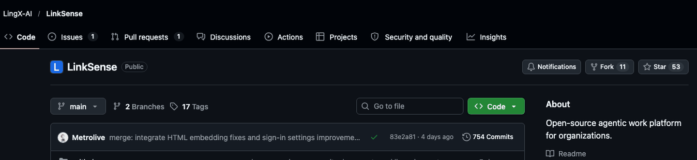

<p align="center">
  
</p>

<h2 align="center">
  面向组织的开源 Agent 工作平台<br>
  <sub>（企业级开源 WorkBuddy 替代方案）</sub>
</h2>

<p align="center">
  <a href="./README.md">English</a> | 简体中文
</p>

<p align="center">
  <a href="https://linksense.guygubaby.top/doc/zh-CN/"></a>
  &nbsp;
  <a href="https://explore.linksense.org/"></a>
  &nbsp;
  <a href="./docs/contact.zh-CN.md"></a>
</p>

<p align="center">
  LinkSense 是面向组织的开源 Agent 工作平台，可部署在自有服务器或私有云中。<br>
  管理员统一部署，成员拥有各自的 AI 工作空间，执行任务，并按权限共享知识库、技能、插件和应用。<br>
  平台集中管理权限与凭据，成员无需获取底层凭据即可使用已授权的系统连接。<br>
  用户专属 Worker 提供用户级运行环境隔离，并支持配置 CPU、内存等资源限制。
</p>

<p align="center">
  <a href="#为什么使用-linksense">功能亮点</a> · <a href="#如何选择部署方案">部署方案</a> · <a href="#部署与集成服务">部署与集成服务</a> · <a href="#快速安装">快速安装</a> · <a href="#开发">开发</a><br>
  <a href="#安全">安全</a> · <a href="#文档导航">文档导航</a> · <a href="#社区与支持">社区与支持</a> · <a href="#开源协议">开源协议</a>
</p>

## 为什么使用 LinkSense

<p><strong><font size="4">⚙️ Agent 执行与成果交付</font></strong>：基于开源 Codex Runtime，在用户专属 Worker 中执行网页信息检索与整理、浏览器操作、代码执行、数据分析和文件处理，生成文档、表格、演示文稿等成果。</p>

<p><strong><font size="4">📚 知识与技能沉淀</font></strong>：知识库支持文档解析、索引和检索；技能与插件将工作方法和工具集成沉淀为可安装的资源，支持版本维护、审核与发布。</p>

<p><strong><font size="4">🧩 开箱即用的场景应用</font></strong>：将指令、模型和所需资源预配置成在线应用服务，授权成员安装后即可发起自己的任务，无需逐项配置。支持聊天式与自定义交互界面；应用安装包则生成个人副本，可能需要使用者补充凭据与资源配置。</p>

<p><strong><font size="4">🔌 业务系统连接</font></strong>：通过连接器对接文档和邮件，并通过 MCP 按需集成 ERP、CRM 等业务系统，让 Agent 在授权范围内读取业务数据、执行操作。</p>

<p><strong><font size="4">👥 组织权限与治理</font></strong>：按用户和用户组授权，集中管理成员、模型凭据和使用额度，提供用量统计与操作审计。</p>

<p><strong><font size="4">🏠 自主部署与模型选择</font></strong>：在自有服务器或私有云运行，自由接入兼容的云端或本地模型服务，在自有基础设施上存储任务记录、文件、知识索引与凭据。</p>


<p><strong><font size="4">💬 多渠道与定时任务</font></strong>：通过 Web、微信、飞书、企业微信、钉钉和 Microsoft Teams 发起任务，也可设置定时任务自动运行。</p>

## 如何选择部署方案

LinkSense 在同一仓库中提供 **Core** 和 **Full** 两种部署方案，区别在于是否包含内置知识库服务，并非免费版与付费版之分。

| 方案 | 包含能力 | 什么情况下选择 |
| --- | --- | --- |
| **Core** | 完整的 Agent 工作空间，以及技能、插件、MCP、应用共享与组织管理能力 | **个人试用或无需内置知识库的组织**：体验网页浏览、代码执行、数据分析与文件处理，并共享技能与应用。 |
| **Full** | Core 全部能力，加上内置知识库的文档解析、索引与检索服务 | **需要内置知识库的组织**：将组织文档沉淀为可检索、可复用的知识库。 |

### 个人试用推荐 Core，需要内置知识库的组织部署推荐使用 Full。

Core 与 Full 的完整安装流程都在下方，不需要跳转到其他安装页面。

LinkSense 面向组织级部署设计，支持大型组织集中管理、按权限共享与多成员协作。管理员可以按用户和用户组管理资源访问权限，集中管理模型、凭据和使用额度，并查看用量和操作审计。各部门成员可在各自的 AI 工作空间执行任务，按权限共享经过审核的技能、应用与知识库，无需各自搭建一套平台。

**Full 组织部署建议从 16 vCPU、32 GiB 内存、200 GiB 可用 SSD 开始规划**，优先使用 Linux + Docker。该配置以接入外部模型 API 为前提，是容量规划参考，不代表固定的用户数或并发上限。

大型组织上线前，建议用实际任务做压测，按**峰值活跃用户数、并发任务数、文档规模和 OCR 负载**预留资源，再逐步调高并发。硬件升级不会自动提高并发上限；配置方法见下方[运维、修复与升级](#9-运维修复与升级)。本地模型与 GPU 需另行规划。

Full 的 x86_64 主机或虚拟机须暴露 `x86-64-v2` 指令集；原生 ARM64 不受这项 x86 要求约束。检查方法见下方[检查主机](#2-检查主机)。

## 部署与集成服务

LinkSense 支持自主部署。如果你的组织希望由我们协助落地，LinkSense 团队可提供**私有化部署与业务系统集成服务**。我们的交付工程师（FDE）可与你的 IT 和业务团队一起梳理需求，协助接入现有系统、配置权限，并验证典型业务流程。

**有部署或集成需求？** 请发邮件至 [hello@linksense.org](mailto:hello@linksense.org)，简单说明部署环境、使用规模和计划接入的系统，我们会与你沟通实施范围。

## 快速安装

**支持 Linux 和 macOS（x86_64 / ARM64），不提供原生 Windows 安装步骤。**

以下流程在一个页面内完成 Core / Full 选择、主机检查、安装、首次配置和第一个任务。安装器会下载已发布镜像并启动服务，无需克隆源码或自行编译。

### 方式一：编程助手安装

**以下提示词对应的安装指引默认安装 Core。** 将提示词交给 Codex、Claude Code、Cursor、Windsurf 或其他编程助手：

```text
Help me install and start LinkSense by following https://raw.githubusercontent.com/LingX-AI/linksense/main/Install.md
```

助手会检查安装环境、保留已有安装，并报告启动结果。

需要 Full 时，在提示词中明确写明 `LinkSense Full`。助手必须报告实际观察到的地址和健康状态；仅下载脚本不代表安装成功。

### 方式二：手动安装

#### 1. 选择方案并确认资源

| 场景 | CPU | Docker 可用内存 | 可用 SSD |
| --- | --- | --- | --- |
| Core 起步体验 | 4 vCPU | 8 GiB | 60 GiB |
| Full 新安装 | 8 vCPU | 安装器硬性预检 10 GiB，建议准备 24 GiB | 120 GiB |
| Full 组织部署规划起点 | 16 vCPU | 32 GiB | 200 GiB |

以上假设使用外部模型 API，不代表固定的并发或用户数。本地模型的 GPU、显存和算力需要另行规划。

#### 2. 检查主机

Linux 使用 Docker Engine 和 Compose 插件，按 [Docker 官方指南](https://docs.docker.com/get-docker/)安装并启动。macOS 请先完成下面的配置，再检查主机。

##### 在 macOS 安装并配置 Docker Desktop

Docker Desktop 包含 Docker Engine、命令行工具和 Compose，无需分别安装。完成下面的检查后，由 LinkSense 安装器自动创建容器，不需要自己在 Docker 界面中创建。

1. 打开 **苹果菜单 → 关于本机**，确认芯片类型和内存容量。在 [Docker Desktop for Mac 官方安装页](https://docs.docker.com/desktop/setup/install/mac-install/)下载对应的 **Apple silicon** 或 **Intel** 版本。
2. 打开下载的 `Docker.dmg`，把 **Docker** 拖入 **Applications（应用程序）**，再打开 **应用程序 → Docker**。按界面完成首次启动设置，等待 Docker Engine 显示为运行状态。
3. 点击 Docker Desktop 的齿轮图标，进入 **Settings（设置）→ Resources（资源）→ Advanced（高级）**。这里是 **Resources 下面的 Advanced**，不是设置中的独立 Advanced 页面。按以下说明调整：

| Docker Desktop 配置项 | 应如何设置 |
| --- | --- |
| **CPU limit** / **CPUs** | Core 至少 **4**，Full 至少 **8**；Mac 本身需要有足够的 CPU 核心。 |
| **Memory limit** | Core 可先设为 **10–12 GB**。Full 建议准备 **24 GB 或更多**，并为 macOS 和其他应用保留额外内存。16 GB 的 Mac 建议先用 Core；Full 建议从 32 GB 或更大内存的 Mac 开始。 |
| **Disk usage limit** | 除已有 Docker 数据外，Core 至少预留 **60 GiB 可用空间**，Full 至少预留 **120 GiB 可用空间**；Mac 磁盘本身也要有相应的剩余空间。 |

4. 点击 **Apply & Restart（应用并重启）**，等待 Docker Engine 重启完成。重启 Docker 会暂时停止其他正在运行的本地容器，请先保存进行中的工作。
5. 必要时重新打开“终端”，执行下面的检查。安装 LinkSense 时使用当前 macOS 账号，不使用 `sudo`。

```bash
docker info --format '{{.NCPU}} {{.MemTotal}}' |
  awk '{printf "CPUs=%s\nDocker memory=%.2f GiB\n", $1, $2 / 1024 / 1024 / 1024}'
```

以下是 Core 的输出示例，实际数值以你的 Mac 为准：

```text
CPUs=4
Docker memory=10.00 GiB
```

Core 要求 **Docker Engine 报告的内存至少为 8 GiB**。Full 以所选发行版的预检要求为准，目前文档中的硬性门槛为 **10 GiB**，上面的建议配置会更高。Docker Desktop 滑块设置的是分配上限，不一定等于 Engine 实际报告的内存；如果检查或安装器仍提示内存不足，继续调高后重启并重新检查。

**Disk usage limit 是最大容量，不是剩余空间。** 设置时要计入现有镜像和容器的占用。不要为了照搬本文而调小已有磁盘上限、重置 Docker 或删除数据卷；这些操作可能删除已有容器、镜像和数据。配置项说明见 [Docker Desktop 资源设置](https://docs.docker.com/desktop/settings-and-maintenance/settings/#advanced)。

##### 验证主机

Docker 启动后，运行：

```bash
uname -s
uname -m
docker version
docker compose version
docker info --format 'CPUs={{.NCPU}} MemoryBytes={{.MemTotal}} DockerRoot={{.DockerRootDir}}'
curl --version
df -h
```

确认输出满足以下要求：

- 系统为 `Linux` 或 `Darwin`，架构为 `x86_64`、`aarch64` 或 `arm64`。
- Docker 有 **Server** 信息，且该部分的 **API version ≥ 1.45**。
- Docker Compose 版本 **≥ 2.24.4**。
- `curl` 正常显示版本，磁盘和 Docker 虚拟机资源满足所选方案。

如果提示找不到 `docker` 命令，先确认 Docker Desktop 已完成首次设置，再重新打开终端。没有 Server 信息或无法连接 daemon 时，先打开 Docker Desktop，等待 Engine 启动后重试。

Full 的 x86_64 主机还必须检查 CPU 指令集。下面的命令在实际运行 Elasticsearch 和 Docling 的 Linux 主机或虚拟机内执行，不是在 macOS 终端中执行。Intel Mac 由安装器在 Docker Desktop 的 Linux 虚拟机内检查：

```bash
LC_ALL=C lscpu
grep -m1 '^flags' /proc/cpuinfo
```

确认包含 `cx16`、`lahf_lm`、`popcnt`、`ssse3`、`sse4_1`、`sse4_2` 和 `pni`（或 `sse3`）。缺失时先调整虚拟 CPU 模式。

#### 3. 下载安装器并检查网络

将 `edition` 设为 `core` 或 `full`：

```bash
edition=core
curl --http1.1 --retry 3 --retry-delay 2 --connect-timeout 15 --max-time 300 -fsSL \
  -o "install-${edition}.sh" "https://raw.githubusercontent.com/LingX-AI/linksense/main/install-${edition}.sh" &&
sh "install-${edition}.sh" --check-network
```

网络检查应以状态码 `0` 结束，且不出现 `[LS_HOST_*]` 错误。终端下载 GitHub 文件和 Docker Engine 拉取镜像是两条独立网络路径；检查可能缓存镜像，但不会创建部署。

#### 4. 安装 Core

只运行与你的系统对应的一段。每段命令都会先下载安装器，再执行。

**Linux**

```bash
curl --http1.1 --retry 3 --retry-delay 2 --connect-timeout 15 --max-time 300 -fsSL \
  -o install-core.sh https://raw.githubusercontent.com/LingX-AI/linksense/main/install-core.sh &&
sudo --preserve-env=http_proxy,https_proxy,HTTP_PROXY,HTTPS_PROXY,ALL_PROXY,all_proxy,NO_PROXY,no_proxy sh install-core.sh
```

**macOS**

```bash
curl --http1.1 --retry 3 --retry-delay 2 --connect-timeout 15 --max-time 300 -fsSL \
  -o install-core.sh https://raw.githubusercontent.com/LingX-AI/linksense/main/install-core.sh &&
sh install-core.sh
```

#### 5. 安装 Full

确认资源与 `x86-64-v2` 要求满足后，运行与你的系统对应的一段。

**Linux**

```bash
curl --http1.1 --retry 3 --retry-delay 2 --connect-timeout 15 --max-time 300 -fsSL \
  -o install-full.sh https://raw.githubusercontent.com/LingX-AI/linksense/main/install-full.sh &&
sudo --preserve-env=http_proxy,https_proxy,HTTP_PROXY,HTTPS_PROXY,ALL_PROXY,all_proxy,NO_PROXY,no_proxy sh install-full.sh
```

**macOS**

```bash
curl --http1.1 --retry 3 --retry-delay 2 --connect-timeout 15 --max-time 300 -fsSL \
  -o install-full.sh https://raw.githubusercontent.com/LingX-AI/linksense/main/install-full.sh &&
sh install-full.sh
```

#### 6. 确认成功输出

安装器完成镜像校验、数据库初始化、服务启动和健康检查后，会显示类似输出：

```text
[linksense-installer] Installed LinkSense core vX.Y.Z successfully.
LinkSense is ready at: http://<服务器地址>:18081

Copy and securely save the credential below before continuing:
<一次性初始化凭证>
```

Full 还会显示 `Full release probe passed.`。实际地址和一次性凭证以本机终端输出为准；不要把凭证粘贴到聊天、工单或公开日志。

#### 7. 处理常见错误

| 现象 | 原因 | 处理方式 |
| --- | --- | --- |
| `docker version` 没有 Server，或无法连接 Docker daemon | Docker 未启动，或账号无权访问 Docker Socket | 启动 Docker，并核对 Linux 权限或 Docker Desktop 状态。 |
| Docker API 或 Compose 版本不足 | Server API 低于 `1.45`，或 Compose 低于 `2.24.4` | 按 Docker 官方方式升级对应组件。 |
| `[LS_HOST_memory]` | 主机或 Docker VM 可用内存不足 | 增加 Docker Desktop 内存，或迁移到更大的主机。 |
| `[LS_HOST_storage]` | 主机、Docker VM 或备份位置空间不足 | 只清理确认可删除的文件或扩容，不要盲目执行 Docker 全局清理。 |
| `[LS_HOST_pull]`、超时或 TLS 错误 | Docker Engine 网络或代理未配置 | 重新运行 `--check-network`，分别检查终端和 Docker Engine 网络。 |
| `CPU does not support x86-64-v2` | Full 所在虚拟机未暴露所需指令集 | 停机后使用 host passthrough 或兼容的 x86-64-v2 CPU 模式。 |
| 端口被占用 | `18081` 已由其他程序使用 | 新安装设置 `LINKSENSE_HTTP_PORT`；已有安装使用 `linksense port <端口>`。 |
| 已存在安装或上次安装中断 | 重跑错误方案可能破坏安装身份 | 先运行 `linksense status` 和 `linksense doctor`；中断安装只重跑同一方案。 |

在 `19090` 端口全新安装 Core 时，只运行与你的系统对应的一段。安装 Full 时，把该段中所有 `install-core.sh`（包括下载地址中的文件名）改为 `install-full.sh`。如果已经安装 LinkSense，请改用 `linksense port 19090`。

**Linux**

```bash
curl --http1.1 --retry 3 --retry-delay 2 --connect-timeout 15 --max-time 300 -fsSL \
  -o install-core.sh https://raw.githubusercontent.com/LingX-AI/linksense/main/install-core.sh &&
sudo --preserve-env=http_proxy,https_proxy,HTTP_PROXY,HTTPS_PROXY,ALL_PROXY,all_proxy,NO_PROXY,no_proxy \
  env LINKSENSE_HTTP_PORT=19090 sh install-core.sh
```

**macOS**

```bash
curl --http1.1 --retry 3 --retry-delay 2 --connect-timeout 15 --max-time 300 -fsSL \
  -o install-core.sh https://raw.githubusercontent.com/LingX-AI/linksense/main/install-core.sh &&
env LINKSENSE_HTTP_PORT=19090 sh install-core.sh
```

#### 8. 首次配置与第一个任务

1. 打开安装器输出的实际地址。默认 Linux 为 `http://<服务器地址>:18081`，macOS 为 [http://localhost:18081](http://localhost:18081)，但终端输出始终优先。
2. 使用一次性初始化凭证创建首位管理员。
3. 在管理界面添加至少一个对话模型渠道；Full 还需要配置知识库使用的向量模型。
4. 运行 `linksense status` 和 `linksense doctor`，确认部署健康。
5. 测试一次简短对话，再运行一次会创建小文件的工具任务。Full 还应上传代表性文档，验证解析、检索和引用。

详细字段和产品操作见[模型配置](https://linksense.guygubaby.top/doc/zh-CN/admin-guide/model-settings/)与[第一个任务](https://linksense.guygubaby.top/doc/zh-CN/user-guide/getting-started/first-task/)。

#### 9. 运维、修复与升级

| 操作 | 命令 |
| --- | --- |
| 状态和实际地址 | `linksense status`、`linksense address` |
| 启动、停止、重启 | `linksense start`、`linksense stop`、`linksense restart` |
| 修改端口 | `linksense port 19090` |
| 查看初始化凭证 | `linksense credential` |
| 查看日志 | `linksense logs api`、`linksense logs runner` |
| 健康与网络诊断 | `linksense doctor`、`linksense doctor --network` |
| 修复与升级 | `linksense repair`、`linksense upgrade` |

升级会等待运行中的任务，并在迁移前保存数据库备份。迁移失败不会自动回滚数据库；升级前应保留安装器生成的备份，并另做异机备份。已有部署不要重复安装或直接切换 Core / Full。

## 开发

如需搭建本地开发环境、修改源码或构建镜像，请参阅[源码开发与镜像构建](https://linksense.guygubaby.top/doc/zh-CN/deploy/development/)。

### 从哪里改起

| 想改什么 | 源码入口 |
| --- | --- |
| Web 工作空间与管理界面 | [apps/web](https://github.com/LingX-AI/LinkSense/tree/main/apps/web) |
| API、权限与业务逻辑 | [apps/api](https://github.com/LingX-AI/LinkSense/tree/main/apps/api) |
| Agent 任务执行与 Worker | [apps/runner](https://github.com/LingX-AI/LinkSense/tree/main/apps/runner) |

系统架构请参阅[系统架构与执行边界](https://linksense.guygubaby.top/doc/zh-CN/deploy/architecture/)，环境配置、常用命令和 Docker 镜像构建说明请参阅[源码开发](https://linksense.guygubaby.top/doc/zh-CN/deploy/development/)。

### 代码贡献

提交前运行受影响的测试，并检查类型、lint 和构建。请先阅读 [AGENTS.md](https://github.com/LingX-AI/LinkSense/blob/main/AGENTS.md) 与<a href="https://github.com/LingX-AI/LinkSense/blob/main/.github/CONTRIBUTING.md">贡献指南</a>；代码贡献需要签署 <a href="https://github.com/LingX-AI/LinkSense/blob/main/docs/legal/CLA.md">CLA</a>。

## 安全

隔离边界是用户 Worker，同一用户的普通任务可访问该用户的其他任务文件。普通执行允许互联网出站，不逐条要求命令审批；接入外部模型或工具时，相关数据会按配置发送至对应服务。

向更多用户开放或对外部署前，请阅读<a href="https://github.com/LingX-AI/LinkSense/blob/main/.github/SECURITY.md#execution-boundaries">安全边界</a>与[部署运维要求](https://linksense.guygubaby.top/doc/zh-CN/deploy/operations/)。安全问题报告：`security@linksense.org`。

## 文档导航

| 我想要…… | 阅读文档 |
| --- | --- |
| 完成任务、创建自动化或接入 IM | [用户指南](https://linksense.guygubaby.top/doc/zh-CN/user-guide/overview/) |
| 管理成员、模型、权限与用量 | [管理员指南](https://linksense.guygubaby.top/doc/zh-CN/admin-guide/overview/) |
| 共享知识、技能、插件与应用 | [技能、插件与应用](https://linksense.guygubaby.top/doc/zh-CN/user-guide/plugin-center/discover-and-install/) · [知识库共享](https://linksense.guygubaby.top/doc/zh-CN/user-guide/knowledge-bases/sharing/) |
| 连接业务系统、构建应用 | [应用开发](https://linksense.guygubaby.top/doc/zh-CN/developer-guide/interactive-application/) |
| 部署、排查、升级与迁移 | [Core](https://linksense.guygubaby.top/doc/zh-CN/deploy/core/) · [Full](https://linksense.guygubaby.top/doc/zh-CN/deploy/full/) · [运维参考](https://linksense.guygubaby.top/doc/zh-CN/deploy/operations/) |
| 了解架构与执行机制 | [系统架构](https://linksense.guygubaby.top/doc/zh-CN/deploy/architecture/) |

## 社区与支持

<p align="center">
  <a href="https://github.com/LingX-AI/LinkSense"></a>
</p>

<p align="center">觉得有帮助？欢迎点个 Star ⭐</p>

使用问题与需求交流：[GitHub Discussions](https://github.com/LingX-AI/LinkSense/discussions)。

组织部署与合作：`hello@linksense.org`。

欢迎自愿在 [ADOPTERS.md](https://github.com/LingX-AI/LinkSense/blob/main/docs/community/ADOPTERS.md) 登记使用 LinkSense 的组织。

## 开源协议

LinkSense 采用 [CPAL-1.0](https://github.com/LingX-AI/LinkSense/blob/main/LICENSE) 开源。内部部署、署名、定制品牌与商标的具体规定，请阅读[开源许可](https://github.com/LingX-AI/LinkSense/blob/main/LICENSE)、[内部部署例外](https://github.com/LingX-AI/LinkSense/blob/main/LICENSE-EXCEPTIONS.md)、[署名要求](https://github.com/LingX-AI/LinkSense/blob/main/ATTRIBUTION.md)与[商标政策](https://github.com/LingX-AI/LinkSense/blob/main/TRADEMARK.md)。其他许可需求：`licensing@linksense.org`。

平台使用的官方开源 Codex 运行时以 Apache-2.0 许可原样交付。LinkSense 是独立项目，与 OpenAI 无关联，也未获得其赞助或认可。参阅[第三方声明](https://github.com/LingX-AI/LinkSense/blob/main/THIRD-PARTY-NOTICES.md)。
