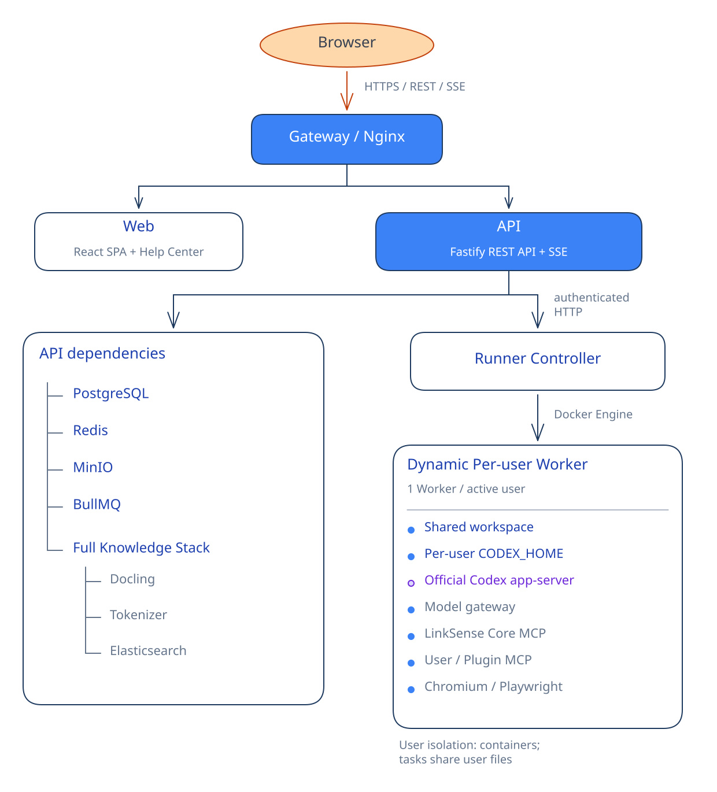
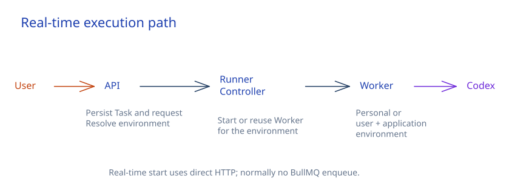
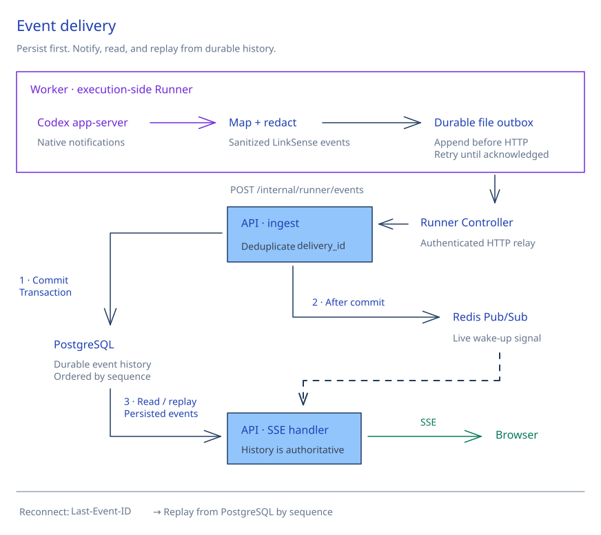

# 系统架构与运行时

[返回 README](../README.zh-CN.md)

## 基于开源 Codex 运行时

LinkSense 在自己管理的 Worker 中运行开源 Codex 运行时，无需依赖 Codex 网页应用或由 LinkSense 托管的 Codex 服务。

LinkSense 通过以下方式直接运行官方 `@openai/codex` 包：

```bash
codex app-server --stdio
```

并通过 Codex app-server JSON-RPC 协议与其通信。

Codex 运行时在 LinkSense 部署环境内执行。模型推理单独配置：组织可以接入自行选择的模型提供商或兼容的私有服务端点。

LinkSense **不**分叉 Codex、不修改其源码，也不重新实现智能体循环。

| Codex | LinkSense |
| --- | --- |
| 智能体推理与轮次（Turns） | 组织工作空间 |
| 原生工具与执行 | 身份、共享和治理 |
| 技能与插件 | 发布与组织生命周期 |
| 模型与子智能体 | 应用、知识和 MCP 管理 |
| 沙箱语义 | Worker、持久化、用量和运维 |

> **Codex 决定智能体如何执行。LinkSense 决定它能访问什么、在哪里运行、能力如何共享和治理，以及执行如何持久化和运维。**

Codex 运行时由 OpenAI 以 Apache-2.0 许可发布，并以未修改的形式随项目交付；其 `NOTICE` 文件包含在我们的镜像中。参阅 [THIRD-PARTY-NOTICES.md](../THIRD-PARTY-NOTICES.md)。

*Codex 是 OpenAI 的商标。LinkSense 是独立项目，与 OpenAI 无关联，也未获得 OpenAI 的赞助或认可。*

---

## 系统架构

<p align="center">
  
</p>

### Worker 模型

LinkSense 为每位活跃用户动态管理一个 Docker Worker。

同一用户的多个任务可以复用该 Worker，并共享用户的 `HOME` 和 `HOME/.codex`（`CODEX_HOME`）。无项目任务共享 `workspace`，同一项目的任务共享 `projects/<projectId>`；任务控制数据按任务分别存放。

**隔离边界是用户的 Worker，而非同一用户的任务目录**。同一用户的普通执行任务可以访问该用户的其他项目和任务文件。

闲置 Worker 会被回收。每用户的软件包环境可以在回收后保留，生成的交付成果则独立持久化到对象存储中。

Worker 控制包括可配置的 CPU / 内存 / PID 限制、只读根文件系统、`no-new-privileges`、移除 Linux capabilities、非特权容器、以非 root 身份运行任务进程，以及独立的控制网络和出站网络。

Worker 不直接加入 PostgreSQL 或 Redis 的服务网络。目前允许互联网出站访问；LinkSense 不强制执行通用域名白名单或默认拒绝全部出站流量的策略。

普通执行模式使用 Codex 的 `approvalPolicy: never` 和完全访问沙箱策略，不会逐条要求命令审批。网页、上传文件或工具返回内容中的提示词注入如果成功诱导任务执行命令，可能读取、修改或外传该用户的共享文件。Plan 模式使用只读且禁止网络的沙箱；它不改变普通执行模式的权限。

当前应用没有默认屏蔽云元数据地址。云部署应在网络或实例配置中限制元数据访问并控制出站范围，实例角色只授予必要权限。控制器还持有 Docker socket，应视为可信管理组件；执行任务的 Worker 不挂载该 socket。详见[安全边界](../SECURITY.md#execution-boundaries)。

### 执行路径

实时任务通常沿以下路径执行：

<p align="center">
  
</p>

执行前通常不会先进入 BullMQ。

BullMQ 主要处理自动化、定时与后台任务、Worker 维护、恢复、邮件、计费、知识同步与处理，以及清理工作。

### 事件传递

<p align="center">
  
</p>

---

## 技术栈

| 层 | 技术 |
| --- | --- |
| Web | React 19 · TypeScript · Vite · React Router · TanStack Query · shadcn/ui · Base UI · Tailwind · i18next |
| API | Node.js · TypeScript · Fastify 5 · Zod · Prisma · PostgreSQL · Redis · BullMQ · MinIO |
| Runner | Node.js · TypeScript · Fastify · Docker · 官方 Codex app-server · Chromium / Playwright |
| 知识 | Docling · Elasticsearch · BM25 + 向量检索 · RRF · 可选重排序 |
