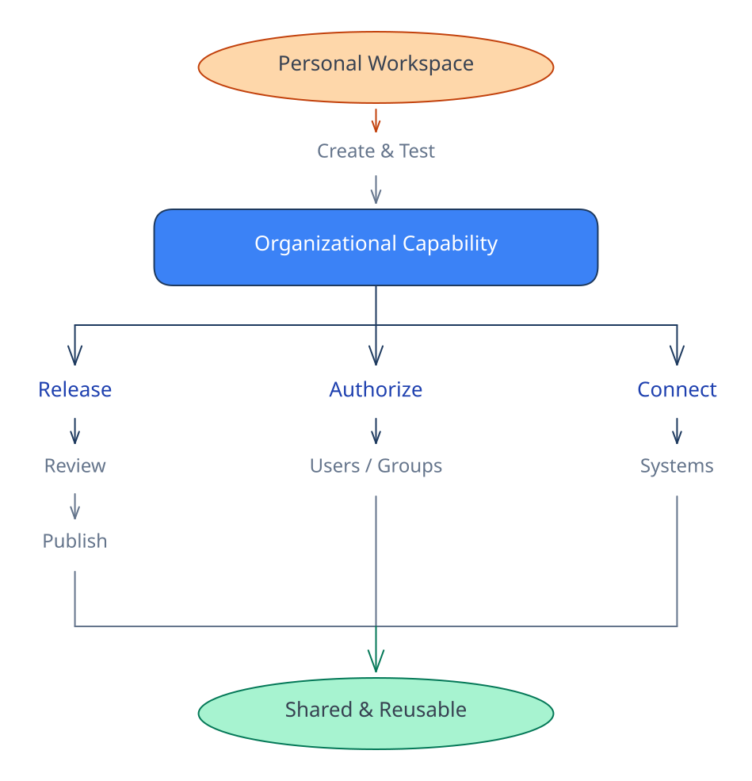
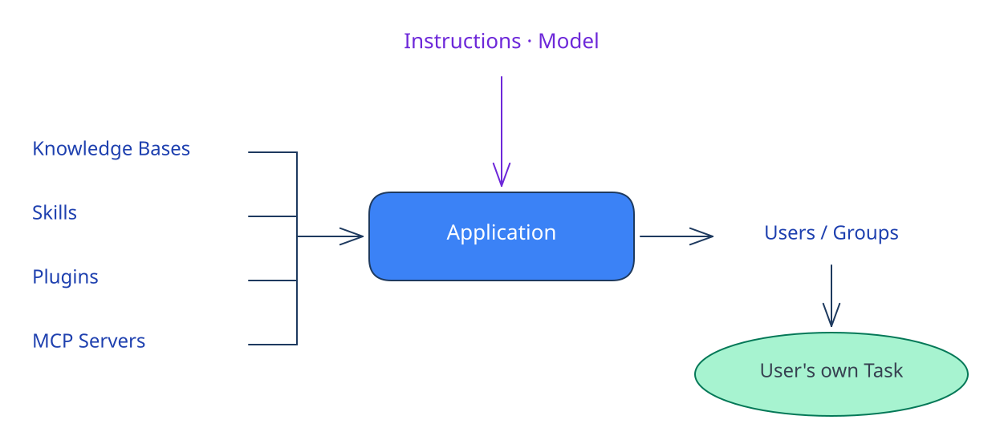
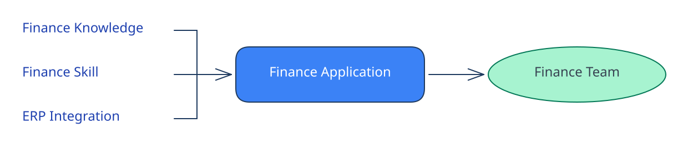
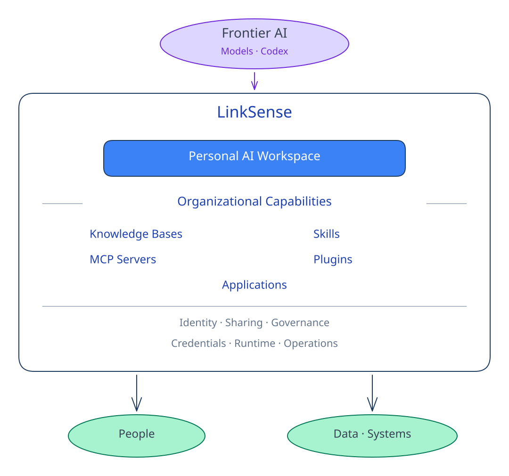

# Organizational Capabilities

[Back to README](../README.md)

LinkSense gives every user their own AI workspace — and provides the organizational layer
for turning what individuals build into capabilities that can be shared, governed, and
reused across teams.

| Capability object | Organizational role |
| --- | --- |
| **Knowledge Bases** | Make organizational context available to AI with controlled access |
| **Skills** | Turn effective ways of working into reusable capabilities |
| **MCP Servers** | Connect AI to organizational systems and actions |
| **Plugins** | Package Skills and MCP integrations for reviewed distribution |

These capabilities can start with an individual and become reusable across the organization.

  

Skills and Plugins can move from personal development to immutable releases,
administrative review, organizational publishing, installation, and explicit updates.

Knowledge Bases can be authorized to selected users and groups. MCP connections and
credentials remain separately managed, allowing AI capabilities to connect to
organizational systems without distributing underlying credentials to every user.

**Delegated execution, not credential sharing.**

### Applications — turn capabilities into experiences for others

Applications are where these capabilities come together.

An Application combines maintained instructions and model configuration with
organizational Knowledge, Skills, Plugins, and MCP connections, then makes that
experience available to authorized users and groups.

  

For example:

  

Users don't need to reconstruct the underlying setup themselves. They open an authorized
Application and start their own Task with the maintained capabilities already composed
for that use case.

Applications are **not autonomous agents**. They are reusable AI work entry points. Each
authorized user starts and owns their own Task, while the Application provides the
maintained configuration and organizational capabilities behind the experience.

Applications can also provide controlled access to creator-maintained Knowledge and MCP
capabilities without giving users direct management access or exposing underlying
credentials through normal LinkSense interfaces.

LinkSense adds identity, ownership, user/group authorization, publishing and review,
credential management, model management, usage, audit, and runtime operations around
these capabilities.

Together, they form **the open capability layer between frontier AI and the organization.**

  

