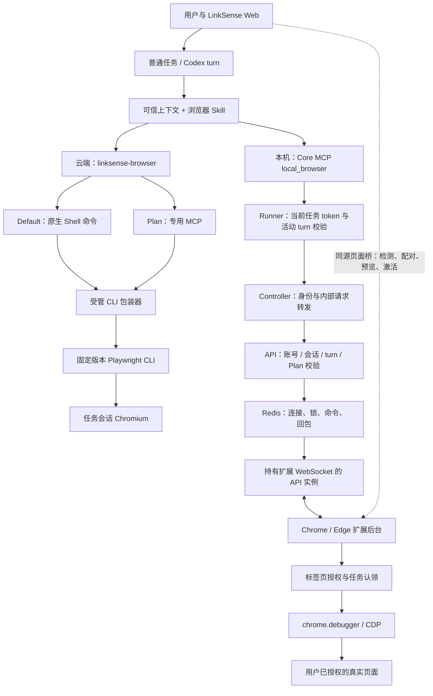
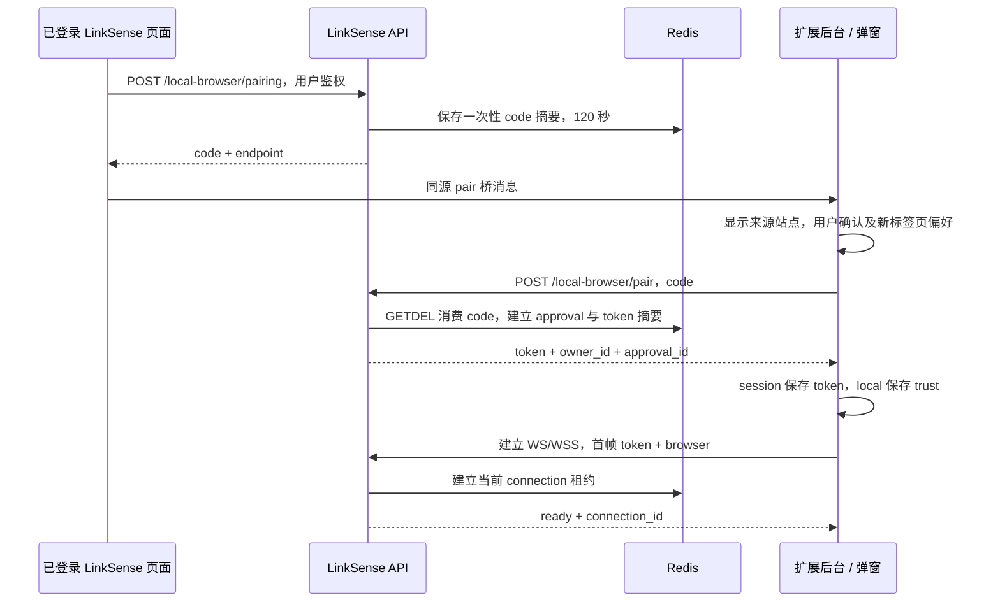
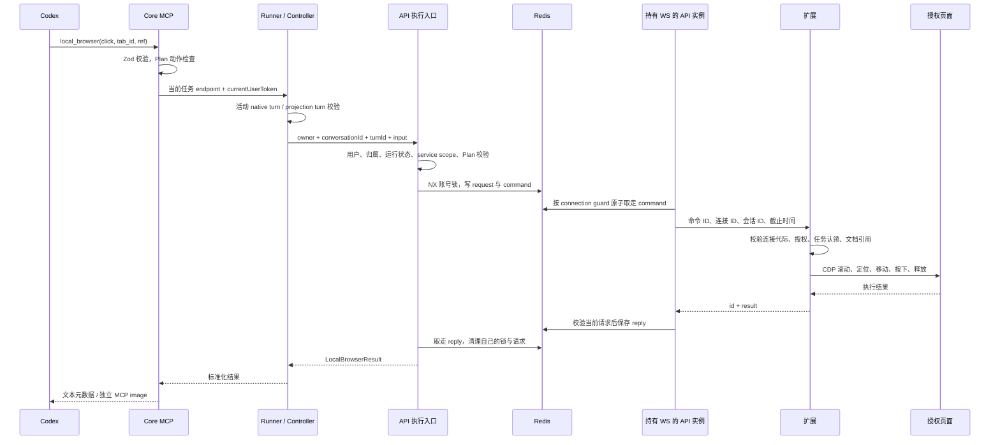

# LinkSense Browser Use 实现逻辑

> 整理日期：2026-10-28。源码基线：`e6be5d5`。
>
> 本文根据当前仓库的实际入口、调用链、共享协议、扩展实现和测试代码整理，不是待实施方案。项目锁定的 Codex 版本为 `0.154.0`，浏览器扩展版本为 `0.4.5`，云端浏览器使用 `@playwright/cli@0.1.17`。这些是仓库配置值，不代表所有已部署实例都已更新。
>
> 本次仅做源码与文档静态核对，未运行浏览器、真实模型或端到端测试。文中“已有测试覆盖”指存在相应测试资产，不代表本次重新执行通过。

## 1. 核心结论

LinkSense 的 Browser Use 不是单一浏览器工具，而是两套独立的浏览器执行链：

1. **云端托管浏览器**：在 LinkSense 的执行环境中运行隔离 Chromium，供公开网页研究、渲染验证、截图、下载和任务工作区 HTML 预览使用。
2. **用户本机浏览器**：通过 Chrome / Edge 扩展，操作用户明确共享的标签页，复用这些页面原有的登录状态。

两套实现共享 Codex 的任务执行框架，但不共享浏览器实例、标签页标识、连接凭据或控制协议。同一个任务可以同时使用两种浏览器。

需要先区分四件事：

- `browser-use-intent` 只是判断是否展示安装、连接引导，不是强制选择浏览器后端的路由器。
- 选用云端还是本机，主要由可信任务上下文、内置 Skill 和工具描述指导模型决定；用户明确选择优先。
- 本机“已连接”不代表“全部标签页已授权”，共享标签页也不代表允许执行用户任务之外的操作。
- **云端人工接管的 API、Runner 逻辑和独立 React 组件仍存在，但当前会话页没有挂载 `BrowserPanel`，不能把它描述为当前可直接使用的页面入口。**

源码依据：[内置浏览器 Skill][skills]、[任务上下文][context]、[本机共享协议][local-contract]、[当前会话页][conversation-page]。

## 2. 两种模式对照

| 维度 | 云端托管浏览器 | 用户本机浏览器 |
| --- | --- | --- |
| 实际运行位置 | LinkSense Worker 执行环境 | 用户桌面 Chrome / Edge |
| 主要场景 | 公开网页、渲染检查、下载、工作区预览 | 已打开的页面、本机既有登录状态 |
| 内置 Skill | `linksense-browser` | `linksense-local-browser` |
| Default 模式入口 | Shell 中的 `linksense-browser` 命令 | Core MCP 的 `local_browser` 工具 |
| Plan 模式入口 | 专用托管浏览器 MCP | 同一个 Core MCP，限制为四项只读动作 |
| 浏览器底层 | Playwright CLI + 完整 Chromium headless | 扩展 `chrome.debugger` + 受限 CDP 调用 |
| 登录状态 | 独立浏览器上下文，不继承本机登录 | 使用被授权页面已有状态，不需要导出 Cookie |
| 任务隔离 | 会话名、状态目录、命令锁、配额 | 标签页授权记录中的会话认领 |
| 当前聊天中的页面预览 | 云端接管组件未挂载 | 已接入本机截图浮窗 |
| 失败后的处理 | 报告实际命令、配额或运行时错误 | 不自动重放不确定动作，不静默切换云端 |

这里的“云端”指 LinkSense 执行端，不特指某个公有云；自托管部署同样使用这条链路。

## 3. 总体架构



部署未拆分 Controller 时，逻辑上的内部转发可以更短；无论部署形态如何，都不能省略任务身份与资源归属校验。

### 3.1 各层职责

| 层 | 负责什么 | 不负责什么 |
| --- | --- | --- |
| Web | 安装、连接引导，共享状态，本机截图浮窗 | 不持有扩展连接 token，不直接构造任意 CDP 命令 |
| Codex / Skill | 理解用户需求，选择工具，观察页面并决定下一步 | 不替代后端授权 |
| Core MCP | 校验本机动作，绑定任务端点，转换工具结果 | 不允许调用方自行指定 owner 或 turn |
| Runner / Controller | 活动 turn 绑定、执行身份、内部请求路由 | 不创建自定义整轮浏览器重试 |
| API | 配对、凭据、用户状态、会话归属、命令协调 | 不直接访问用户桌面 |
| Redis | 跨 API 实例的连接索引、互斥和短期传输状态 | 不是长期浏览历史库或完整操作日志 |
| 扩展后台 | 连接、标签页授权、任务认领、CDP 执行和取消 | 不提供任意桌面、本机文件或任意 JavaScript 工具 |
| 云端 CLI 包装器 | 固定任务会话、受管配置、输出位置、配额和清理 | 不是所有上游 CLI 能力的细粒度权限系统 |

源码依据：[本机 MCP][local-mcp]、[Runner 进程池][pool]、[Controller][controller]、[本机 API][local-routes]、[扩展后台][extension-background]、[云端包装器][cloud-cli]。

## 4. 能力如何被发现与选用

### 4.1 内置 Skill 的发布

浏览器能力不是临时拼进每次用户消息的一段说明：

1. 共享能力定义保留 `linksense-browser`、`linksense-local-browser` 两个内置名称。
2. API 的用户能力物化器生成对应 `SKILL.md`，纳入能力内容摘要与 publication。
3. 云端 Skill 是否发布受 `managedBrowserEnabled` 控制；本机 Skill 单独存在，不因云端浏览器关闭而消失。
4. Runner 校验 API 发布的只读 `.agents` 能力投影，由原生 Skill 机制发现、加载。
5. 修改内置 Skill 内容时，必须同步 `BUILT_IN_CAPABILITY_RUNTIME_REVISION`，并验证旧快照刷新；不能只改生成文本。

这是能力发布与执行边界，不意味着每轮必定调用浏览器，也不意味着用户必须手工选中 Skill 才能使用内置能力。

源码依据：[能力名称定义][capabilities]、[Skill 物化器][skills]、[Runner 能力校验][capability-runtime]。

### 4.2 云端与本机的选择规则

Runner 在当前 turn 的 `additionalContext` 中提供 `linksense.browser-selection`：

- 用户明确要求本机、云端或指定页面时，首先遵守该选择。
- 普通公开网页、查资料等需求优先使用云端浏览器。
- 用户说“我已经打开的页面”“我浏览器里登录的系统”等，需要本机上下文时使用本机工具。
- 本机使用前先 `status`，再 `tabs` 或 `open`。
- 本机未连接时引导至 `/settings/general#browser-extension`，不能用不含原登录态的云端浏览器悄悄代替。
- 不增加每个任务都必须回答的浏览器选择弹窗；同一任务可以并用两条链路。

**当前没有一个接收自然语言后，确定性强制把全部浏览器调用分流至某一后端的中央路由器。** 模型选择是否符合上述契约，仍需要真实任务验收；不能仅凭提示词存在就声称选路完全准确。

源码依据：[任务上下文][context]、[两种 Skill 的描述与步骤][skills]、[Core MCP 工具描述][local-mcp]。

### 4.3 Browser Use 发现引导

引导是一条独立的辅助链路：

```text
普通聊天中出现最新一条已发送的用户消息
  -> 判断浏览器支持范围、交互状态、用户是否明确关闭提示
  -> 按需检测一次扩展，刷新共享连接状态
  -> 已连接：不调用意图模型
  -> 尚未连接：请求 browser-use-intent
  -> true：展示安装 / 连接引导
  -> false 或失败：静默，不影响主任务
```

前端只在普通可交互聊天中启用该引导。新空会话、未发送消息、只读、嵌入、应用运行和应用开发界面不触发相同提示流程。

后端分类逻辑：

1. 接口只接收 `message_id`，不直接信任客户端提供的消息正文。
2. 校验会话属于当前用户、未归档且不是应用会话。
3. 从数据库读取最新用户消息；请求 ID 不是最新消息时返回 `false`。
4. 只把前 2,000 个字符交给管理员配置的标题 chat 模型，要求严格输出小写 `true` 或 `false`。
5. 单次模型调用总超时 5 秒，`maxRetries: 0`。无可用模型、调用失败、格式不符或缓存异常均静默返回 `false`。
6. Redis 按 owner、conversation、message 和文本摘要去重；`pending` 标记有效 30 秒，结果缓存 24 小时。其他实例最多等待约 5 秒，不重复派发同一分类。
7. 该调用按 `browser_use_intent` 单独记录用量，不创建 Codex turn、不执行工具、不改变原任务生命周期。

前端按账号、会话、消息 ID 缓存结果，禁用自动重试与聚焦重查，使用低网络优先级；助手流式输出不会反复触发分类。

提示采用非模态 Popover：点击外部或 Escape 只收起弹层，仍可重新展开；只有明确点击“暂不需要”或前往设置，才在当前账号的 `sessionStorage` 中保存 `explicit` 关闭标记。旧版 `true` 标记不再当作明确拒绝。

源码依据：[引导组件][browser-prompt]、[意图分类服务][intent]、[当前会话页][conversation-page]。

## 5. 云端托管浏览器

### 5.1 Default 模式调用链

```text
模型读取 linksense-browser Skill
  -> 原生 Shell 工具执行 linksense-browser
  -> LinkSense CLI 包装器校验环境与会话
  -> 固定 @playwright/cli
  -> 当前任务的 Chromium 会话
  -> CLI 文本 / 快照 / 截图文件返回任务
```

典型工作流：

```sh
linksense-browser open https://example.com
linksense-browser snapshot
linksense-browser screenshot --filename=page.png
linksense-browser close
```

交互使用最新快照中的引用；导航或页面明显改变后重新观察。`close` 是显式结束浏览器，不是每个 turn 结束后由平台无条件执行。

模型不应该根据找不到裸 `chromium`、`google-chrome` 或通用 Playwright 命令就断言浏览器不可用；受支持的入口是 `linksense-browser`。诊断时先检查该命令及其 `--help`，再报告实际失败。

源码依据：[云端 Skill][skills]、[运行时可执行入口][cloud-entry]、[云端包装器][cloud-cli]。

### 5.2 包装器如何固定任务边界

`browserCliMain` 的主要步骤：

1. 校验 `HOME`、`CODEX_HOME`、任务 workspace 和 conversation UUID；`CODEX_HOME` 必须是用户共享 HOME 下的 `.codex`。
2. 校验当前命令目录仍在该用户 HOME 内。工作区子目录归并至任务 workspace，同用户其他项目目录允许作为命令目录。
3. 生成 `linksense-<conversation_id>` 会话名，准备状态、缓存、短 socket 临时目录和输出目录。
4. 去掉调用方传入的 `-s`、`--session`、`--config`、`--persistent`、`--profile`，改用受管会话和配置。
5. 取得同一浏览器会话的跨进程命令锁，检查是否正由人工控制。
6. `open` 领取用户级会话配额，成功后保存 `session-active` 和首次打开时的 `session-cwd.json`。
7. 后续命令要求 marker 和租约均存在，并沿用保存的会话目录，避免 Shell 切目录后找不到原会话。

关键状态分布：

| 位置 | 内容 |
| --- | --- |
| 用户 HOME 下 `.local/share/linksense/browser/<conversation_id>/` | 配置、会话 marker、原始 cwd、缓存、人工控制记录 |
| 用户 runtime 的 `browser-sessions/` | 用户级会话租约 |
| 任务 workspace 的 `temp/browser/` | 截图、PDF 等浏览器临时输出 |
| 独立短临时目录 | Playwright daemon 的 Unix socket 等临时内容 |
| supervisor 准备的只读 policy | 租约位置和会话数量上限 |

配额默认是**每用户 2 个活动浏览器会话**，可配置为 1–20；不是每任务两个标签页，也不是全系统只能两个浏览器。配额领取使用原子目录锁和独占文件创建，同一会话复用不重复计数。

`--filename`、`state-save`、`video-start` 等已处理的输出参数仅接受普通文件名，重定向到受管输出目录；最终交付物按 Skill 放入 `artifacts/` 并通过 File Service 注册。不能把这概括成任意上游脚本写文件都经过完整拦截。

源码依据：[包装器与租约实现][cloud-cli]、[会话互斥][session-control]、[只读 policy][cloud-policy]、[Runner 配置][runner-config]。

### 5.3 Chromium 配置与实际隔离

当前生成的配置包括：

- `browserName: chromium`、`channel: chromium`、`isolated: true`、`headless: true`，使用完整 Chromium，而不是精简 headless-shell。
- 输出目录固定，`outputMode: stdout`，`allowUnrestrictedFileAccess: false`，关闭 codegen。
- 页面动作超时 10 秒，导航超时 60 秒；包装器普通命令执行超时 120 秒。
- User-Agent 从实际安装的 Chromium 生成，替换 headless 标识，不是完整反检测系统。
- `chromiumSandbox: false`。代码明确依赖 Worker 容器与非特权 task 进程边界，不能声称启用了 Chromium 自身沙箱。

Docker Worker 具有只读根文件系统、`no-new-privileges`、资源限制和 task 子进程降权。可信 supervisor 与 task 子进程的权限不同；同用户的多个任务通常共享用户环境和 task UID，浏览器任务会话隔离不等于任务间各有一层独立 OS 沙箱。

`local-process` Worker 显式关闭托管浏览器；不能把这种开发执行方式与“通过扩展控制用户本机浏览器”混为一谈。

Default 包装器有意保留较宽的 Playwright CLI 能力，包含上游代码执行类命令；其 URL 策略也不是公网目标白名单。现有测试明确接受 localhost、私网、metadata hostname 和 file URL。因此，它是受管浏览器入口，**不是完整 SSRF 防护或不可信任意脚本隔离器**。

源码依据：[浏览器配置生成][cloud-cli]、[Docker Worker][docker-worker]、[子进程降权][child-isolation]、[启动时能力选择][runner-index]、[Default 策略测试][test-cloud-cli]。

### 5.4 无需启动服务的 HTML 预览

`linksense-browser open-workspace-html <相对路径>` 用于自包含静态 HTML：

1. 只接受相对 `.html` / `.htm` 文件。
2. 校验路径与 realpath 均在当前 workspace 内，拒绝符号链接和目录穿越。
3. 文件最多 256 KiB，编码后的 data URL 最多 1,000,000 个字符。
4. 读取内容后转为 `data:text/html`，交给同一浏览器 `open`。

该机制不启动 HTTP 开发服务，符合当前任务不允许自行启动网络监听服务的运行规则。它不是完整开发服务器，不承诺支持外部相对资源、服务端路由或后端接口。

源码依据：[HTML 校验与打开][cloud-cli]、[运行时服务限制][context]。

### 5.5 Plan 模式为什么走独立 MCP

Plan 的只读 Shell 不能直接使用云端浏览器命令，因此 Runner 临时启用：

```text
mcp__linksense_managed_browser__run_browser_command
```

该 MCP 在 Shell 沙箱之外运行，但仍绑定当前任务、workspace、浏览器会话与包装器；不是任意外部浏览器代理。

输入示例：

```json
{
  "command": "open",
  "arguments": ["https://example.com"],
  "timeout_ms": 120000
}
```

约束分为三层：

| 层 | 具体限制 |
| --- | --- |
| MCP 参数 | 严格对象，最多 128 个参数，每个最多 4,096 字符，总长度最多 32,768 字符，无 NUL，超时 1–120 秒 |
| 命令 | 白名单允许导航、快照、查找、截图、PDF、滚动、hover、标签管理、请求与控制台查看等；拒绝 click、任意代码、上传、存储修改等 |
| 浏览器请求 | 设置 `LINKSENSE_BROWSER_READ_ONLY=1`，禁止下载、阻止 Service Worker，只继续 GET / HEAD / OPTIONS，关闭 WebSocket |

`open`、`goto`、`tab-new` 的普通导航目标仅允许 HTTP(S)；工作区 HTML 只能通过专门的受控命令打开。

MCP 用队列串行执行命令，标准输出和错误合计最多保留 256 KiB，返回：

```json
{
  "exit_code": 0,
  "stdout": "...",
  "stderr": "",
  "output_truncated": false,
  "timed_out": false
}
```

取消通知可以直接 abort，不必等前一命令排完；取消或超时会终止当前 CLI 子进程。取消使用 JSON-RPC `-32800`，超时结果标记 `timed_out`。

这里的“只读”是命令和请求方法约束，不是绝对无副作用保证。网页仍会执行 JavaScript，第三方 GET 也可能产生状态变化；这里没有实现 DNS、私网 IP 或公网域名准入白名单。

源码依据：[MCP 参数、队列与白名单][cloud-mcp]、[stdio MCP 服务][cloud-mcp-server]、[Plan 请求策略][cloud-init]、[运行配置覆写][runtime-overrides]、[Plan 启用逻辑][pool]。

### 5.6 会话生命周期

```text
首次 open -> 领取配额 -> 浏览器可复用
  -> turn 正常结束：保留浏览器
  -> 后续消息：沿用同一 conversation 会话
  -> 显式 close / runtime 关闭 / 空闲回收：清理
```

默认 app-server 空闲回收时间为 900 秒。浏览器面板的有效访问也会更新 runtime 活动时间。

清理先调用当前会话的 CLI `close`；失败时按精确 session name 查找对应 daemon 与子进程树，强制结束。之后移除租约、浏览器状态和 socket 临时目录，保留 workspace 已产生的输出文件。

Worker 重建会清理陈旧会话配额，不能把这解释为跨 Worker 重启恢复活浏览器。浏览器清理或重建后，不承诺保留上一实例登录态。

源码依据：[进程池生命周期][pool]、[浏览器清理][cloud-cleanup]、[包装器清理与进程匹配][cloud-cli]、[用户 runtime 初始化][user-runtime]。

## 6. 本机扩展的组成

当前扩展为 Manifest V3，最低 Chrome 版本 127；产品支持桌面 Chrome / Edge。

| 文件 | 作用 |
| --- | --- |
| `background.ts` | Service Worker：配对、WebSocket、队列、授权、CDP、预览、取消 |
| `content.ts` | 顶层网页与扩展之间的固定消息桥 |
| `popup.ts` | 用户确认连接、共享当前页、停止共享、断开、重新连接 |
| `control.ts` | 被控制网页中的品牌描边和虚拟指针 |
| `control-protocol.ts` | 控制提示层的受限消息协议 |
| `public/manifest.json` | 权限、后台入口、内容脚本、最低版本 |

权限为 `debugger`、`storage`、`activeTab`、`scripting`，并声明 HTTP(S) host permissions。

需要准确理解：扩展的 host permissions 覆盖面较宽，**不是浏览器权限系统只授予了当前共享页**。实际控制范围由后台逐步执行的 grants 校验进一步限制。没有提供 Cookie 导出、文件系统读取或桌面应用控制接口。

`content.js` 在 HTTP(S) 顶层页面存在；真正的 `control.js` 只在已授权目标页按需注入，普通网页不预载全部控制显示逻辑。

源码依据：[Manifest][extension-manifest]、[后台实现][extension-background]、[页面桥][extension-content]、[弹窗][extension-popup]、[控制提示层][extension-control]。

## 7. 安装、检测、配对与重连

### 7.1 Web 侧入口

统一设置位置为：

```text
/settings/general#browser-extension
```

设置页提供扩展 ZIP 下载、安装说明、连接状态和撤销入口。当前发放的是可解压加载的扩展包，而非通过代码接入扩展商店安装流程。

浏览器支持判断优先使用低熵 User-Agent Client Hints，缺失时回退 UA。移动端、Safari、Firefox 和已识别的其他 Chromium 浏览器不启动扩展检测、配对或意图分类。此判断只影响界面引导，不承担服务端鉴权。

全局 `BrowserExtensionConnection` 在用户登录后工作，按账号共享 Query 状态，每 30 秒检测，支持窗口聚焦和网络恢复续接。设置页的服务端连接状态另以 5 秒间隔更新。

打开扩展管理页时，优先发送固定的 `open_extensions` 桥动作，由扩展打开本浏览器管理页；失败后才复制 `chrome://extensions` 或 `edge://extensions`。这不是让普通网页任意导航到浏览器内部地址。

源码依据：[全局连接][web-connection]、[支持范围检测][browser-support]、[设置页][web-settings]、[共享连接状态][web-extension-state]。

### 7.2 页面桥的边界

允许的页面桥动作只有：

```text
detect / pair / preview / activate / open_extensions
```

Web 通过 `window.postMessage` 发送请求，以随机 UUID 关联响应；双方校验同一 window、同源，扩展还校验顶层 frame 与浏览器提供的来源信息。

`open_extensions` 限设置页；`pair` 支持设置页明确配对，以及已登录页面带账号上下文的自动连接流程。最终是否可以续接，仍由扩展 trust 和服务端 approval 决定。

这条桥不接受 `click`、`type`、`evaluate` 等任意操作。**网页不能绕过活动任务和后端鉴权，直接通过 postMessage 发起 AI 页面控制动作。**

桥请求超时：配对 15 秒，激活标签页 5 秒，其他动作 1.5 秒。超时返回未检测到或失败状态，不无限等待。

源码依据：[Web 桥客户端][web-bridge]、[扩展 content script][extension-content]、[后台来源校验][extension-background]。

### 7.3 首次配对时序



关键约束：

- 配对码来自 32 字节随机数，只有 120 秒有效且只能消费一次；同账号发码限制为每秒一次。
- 扩展确认前后检查弹窗显示的来源 origin，不能让其他页面替换待配对地址后继续连接。
- endpoint 必须是无内嵌凭据的 HTTP(S)，路径符合 `/api/v1/local-browser`，无 query / hash，并与来源页面同源。
- `/pair` 使用配对码换连接凭据，扩展不附带用户 Cookie、不接受重定向。
- token 是随机 opaque 凭据，不是普通应用登录 JWT；Redis 保存其哈希与账号、认证版本、origin、approval 关联。
- 首次明确配对生成 approval；连接凭据有效 24 小时，自动续接授权有效期为最后续接后 30 天。
- 每账号只有一个当前连接凭据与主动连接，新的明确配对会替换旧浏览器。

配对码交换额外使用共享 Redis 按来源 IP 限流：每分钟 10 次，IPv6 按 /64 聚合，计数键使用 HMAC 而非原始 IP；超限返回 `LOCAL_BROWSER_PAIR_RATE_LIMITED`、429 与 `Retry-After`，Redis 不可用时拒绝交换。

源码依据：[配对与凭据服务][local-service]、[配对 HTTP 路由与限流][local-routes]、[扩展配对处理][extension-background]。

### 7.4 自动续接与用户主动断开

扩展检测结果的 `pairing_mode` 包括：

| 状态 | 含义 |
| --- | --- |
| `connected` | 当前站点、账号的会话已建立连接 |
| `reconnecting` | 已有会话正在恢复，或配对正在进行 |
| `automatic` | 有匹配站点、账号和 approval 的持久授权，可以自动换码 |
| `confirmation` | 需要用户在扩展弹窗明确确认 |
| `pending` | 已有待确认配对请求 |
| `blocked` | 用户主动断开或自动连接被明确禁用 |

自动续接不是仅凭 Web 已登录就重新授权：

1. Web 获取新的短期配对码。
2. 扩展提交持久记录中的旧 `approval_id`。
3. 服务端原子核对当前 approval；已撤销、被替换或过期则拒绝。
4. 成功后签发新 token，使旧凭据失效并延长 approval。
5. 同账号自动续接可保留当前浏览器 session 中的网页授权；跨账号不能继承 grants 或预览。

浏览器重启后，持久 trust 可以帮助自动恢复连接，但 session 中的旧 token、标签页授权和预览不保留，已有页面仍需重新共享。后台有一处历史注释仍写“重启后需明确同意”，不能用该注释覆盖当前自动续接实现。

用户主动断开会阻止自动恢复；用户可以在扩展中明确重新连接。设置页撤销则使服务端 approval、凭据、连接和当前命令失效，旧浏览器不能靠原 approval 自动抢回连接。

源码依据：[扩展连接与 detect 状态机][extension-background]、[approval 原子发布与撤销][local-service]、[存储操作][browser-store]。

### 7.5 WebSocket 与故障恢复

HTTP endpoint 对应 WS，HTTPS 对应 WSS。凭据不出现在 WebSocket URL 中，而在首帧 `{ token, browser }` 认证。

服务端要求扩展 Origin 格式为 `chrome-extension://...`，并继续验证实际 token、用户 active 状态与 `authValidAfter`。扩展 Origin 检查本身不是充分身份认证。

时序参数：

| 项目 | 当前值 |
| --- | --- |
| 首帧认证期限 | 5 秒 |
| 扩展心跳 | 每 20 秒发送 `"ping"` |
| 失联判断 | 超过 45 秒未收到心跳 |
| Redis connection 租约 | 45 秒，每 10 秒续期 |
| 命令拉取 / 取消检测 | 约每 250 毫秒 |
| 非认证类断线重连 | 1 / 2 / 4 / 8 / 16 / 30 秒，最多六次 |

`4401` 表示需要重新取得有效会话；`4403` 用于撤销、禁用或认证状态失效等拒绝，扩展会清理授权并停止自动恢复；心跳超时使用 `4408`。

恢复网络或重新聚焦 LinkSense 可以继续尝试连接。**重连只恢复传输，不重放旧浏览器操作。**

源码依据：[WebSocket 路由][local-routes]、[扩展 connect 实现][extension-background]、[全局恢复触发][web-connection]。

## 8. 一次本机浏览器调用的完整过程

以模型请求点击已共享页面上的按钮为例：



### 8.1 工具与活动 turn 的绑定

模型看到的工具名是：

```text
mcp__linksense_core__local_browser
```

调用参数不含可以自行指定的 owner、connection、conversation 或 turn 身份。

Runner 根据当前进程上下文补足身份：

1. 请求携带当前任务绑定的 `currentUserToken`。
2. ProcessPool 安全比较 token，要求同时存在 `activeTurnId` 和 `activeProjectionTurnId`。
3. 使用实际活动 projection turn ID，而不是接受模型自行传入 turn。
4. EventSink 从 workspace 归属提取 owner，携带内部凭据转发；分离部署经 Controller。
5. API 再确认用户 active、会话属于该用户且 active、turn 属于该会话且为 running。

发布服务的外部 `service-session` 不能继承发布者的本机浏览器和登录状态，Controller 和 API 都拒绝这种请求。

Plan 限制在 MCP、ProcessPool、API 三层检查，不能仅靠工具描述约束模型。

源码依据：[本机 MCP][local-mcp]、[Worker HTTP 入口][runner-server]、[进程池绑定][pool]、[EventSink][event-sink]、[Controller][controller]、[API 执行鉴权][local-routes]。

### 8.2 Redis 如何实现跨实例协调

API 的 `LocalBrowserService.execute`：

1. 读取账号当前 connection；`status` 可直接返回，不进入扩展命令队列。
2. 其他动作必须已连接，使用 `SET NX` 领取账号级互斥锁；忙碌时直接返回 `LOCAL_BROWSER_BUSY`，不是无限排队。
3. 为命令生成 UUID，绑定当前 connection、conversation 与 `expires_at`，写入 `request` 和待投递 `command`。
4. 持有 socket 的实例使用连接值作为 guard，通过原子 `GETDEL` 取走命令。
5. 调用实例约每 100 毫秒检查取消、连接是否被替换以及 reply。
6. 回包只有在命令 ID、connection、当前 request 和截止时间都一致时才接纳，并以 NX 保存一次。
7. `finally` 按自己持有的 request 值和锁 ID 条件清理，避免旧请求误删新状态。

`putIf`、`takeIf`、`touch`、条件 `remove` 由 Redis 原子操作或 Lua 实现，以当前连接、approval 或值作为 fence，防止旧连接越过新授权状态。

本机命令传输不是 SSE、Redis Stream 或 BullMQ 任务；这里使用短期键值记录、原子消费和轮询。

源码依据：[LocalBrowserService][local-service]、[RedisBrowserStore][browser-store]、[WebSocket pump][local-routes]。

### 8.3 扩展如何防止过期、取消与旧连接执行

扩展按队列串行处理命令，并维护连接 `generation`、待执行集合、取消集合和当前执行的 AbortController：

- 命令必须属于当前 `connection_id`，旧 socket 的回调不能继续生效。
- 执行前、异步调试器连接后及每个关键 CDP 步骤前再次检查授权、取消、连接代际和截止时间。
- 停止共享、断开、标签关闭、超时或服务端 cancel 都能中止尚未完成的步骤。
- 被取消的待执行命令不会继续运行。
- CDP 等待与取消信号竞争；即使底层调用卡住，也能取消并解除调试连接，避免卡死整个后续队列。

命令有效期 30 秒，相关 Redis 状态一般保留 45 秒，Core MCP 的外层 HTTP 请求超时 40 秒。

该机制提供的是**单次投递、不自动重放**，不是“网页副作用端到端恰好成功一次”。如果提交已完成但回包丢失，结果仍可能不确定，必须先重新观察真实页面，不能盲目再提交。

源码依据：[扩展执行队列与 CDP 包装][extension-background]、[服务端取消传播][local-routes]、[服务端等待与清理][local-service]。

## 9. 标签页授权与任务归属

扩展中的 grants 记录形如：

```json
{
  "tab_id": 123,
  "conversation_id": null
}
```

`conversation_id: null` 表示用户已共享，但尚未被任务认领；实际操作时绑定当前任务。

### 9.1 已有页面

1. 用户在目标页面打开扩展弹窗并共享。
2. `tabs` 只列出未认领或属于当前任务的已授权页面，最多 100 个。
3. 当前任务首次实际操作时认领。
4. 其他任务不能操作该页面，直到原任务 `release` 或用户重新授权。

### 9.2 新页面

`open` 只在用户允许新建标签页时可用。扩展创建真实标签页后，直接把它授权并认领给当前任务；这不意味着以后所有新标签页都自动共享。

### 9.3 release、停止共享、断开并不相同

| 操作 | 效果 |
| --- | --- |
| 工具 `release` | 清除当前任务认领、解除调试连接，保留页面共享与真实标签页 |
| 扩展停止共享 | 删除该页 grant，取消该页未完成操作 |
| 扩展主动断开 | 停止当前连接及自动恢复，不关闭用户页面 |
| Web 设置页撤销 | 服务端撤销 approval、凭据、连接与当前请求 |
| 关闭聊天截图浮窗 | 只隐藏浮窗，不 release、不停止共享、不关闭页面 |

控制时拒绝隐身页、浏览器内部页、非 HTTP(S) 页面和 LinkSense 服务自身 origin。导航到不允许的目标、页面关闭或调试器被外部解除时，相关授权会失效或被清理。

**授权粒度是标签页，不是逐域名授权。** 同一授权 tab 在普通 HTTP(S) 网站之间跳转，不会每次按新域名重新请求确认。不能把它描述成域名级访问白名单。

源码依据：[grant、authorized 与标签事件][extension-background]、[本机 Skill][skills]。

## 10. 本机动作协议与页面操作

### 10.1 动作清单

| action | 主要输入 | 实现与结果 | Plan |
| --- | --- | --- | --- |
| `status` | 无 | API 返回 connected、browser、connection_id | 允许 |
| `tabs` | 无 | 列出当前任务可用的授权页 | 允许 |
| `open` | `url` | 经允许后创建真实标签页并认领 | 拒绝 |
| `navigate` | `tab_id`、`url` | `Page.navigate` | 拒绝 |
| `snapshot` | `tab_id` | 返回 AX 元素引用、role、name | 允许 |
| `screenshot` | `tab_id` | 返回 JPEG 与 CSS viewport 尺寸 | 允许 |
| `click` | `tab_id`、`ref` | 校验文档引用，定位后发原生鼠标事件 | 拒绝 |
| `click_at` | `tab_id`、`x`、`y` | 按 CSS 视口坐标点击 | 拒绝 |
| `type` | `tab_id`、`text`、`clear` | 对已聚焦输入目标执行 `Input.insertText` | 拒绝 |
| `scroll` | `tab_id`、点位与 delta | 原生 `mouseWheel` | 拒绝 |
| `key` | `tab_id`、`key` | 受限键盘事件 | 拒绝 |
| `release` | `tab_id` | 解除任务认领，不关闭页面 | 拒绝 |

请求由共享 Zod discriminated union 和 `strictObject` 验证。当前没有任意 `evaluate`、Cookie 读取、本机文件上传、桌面控制、关闭标签页或独立拖拽动作。

主要边界：URL 最多 4,096 字符且不得含内嵌凭据，ref 最多 200 字符，输入文本最多 8,000 字符，坐标为有限值且在 0–32,768，滚动 delta 在 ±10,000 内。实际点击还校验当前 viewport 边界。

源码依据：[共享动作与结果契约][local-contract]、[CDP 动作实现][extension-background]。

### 10.2 snapshot 与 ref

快照不是完整 DOM，也不是屏幕 OCR：

1. 用 `Page.getFrameTree` 取得当前文档 `loaderId`。
2. 用 `Accessibility.getFullAXTree` 取得无障碍树。
3. 排除扩展自己的控制提示子树。
4. 过滤 ignored、没有 backend DOM node ID 或没有名称的节点。
5. 最多返回 200 个元素，每个包含 `ref`、`role`、`name`。

引用格式：

```text
<document-loader-id>:<backend-dom-node-id>
```

点击前会校验 loader ID 仍与当前文档一致，再 `DOM.scrollIntoViewIfNeeded`、读取 box model，取元素中心点发送鼠标事件。导航后旧 ref 不可沿用；节点消失也需要重新快照。

这比让模型长期记住 CSS selector 更贴近当前观察，但 AX 快照存在截断、节点无名称、canvas 或复杂 iframe 等覆盖限制；必要时改用截图与坐标观察，不是任意脚本兜底。

### 10.3 截图与坐标

`screenshot` 使用 `Page.captureScreenshot`：

- JPEG，quality 65，仅当前 viewport。
- 附带 `Page.getLayoutMetrics` 的 CSS viewport 宽高。
- 返回给模型时，Core MCP 把 base64 图片拆为独立 `image` content，文本只保留元数据。

`click_at` 与 `scroll` 使用 CSS 像素，不是直接把截图文件的物理像素当坐标；图片缩放或设备像素比不同时必须换算。

### 10.4 输入与键盘

`type` 写入当前已聚焦字段，通常应先点击输入框。`clear: true` 先按平台执行全选，再插入文本，不是直接给 DOM 的 value 赋值。

`key` 仅允许 Enter、Tab、Escape、Backspace、方向键、Home、End、PageUp、PageDown 和 SelectAll 等协议内键值，不允许任意组合字符串。

`navigate` 成功不表示业务页面、异步数据或登录状态已经完全就绪；动作之后仍应重新观察。

源码依据：[快照、点击、截图与输入][extension-background]、[MCP 图片转换][local-mcp]。

## 11. 页面描边、虚拟指针与聊天截图浮窗

### 11.1 目标页面上的可视反馈

扩展对正在读取或操作的授权页显示品牌描边和虚拟指针：

- 使用 Shadow DOM 和手动 Popover，尽量不影响第三方页面布局。
- 装饰层不接收网页点击，也不进入模型的 AX 快照。
- 样式从 Web 语义 token 构建，控制尺寸不随网页根字号变化。
- 点击前先移动真实鼠标与虚拟指针，等待指针到位后再按下、释放。
- 同位置不重复移动；后台标签页和 reduced-motion 环境跳过动画等待。
- 移动过程中如果文档变化，拒绝旧坐标点击。
- 撤权、取消、断开时清理；长时间没有更新会自动隐藏。

可视提示失败不能导致已完成动作被重试。**当前 `0.4.5` 没有页面顶部停止提示条或页内停止按钮，停止共享在扩展弹窗中。**

源码依据：[控制提示协议][control-protocol]、[提示层渲染][extension-control]、[后台指针与输入协同][extension-background]。

### 11.2 聊天截图浮窗的生成

成功打开或操作某个任务的授权页后，后台尽力生成预览：

1. 对打开、导航、点击等动作短暂等待页面加载，最多约 2 秒。
2. 生成小尺寸 JPEG，quality 55，目标尺寸不超过 480 × 320。
3. 同一任务更新原预览，最多保留最近 8 个任务，存于扩展 session storage。
4. 预览失败不把已经成功的网站操作改成失败，也不会重放该操作。

这不是实时视频，也不会因为 Web 定时读取浮窗就持续重新拍摄真实页面；显示的是后台保存的最近一次预览。

### 11.3 浮窗的读取、激活与隔离

```text
当前聊天 LocalBrowserPreview
  -> 同源 bridge preview
  -> content script
  -> 扩展后台校验来源、账号、会话、页面授权
  -> 返回该任务缓存的缩略图
```

它不经过本机工具的 Redis 命令通道，也不走 SSE；该预览链路不另写任务消息或数据库。

后台同时检查：

- 顶层来源文档 origin 与配对站点一致。
- `chrome.tabs.get(sender.tab.id)` 返回的**当前页面**仍是该 origin 下对应 conversation 路径。
- 账号、会话、目标 tab 与任务授权一致，WebSocket 仍可用。

必须读取真实 tab 的当前 URL，是因为 SPA `pushState` 后 `MessageSender.url` 可能仍保留文档初始路径，不能只靠后者做会话判断。

前台聊天每 1.5 秒读取预览，后台暂停；点击通过 `activate` 激活真实 tab 并聚焦浏览器窗口。浮窗可拖到内容区四角、用方向键移动并按账号保存位置；关闭只影响显示。

源码依据：[后台预览生成与授权读取][extension-background]、[浮窗组件][local-preview]、[Web 桥][web-bridge]。

## 12. 云端人工接管：保留的底层能力

### 12.1 当前接入状态

当前存在：

- `BrowserPanel` React 组件及组件测试。
- `POST /api/v1/conversations/:id/browser`。
- ConversationService、RunnerClient、Controller、Worker 路由。
- 同一云端浏览器会话的截图、人工输入与控制租约。

但当前生产页面没有导入、渲染 `BrowserPanel`。历史文档所写“普通任务右上显示器入口”与当前源码不一致；**本节说明保留的实现，不声称用户现在能从聊天页打开该面板。**

源码依据：[独立 BrowserPanel][web-browser-panel]、[当前会话页][conversation-page]、[历史面板说明][historical-panel-doc]。

### 12.2 截图与输入链路

```text
BrowserPanel 组件
  -> 鉴权 conversation browser API
  -> ConversationService 校验用户运行租约、归属、应用权限
  -> RunnerClient / Controller 定位 owner Worker
  -> ProcessPool.browserPanel
  -> 降权 panel-cli
  -> 同一 browserCliMain 会话与命令锁
  -> Playwright 截图或输入
```

不会为面板新开另一台浏览器，也不向 Web 暴露 CDP 或 Runner 密钥。

协议支持 `frame`、`claim`、`release`、`input`；画面约 1.5 秒刷新一次 JPEG，不是 noVNC 或持续视频。

人工输入支持归一化到 0–1 的点击坐标、滚轮、最多 4,096 字符文本和有限导航键；这里的坐标协议与本机工具的 CSS 像素不同。

### 12.3 人工控制与 Agent 的互斥

- 每个面板实例生成独立 UUID token，一个浏览器最多一个活跃人工控制者。
- 控制租约 30 秒，可见面板每 10 秒续租；单纯读 frame 不续期。
- 人工持有期间，Agent 浏览器命令被拒绝，但不因此自定义中断整个 Codex turn。
- 关闭或卸载尽力释放，失联依赖租约自动过期。
- `release` 留有短续接窗口，但 runtime 真正关闭时仍强制清理，不能保证一直保留页面。
- Plan 或归档任务不能接管、输入；保存的只读浏览器配置也会阻止 Plan turn 结束后误开放写入。

组件的“交还并继续”只在释放后调用 `onContinue`，不在浏览器协议中重放 turn；由于当前没有生产挂载，也不能声称该回调已经接入真实会话续聊入口。

源码依据：[面板 API][panel-routes]、[ConversationService][conversation-service]、[Runner 适配器][runner-adapter]、[面板子进程][panel-client]、[控制租约][session-control]、[面板操作][panel-operation]。

## 13. HTTP、WebSocket 与消息契约

下表为当前接口分工，不表示所有内部接口都暴露给 Web。

| 接口 | 调用方与作用 | 鉴权边界 |
| --- | --- | --- |
| `GET /api/v1/local-browser` | Web 查询本账号连接状态 | 用户登录 |
| `GET /api/v1/local-browser/extension` | 下载已构建扩展 ZIP | 用户登录 |
| `POST /api/v1/local-browser/pairing` | 创建一次性配对码 | 用户登录，严格空 body |
| `POST /api/v1/local-browser/pair` | 扩展换 token / approval 续接 | 一次性 code、可选旧 approval、IP 限流 |
| `DELETE /api/v1/local-browser` | 撤销本账号连接与授权 | 用户登录 |
| `WS /api/v1/local-browser/socket` | 扩展接收命令、回包、心跳 | 扩展 Origin、首帧 token、用户状态 |
| `POST /api/v1/conversations/:id/browser-use-intent` | 是否展示发现引导 | 用户与普通会话归属 |
| `POST /mcp-current-user/:conversationId/local-browser` | Core MCP 到 Worker 的本地业务桥 | 当前任务 token、活动 turn |
| `POST /internal/local-browser/execute` | Runner 到 API 的本机执行入口 | 内部凭据、owner、会话、running turn、scope |
| `POST /api/v1/conversations/:id/browser` | 云端面板底层操作 | 用户、会话归属、应用权限、Plan / 归档限制 |

本机命令包：

```json
{
  "id": "<command-uuid>",
  "connection_id": "<connection-uuid>",
  "conversation_id": "<conversation-uuid>",
  "expires_at": 1790000000000,
  "request": {
    "action": "snapshot",
    "tab_id": 123
  }
}
```

扩展回包：

```json
{
  "id": "<same-command-uuid>",
  "result": {
    "ok": true,
    "browser": "local",
    "data": {
      "tab_id": 123,
      "elements": []
    }
  }
}
```

示例 ID 和截止时间仅展示字段结构，不能作为真实调用值。

取消消息为 `{ "type": "cancel", "id": "<command-uuid>" }`；连接 ready 带 `connection_id`，心跳为 JSON 字符串 `"ping"` / `"pong"`。

源码依据：[共享协议][local-contract]、[API 路由][local-routes]、[Worker 路由][runner-server]、[面板协议][panel-contract]。

## 14. 状态保存在哪里

### 14.1 服务端 Redis

| 键模式 | 内容 | 生命周期 / 用途 |
| --- | --- | --- |
| `local-browser:pair:<code_hash>` | owner、认证版本、origin | 120 秒，一次消费 |
| `local-browser:credential:<token_hash>` | 凭据关联元数据 | 24 小时 |
| `local-browser:revoked:<token_hash>` | 撤销标记 | 24 小时，区分显式失效 |
| `local-browser:<owner>:approval` | 自动续接授权 UUID | 30 天，成功续接时延长 |
| `local-browser:<owner>:credential` | 当前 token hash | 24 小时，单一当前凭据 |
| `local-browser:<owner>:connection` | 连接 ID、浏览器、凭据摘要 | 45 秒，定期续租 |
| `local-browser:<owner>:pair-rate` | 发码限流标记 | 1 秒 |
| `local-browser:<owner>:lock` | 当前命令 UUID | 45 秒，账号级互斥 |
| `local-browser:<owner>:request` | 当前命令 JSON | 45 秒，回包与取消依据 |
| `local-browser:<owner>:command` | 待投递命令 JSON | 45 秒，guard + GETDEL |
| `local-browser:<owner>:reply:<id>` | 结果 JSON | 45 秒，NX 写入、调用方取走 |
| `local-browser:intent:...` | 分类 pending 或布尔值 | pending 30 秒，结果 24 小时 |

请求、结果还会在执行结束时主动清理，TTL 是异常退出兜底。账号连接、锁和命令协调不依赖某一个 API 进程的内存。

### 14.2 扩展与 Web

| 位置 | 内容 | 说明 |
| --- | --- | --- |
| 扩展 `storage.session` | token / session、grants、预览、当前连接状态等 | 浏览器 session 生命周期，不持久保存到下次重启 |
| 扩展 `storage.local` | 当前可信 origin、owner、approval、新标签页偏好、自动连接开关 | 不保存连接 token |
| Web Query 缓存 | 扩展连接状态、按消息的意图结果 | 按账号及相关资源隔离 |
| Web `sessionStorage` | 明确拒绝发现引导的 `explicit` 标记 | 当前账号的标签页会话 |
| Web `localStorage` | 截图浮窗角落偏好 | 只保存 UI 偏好 |
| 云端文件系统 | 浏览器会话状态、租约和输出 | 与本机扩展独立 |

当前本机 Browser Use 没有专门的 Prisma 浏览器连接表或配对迁移；仍读取现有 user、conversation、turn 验证身份，意图分类按既有用量机制记录。

源码依据：[本机服务][local-service]、[Redis 存储][browser-store]、[扩展状态][extension-background]、[发现引导][browser-prompt]、[截图浮窗][local-preview]、[意图分类][intent]。

## 15. 安全、隐私与明确边界

### 15.1 不是“连上就拥有整台电脑”

本机能力叠加了以下约束：

1. 用户登录后才能创建配对码，扩展首次连接需用户确认站点。
2. token、approval、认证版本与当前连接均需有效。
3. 工具绑定真实 owner、conversation 和 running turn。
4. 页面必须由用户授权，且不能属于其他任务。
5. 动作必须符合共享协议，Plan 只允许四项只读动作。
6. 每个关键执行步骤重新检查授权、取消和截止时间。

安装、连接和共享都不等价于用户批准所有敏感操作。当前没有一个通用的“每次付款、提交、删除前自动弹确认”审批系统；是否应执行仍受用户任务与模型行为约束。

### 15.2 本机不等于数据只在本机

浏览器登录态可在页面内复用，不需要工具导出 Cookie。但 URL、标题、AX 文本、输入指令和工具截图会经过 LinkSense API、短期 Redis 传输、Runner 及所配置模型。

应区分：

- 聊天浮窗预览：扩展与同源 Web 的独立桥，不另写任务消息或数据库。
- 模型工具截图 / 页面快照：进入模型工具调用链，不能承诺页面内容从不离开用户电脑。

控制提示层本身不接收输入正文，也不代表所有页面截图都会移除可视描边或指针；当前仅 AX 快照明确剔除了控制子树。

### 15.3 网络与页面信任

- HTTP / WS 可用于可信内网，但不加密配对、命令和页面数据；公开访问应使用 HTTPS / WSS。
- 连接 endpoint 与 Web 同源，当前连接入口不支持独立跨源 API 部署。
- `LINKSENSE_PUBLIC_BASE_URL` 应与用户访问地址一致。仅开发 loopback 主机之间、协议端口相同时允许返回当前页面实际主机名，不信任任意 Host 或转发头改写。
- 本机工具并未禁止私网目标；访问用户本机网络中的站点是可能的，边界是页面授权和受限动作。
- 页面内容是不可信参考数据，不能提升为系统指令。该要求来自 Skill / 工具契约，不是已经消除全部提示注入风险的证明。

### 15.4 原生任务生命周期保持不变

Browser Use 作为原生 Shell / MCP 工具运行。前端将本机 `mcpToolCall` 映射为本地化的 Browser Use 进行中、完成状态，不额外发起一次执行。

断线、页面预览失败、API 重连或面板交还，都不应创建自定义整轮 Codex 重试、重放用户输入或替换原生终态。浏览器取消只能阻止尚未完成的步骤，不能回滚网站已完成的副作用。

源码依据：[工具结果与限制][local-mcp]、[原生活动显示映射][activity-view-model]、[原生协议投影][codex-protocol]、[扩展与服务端执行][extension-background]、[本机服务][local-service]。

## 16. 构建、部署与升级

### 16.1 扩展包如何产生

API 的 `dev` / `build` 包含扩展构建：

1. 复制 Manifest、弹窗页面、六语言资源和许可证。
2. 用 esbuild 打包 background、popup、content、control，目标 `chrome127`。
3. 从现有品牌 SVG 生成 16 / 32 / 48 / 128 像素图标。
4. 从 Web 提取语义主题 token，为弹窗和 Shadow DOM 提示层编译 Tailwind 样式。
5. 输出到 API 的 `dist/browser-extension`。

鉴权 ZIP 下载接口读取构建产物并压缩，不在用户每次下载时即时编译。产物缺失或不完整时返回服务暂不可用。

单独构建扩展的现有命令：

```sh
pnpm --filter @linksense/api build:browser-extension
```

### 16.2 部署必须同时关注的组件

- API：配对、命令协调、共享协议及 Skill publication。
- Runner / Worker：活动 turn 绑定、本机 MCP、云端运行时及清理。
- Web：桥、连接状态、引导、预览与协议解析。
- 扩展：用户浏览器实际加载的版本；服务端发布不会自动替用户重新加载未打包扩展。
- 外层代理：`/api/v1/local-browser/socket` 必须正确转发 WebSocket upgrade，保留 Origin 与长连接。

仓库 Nginx 模板及 Vite API WebSocket 代理已有对应配置；自定义网关仍需按实际配置检查。

云端托管浏览器受 `LINKSENSE_MANAGED_BROWSER_ENABLED` 控制，会话上限由 `LINKSENSE_BROWSER_SESSION_LIMIT` 控制。API 与 Worker 的开关、能力发布和镜像应保持一致。

### 16.3 历史数据与旧版本

当前兼容点：

- 旧 credential / connection 缺少 `approval_id` 时仍能按旧凭据链路验证，不因此强制删除连接。
- 新自动续接必须建立有效 approval，不能把旧记录缺字段当作自动授权。
- 配对响应中的 owner / approval 字段在共享协议中兼容旧格式。
- 引导旧 `true` 关闭标记不再表示明确拒绝，升级后可能再次提示，但不影响任务或配对数据。
- 新增内置 Skill 保留名可能与旧自定义能力冲突，升级前需检查并解决，不能默默覆盖或要求用户重建任务。
- API / Web / Runner 的共享契约和 `browser_use_intent` 用量分类应同步发布。

本机浏览器功能本身无需新增数据库表；这不意味着其他功能的迁移可以跳过，也不意味着旧 Worker、旧扩展和新协议可以长期任意混用。

源码依据：[扩展构建脚本][extension-build]、[ZIP 下载实现][extension-zip]、[API 包脚本][api-package]、[网关模板][nginx]、[Vite 配置][vite-config]、[旧凭据兼容实现][local-service]、[现有部署说明][local-doc]。

## 17. 失败语义与排查顺序

### 17.1 本机工具失败码

本机工具失败统一返回 `ok: false`、`retryable: false`、固定 `help_path`；MCP 将其标记为错误结果，而不返回原始堆栈。

| 错误码 | 主要含义 | 下一步 |
| --- | --- | --- |
| `LOCAL_BROWSER_NOT_CONNECTED` | 没有有效当前连接，或连接被替换 | 检查扩展、配对账号、WS 和设置状态 |
| `LOCAL_BROWSER_BUSY` | 当前账号已有命令执行 | 先确认前一动作是否结束，不盲目重放 |
| `LOCAL_BROWSER_ACCESS_DENIED` | 任务、Plan、scope 或页面授权不满足 | 分层核对权限；必要时由用户明确重新授权 |
| `LOCAL_BROWSER_TAB_BUSY` | 页面已被其他会话认领 | 原任务 release，或用户重新共享 |
| `LOCAL_BROWSER_STALE_REF` | 引用不属于当前文档或节点已失效 | 重新 snapshot，再决定是否操作 |
| `LOCAL_BROWSER_TIMEOUT` | 超过命令截止时间 | 先观察页面实际结果，再决定下一步 |
| `LOCAL_BROWSER_CANCELLED` | 取消、撤权、断线或旧代际失效 | 不自动续做原动作 |
| `LOCAL_BROWSER_COMMAND_FAILED` | 其他受限执行失败 | 观察状态并报告，不将失败当作重复提交许可 |

`LOCAL_BROWSER_PAIR_RATE_LIMITED` 是配对 HTTP 层错误，不属于上述工具结果枚举。

### 17.2 常见现象

| 现象 | 优先核对 |
| --- | --- |
| 已安装但 Web 未检测到 | 是否支持的桌面浏览器、是否刷新页面、content script 是否加载 |
| 配对码已创建但仍离线 | 是否在弹窗确认、endpoint 同源、WS upgrade、首帧认证 |
| 已连接却没有可操作标签页 | 是否共享目标页、是否允许新建 tab、是否被别的任务认领 |
| 重启后连接恢复但原页面不可用 | token 与 trust 恢复不等于旧 grants 恢复，需重新共享 |
| 导航后点击失败 | 是否误用了旧文档 ref，重新快照 |
| 截图浮窗没有更新 | 它读取最后一次成功动作后的缓存预览，不是实时屏幕采集 |
| 关闭浮窗后任务仍操作页面 | 关闭只隐藏 UI，停止共享需扩展弹窗或撤销连接 |
| 云端“找不到 Chromium” | 先检查 `linksense-browser --help`，再区分入口、镜像、配额和上游错误 |
| 找不到云端人工接管入口 | 当前页面没有挂载 `BrowserPanel`，不是靠重配本机扩展解决 |

排查不得用“多点几次提交”“自动换云端”“重建任务”掩盖授权、连接或不确定副作用问题。

源码依据：[错误契约][local-contract]、[配对路由][local-routes]、[执行服务][local-service]、[扩展动作][extension-background]、[云端 Skill][skills]。

## 18. 已有测试资产与本次核对范围

### 18.1 关键测试位置

| 范围 | 现有测试入口 | 关注点 |
| --- | --- | --- |
| 共享协议 | `packages/shared/tests/local-browser.test.ts` | URL、边界、严格动作、只读、旧格式 |
| 本机状态与 HTTP | `apps/api/test/local-browser.test.ts`、`local-browser-routes.test.ts` | 单次消费、哈希、替换、撤销、归属、Plan、限流 |
| 扩展执行 | `apps/api/test/local-browser-extension.test.ts`、`local-browser-control.test.ts` | 取消、重连、账号隔离、来源、原生鼠标、导航竞态 |
| 真 Redis | `apps/api/test/integration/local-browser-redis.ts` | 双客户端原子消费、互斥与连接替换 |
| 意图分类 | `apps/api/test/browser-use-intent.test.ts` | 消息归属、去重、截断、无模型与失败降级 |
| 本机 MCP / 运行上下文 | `apps/runner/test/local-browser-service.test.ts`、`context.test.ts` | 活动任务入口、MCP image、Plan、云端 / 本机分工 |
| 云端包装器 / MCP | `apps/runner/test/browser-cli-wrapper.test.ts`、`managed-browser-service.test.ts`、`browser-init-page.test.ts` | 会话、路径、配额、命令白名单、网络方法、取消 |
| 云端接管底层 | `apps/runner/test/browser-panel.test.ts`、`apps/api/test/conversation-browser-routes.test.ts` | 单控制者、续租、锁、文本转义、鉴权 |
| Web 交互 | `apps/web/src/features/local-browser/` 下相关测试 | 连接、引导关闭、浮窗、来源与 UI 状态 |
| 浏览器回归 | `apps/web/e2e/local-browser-extension.spec.ts`、`browser-extension-settings.spec.ts` | 隔离 Chrome 扩展链路、设置与引导 |
| 内置能力升级 | `apps/api/test/user-home-capability-materializer.test.ts` | 内置内容指纹、旧 publication 刷新 |

### 18.2 本次实际完成与未完成

本次完成：

- 阅读并交叉核对两套执行链、实际前端挂载点、共享契约、权限与取消逻辑。
- 区分历史文档说明与当前代码，特别标明云端人工接管入口未接入。
- 核对关键测试定义、版本配置、构建及部署入口。
- 文档静态检查通过：61 个本地源码链接存在，JSON 示例可解析，代码围栏闭合，版本描述与仓库一致；同时再次确认 `BrowserPanel` 没有生产挂载。
- 仅新增本文，不调整业务代码、配置、依赖、数据库或用户既有修改。

未进行：

- 未重新执行上表的单元、集成、E2E、类型检查或构建。
- 未连接用户真实浏览器，未读取真实登录状态，未调用付费模型。
- 未验收 Edge / Windows、企业浏览器策略、验证码、第三方站点限制与生产代理。

因此本文能说明“代码如何实现”，不能单独证明某个部署实例“已经端到端可用”。仍需在目标环境验证实际模型选路、扩展授权、网络连通与具体网站行为。

## 19. 维护导航与历史文档关系

| 要修改或追踪的内容 | 首先阅读 |
| --- | --- |
| 云端 / 本机选择规则 | [任务上下文][context]、[内置 Skill][skills] |
| 本机动作、字段与错误 | [共享本机契约][local-contract] |
| 配对、撤销、命令状态 | [本机服务][local-service]、[Redis 存储][browser-store] |
| HTTP、WS、任务鉴权 | [本机路由][local-routes]、[进程池][pool]、[Controller][controller] |
| CDP、页面授权、重连、预览 | [扩展后台][extension-background] |
| 页面可视反馈 | [control.ts][extension-control]、[控制消息][control-protocol] |
| 安装、引导、连接与浮窗 | [设置页][web-settings]、[全局连接][web-connection]、[引导][browser-prompt]、[浮窗][local-preview] |
| 云端会话、输出、清理 | [CLI 包装器][cloud-cli]、[清理入口][cloud-cleanup] |
| Plan 云浏览器 | [专用 MCP][cloud-mcp]、[stdio server][cloud-mcp-server]、[请求策略][cloud-init] |
| 云端人工接管底层 | [独立组件][web-browser-panel]、[面板操作][panel-operation]、[控制锁][session-control] |
| 原生 Codex 集成版本 | [版本锁定][codex-version]、[协议投影][codex-protocol] |

相关旧文档：

- [本地 Browser Use][local-doc]：保留安装、使用及历次验证记录；本文补全跨模块调用链。
- [Browser Use 方案研究][research-doc]：方案背景，不应替代当前已落地代码的事实。
- [自动化监控与浏览器人工接管][historical-panel-doc]：人工接管协议可作为背景，但其“会话页入口已存在”的描述不符合当前挂载状态。

后续维护应优先依据当前入口与实现校正文档，不能把历史验证结果直接当作新版本已经验证的证据。

[skills]: ../../apps/api/src/modules/capabilities/user-home-materializer.ts
[context]: ../../apps/runner/src/context.ts
[capabilities]: ../../packages/shared/src/capabilities.ts
[capability-runtime]: ../../apps/runner/src/workspace/capability-runtime.ts
[local-contract]: ../../packages/shared/src/local-browser.ts
[panel-contract]: ../../packages/shared/src/browser-panel.ts
[local-mcp]: ../../apps/runner/src/mcp/core-services/local-browser-service.ts
[pool]: ../../apps/runner/src/process-pool.ts
[runner-server]: ../../apps/runner/src/server.ts
[event-sink]: ../../apps/runner/src/event-sink.ts
[controller]: ../../apps/runner/src/controller/server.ts
[local-routes]: ../../apps/api/src/modules/local-browser/routes.ts
[local-service]: ../../apps/api/src/modules/local-browser/service.ts
[browser-store]: ../../apps/api/src/modules/local-browser/store.ts
[intent]: ../../apps/api/src/modules/local-browser/intent.ts
[extension-background]: ../../apps/api/browser-extension/background.ts
[extension-content]: ../../apps/api/browser-extension/content.ts
[extension-popup]: ../../apps/api/browser-extension/popup.ts
[extension-control]: ../../apps/api/browser-extension/control.ts
[control-protocol]: ../../apps/api/browser-extension/control-protocol.ts
[extension-manifest]: ../../apps/api/browser-extension/public/manifest.json
[extension-build]: ../../apps/api/scripts/build-browser-extension.mjs
[extension-zip]: ../../apps/api/src/modules/local-browser/extension.ts
[api-package]: ../../apps/api/package.json
[web-bridge]: ../../apps/web/src/features/local-browser/bridge.ts
[web-connection]: ../../apps/web/src/features/local-browser/browser-extension-connection.tsx
[web-extension-state]: ../../apps/web/src/features/local-browser/extension-state.ts
[browser-support]: ../../apps/web/src/features/local-browser/browser-support.ts
[web-settings]: ../../apps/web/src/features/local-browser/browser-extension-settings.tsx
[browser-prompt]: ../../apps/web/src/features/local-browser/browser-use-prompt.tsx
[local-preview]: ../../apps/web/src/features/local-browser/local-browser-preview.tsx
[conversation-page]: ../../apps/web/src/pages/conversation-pages.tsx
[activity-view-model]: ../../apps/web/src/features/conversations/native-activity-view-model.ts
[cloud-cli]: ../../apps/runner/src/browser/cli-wrapper.ts
[cloud-entry]: ../../deploy/runtime/browser/linksense-browser
[cloud-policy]: ../../apps/runner/src/browser/policy.ts
[session-control]: ../../apps/runner/src/browser/session-control.ts
[cloud-cleanup]: ../../apps/runner/src/browser/session-cleanup.ts
[cloud-mcp]: ../../apps/runner/src/mcp/managed-browser-service.ts
[cloud-mcp-server]: ../../apps/runner/src/mcp/managed-browser-service-server.ts
[cloud-init]: ../../deploy/runtime/browser/init-page.ts
[runtime-overrides]: ../../apps/runner/src/codex/runtime-config-overrides.ts
[runner-config]: ../../apps/runner/src/config.ts
[runner-index]: ../../apps/runner/src/index.ts
[user-runtime]: ../../apps/runner/src/user-runtime.ts
[docker-worker]: ../../apps/runner/src/controller/docker-worker-provider.ts
[child-isolation]: ../../apps/runner/src/child-process-isolation.ts
[panel-routes]: ../../apps/api/src/modules/conversations/browser-routes.ts
[conversation-service]: ../../apps/api/src/modules/conversations/service.ts
[runner-adapter]: ../../apps/api/src/adapters/runner.ts
[panel-client]: ../../apps/runner/src/browser/panel-client.ts
[panel-operation]: ../../apps/runner/src/browser/panel-operation.ts
[web-browser-panel]: ../../apps/web/src/features/browser-panel/browser-panel.tsx
[codex-protocol]: ../../apps/runner/src/codex/protocol.ts
[codex-version]: ../../apps/runner/src/codex/runtime-version.json
[test-cloud-cli]: ../../apps/runner/test/browser-cli-wrapper.test.ts
[nginx]: ../../deploy/nginx/default.conf.template
[vite-config]: ../../apps/web/vite.config.ts
[local-doc]: local-browser-use.md
[research-doc]: browser-use-solutions-research.md
[historical-panel-doc]: automation-monitoring-and-browser-panel.md
