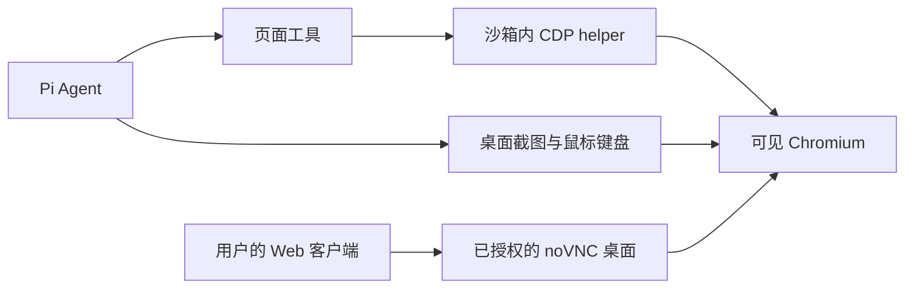
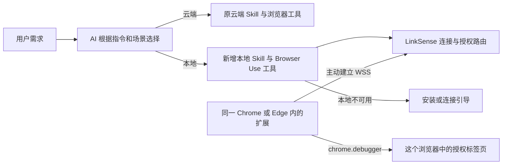

# Browser use 开源方案调研

调研日期：2026-10-26（Asia/Shanghai）。范围：官方 GitHub 仓库、README、源码、许可证及项目官方文档；未安装候选软件、未实际控制浏览器、未做成功率或性能对比。以下“事实”来自所链接的一手资料，“建议”是结合 LinkSense 已有 Codex 执行方式作出的工程判断。

实施已另行完成首版，接入与验证说明见[本地 Browser Use](./local-browser-use.md)。下文保留调研时的候选判断；本期没有安装上游完整 Agent，而是采用 Chrome 标准 debugger/CDP 执行受限动作，沿用现有 Codex Core MCP。跨账号认证、设备配对与 LinkSense 路由仍由项目自身实现。

## 当前确认的范围与选型结论

用户已明确：**云端浏览器与用户本地 Browser Use 并存。原内置浏览器保留，新增能力通过浏览器扩展操作用户打开 LinkSense 的 Chrome / Edge；首版支持这两种浏览器。AI 根据用户指令、场景和实际可用状态选择，用户也可明确指定。界面提供扩展安装引导，Skill 明确区分云端与本地。**

原内置浏览器的执行工具、面板、Worker 配置和会话清理行为保持；为避免 AI 混用，需要调整能力描述、Skill 选择规则和任务上下文。这不等于替换原浏览器执行实现。后续 Rakazo、Steel、E2B、noVNC 等章节保留为背景调研，不属于本期云端浏览器改造范围。

### 最新确认：AI 按场景选择，用户可明确指定

本节以用户最新提供的聊天记录为准，**替代此前“每次打开或任务首次打开时必须让用户选择”的建议**。用户知道并可指定执行位置，但不必在每个任务开始前回答浏览器二选一问题。第三方项目是否自带完全相同的远程模式不构成产品要求；本地扩展到 LinkSense 的连接仍需按实际部署实现。

| 能力名称 | 执行位置与登录态 | 使用前提 |
| --- | --- | --- |
| 云端浏览器（原内置） | LinkSense 管理的浏览器运行环境与自身会话，不继承用户本地 Chrome/Edge 登录态 | 沿用原有可用性、任务权限和使用流程，无需浏览器扩展 |
| 本地浏览器（Browser Use） | 用户正在使用的 Chrome / Edge 与授权页面，复用该 profile 的已有登录态 | 安装扩展、连接当前 LinkSense，并授权相应页面；仅安装不等于已连接或允许控制 |

以下为根据已确认方向细化的首版选择规则与验收建议：

| 用户意图或上下文 | AI 的选择与处理 |
| --- | --- |
| 明确要求“用我本地电脑的浏览器” | 使用本地浏览器；未连接时引导安装/连接，不擅自改用云端 |
| 明确要求“用云端浏览器” | 使用原内置能力，不要求安装扩展 |
| “读取我已经打开的页面”“操作我已登录的账户页面” | 需要用户现有浏览器上下文，使用已连接并授权的本地浏览器；页面或账号不明确时再澄清目标 |
| “打开某个公开网页”“查资料/查看网页”，没有本地上下文要求 | 建议默认沿用云端浏览器；安装了扩展也不表示所有任务都改成本地 |
| 继续点击、输入、翻页或操作某个已经打开的页面 | 沿用该页面的浏览器/会话/标签页归属；新子任务可另选浏览器，不把整个任务强制锁定为一种方式 |

选择优先遵循用户明确指令；其次依据已有页面归属和具体场景；普通公开网页走原有云端路径。仅“网站需要登录”不足以证明用户希望使用本地浏览器；若任务依赖已有登录态而目标不清楚，才需要澄清。AI 可以建议使用本地能力，但权限检查、连接确认与页面授权由工具边界执行。

正常流程：**用户提出需求 → AI 检查指令/场景及可用浏览器 → 调用对应 Skill 与工具 → 明确显示执行位置 → 对该页面继续操作。** 本地未就绪时提供连接引导；本地授权范围不足、多个候选目标或执行位置会影响任务结果时进行必要澄清。连接授权不等于浏览器方式选择，也不等于对任务外操作的授权。

### Skill 与任务上下文的职责

| 位置 | 需要表达的内容 | 保持的边界 |
| --- | --- | --- |
| 原 `linksense-browser` Skill | 明确“云端/平台托管浏览器”；适用普通网页、公开信息和任务工作区预览；不会读取用户本地标签页或登录态 | 保留命令、会话隔离、只读模式、输出和清理语义 |
| 新本地浏览器 Skill（名称待定，可用 `linksense-local-browser`） | 明确“用户电脑的 Chrome/Edge”；适用已打开页面、已有登录态及用户指定本地的任务；写清连接/状态/观察/动作和断开方法 | 只访问当前用户、连接和任务获准的页面；不控制其他桌面应用或任意本地文件 |
| 共享任务上下文/能力目录 | 在使用前让 AI 知道两种能力、选择优先级和当前可用状态，避免未安装用户只能通过已安装 Skill 才发现本地能力 | 不靠读取其他 tabs 来判断是否有权限；状态来自服务端/扩展连接协议 |

当前 [Runner 上下文](../../apps/runner/src/context.ts) 的普通/Plan 指引和 [内置 Skill writer](../../apps/api/src/modules/capabilities/user-home-materializer.ts) 都将网页工作泛化指向 `linksense-browser`，实施时需收窄为云端路径并增加本地选择说明，避免两份 Skill 都声明“所有网页任务都用我”。修改内置 Skill writer 时必须按仓库规则同步 runtime digest 和快照刷新验证。本轮只记录需求，未改 writer 或 runtime。

### 扩展发现、安装与连接引导

“用户不知道有本地能力”通过产品内可发现入口解决，不通过每次任务弹二选一解决。建议主入口放在**设置中的“浏览器扩展”**，展示 Chrome/Edge 安装入口、连接步骤、能力说明与几个可直接尝试的场景；具体位置和视觉仍待设计。用户提出必须使用本地浏览器的需求而能力未就绪时，在对话中给出同一入口，避免把产品介绍重复塞进普通网页任务。

能力说明应写清：LinkSense 可读取和操作用户授权的网页、利用现有登录态，页面信息/截图会按任务发送给 LinkSense 及配置的模型处理，并可随时停止/断开；不承诺全部数据仅在本机处理。示例包括“总结我打开的标签页”“在我已登录的网站中整理资料”。

界面区分“未检测到扩展”“待连接”“已连接”“已断开/需要重新授权”；未检测到不能当成确认未安装。AI 能读取实际连接/授权可用状态，安装入口和状态提示本身不授予页面访问权限。运行时展示“云端浏览器”或“本地浏览器 · Chrome/Edge”的目标标识，保留停止/断开入口。

### 会话与失败处理

同一任务可包含云端检索和本地已登录页面操作；每个页面必须绑定自己的执行位置、连接与标签页标识，不能因另一步换了浏览器而误操作既有页面。用户改变执行位置时新开相应会话，登录态和已有流程不自动迁移。

本地连接或授权失效后，拒绝新的本地命令并取消可取消的待执行动作，不自动重放；任务明确依赖本地上下文时提示连接或让用户决定后续方式。云端普通任务不因未安装扩展受阻。保留原有无交互任务行为，不新增所有旧任务都必须等待选择的步骤。

交互参考：Playwright 官方扩展提供连接时的 tab 选择及单独断开；Midscene 在连接层授权；HAX/PAIR 强调高效调用、纠错、监督和接管。它们支持清楚展示目标与可撤销控制，不能据此推出 LinkSense 必须使用统一二选一弹窗。[Playwright Extension](https://github.com/microsoft/playwright/blob/main/packages/extension/README.md#usage) · [Midscene 连接授权](https://midscenejs.com/bridge-mode#3-run-and-authorize) · [HAX](https://www.microsoft.com/en-us/haxtoolkit/ai-guidelines/) · [PAIR](https://pair.withgoogle.com/guidebook-v2/chapter/feedback-controls/)

**技术候选仍待验证：新增本地能力以 Chrome/Edge 扩展为入口，优先验证 Midscene Chrome Bridge 和 Nanobrowser 控制层，以及 Playwright 的可复用执行能力。** 尚未要求额外安装本地连接程序；若选定实现需要，必须在实施方案中明确，不能在“安装扩展”的承诺中隐藏这项成本。

| 主流候选 | GitHub stars（本轮快照） | 与当前需求相符的部分 | 连接与集成限制 |
| --- | --- | --- | --- |
| [Microsoft Playwright MCP / Extension](https://github.com/microsoft/playwright-mcp) | 38,642；Playwright 主库 98,536 | 官方支持已有 Chrome/Edge 和登录态；CLI/MCP 可由现有 Codex 调用 | 原版扩展只连 loopback；远端 LinkSense 需要本地连接程序和受控通道，或适配扩展 |
| [Midscene.js](https://github.com/web-infra-dev/midscene) | 15,396 | 字节维护；Chrome Bridge 扩展可连接另一台机器，复用用户浏览器 | 原版远程模式仅建议可信私网；需补齐公网认证、设备/任务绑定和传输保护；当前 MCP 已退役 |
| [Nanobrowser](https://github.com/nanobrowser/nanobrowser) | 14,182 | Chrome/Edge 扩展产品；已有无模型的 browser-control 层 | 控制层有源码接口，但尚无现成远端 MCP bridge；需单独接入 LinkSense |
| [Alibaba Page Agent](https://github.com/alibaba/page-agent) | 29,564 | 单页 DOM SDK、多页扩展，以及独立 PageController | 现有 beta MCP 调用完整内部 Agent；若由 Codex 决策，需复用 DOM 层并增加扩展通道 |
| [Chrome DevTools MCP](https://github.com/ChromeDevTools/chrome-devtools-mcp) | 54,177 | Google 官方；Chrome 144+ 可授权接入正在使用的 profile | 本地工具/调试连接路线；不是纯扩展远端桥；访问范围包含该 profile 所有窗口，Edge 未实测 |

关注度依据是 2026-10-26 本轮读取的 [Playwright MCP API](https://api.github.com/repos/microsoft/playwright-mcp)、[Playwright API](https://api.github.com/repos/microsoft/playwright)、[Midscene API](https://api.github.com/repos/web-infra-dev/midscene)、[Nanobrowser API](https://api.github.com/repos/nanobrowser/nanobrowser)、[Page Agent API](https://api.github.com/repos/alibaba/page-agent)、[Chrome DevTools MCP API](https://api.github.com/repos/ChromeDevTools/chrome-devtools-mcp)。均未归档；星数不能证明浏览器兼容性、安全隔离或任务成功率。[Browser Use](https://github.com/browser-use/browser-use) 同次为 119,163 stars，属于主流候选，但其已有 Chrome/CDP 路径也没有省去设备连接和授权工作。

Playwriter 与 OpenClaw Browser Relay 保留为远程连接实现参考：前者已有扩展直连远端 tunnel，后者已有手动远端 WSS 配对。两者不再是仅有的优先候选；具体限制见各自章节。以下建议均未通过 LinkSense 浏览器端或跨机 PoC。

## DeerFlow：已有浏览器操作与 CDP attach，尚非本需求的完整连接方案

本轮核对当前 2.0 提交 [`794be98704852b9a61cbb8022f7374504037fead`](https://github.com/bytedance/deer-flow/tree/794be98704852b9a61cbb8022f7374504037fead)，不沿用早期 Deep Research 版本的结论。官方仓库在本轮 API 快照为 84,435 stars、MIT 许可。[仓库元数据](https://api.github.com/repos/bytedance/deer-flow) · [LICENSE](https://github.com/bytedance/deer-flow/blob/794be98704852b9a61cbb8022f7374504037fead/LICENSE)

**已经实现的部分：** 可选 browser tool group 提供导航、页面快照、按元素 ref 点击/输入、正文读取、后退、截图和关闭；底层是 Python Playwright。工具层可参考，但它是 DeerFlow Harness 的组成部分，不是一个独立的 Chrome 连接 SDK。[工具实现](https://github.com/bytedance/deer-flow/blob/794be98704852b9a61cbb8022f7374504037fead/backend/packages/harness/deerflow/community/browser_automation/tools.py)

连接分两条路径：

1. **默认路径：** `chromium.launch()` 后创建新 context 和页面。它操作执行环境里的浏览器，不会自动获得打开 LinkSense 的用户浏览器及登录态。
2. **配置 `cdp_url`：** 调用 `chromium.connect_over_cdp()`，复用已有 context，并优先采用 `context.pages[-1]`。这确实支持控制已有浏览器，但前提是该 CDP endpoint 已建立并对后端可达；它没有自动识别“打开当前 LinkSense 页面的浏览器实例”。该配置还需显式设置 `allow_unguarded_cdp: true`，因为 DeerFlow 无法在该 context 执行其完整请求层 SSRF 防护。

来源：[连接与页面选择源码](https://github.com/bytedance/deer-flow/blob/794be98704852b9a61cbb8022f7374504037fead/backend/packages/harness/deerflow/community/browser_automation/session.py#L408-L453)、[启用检查](https://github.com/bytedance/deer-flow/blob/794be98704852b9a61cbb8022f7374504037fead/backend/app/gateway/browser_capability.py)。这里描述的是 DeerFlow 的限制，不是建议 LinkSense 复制该配置或关闭自己的授权。

其 Browser Live WebSocket 将后端浏览器的 JPEG 截图发送到前端，并把前端输入转成该会话的动作。**这是浏览器画面与人工控制通道，不是用户 Chrome 扩展向服务端注册的设备通道。** 会话按 thread 保存在进程中，当前 browser group 要求单 Gateway worker；部署模型不能直接照搬到 LinkSense 的多用户 Runner。[Live 路由](https://github.com/bytedance/deer-flow/blob/794be98704852b9a61cbb8022f7374504037fead/backend/app/gateway/routers/browser.py) · [会话管理与 worker 限制](https://github.com/bytedance/deer-flow/blob/794be98704852b9a61cbb8022f7374504037fead/backend/packages/harness/deerflow/community/browser_automation/session.py)

**结论：** DeerFlow 有 browser use，也有接入已有 Chrome 的底层路径。本次检查官方文档、完整文件树及上述调用链，没有找到可直接复用的“Chrome/Edge 扩展 + 用户设备配对 + 反向连接 + 任务授权”成品。它的 Python 插件、BrowserModule 和 MCP extensions 也不能仅因名称含 extension 就当成浏览器扩展。适合参考工具返回、快照与操作反馈；不建议为了这项能力引入整个 DeerFlow 或另建 Agent 循环。

## Playwriter：当前浏览器执行与纯扩展远程控制

源码核对提交 [`6489336628e6737e32a59f25ed270622400cb277`](https://github.com/remorses/playwriter/tree/6489336628e6737e32a59f25ed270622400cb277)。当前源码 package 标为 `0.9.0`、扩展 manifest 标为 `0.0.171`，不代表商店或 npm 当时已发布相同版本。它通过 `chrome.debugger` 驱动用户已有浏览器，暴露 Playwright 操作、快照和截图，并提供 CLI/MCP；不需要另开一个浏览器 profile。[README](https://github.com/remorses/playwriter/blob/6489336628e6737e32a59f25ed270622400cb277/README.md) · [manifest](https://github.com/remorses/playwriter/blob/6489336628e6737e32a59f25ed270622400cb277/extension/manifest.json)

必须区分两种模式：常规模式连接本机 relay；Remote control 模式由扩展 service worker 直接建立远端 WSS，用户电脑无需安装 CLI。CLI 可在 Agent 所在机器连接远端控制 ID。该模式能够访问所有已启用 Playwriter 的 tabs，并创建新 tabs，不能因分享从一个 tab 发起就宣称只授予该 tab。[远程接入文档](https://playwriter.dev/docs/remote-access) · [权限说明](https://playwriter.dev/docs/remote-control)

源码 `RemoteTunnel` 是扩展内的出站连接；`background.ts` 使用默认 `REMOTE_TUNNEL_BASE_DOMAIN`，该常量为 `playwriter.dev`。协议支持自定义 host 的部分不等于商店扩展已提供 LinkSense 自托管配对 UI。LinkSense 若复用，需要新增自己的服务地址、现有账号授权、设备和任务绑定，并核对分发版本。[扩展 tunnel](https://github.com/remorses/playwriter/blob/6489336628e6737e32a59f25ed270622400cb277/extension/src/remote-tunnel.ts) · [调用与默认域名](https://github.com/remorses/playwriter/blob/6489336628e6737e32a59f25ed270622400cb277/extension/src/background.ts) · [共享协议](https://github.com/remorses/playwriter/blob/6489336628e6737e32a59f25ed270622400cb277/playwriter/src/remote-control.ts)

根仓库采用 MIT。工具 package 使用自己的 Playwright 分支，并包含其他运行依赖，因此应作为新增能力单独适配，不能直接替换内置 `@playwright/cli`，也不应把任意 Playwriter 脚本视为已经通过 LinkSense 的任务授权。[许可](https://github.com/remorses/playwriter/blob/6489336628e6737e32a59f25ed270622400cb277/LICENSE) · [package](https://github.com/remorses/playwriter/blob/6489336628e6737e32a59f25ed270622400cb277/playwriter/package.json)

## OpenClaw Browser Relay：纯扩展直连与配对参考

当前官方文档明确支持：在 Gateway 所在机器生成带 `--gateway-url wss://...` 的 pairing，用户在扩展设置粘贴；浏览器所在电脑可以不运行 OpenClaw、browser node 或 native host。非 loopback 地址要求 WSS，路径为 `/browser/extension`。默认 native bootstrap 流程与这条手动远端配对路径不同。[官方远端配对](https://docs.openclaw.ai/tools/chrome-extension#advanced-manual-pairing) · [URL 与协议检查](https://github.com/openclaw/openclaw/blob/main/extensions/browser/chrome-extension/modules/relay-core.js) · [扩展连接](https://github.com/openclaw/openclaw/blob/main/extensions/browser/chrome-extension/modules/relay-connection.js)

浏览器端通过 `chrome.debugger` 控制实际 tabs；有 All tabs、Selected tabs 与暂停/撤销状态；服务端把扩展协议桥接成 CDP。连接认证使用 HMAC challenge/proof v2，不能把原 Gateway 的长期配对 key 简单当成 LinkSense 应用 session。多个 CDP 客户端仍共享真实页面，不能等同于隔离 browser contexts。[配对生成](https://github.com/openclaw/openclaw/blob/main/extensions/browser/src/browser/extension-pairing.ts) · [v2 认证](https://github.com/openclaw/openclaw/blob/main/extensions/browser/chrome-extension/modules/relay-auth-v2.js) · [tab scope](https://github.com/openclaw/openclaw/blob/main/extensions/browser/chrome-extension/modules/tab-access.js) · [CDP bridge](https://github.com/openclaw/openclaw/blob/main/extensions/browser/src/browser/extension-relay/relay-bridge.ts)

其 MIT 代码有复用价值，但 `@openclaw/browser-plugin` 为 `private: true`，服务端依赖 plugin-sdk；当前 Gateway/profile key 和连接替换规则也不是即用的多用户设备系统。LinkSense 可参考或抽取扩展与 relay，Codex 继续负责 Agent 决策，现有认证继续负责用户身份。[package 边界](https://github.com/openclaw/openclaw/blob/main/extensions/browser/package.json) · [relay server](https://github.com/openclaw/openclaw/blob/main/extensions/browser/src/browser/extension-relay/relay-server.ts) · [MIT 许可](https://github.com/openclaw/openclaw/blob/main/LICENSE)

以下章节保留既有实现与其他方案的核对记录。涉及云端浏览器、持久 profile 和桌面 Sandbox 的建议均不属于本轮已确认需求。

## 既有内置浏览器基线（只读核对，保持不变）

以下来自本次本地代码核对，表示代码中已经实现，不表示本次重新完成了运行验证。

| 边界 | 已有实现 | 与新增能力的边界 |
| --- | --- | --- |
| 浏览器执行 | [`@playwright/cli` 固定为 `0.1.17`](../../deploy/runtime/browser/package.json)，[`linksense-browser`](../../apps/runner/src/browser/cli-wrapper.ts) 创建任务会话与隔离 Chromium | 该 runtime 和 wrapper 不改；“当前浏览器”另设连接，不替换其 URL 或 profile |
| Agent 工具 | [普通模式使用 CLI + Skill，Plan 使用只读浏览器 MCP](../../apps/runner/src/context.ts) | 原工具继续指向内置浏览器；新增工具独立命名与授权，不扩大原有权限 |
| 人工接管 | [现有面板](../../apps/web/src/features/browser-panel/browser-panel.tsx) 约每 1.5 秒刷新截图；[控制租约与互斥](../../apps/runner/src/browser/session-control.ts) 已实现 | 原面板保持；新增能力对应用户真实窗口，不能让该面板误显示或控制另一目标 |
| 资源权限 | [API 服务](../../apps/api/src/modules/conversations/service.ts) 校验任务归属、应用运行权限与 Plan/归档状态，再经 Runner 路由 | 设备连接还需绑定账号、任务和授权页面；不能让 agent 自行提供任意 CDP endpoint |
| 会话清理 | [CLI wrapper](../../apps/runner/src/browser/cli-wrapper.ts) 用 `open` 建立租约和活动标记，清理调用 `close`，必要时回收托管进程 | 原清理逻辑不改；新连接独立断开，不进入托管进程回收，也不关闭用户浏览器或删除 profile |

另外，[local-process worker 配置](../../apps/runner/src/controller/local-process-worker-provider.ts) 明确关闭托管浏览器，不能把生产 Worker 的浏览器能力当作当前本地开发模式已经可用。现有人工接管与生命周期说明见[项目文档](./automation-monitoring-and-browser-panel.md)。

项目的 [Codex 版本声明](../../apps/runner/src/codex/runtime-version.json) 固定为 `0.154.0`；[现有配置适配器](../../apps/runner/src/codex/runtime-config-overrides.ts) 已配置原生 MCP。OpenAI 官方文档确认 Codex 可接 STDIO 和 Streamable HTTP MCP；因此工具接入优先沿用该边界，由原生 Codex 决定下一步。[OpenAI MCP 文档](https://learn.chatgpt.com/docs/extend/mcp)

官方桌面浏览器扩展的文档要求通过 ChatGPT/Codex 桌面应用配对。本次未找到供自托管 app-server 独立嵌入该扩展的公开控制接口，不能把桌面端可用直接视为 LinkSense 已可复用。[官方 Browser extension 文档](https://learn.chatgpt.com/docs/chrome-extension)

## 方案能力与产品边界总表

| 方案 | 产品定位与决策循环 | 已有浏览器/登录态 | 与 Codex 配合 | 对 LinkSense 的判断 |
| --- | --- | --- | --- | --- |
| Microsoft Playwright CLI + Extension | 浏览器执行工具，决策由调用它的 agent 负责 | 最新官方文档提供扩展 attach 和 CDP attach | CLI + Skill | 现有 CLI 内置路径保持；扩展能力若采用则另行接入 |
| Microsoft Playwright MCP + Extension | MCP 浏览器工具服务器，无需独立 LLM agent | 官方扩展连接用户选择的 tabs；也支持 CDP | 原生 MCP client 可调用 | 需要 MCP 工具路径时优先；不是远程桌面桥接平台 |
| Browser Use | Python Agent、直接 CLI、本地 MCP、Cloud 是不同产品/模式 | CLI 可用已有 Chrome；也可接 CDP/云浏览器 | CLI/MCP 可供既有 agent；Python Agent/Cloud task 自己运行决策循环 | 主流候选，但不能因项目名直接引入完整 Agent |
| Browser Use Browser Harness | 面向既有 coding agent 的 Python 浏览器控制层 | 本机 Chrome/CDP；已有登录态 | CLI + Skill、另有 stdio MCP | 有价值的补充候选；新增 Python 浏览器依赖和另一套控制层 |
| Stagehand v4 | AI primitives 与确定性浏览器 SDK；完整决策交给宿主 agent | 本地启动、现有 CDP、Browserbase | 有实验性 Codex MCP adapter | 适合自然语言动作、结构化提取需求，首版非必需 |
| Chrome DevTools MCP | Chrome 自动化、网络/console/performance 调试工具 | 新浏览器；或本机 Chrome 144+ `autoConnect`；也能连 CDP endpoint | MCP，也提供 CLI/Skills | 开发调试优先；现有 profile 的整体访问范围需评估 |
| BrowserMCP | 本地 MCP server + Chrome extension | 复用已有 profile 和登录态 | MCP client 调用 | 可借鉴；构建完整性和公开维护情况使其优先级较低 |
| Nanobrowser | 完整的扩展内 browser agent 与侧栏产品 | 用户现有 Chrome/Edge 登录态 | 已核对的文档没有提供现成的 LinkSense/Codex 工具接入口 | 可参考扩展控制与授权交互；直接接入需要拆出执行层 |
| Midscene Chrome Bridge | AI UI SDK；桥接层另有确定性截图/输入方法 | 扩展连接用户已有 Chrome，可跨机 | 当前推荐 SDK/CLI/Skills；MCP 已退役 | 纯扩展路线优先验证，需补齐公网连接与任务授权 |
| Alibaba Page Agent | DOM Agent SDK、多页扩展、独立 PageController | 当前注入页面；扩展支持多页 | beta MCP 内部执行完整 Agent；可拆 DOM 控制层 | 适合 DOM 优先的自有扩展，不能保证 Canvas/系统 UI 能力 |
| DeerFlow 2.0 | 完整 Harness 的可选 Playwright browser group | 默认新浏览器；`cdp_url` 可连已有 context | 原项目使用 Python/LangGraph 工具边界 | 可参考工具反馈，尚无已核对的用户浏览器反向配对通道 |
| Rakazo | 自托管 Agent 应用；页面工具与图形桌面共用浏览器 | 持久化的 bot 浏览器 profile；另有受信任本地电脑模式 | 自己使用 Pi；LinkSense 可借鉴执行与显示边界 | 作为产品架构参考；不是即装即用的浏览器 SDK 或扩展 |

表中连接、版本和限制分别由各章节来源支撑；不单凭 GitHub stars 排名，也不把供应商 benchmark 当作 LinkSense 成功率。

## Microsoft Playwright：最贴合现有工具链

### CLI 与 MCP 的边界

**事实：** 当前 Playwright CLI 文档提供 `attach --extension=chrome`、`attach --cdp=chrome`、`attach --cdp=<url>` 和 `detach`。这些是调研当日上游能力，不能据此认定 LinkSense 固定的 `@playwright/cli` 版本已经支持。[CLI attach 参数](https://github.com/microsoft/playwright-cli#open-parameters)

MCP 默认暴露结构化页面与操作工具，可通过 stdio 由 agent 启动，也可用 `--port` 运行 HTTP 服务。MCP HTTP 仅解决 MCP client 到服务器的通信；浏览器的位置和连接方式仍由该服务器配置决定。[官方 MCP 入门与 HTTP 模式](https://github.com/microsoft/playwright/blob/main/docs/src/getting-started-mcp.md)

### 官方扩展能提供什么

**事实：** Playwright Extension 支持 Chrome/Edge/Chromium，连接已有浏览器页面并利用原 profile 的登录态。默认要批准连接及选择 tab；当前 README 描述每个 client 独立 tab group，可在扩展状态页断开连接。`PLAYWRIGHT_MCP_EXTENSION_TOKEN` 可绕过每次连接批准，所以生产产品不能把它当作等同于 LinkSense 的每任务授权。[官方 Extension README](https://github.com/microsoft/playwright/blob/main/packages/extension/README.md)

**源码核对：** MCP 侧 `CDPRelayServer` 启动 WebSocket relay，生成 CDP 与 extension 路径，再通过本机浏览器 executable 打开 `chrome-extension://.../connect.html` 并传入 relay URL。扩展侧通过 `chrome.debugger`、tabs 等 API 执行命令。[MCP relay 源码](https://github.com/microsoft/playwright/blob/main/packages/playwright-core/src/tools/mcp/cdpRelay.ts) · [扩展 relay 源码](https://github.com/microsoft/playwright/blob/main/packages/extension/src/relayConnection.ts)

**已确认的硬限制：** 扩展 `connect.tsx` 校验 relay URL 的 hostname，只接受 `127.0.0.1` 或 `[::1]`，其他地址直接拒绝。因此未修改的官方扩展不能直接连接 LinkSense 云端 WSS。该文件的授权提示还明确警告连接可能暴露整个浏览器及其他 tabs/windows 的内容；README 的 tab group 行为不能当作强安全隔离。[loopback 检查与授权提示源码](https://github.com/microsoft/playwright/blob/main/packages/extension/src/ui/connect.tsx)

**推断：** 把 MCP 放入远程 Docker 后，它启动的是容器/服务器侧 executable，用户电脑上的扩展不会因此自动接入。`--port`、`--host` 或 extension token 本身不能完成跨机连接、设备配对、租户授权与上传下载传输。

可评估两种集成方式，均需 PoC：

1. **本地伴随程序 + 官方扩展：** 用户电脑运行固定版本 Playwright 工具/bridge，向 LinkSense 建立经过认证的出站通道；远程 Runner 通过通道调用。优点是尽量保留上游扩展；代价是额外分发和升级本地程序。
2. **LinkSense 自有扩展 + 受限 relay：** 扩展直接向 LinkSense 建立出站 WSS，按已配对用户、设备、任务和 tabs 转发浏览器命令。服务端适配已有 Playwright 工具。优点是可提供只安装扩展的体验；代价是自己维护扩展协议、CDP 兼容、授权、断线与浏览器版本适配。

第二种是待确认的架构建议，**不代表官方扩展已经支持该产品拓扑**。如果自有 relay 只实现部分 CDP，不得宣称兼容任意 Playwright/CDP 操作；应对实际工具使用的命令逐项验证。

## Midscene Chrome Bridge：主流扩展桥接候选

**事实：** Chrome Bridge 通过扩展控制用户桌面 Chrome，复用现有登录态、cookies 和扩展。Node.js 端运行 Bridge Server；跨机场景允许浏览器扩展填写另一台机器的 server 地址，因此不要求 Chrome 所在电脑另跑 Node。它支持连接当前 tab 和新 tab；SDK 不暴露 Playwright `Page`，不是现有 Playwright 工具的无缝替换。[官方连接与跨机文档](https://midscenejs.com/bridge-mode) · [Chrome Bridge SDK](https://midscenejs.com/sdk/chrome-bridge)

桥接层有 screenshot、mouse 和 keyboard 方法，可进一步验证由 Codex 直接决定动作的接法，不必把每次操作都交给完整 `aiAct` 任务。AI 自然语言定位/动作方法则需要另外配置模型。每个 Agent 实例绑定一个 tab，切换另一个 tab 的生命周期需按 SDK 约束处理。[桥接执行源码](https://github.com/web-infra-dev/midscene/blob/main/packages/web-integration/src/bridge-mode/agent-cli-side.ts)

**公网接入缺口：** 上游 Bridge Server 使用 HTTP + Socket.IO，默认 loopback，源码主要执行 Origin 检查。官方远程模式只建议可信私网，明确不能直接向公网暴露端口。产品化还要补齐 LinkSense 用户/设备认证、任务与 tab 绑定，以及受控的加密通道；把 host 改成 `0.0.0.0` 或加 TLS 本身不能解决这些问题。[server 源码](https://github.com/web-infra-dev/midscene/blob/main/packages/web-integration/src/bridge-mode/io-server.ts) · [官方远程边界](https://midscenejs.com/bridge-mode#remote-access-configuration)

**当前版本变化：** 官方已经退役 MCP servers，最后支持版本为 `1.9.8`。新方案应评估 SDK 或 CLI/Skills，不能把旧 `@midscene/web-bridge-mcp` 教程当成当前推荐方式。项目采用 MIT。[MCP 退役说明](https://midscenejs.com/mcp) · [CLI/Skills](https://midscenejs.com/skills) · [LICENSE](https://github.com/web-infra-dev/midscene/blob/main/LICENSE)

## Alibaba Page Agent：可单独评估 DOM 控制层

**事实：** 除了嵌入网页的单页 Agent，官方还有多页浏览器扩展和独立 `@page-agent/page-controller`。控制器源码暴露 `getBrowserState()`、`clickElement()`、`inputText()`、滚动等 DOM 操作，适合作为自有扩展 content script 中的可复用候选。复用该层的可行性需按实际打包与网站验证，不能仅凭导出方法认定已完成 LinkSense 接入。[官方仓库](https://github.com/alibaba/page-agent) · [PageController](https://github.com/alibaba/page-agent/blob/main/packages/page-controller/src/PageController.ts) · [独立包](https://github.com/alibaba/page-agent/blob/main/packages/page-controller/package.json)

当前 beta MCP 的主要工具为 `execute_task`、`get_status`、`stop_task`，通过本地 Node hub 与扩展运行内部 MultiPageAgent，仍有自己的模型调用和任务循环。它不是现成的“Codex snapshot/click 工具 + 纯扩展直连远端”；若复用，应把页面控制与连接层单独评估。DOM 能力也不能外推成对 Canvas、原生弹窗或跨源 iframe 的完整支持。项目采用 MIT。[MCP 架构与工具](https://github.com/alibaba/page-agent/blob/main/packages/mcp/README.md) · [本地 hub](https://github.com/alibaba/page-agent/blob/main/packages/mcp/src/hub-bridge.js) · [LICENSE](https://github.com/alibaba/page-agent/blob/main/LICENSE)

## Browser Use：必须按模式判断

**事实：** Browser Use 官方区分 hosted agent、给现有 agent 用的 CLI，以及自己运行的 Python library。CLI 和 Python library 都可以连接 local/cloud browser；托管浏览器只提供浏览器，hosted agent API 还负责运行 agent。[官方产品边界](https://github.com/browser-use/browser-use#faq)

本地 MCP 使用 stdio，提供 navigate/click/type/get_state、tabs、截图等低级工具；另有 `retry_with_browser_use_agent` 整任务 Agent 和 AI 内容提取工具。因此它可以作为 Codex 工具，但必须明确启用哪些工具，避免让整任务 Agent 在一次工具调用里接管当前 Codex turn。[本地 MCP 工具清单](https://docs.browser-use.com/open-source/customize/integrations/mcp-server)

当前 CLI 直接提供浏览器控制并以 Browser Harness 为底层，可连接已有 Chrome 的 tabs/cookies/extensions/logins、Browser Use cloud，或任意可达的 CDP endpoint。[当前 CLI 文档](https://docs.browser-use.com/open-source/browser-use-cli)

**Browser Harness 单列观察：** 它有 CLI + Skill 和 `browser-harness-mcp` stdio 入口；官方本机设置走 Chrome remote debugging，而非要求安装浏览器扩展。它使用 whole-browser 授权，与 Playwright Extension 的 tab 选择体验不同。[Browser Harness README](https://github.com/browser-use/browser-harness) · [本机设置说明](https://github.com/browser-use/browser-harness/blob/main/install.md)

**建议：** Browser Use 可列为新增连接能力的另一执行方式；若采用，需独立适配 Python 浏览器依赖、日志与取消链路。当前不替换内置 Playwright，也不将引入完整 Browser Use Agent 当作“浏览器可点击”的前置条件。

## Stagehand v4：SDK 可组合，但要避开旧版本结论

**事实：** 当前 v4 保留自然语言 `act`、`extract`、`observe` 和确定性的 page/locator API；官方迁移文档明确移除了 v3 的 `agent()`，完整控制流由调用者负责。故“Stagehand 一定会新增第二套 agent loop”已不准确。[v4 概览](https://docs.stagehand.dev/v4/first-steps/introduction) · [v3 到 v4 迁移](https://docs.stagehand.dev/v4/migrations/v3)

浏览器可以由 Browserbase 托管、本地启动，或通过 `localBrowser.connect({ cdpUrl })` 连接已有 Chromium。AI primitives 会调用模型；本地浏览器不能使用依赖 Browserbase session 的 Model Gateway，需要独立配置模型或 callback。[浏览器连接方式](https://docs.stagehand.dev/v4/configuration/browser) · [模型配置与 Gateway 限制](https://docs.stagehand.dev/v4/configuration/models)

v4 官方 Codex 集成以 `run`、`snapshot`、`screenshot` 提供持续 MCP/stdio 浏览器会话；文档明确标记为仓库提供的实验性集成，非独立发布 adapter。旧 `browserbase/mcp-server-browserbase` 仓库已归档，不能拿旧示例当作当前默认实现。[Codex adapter](https://docs.stagehand.dev/v4/integrations/cli-agents/codex) · [已归档旧 MCP 仓库](https://github.com/browserbase/mcp-server-browserbase)

**建议：** 当需求包含大量“自然语言动作 + Zod 结构化提取 + 重复脚本”时再评估。它不会自动解决服务器到用户本地 Chrome 的通道问题；有 `cdpUrl` 仍需要 endpoint 可达且经过认证。

## Chrome DevTools MCP：调试能力强，授权面需区分

**事实：** 官方提供页面交互、截图、网络/console 与 performance tracing，底层使用 Puppeteer；当前也有 CLI 和 Skills。[官方仓库](https://github.com/ChromeDevTools/chrome-devtools-mcp)

默认启动专用 profile；Chrome 144+ 可以由用户在 `chrome://inspect/#remote-debugging` 开启连接，然后用 `--autoConnect` 附着现有浏览器。官方明确服务器能够访问所选 profile 的所有已打开窗口。远程/沙箱可以用 `--browser-url`、`--ws-endpoint` 等连接已开放的调试端点，连通性仍需自行解决。[高级连接方式和范围](https://github.com/ChromeDevTools/chrome-devtools-mcp/blob/main/docs/advanced-usage.md) · [参数清单](https://github.com/ChromeDevTools/chrome-devtools-mcp/blob/main/docs/configuration.md)

**建议：** 适合将来补充网站调试、性能分析；面向普通用户选择网页的体验，Playwright Extension 提供了更接近目标的交互，但仍须核实底层授权范围。两者都不能仅凭界面上选择了 tab 就宣称只获得该 tab 的底层权限。

Chrome 官方文档确认 `--autoConnect` 要求 Chrome 144+、用户开启 remote debugging 并允许连接。Chrome 136 对旧命令行调试开关和默认 profile 的限制，不能用来推断新版本无法连接已有登录态。[当前 auto-connect 指南](https://developer.chrome.com/docs/devtools/agents/use-cases/auto-connect) · [Chrome 136 变更](https://developer.chrome.com/blog/remote-debugging-port)

## BrowserMCP：功能方向吻合，但不宜直接作为首选底座

**事实：** 其 README 描述本地 MCP server + Chrome extension，可复用现有浏览器 profile；同时明确当前公开仓库因为依赖原 monorepo 的 utils/types，无法独立构建。GitHub API 在调研时返回公开仓库 `pushed_at=2025-04-24T21:49:44Z`；这只表示该公开仓库可见状态，不能据此推断商店扩展最后更新时间。[README](https://github.com/BrowserMCP/mcp) · [仓库元数据](https://api.github.com/repos/BrowserMCP/mcp)

**建议：** 作为交互参考，不能在未验证独立构建、扩展源码、版本对应关系和远程部署能力前选为 LinkSense 的核心依赖。README 的本机隐私或反检测宣传也不能推导出页面数据不会进入远端模型，或验证码一定可绕过。

## Nanobrowser：扩展产品的实现参考

**事实：** Nanobrowser 是运行在用户浏览器中的完整开源 agent，有侧栏、模型设置和人工确认流程。当前 README 说明执行层通过 `chrome.debugger` 操作页面，并借助 Puppeteer 管理 frames；与浏览器交互的执行层不包含 AI 模型。[官方 README](https://github.com/nanobrowser/nanobrowser)

**建议：** 可参考其页面动作、iframe 处理与接管交互。直接搬入完整产品会同时引入自己的会话、模型配置和 agent 决策，因此 LinkSense 若复用，应单独评估执行层而非替换现有任务系统。`chrome.debugger` 是 Chrome 提供的 CDP 传输 API，有受限的协议域，并受企业策略限制，不是任意完整 CDP 服务的直接替代。[Chrome debugger API](https://developer.chrome.com/docs/extensions/reference/api/debugger)

本轮进一步核对源码：`src/browser-control` 明确分出独立 Controller/Session、observe/action 协议、输入、截图、tabs 锁与执行回执，值得优先验证作为自有扩展的控制层。Controller 注释也明确当前调用方是扩展内 Agent/测试面板，MCP bridge 是后续方向；有独立控制接口不等于已经发布远程 SDK。[控制层导出](https://github.com/nanobrowser/nanobrowser/blob/master/src/browser-control/index.ts) · [Controller 与调用边界](https://github.com/nanobrowser/nanobrowser/blob/master/src/browser-control/core/controller.ts)

## 补充候选：mcp-chrome 与 UI-TARS

[hangwin/mcp-chrome](https://github.com/hangwin/mcp-chrome) 提供现有 Chrome 的细粒度 MCP 工具，采用 MIT；但安装流程明确需要本机 `mcp-chrome-bridge`，扩展通过 `chrome.runtime.connectNative()` 连接 native host，并非只装扩展即可直连 LinkSense。GitHub API 本轮为 12,510 stars，最后 push 为 2026-01-06，维护活跃度需在采用前复核。[安装说明](https://github.com/hangwin/mcp-chrome#-quick-start) · [native host 源码](https://github.com/hangwin/mcp-chrome/blob/master/app/chrome-extension/entrypoints/background/native-host.ts) · [元数据](https://api.github.com/repos/hangwin/mcp-chrome)

[UI-TARS-desktop](https://github.com/bytedance/UI-TARS-desktop) 更适合作为未来完整桌面 computer use 的参考：其 browser operator 默认自己启动浏览器，remote operator 接受已有 WS endpoint；NutJS operator 在本机执行截图、鼠标与键盘。项目采用 Apache-2.0；SDK 有独立 Agent 循环，operator 可以另行评估，不能把桌面应用本身当作已完成 LinkSense 网页到当前 Chrome 的配对通道。[browser operator](https://github.com/bytedance/UI-TARS-desktop/blob/main/packages/ui-tars/operators/browser-operator/src/browser-operator.ts) · [NutJS operator](https://github.com/bytedance/UI-TARS-desktop/blob/main/packages/ui-tars/operators/nut-js/src/index.ts) · [SDK](https://github.com/bytedance/UI-TARS-desktop/blob/main/packages/ui-tars/sdk/README.md)

## Rakazo：页面工具、可见桌面与持久浏览器

本节核对提交 [`3bb4ea4f283abf76f466ac3976a96262ddc948a8`](https://github.com/elie222/rakazo/tree/3bb4ea4f283abf76f466ac3976a96262ddc948a8)。已读取 README、运行文档、默认 provider、CDP helper、Docker 适配器、屏幕授权和 Electron 本机连接代码；未运行项目。README 标记项目为 beta，不能把代码存在当作已通过 LinkSense 场景验收。

### 实际实现

生产默认 `BrowserProvider` 是 `computer`：Agent 的 `browser_navigate`、`browser_snapshot`、`browser_act` 经 `ComputerBrowserProvider` 与 `SandboxProvider.pageBrowser` 操作已有的可见 Chromium。Docker 适配器请求 supervisor 的 `/computers/:id/browser`；沙箱内 `rakazo-page-browser` 用 Python 标准库自己实现 CDP discovery、WebSocket 和命令调用，**该默认路径没有采用 Playwright、Stagehand 或 Browser Use SDK**。测试专用 fake/emulator 不代表真实浏览器。[默认 provider](https://github.com/elie222/rakazo/blob/3bb4ea4f283abf76f466ac3976a96262ddc948a8/packages/adapters/src/browser-provider-factory.ts) · [页面适配器](https://github.com/elie222/rakazo/blob/3bb4ea4f283abf76f466ac3976a96262ddc948a8/packages/adapters/src/computer-browser.ts) · [Docker 调用](https://github.com/elie222/rakazo/blob/3bb4ea4f283abf76f466ac3976a96262ddc948a8/packages/adapters/src/docker-sandbox.ts) · [CDP helper](https://github.com/elie222/rakazo/blob/3bb4ea4f283abf76f466ac3976a96262ddc948a8/infra/sandboxes/computer/rakazo-page-browser)

图形环境由 Chromium、Xvfb、Fluxbox、x11vnc、noVNC 与 websockify 组成。网页通过 noVNC 显示和控制同一图形桌面，Agent 另外有截图与鼠标键盘工具；这与把网站放入普通 iframe 不同。[镜像定义](https://github.com/elie222/rakazo/blob/3bb4ea4f283abf76f466ac3976a96262ddc948a8/infra/sandboxes/computer/Dockerfile) · [noVNC 嵌入页](https://github.com/elie222/rakazo/blob/3bb4ea4f283abf76f466ac3976a96262ddc948a8/infra/sandboxes/computer/embed.html)

### 对 LinkSense 有价值的五点

| 可参考部分 | 源码中的做法 | LinkSense 的适用方式 |
| --- | --- | --- |
| 操作与画面使用同一浏览器 | DOM 工具附着当前桌面 Chromium；失败返回 `computer_act` 路径 | 继续用 Playwright 执行，保证 Agent、截图面板和人工接管对应同一会话 |
| 页面工具与视觉操作互补 | 快照有界，常规交互元素上限 80；frames 与不支持的控件转桌面工具；无视觉能力时转人工 | 借鉴工具选择策略；不必为此重写已有 Playwright 定位、iframe 和等待逻辑 |
| 保存登录态与运行进程分离 | Chrome profile 绑定 bot；释放显示会话不删除 profile；工作区 checkpoint 前协调浏览器写入 | 可评估“用户登录一次，后续任务复用”的云端 profile；需明确账号隔离、清除和并发归属，不能把当前临时隔离会话静默改为永久保存 |
| 防止重复操作与旧引用误点 | refs 对应实际 DOM 节点并拒绝失效引用；结果返回 `completed`、`uncertain`，失败提示重新观察而非重放 | 复用 Playwright 已有能力；连接或工具超时后不要自动重做已提交操作，也不要新增整轮重试 |
| 观看与控制分权 | 屏幕 capability 绑定 bot、computer generation 和 control lease；API 校验后代理，隐藏供应商凭据 | 可借鉴可撤销的只读观看/独占输入权限；保留 LinkSense 已有任务归属检查与接管规则 |

来源：[浏览器 helper](https://github.com/elie222/rakazo/blob/3bb4ea4f283abf76f466ac3976a96262ddc948a8/infra/sandboxes/computer/rakazo-page-browser)、[失败结果与工具提示](https://github.com/elie222/rakazo/blob/3bb4ea4f283abf76f466ac3976a96262ddc948a8/packages/adapters/src/browser-tools.ts)、[profile 与持久化说明](https://github.com/elie222/rakazo/blob/3bb4ea4f283abf76f466ac3976a96262ddc948a8/docs/computer-runtime.md)、[screen capability](https://github.com/elie222/rakazo/blob/3bb4ea4f283abf76f466ac3976a96262ddc948a8/packages/core/src/node/screen-capability.ts)、[API 授权](https://github.com/elie222/rakazo/blob/3bb4ea4f283abf76f466ac3976a96262ddc948a8/apps/api/src/screen-proxy.ts)。这些是可参考设计，不构成对其安全性或真实网站成功率的完整审计。

其文档也明确：同一 Team Computer 内 bots 共享 OS 用户、工作区及浏览器文件，独立 profile 和控制租约不是抵御互不信任代码的隔离边界。LinkSense 应保持现有按用户 Worker 的隔离，不因参考其多 bot 桌面分配而合并不同用户的运行环境。

另外，`fill_secret` 让模型引用已保存登录的名称，由后端解析值并填入页面，helper 在实际填入时检查 HTTPS、origin 与字段类型，并从元素快照隐藏已填凭据。可参考这种秘密值与模型工具参数分离的设计，但本次没有完整审计凭据在所有页面、日志、截图与模型路径的流向。[工具输入边界](https://github.com/elie222/rakazo/blob/3bb4ea4f283abf76f466ac3976a96262ddc948a8/packages/adapters/src/browser-tools.ts) · [页面填入检查](https://github.com/elie222/rakazo/blob/3bb4ea4f283abf76f466ac3976a96262ddc948a8/infra/sandboxes/computer/rakazo-page-browser)

### 它没有直接补齐的能力

本次检查没有找到可独立接入 LinkSense 的 Chrome 扩展及云端 WSS 配对实现。Electron 的本机电脑功能通过 app-private token 和 `host.docker.internal` 连接本地 Docker 后端；`main.ts` 将授权入口限定为应用管理的本地实例，连接远程既有服务不是该授权路径。不能把“有桌面客户端”推断为“云端已能控制任意用户电脑”。[本机连接](https://github.com/elie222/rakazo/blob/3bb4ea4f283abf76f466ac3976a96262ddc948a8/apps/desktop/src/host-computer.ts) · [授权入口](https://github.com/elie222/rakazo/blob/3bb4ea4f283abf76f466ac3976a96262ddc948a8/apps/desktop/src/main.ts) · [本机 server](https://github.com/elie222/rakazo/blob/3bb4ea4f283abf76f466ac3976a96262ddc948a8/packages/adapters/src/host-computer-server.ts)

其托管浏览器的持久 profile 也不是用户日常 Chrome profile。用户可以在云端浏览器登录并保留会话，不能因此省去第一次登录或宣称复用了本机 SSO。

不建议照搬 Python 自写 WebSocket/CDP 客户端：它增加另一套浏览器协议与 DOM 行为维护，而 LinkSense 已有成熟 Playwright 工具。Rakazo 的页面工具对 frames 等有明确局限；其 Pi agent、数据库租约、工作区 checkpoint 和接管状态机也不能直接代替 LinkSense 的 Codex 原生生命周期。

## 由 Rakazo 扩展的基础设施候选

这几项与上面的浏览器执行工具处在不同层，不能按一个“浏览器 Agent SDK”统一替换。E2B Desktop、noVNC 直接出现在 Rakazo 实现中；Steel 与 Browserless 是由浏览器服务需求扩展出的候选，不是已确认的 Rakazo 依赖。

| 候选 | 解决的层 | 可复用能力 | 不覆盖的范围 / 接入代价 |
| --- | --- | --- | --- |
| [Steel Browser](https://github.com/steel-dev/steel-browser) | 服务端浏览器基础服务 | Docker 自托管、session API、CDP 连接、状态与进程管理；Playwright 可接入 | 不接管用户本机 Chrome；增加服务部署，需验证租户隔离、持久化与当前面板；README 标记 public beta |
| [E2B Desktop](https://github.com/e2b-dev/desktop) | 远程图形 Sandbox | 桌面生命周期、截图、鼠标键盘、应用启动与可认证画面流；Rakazo 已有对应 adapter | 远程资源单独计费；不等于本机登录态；SDK 已迁入 [E2B monorepo](https://github.com/e2b-dev/E2B/tree/main/packages/desktop-js)，不能只看旧仓库目录 |
| [noVNC](https://github.com/novnc/noVNC) | 前端远程桌面显示与输入 | 可嵌入 Web 的 VNC client，触摸、缩放、剪贴板；Rakazo 使用其 RFB client | 没有 DOM、Agent 或浏览器调度；需 VNC server/WebSocket 网关；当前 headless Chromium 不能仅加一个播放器就变成可见桌面 |
| [Browserless](https://github.com/browserless/browserless) | 浏览器服务与商业托管候选 | Docker、Playwright/Puppeteer 连接、会话并发及调试 | 采用 SSPL-1.0 或商业许可；README 将 Hybrid streaming、持久会话、自定义扩展等列为 Premium，不能按 Apache/MIT 的完整免费替代方案评估 |

来源：[Steel README](https://github.com/steel-dev/steel-browser#readme)、[E2B Desktop README](https://github.com/e2b-dev/desktop#readme)、[noVNC README](https://github.com/novnc/noVNC#readme)、[Browserless 功能区分](https://github.com/browserless/browserless#features)、[Browserless LICENSE](https://github.com/browserless/browserless/blob/main/LICENSE)。没有实际部署这些新增候选，也没有据此认定其商业服务、所有插件或全部依赖都采用相同许可。

**与当前需求的关系：** Rakazo 可参考操作反馈、权限和接管交互；Steel、E2B Desktop、noVNC、Browserless 的服务端浏览器/桌面能力不进入本期选型。当前优先级以本文开头的“当前浏览器”扩展方案为准。

## 许可证与分发边界

| 项目 | 已核对源码许可 | 额外边界 |
| --- | --- | --- |
| Playwriter | MIT | package 含 Playwright 分支与其他依赖；默认远程 tunnel 是第三方服务 |
| OpenClaw Browser Relay | MIT | browser plugin 是依赖宿主的 private package，不是独立可安装 SDK |
| Playwright CLI/MCP 与官方扩展源码 | Apache-2.0 | 保留许可/通知；商标、商店发布与第三方依赖需按实际分发核对 |
| Browser Use / Browser Harness | MIT | 开源 library/harness 不等同于云服务、模型、代理与验证码服务免费或同许可 |
| Stagehand | MIT | Browserbase 托管服务及服务端特有能力需另行评估 |
| Chrome DevTools MCP | Apache-2.0 | 浏览器本体与外部服务分别核对 |
| BrowserMCP 服务器仓库 | Apache-2.0 | 不能把服务器仓库许可外推为未核对扩展的许可 |
| Nanobrowser | Apache-2.0 | 拆出执行层或修改后分发仍需保留原许可与必要声明 |
| Midscene / Alibaba Page Agent / mcp-chrome | MIT | 商店分发、第三方依赖与可复用包边界仍需按选定版本核对 |
| DeerFlow | MIT | 完整 Python Harness；不代表已有独立浏览器扩展 SDK |
| UI-TARS-desktop | Apache-2.0 | 完整桌面应用、SDK Agent 与 operator 层分别评估 |
| Rakazo | Apache-2.0 | 综合应用参考；复用代码仍需评估其依赖和宿主边界 |
| Steel Browser / E2B Desktop 仓库 | Apache-2.0 | 不等同于托管服务、所有模板或第三方依赖同许可 |
| noVNC | 主要为 MPL-2.0 | 部分依赖采用其他许可，按实际分发文件核对 |
| Browserless | SSPL-1.0 或商业许可 | 单独评估授权及开源版与 Premium 功能边界 |

许可来源：[Playwright CLI](https://github.com/microsoft/playwright-cli/blob/main/LICENSE)、[Playwright MCP](https://github.com/microsoft/playwright-mcp/blob/main/LICENSE)、[Playwright 扩展源码声明](https://github.com/microsoft/playwright/blob/main/packages/extension/src/relayConnection.ts)、[Browser Use](https://github.com/browser-use/browser-use/blob/main/LICENSE)、[Browser Harness](https://github.com/browser-use/browser-harness/blob/main/LICENSE)、[Stagehand](https://github.com/browserbase/stagehand/blob/main/LICENSE)、[Chrome DevTools MCP](https://github.com/ChromeDevTools/chrome-devtools-mcp/blob/main/LICENSE)、[BrowserMCP](https://github.com/BrowserMCP/mcp/blob/main/LICENSE)、[Nanobrowser](https://github.com/nanobrowser/nanobrowser/blob/master/LICENSE)。

本轮补充许可来源：[Rakazo](https://github.com/elie222/rakazo/blob/3bb4ea4f283abf76f466ac3976a96262ddc948a8/LICENSE)、[Steel](https://github.com/steel-dev/steel-browser/blob/main/LICENSE)、[E2B Desktop](https://github.com/e2b-dev/desktop/blob/main/LICENSE)、[noVNC](https://github.com/novnc/noVNC/blob/master/LICENSE.txt)、[Browserless](https://github.com/browserless/browserless/blob/main/LICENSE)。

当前浏览器候选许可来源：[Playwriter](https://github.com/remorses/playwriter/blob/6489336628e6737e32a59f25ed270622400cb277/LICENSE)、[OpenClaw](https://github.com/openclaw/openclaw/blob/main/LICENSE)。

## 当前建议的接入形态

**原云端浏览器的执行实现保持现状，新增独立本地 Browser Use 连接、Skill、扩展引导与状态展示。** AI 根据前文规则选择已有云端工具或新增本地工具；不设置必经的浏览器方式选择框。原 Skill/任务指引补齐云端定位与选择规则，命令、MCP、面板、Worker 配置和清理语义不因此替换。

本地连接由用户正在使用的 LinkSense 页面发起绑定，扩展确认后关联这个 Chrome/Edge 实例和 profile，避免仅凭用户邮箱、服务器地址或“最近活动浏览器”误选另一台电脑。可控 tabs 的权限在真正执行操作的扩展和服务端共同校验；AI 的选择不能越过这层校验。

以下仅为新增能力的建议边界，尚未实现；执行/协议层先按是否接受本地连接程序选择 PoC：官方 Playwright 路线，或 Midscene/Nanobrowser 的扩展路线。Playwriter/OpenClaw 作为连接参考，不要求同时引入所有候选：

首版建议覆盖连接/断开、选择标签页、页面观察与截图、点击、输入、滚动、导航和停止控制。Codex 继续负责工具选择、取消与原生 turn 语义；不在扩展里增加第二套模型决策循环。页面 DOM 与截图坐标操作都指向同一个授权 tab，用户直接看自己的浏览器即可。

## 当前浏览器的最小验证范围

以下是 LinkSense 方案验收建议，尚未实施或验证：

1. **连接和授权：** 登录并配对设备；选择可控 tabs；服务端校验用户/租户/任务；断开或撤销后立即拒绝新命令。用户电脑只需出站连接，不直接公开裸 CDP 端口。
2. **浏览器能力：** 已登录页面读取、点击/输入、导航后 tabs 归属、弹窗/新 tab/iframe、截图，以及人工接管。需覆盖扩展被关闭、Chrome 重启、MV3 service worker 生命周期和短时网络断连。
3. **文件边界：** Runner 文件不等于用户本机文件。上传必须有明确的文件传输与用户授权；下载应明确保存位置、回传时机、取消与清理，不能仅返回另一台电脑的绝对路径。
4. **执行边界：** Codex 继续负责 turn、tool call、取消和原生审批；LinkSense 负责连接、资源授权、隔离、审计和可见状态。网络重连只能恢复通道，不能无条件重放提交/支付/发消息等非幂等操作或整个 turn。
5. **选择与兼容验收：** 覆盖普通公开网页默认云端、明确指定云端/本地、操作已有登录态/标签页、扩展未就绪的安装连接引导，以及同任务云端/本地混用时的页面归属。验证打开 LinkSense 的具体 Chrome/Edge 实例（含多设备、多 profile），两条路径并行且互不影响；普通网页和旧无交互任务不新增二选一等待。扩展失效时明确本地不可用，不静默迁移依赖本地状态的流程。

调研限制：Context7 配额已耗尽，事实通过官方仓库和官网核对；部分 raw/doc Markdown 地址读取失败后使用对应官方 HTML 页面。未安装/运行候选，也未修改业务代码。尚未验证自托管改造、Chrome/Edge 商店发布版本、同浏览器实例配对、真实网站行为或原内置浏览器并行回归。上游 main/官网会变化，实施前应固定版本并重查接口。
