# LinkSense 桌面端双模式任务拆解

日期：2026-11-16，2026-11-24 修订。依据：[桌面端双模式方案 v2](../research/linksense-desktop-dual-mode-plan-2026-11-16.md)。

> 2026-11-17 修订：壳改为 Go + mygo；按"完整桌面客户端"重排任务，新增主窗口 webview、桌面宿主适配层、本地 runner supervisor；computer use 按已有初稿扩展而非重写。
>
> 2026-11-17 安全边界及复审修订：新增 `desktop` provider、独立严格设备契约及用途凭据（P1-24）、文件链路（P1-25）、GUI 设备租约（P1-26）、协议兼容（P1-27）、GUI 授权（P1-28）与 Core MCP 受限回调（P1-29）。命令与文件审批分别校验；E2E、安全、Windows 权限/发布、手册分为 M1 与 GUI 增量。合计 130 人日，理想开发约 13 周，排期预留 14 周。
>
> 2026-11-17 复审补齐：设备通道以真实 Codex 回合验收（P1-01/24/02/03/04 后的通道门槛），回显桩不算通过；更新与进行中回合互斥（P1-22）；本地工作区保留期与清理（P0-07、P1-10）。均为既有任务内的验收补充，不改动估时。
>
> 2026-11-18：本轮仅推进 macOS 的 Phase 0、M1、M1b 与 Phase 2。Windows 专属任务及跨平台项中的 Windows 验收留待后续。
>
> 2026-11-24 范围调整：macOS 本期不含内置浏览器；P2-05 至 P2-07（未完成）暂缓，已移出活动行、依赖图与阶段出口。

范围与前提：

- 桌面壳：**Go + mygo**（`github.com/egoist/mygo` v0.10.0，MIT；Go 1.27.3）；外壳单二进制、无 Electron/Node 运行时；本地执行运行时（Node + `apps/runner` + Codex）随安装包分发。
- 目标是**完整桌面客户端**，不是只做 computer use 的伴随程序：主窗口 = mygo webview 承载 `apps/web` 全量 UI；Go 侧提供窗口/托盘/深链/更新/本地 runner 监督/设备桥/computer-use 引擎。
- 开发基线是当前 `feat`。`feat-computer-use` 分支的 `apps/desktop` 只作 **computer use 参考实现**（配对、设备 WS、`agent-desktop` 引擎、原生伴随窗口、六语言、打包脚本），不整分支合并、不 cherry-pick；需要的部分按当前主线结构重写/摘取并记录参考 commit。
- 仓库形态：当前 monorepo；`apps/desktop` 是 **Go module**（不进 pnpm workspace，由 `scripts/desktop.mjs` 构建）；桌面契约放 `packages/shared`；不建 `apps/desktop-helper`（引擎与应用同进程）。
- 本地电脑 **macOS + Windows**；云电脑 **只复用现有 Linux Docker runner**；不做 Windows 云电脑/VM、Linux 客户端、WebRTC/PIP 可视化云桌面、混合模式。
- 本地 computer use 使用 **`agent-desktop`（vercel-labs，Apache-2.0）**。
- 浏览器边界：主窗口 WebView 承载 LinkSense UI；普通外链与 OAuth/登录走系统浏览器（经授权交接复用已有登录，不读取或复制 Cookie）；本地 Browser Use 用现有 Chrome/Edge 扩展，云用现有 Docker Runner Chromium 与同一 `BrowserPanel`；本期不含内置浏览器，不新增浏览器引擎、不迁移链接。
- 估时为**理想开发日**，按 1 名熟悉仓库的工程师计；并行安排见 §7。

---

## 1. 基线盘点：初稿里已有什么

| 能力 | 参考实现（`feat-computer-use:apps/desktop`） | 本期 |
| --- | --- | --- |
| 设备配对 | 配对码 UI、`api/v1/computer-use/pair`、单次码 2 分钟 | 复用，接入设备网关与设备列表 |
| 设备通道 | WS `/socket`，`desktopBridge`/`desktopCommand`/`desktopRequest` | 复用，补命令白名单/TTL/幂等/重连 |
| computer use | `engine.go` 调 `agent-desktop`、错误归一、5 分钟任务授权、暂停 | 复用，加 loopback RPC 供本地 runner 调用 |
| 原生 UI | 480×570 伴随窗口（配对/状态/权限/暂停），mygo `ui` | 保留为伴随窗口 |
| 主窗口 | 无（不承载网站） | **新增**：webview 加载 `apps/web` 构建 |
| 本地 runner | 无 | **新增**：supervisor + loopback 转发 |
| 产品 UI 集成 | 无 | **新增**：Web 侧桌面宿主适配层 + 目标/设备/权限面板 |
| 打包 | `scripts/desktop.mjs`、`mygo.config.ts`、`.app`/DMG/zip、legal | 复用，补 Developer ID 签名/公证/更新 |
| Windows 构建 | `mygo.config.ts` Windows 目标、`process_windows.go`、x64/arm64 安装器产物 | 复用，补 Authenticode、WebView2 检测、UIA 回归 |
| Browser Use | 现有 Chrome/Edge 扩展、`browser_use` 工具链、配对/授权/撤销 | 复用；桌面端补状态、引导与配对入口 |
| 壳能力 | mygo v0.10.0：webview/native、类型化 IPC、菜单/托盘/深链、Secrets、打包/签名/更新、权限引导 | 直接使用；用法见方案 §5.9/§5.10/§7.2 |
| 测试 | Go 单测 + 原生白盒（真实窗口/AX）+ 打包引擎测试 | 复用，补浏览器侧 E2E、Windows 白盒与桌面冒烟 |

**结论**：初稿解决了"设备 + computer use"；本期主要新增"完整客户端壳 + 本地 runner + 产品 UI 接入"。

---

## 2. 工作流与依赖

```mermaid
flowchart LR
    WS0["WS0 参考实现/资产<br/>P0-01,02"] --> WS1["WS1 共享契约<br/>P0-03"]
    WS1 --> WS2["WS2 API<br/>P0-04,05,06"]
    WS0 --> WS3["WS3 桌面壳<br/>P0-08,09,10"]
    WS3 --> WS4["WS4 本地运行时<br/>P0-07,11"]
    WS2 --> WS11["WS11 设备凭据<br/>P1-24"]
    WS11 --> WS5["WS5 设备通道/审批<br/>P1-02,03,04,07"]
    WS4 --> WS5
    WS2 --> Devices["设备管理<br/>P1-01"] --> WS11
    WS5 --> Tools["受限工具回调<br/>P1-29"]
    Tools --> WS12["WS12 文件链路/协议版本<br/>P1-25,27"]
    WS5 --> WS7["WS7 M1 产品 UI<br/>P1-09,10,21"]
    WS12 --> WS7
    WS7 --> WS8["WS8 macOS 打包/更新<br/>P1-12,22"]
    WS8 --> WS9["WS9 M1 E2E/安全/文档<br/>P1-13a,14a,15,16a"]
    WS7 --> WS9 --> M1["macOS M1 发布"]
    M1 --> WS6["WS6 GUI（M1b）<br/>P1-05,06,08,11,23,26,28"]
    WS6 --> GuiChecks["macOS GUI 增量验收<br/>P1-13b,14b,16b"]
    GuiChecks --> M1b["macOS M1b 发布"]
    WS7 --> WS10["WS10 云模式回归<br/>P2-01..04"]
```

macOS M1 主要依赖链：Phase 0 出口 → P1-01 → P1-24 → P1-02/03/04 → P1-29 → P1-25 → P1-10 → P1-12 → P1-22 → P1-13a/14a → P1-16a。审批（P1-07）和协议兼容（P1-27）也必须在产品 UI 验收前完成。

Windows 专属任务 P1-17/18/19a/19b/20a/20b 不属于本轮前置。进入 Windows 实施时再恢复对应依赖。M1 的依赖闭包不能包含 GUI 任务。

可并行的三条主线：

1. **Go/桌面壳**：P0-01、P0-08、P0-09、P0-10、P0-11、P1-09、P1-12。
2. **API/传输**：P0-03、P0-04、P0-05、P0-06、P1-24、P1-01、P1-02、P1-03、P1-04、P1-25、P1-27、P1-29；P1-26 在 M1b 接入 GUI 执行器。
3. **Web/UI**：P0-09、P1-10、P1-15。

---

## 3. Phase 0：基线与壳（约 30 人日）

| ID | 任务 | 产出/落点 | 依赖 | 验收 | 估时 |
| --- | --- | --- | --- | --- | --- |
| P0-01 | 新建 Go 模块并参考旧实现 | 在当前 `feat` 新建 `apps/desktop`（Go module）、`scripts/desktop.mjs`、licenses；按需摘取配对/设备 WS/引擎/打包代码并重写 | 无 | `go test ./...` 通过；`pnpm desktop:test` 通过；构建出 `.app` 与 Windows 安装器；记录参考 commit 与摘取范围 | 2 |
| P0-02 | `agent-desktop` 升级/许可/校验 | 使用最新版（当前 1.3.1）；manifest + sha256；`THIRD-PARTY-NOTICES` | 无 | 升级后 macOS AX / Windows UIA 各自 `snapshot`/`click`/`type` 冒烟；下载/内置 binary 校验；不自动下载未校验 binary | 2 |
| P0-03 | 共享契约 | `packages/shared/src/computer-use.ts`、`desktop-device.ts`、事件、错误码、六语言 key | 无 | Zod schema + 派生类型；单测；六语言 key 占位 | 2 |
| P0-04 | Prisma 模型与迁移 | `prisma/schema.prisma` + forward migration | P0-03 | `prisma validate`；新库迁移成功；`Conversation` 新字段默认 cloud；无破坏性变更 | 1.5 |
| P0-05 | 设备配对 + WS 骨架 | `apps/api/src/modules/desktop-devices/*` | P0-03/04 | 配对码一次性/TTL/限速；token 只存哈希；WS 认证/心跳/撤销；Fastify inject 测试 | 3 |
| P0-06 | 会话 `executionTarget` | `apps/api/src/modules/conversations/*` | P0-04 | 创建/读取 local/cloud；local 必须绑定已配对设备；默认 cloud；旧会话不受影响 | 1.5 |
| P0-07 | `desktop` worker provider 最小实现（双平台） | `apps/runner/src/controller/desktop-worker-provider.ts` + `config.ts` 新增枚举；不复用 development-only 的 `local-process` | P0-01 | 测试专用入口 + fake model 验证 Codex 启动、临时工作区、Core MCP 装载与退出；macOS/Windows 当前用户运行；确认 Windows 原生/WSL2 路径；工作区按会话隔离，启动时清理超过 14 天或总量超 10 GiB 的最旧会话；不接生产内部接口或下发平台密钥；runner 相关测试通过 | 4 |
| P0-08 | 主窗口 webview | `apps/desktop/web.go`：加载 `apps/web` 构建、系统浏览器登录、单实例、窗口状态、外部链接策略 | P0-01 | 服务地址打包注入、首启无 URL 表单；复用浏览器 session，经 state/PKCE 一次性授权码交接；主窗口显示完整 Web UI；刷新/前进后退正常；外链走系统浏览器；无 Node 暴露 | 4 |
| P0-09 | 桌面宿主适配层（Web 侧） | `apps/web` 桌面入口 + mygo typed IPC 客户端；环境检测、登录交接、下载/上传、通知、更新入口 | P0-08 | 纯浏览器行为不变；桌面内可用；类型化调用有测试；失败降级 | 3 |
| P0-10 | 本地 runner supervisor（Go） | `apps/desktop/runtime.go` 扩展：启动/健康检查/退出清理/orphan guard/日志 | P0-01/07 | 应用启动即拉起 runner；崩溃可重启；退出无孤儿进程；日志脱敏 | 3 |
| P0-11 | 独立运行时冒烟 + 云模式贯通 | 随包 Node + `apps/runner` + Codex；`scripts/desktop.mjs` 测试入口 | P0-07/08/09/10 | **干净机器**上安装 → 登录 → 云会话 → SSE → 下载 → 更新检查；独立本地运行时用 fake model 验进程/工作区/退出，不依赖设备执行通道或 `computer_use`；记录体积（预算 150–250 MB） | 4 |

**macOS Phase 0 出口标准**：打包应用在干净 Mac 上跑通壳与云模式（登录/SSE/下载/更新检查），独立本地运行时通过 fake model 冒烟；设备配对/WS 只验注册、心跳和撤销骨架。完整设备回合及受限业务请求在 M1 验收，GUI 在 M1b 验收。本机开发白盒可与独立模块的实现并行；夹具不代替安装验收。

---

## 4. Phase 1：本地电脑模式 MVP（约 82 人日）

> M1：**设备白名单契约/凭据 → 双向受限请求 → 文件链路/原生审批 → 产品 UI → macOS 发布验收**。GUI、桌面占用租约与其测试归 M1b；M1 只依赖回合凭据租约。后缀 a 为 M1，b 为 GUI 增量。

**通道门槛（第 4–5 周末）**：P1-01/24/02/03/04 完成后，用**一次真实 Codex 回合**验收设备通道——读文件 → 执行命令 → 事件回传 → 取消各一次，且设备侧全程无供应商密钥。回显桩、只回状态的假回合不算通过；未过不进入 P1-25/P1-29/P1-10。理由：否则事件排序、去重、取消的缺陷要到文件链路和 UI 集成时才暴露。

### 4.1 API / 设备通道

| ID | 任务 | 产出/落点 | 依赖 | 验收 | 估时 |
| --- | --- | --- | --- | --- | --- |
| P1-01 | 设备管理正式化 | `desktop-devices` service/routes；列表、重命名、撤销、在线状态 | P0-05 | 撤销立即断 WS、token 失效；跨 owner 拒绝；审计；测试 | 2 |
| P1-24 | 严格设备契约与用途凭据 | shared 独立严格设备 schema；`desktop-credentials`、`model-proxy`；保留云端内部契约 | P0-03、P1-01 | 白名单构造设备请求；主模型/记忆提取/模型切换来源均用用途代理 token；未知字段、嵌套内部 provider 拒绝；三条路径抓包/进程检查无真实供应商密钥及内部 secret；过期/撤销生效；云契约回归 | 3 |
| P1-02 | `RunnerTransport` 抽象 | `apps/api/src/adapters/runner.ts` + `desktop-device-transport.ts` | P0-06/10、P1-24 | cloud 走 HTTP、local 走 WS；设备离线→`RUNNER_UNAVAILABLE`、结果不明→`RUNNER_OPERATION_UNCERTAIN` 且不重发；`turns/start` 幂等；按 requestId 去重；设备方向 body 不含平台凭据 | 3 |
| P1-03 | 设备桥生产化（Go） | `apps/desktop/bridge.go` 扩展 | P0-10、P1-24 | 命令 TTL/取消；事件批量/去重；受限请求帧收发；断线重连；日志脱敏；不持有 `/internal` secret | 4 |
| P1-04 | 本地会话与权限 API | `apps/api/src/modules/local-computer/*` | P1-01/02 | 启动/停止/状态；grant 创建/撤销/过期；owner/会话校验 | 2.5 |
| P1-29 | Core MCP 受限请求/响应 | runner `desktop/device-event-sink.ts` + 设备桥 + API 网关操作白名单，见方案 §6.7 | P1-02/03/24 | Browser Use/知识库/网页搜索/连接器实际闭环；逐项覆盖现有必要工具及启动确认/心跳/退出回调；服务端资源权限；关联 ID、超时/取消、迟到响应、断线副作用不重放；不开放任意内部路径，不下发内部 secret | 3 |
| P1-25 | 文件与工件链路 | `modules/files/` 扩展；设备桥上传/下发 | P1-03/29 | 输入附件下发到设备工作区并回 `ready`；本地工件预签名上传 + API 确认后入列表；`workspaceRelativePath` 在 API 侧换成资源 ID；本地绝对路径不进事件/日志/模型上下文 | 4 |
| P1-27 | 桌面协议版本兼容 | API `client-build` 扩展 + Web 宿主适配层 | P0-09 | 桌面上报 `desktopProtocolVersion` + 能力位，API 校验兼容区间；不兼容返回 `DESKTOP_UPDATE_REQUIRED` 并给更新入口；上一版安装包连当前 API 可登录、可开会话；Web 现有构建一致性检查不变 | 2 |
| P1-07 | 命令/文件审批与沙箱分档（M1） | API + runner + 按请求类型的审批卡 | P1-02/04 | 默认 `untrusted` + `workspaceWrite`，显式 `full_access` 才用宽松档；命令按 `CommandExecutionApprovalDecision`、文件按 `FileChangeApprovalDecision`；文件无前缀规则选项且 API/runner 拒绝错类型决策；超时 `cancel`；命令始终授权显式开启、30 天过期、native 撤销后复测；云保持现有策略 | 3 |

### 4.2 Computer use（M1b）

| ID | 任务 | 产出/落点 | 依赖 | 验收 | 估时 |
| --- | --- | --- | --- | --- | --- |
| P1-05 | `computer_use` Core MCP 模块 | `apps/runner/src/mcp/core-services/computer-use-service.ts` + 注册 | P0-03、P1-29 | `computer_status/observe/act`；Plan 只读；fake 引擎单测；超时/取消 | 3 |
| P1-06 | 引擎本地入口（Go） | `apps/desktop` loopback RPC：status/observe/act/pause/resume/stop/permissions | P0-01、P1-24 | 本地 token 校验；action allowlist；ref 校验；截图/树裁剪；JSON 错误归一 | 3 |
| P1-26 | 设备桌面占用租约 | `desktop-devices` + 引擎 | P1-04/06 | 同设备单 GUI 任务；首次 observe 获取、回合结束/暂停/断线/超时/崩溃释放；第二会话 `DEVICE_BUSY`；窗口身份变化 `COMPUTER_TARGET_CHANGED` | 2 |
| P1-08 | 桌面操作安全边界 | 引擎 + runner | P1-06/28 | 禁止任意 `--arg/--env/--cdp`；launch 白名单；不记录键入/截图；危险动作二次确认 | 2 |
| P1-23 | 本地动作执行管道与效果契约 | Go 引擎：`ActionExecutor`、通行证约束、风险分级、`effect`/`wait` 读回、中断语义 | P1-05/08/26/28 | 所有 GUI 动作只能经执行器；风险等级进审批与审计；`no_effect` 不自动重试；等待默认 8s / 上限 20s；崩溃标 `interrupted` 不重放；单测覆盖 | 3 |
| P1-28 | GUI 授权、暂停/停止与审计 | 引擎 + API + 事件 | P1-06/07/26 | 5 分钟 grant；续期；暂停立即停止输入；停止撤销；拒绝路径；审计；撤销后已授权动作失效 | 2 |
| P1-11 | macOS 权限引导 | mygo `plugins/permissionflow` + 主窗口联动，见方案 §7.2 | P1-06/28 | 签名 `.app` 只在用户需要 GUI 时分项引导；确认设置页、跟随面板拖入 LinkSense、手动开关后的引擎权限复查；覆盖已有权限、取消/拒绝、录屏待重启及手动添加 | 2 |

### 4.3 桌面壳 / 产品 UI

| ID | 任务 | 产出/落点 | 依赖 | 验收 | 估时 |
| --- | --- | --- | --- | --- | --- |
| P1-09 | 桌面产品化（Go） | 托盘、菜单、全局快捷键、通知、多窗口、崩溃日志、单实例深链 | P0-08 | 关窗不退出策略可配；托盘菜单齐全；浏览器登录与深链配对可用；六语言；macOS 主窗口沉浸式标题栏：内容与背景贴合窗口顶部、无独立顶栏色带，系统红黄绿按钮保持可交互，页面固定为 100%，紧凑品牌及其可见焦点环、工具条在默认侧栏、窄侧栏与全屏下均避让原生控件，常规宽度下品牌与工具条保持同一行，不新增自定义拖拽层或尺寸轮询，Web 与 Windows 保持原行为（细则见[窗口外观](../../apps/desktop/README.md#window-chrome)） | 3 |
| P1-10 | M1 桌面 UI 集成（Web 侧） | 本地/云目标、设备设置、命令/文件审批、审计页；GUI 卡片由 M1b 补齐 | P1-02/04/07/25/27/29 | 本地/云均可创建会话并确认切换；审批选项按原生类型显示；命令规则可撤销；审计脱敏；设置页显示本地工作区占用并可一键清理；GUI 未启用时不要求其权限 | 5 |
| P1-21 | Browser Use 桌面接入 | 桌面宿主适配层 + 设置页引导 + 状态展示 | P0-09、P1-29 | 桌面内显示扩展状态；系统浏览器完成配对后桌面可见；本地会话经受限回调操作真实标签页；撤销即时；macOS/Windows | 3 |
| P1-22 | 应用内更新 | `mygo.config.ts` 的 `updates`、stable/beta HTTPS 目录、更新密钥、固定 HTTPS 安装页、更新窗口/横幅、发布流程文档（不集成 `mygo build -upload`） | P1-12 | macOS 签名更新；delta 命中与失败回退整包；stable/beta 切换不降级；签名 release + update 目录必须提供 HTTPS 安装页（可写安装应用内更新，只读安装显示固定安装页）；旧 check-only 安装一次性已验证 DMG 桥接；回合运行中返回 busy，结束或中止后手动重试，不排队/等待/重放，重启不续跑；构建校验与打包运行时冒烟后签发 `.signed` 信封，先文件与原始 manifest、最后 `.signed` 暂存 promote；发布流程文档 | 4 |
| P1-12 | 打包/签名/公证 | `scripts/desktop.mjs`、`mygo.config.ts`、`deploy/desktop/` | P1-09/10 | arm64 `.app`/DMG；Developer ID + 公证；运行时/legal 随包；干净 Mac 冒烟；产物供 P1-22 验证更新，不以更新 UI 为本任务前置 | 4 |

### 4.4 测试 / 发布

| ID | 任务 | 产出/落点 | 依赖 | 验收 | 估时 |
| --- | --- | --- | --- | --- | --- |
| P1-13a | M1 本地 E2E | Web UI E2E + macOS 打包应用冒烟 | P1-10/21/22/25/27/29 | 登录→配对→真实 local 回合→读/写/Shell/扩展浏览器/知识库/连接器→断线重连→撤销；旧安装包连新 API；不依赖 GUI | 3 |
| P1-13b | GUI 增量 E2E | Go 白盒 + macOS 打包冒烟 | P1-13a/11/23 | observe/act→效果/等待→暂停/恢复→崩溃中断不续跑→撤销 | 1 |
| P1-14a | M1 安全测试 | API/runner/设备协议 | P1-07/24/25/27/29 | 伪造/过期/撤销凭据、跨会话、受限工具越权、路径遍历、嵌套密钥泄露、错类型审批、默认档直调 AppleScript/PowerShell 绕过拦截、云契约回归；不依赖 GUI 执行器 | 2 |
| P1-14b | GUI 增量安全测试 | API/引擎/设备租约 | P1-08/23/26/28 | GUI 授权绕过、同设备并发、窗口变化、暂停/撤销后动作拒绝、断线不续跑 | 1 |
| P1-15 | M1 i18n 六语言 | `packages/shared`、`apps/web`、`apps/desktop/locales` | P0-03/09 | M1 新文案六语言；key 覆盖测试；无英文占位；GUI 文案在各增量任务按 DoD 验收 | 1.5 |
| P1-16a | M1 文档与运行手册 | `docs/development/desktop-*` | P1-13a/14a | 开发/构建/配对/模型及工具代理/文件/命令审批/升级/故障排查/回滚 | 1 |
| P1-16b | GUI 增量手册 | 既有桌面手册补充 | P1-13b/14b | 系统权限、桌面租约、暂停/停止、GUI 故障排查与恢复 | 0.5 |

### 4.5 Windows 本地模式（后续）

| ID | 任务 | 产出/落点 | 依赖 | 验收 | 估时 |
| --- | --- | --- | --- | --- | --- |
| P1-17 | Windows 构建与安装器 | `mygo.config.ts` Windows 目标、安装器脚本、`deploy/desktop/` | P0-01 | x64/arm64 构建；WebView2 检测与引导；安装/卸载/升级；Authenticode 签名 | 3 |
| P1-18 | UIA 引擎回归 | `apps/desktop/engine.go`、`process_windows.go` | P1-06 | UIA snapshot/click/type/scroll；DPI/多显示器；提权窗口返回稳定 code；白盒测试 | 3 |
| P1-19a | Windows M1 权限与沙箱 | runner + API + UI | P1-07/17 | 当前用户文件访问、原生命令/文件审批与沙箱、SmartScreen/WebView2 提示；无 GUI 权限前置 | 1 |
| P1-19b | Windows GUI 安全差异 | 引擎 + API + UI | P1-18/28 | 完整性级别约束；无 TCC 的引导路径；剪贴板/启动白名单 | 0.5 |
| P1-20a | Windows M1 测试与发布 | CI + 安装包 | P1-12/17/19a/22 | Go 测试（arm64 无 `-race`）；干净机器安装/升级/自动更新；文件/Shell/扩展浏览器；不依赖 UIA | 1.5 |
| P1-20b | Windows GUI 增量回归 | 既有安装包 + UIA 白盒 | P1-18/19b/23/20a | GUI 输入、DPI/多显示器、提权拒绝；M1 安装/升级流程继续可用 | 0.5 |

**Phase 1 出口标准**：

- **macOS M1**：安装/升级、会话/工件/浏览器/设置、本地文件/Shell/扩展浏览器及知识库/连接器调用均可用；严格设备凭据、受限工具请求、文件链路、分类型审批、协议兼容、六语言全部验收。P1-13a/14a/16a 交付；GUI 不启用、不索取其系统权限。
- **macOS M1b（不阻塞 M1）**：完成 GUI 操作与设备桌面占用租约闭环，P1-13b/14b/16b 作为增量交付，M1 功能继续可用。

---

## 5. Phase 2：云模式回归

| ID | 任务 | 产出/落点 | 依赖 | 验收 | 估时 |
| --- | --- | --- | --- | --- | --- |
| P2-01 | 云目标路由回归 | API + Web/桌面 UI | P1-02/10/27 | 回归 M1 已提供的双目标与确认切换；cloud 走现有 `RunnerClient`、本地设备不参与；默认 cloud | 1.5 |
| P2-02 | 桌面端云模式对齐 | `apps/desktop` + `apps/web` | P2-01 | 会话/SSE/工件/浏览器面板与 Web 一致；断线重连；worker 回收 | 2 |
| P2-03 | 云模式回归 | 测试（用户部署后） | P2-02 | `e14f12c2` 的 103 项定向 Runner 单测已通过（含 Docker provider）；P2-02 的 Mac 夹具回归见下方记录。真实 Docker 验收待做：到此阶段时提醒用户将最新适用的 LinkSense 服务部署到 `linksense-dev-server` 并确认所部署的版本；确认后用现有 Docker runner 验证 Shell 实际执行并返回输出、Browser Use 操作云端浏览器、重开同一任务后仍可读取已保存的输出和工件、停止运行中的回合并观察 worker 按现有空闲策略回收。受影响包仍需跑 `pnpm test`；无 Windows 依赖 | 2 |
| P2-04 | 功能开关/灰度 | API + UI | P2-03 | `desktop.localComputer`、`desktop.cloudTarget` 开关；不可用提示；遥测 | 1.5 |

**暂缓**：P2-05 至 P2-07（内置浏览器窗口、Agent 适配、安全与交接）尚未完成，移出活动工作、依赖与出口；确认具体需求后第一步仅评估最小 MyGo 原型，范围与重新评估条件见[方案 §5.11](../research/linksense-desktop-dual-mode-plan-2026-11-16.md#511-内置浏览器暂缓)。

**Phase 2 出口标准**：M1 双目标与桌面/Web 行为一致性回归通过；云模式完全复用现有 Docker runner，无新增云桌面基础设施；云端 Browser Use 继续使用现有 `BrowserPanel`。

---

## 6. 跨任务测试矩阵

| 层级 | 范围 | 工具/命令 | 必须覆盖 |
| --- | --- | --- | --- |
| 单元 | shared schema、权限、命令白名单、审批决策映射、效果/风险分级、transport 路由 | `pnpm --filter @linksense/shared test`、runner/api Vitest | 正常/边界/空值/非法输入 |
| API | 配对、设备 WS、会话目标、本地会话/权限 | Fastify inject + Vitest | 未认证、越权、撤销、过期、并发 |
| Runner | `computer_use` 模块、引擎客户端 | Vitest + fake 引擎 | 超时、取消、Plan 只读、错误归一、`effect`/`wait` 语义 |
| 桌面（Go） | 配对、设备桥、引擎 adapter、执行器、supervisor | `go test ./...`、`pnpm desktop:test` | 权限拒绝、ref 失效、暂停、停止、孤儿进程、中断不重放 |
| 桌面（原生白盒） | macOS AppKit/WKWebView 夹具、真实 AX 引擎冒烟 | 夹具 `pnpm desktop:whitebox`（工作区用例以 `LINKSENSE_DESKTOP_RUNTIME_DIST` 指定已准备运行时）；引擎 `pnpm desktop:whitebox:engine`（隔离解锁登录、已授 Accessibility）；快捷键注册/释放检查见 [README](../../apps/desktop/README.md#five-minute-grant-renewal-pause-resume-and-stop) | 夹具：真实窗口几何与标题栏、登录/设备旅程、云面板；引擎：真实 AX 快照、Unicode 输入、语义点击；滚动未实测、截图仍禁用；签名安装与 TCC 另验 |
| Windows | 构建、UIA、安装器、更新 | Windows runner 上 `go test`/`pnpm desktop:test` + 安装器冒烟 | 签名、WebView2、升级、完整性级别 |
| Browser Use | 扩展状态、配对引导、工具路由 | 现有 Web/API 测试 + 桌面冒烟 | 未安装、未连接、撤销、跨任务 tab、重连 |
| 更新 | 签名、manifest、delta、回退、渠道 | 打包冒烟 + 本地 HTTPS 源 | 篡改签名、降级、断网、delta 失败回退整包 |
| 产品 UI | Web UI（浏览器 + webview） | 现有 Web E2E + 桌面冒烟 | 登录、会话、工件、浏览器面板、目标选择、权限卡片 |
| 云模式 | Docker runner 回归 | 现有 runner 测试 + 冒烟 | 文件/Shell/浏览器/SSE/回收 |
| 安全 | 设备/命令/权限/路径 | 专用测试 | 伪造、重放、越权、路径遍历、日志脱敏 |
| 凭据边界 | 严格设备契约、用途代理 token、事件回传 | API Vitest + 抓包/进程检查 | 正常/记忆提取/模型切换均无真实供应商密钥及内部 secret；未知/嵌套字段拒绝；过期/撤销/跨会话拒绝；云契约回归 |
| Core MCP 回调 | P1-29 受限请求/响应 | API + runner/设备桥 + fake service/冒烟 | Browser Use/知识库/网页搜索/连接器；操作白名单及资源权限；请求关联、超时/取消、迟到响应、副作用不重放 |
| 沙箱与审批 | 本地 shell/文件 | runner + 真实 Codex | `untrusted` + `workspaceWrite` 生效；默认档直调 AppleScript/PowerShell 绕过拦截；宽松档显式开启；命令/文件各自 v2 schema，文件无前缀选项且错类型决策拒绝；`cancel` 超时；native 命令规则撤销 |
| 里程碑依赖 | Phase 0 / M1 / M1b | 任务依赖与打包验收清单核对 | Phase 0 不引用 P1/P2 前置；M1 不依赖 GUI；安全/E2E/Windows/手册 a/b 增量分开 |
| 文件链路 | 附件下发、工件上传、路径映射 | API + 设备桥 + 冒烟 | 附件到达设备；工件确认后入列表；本地路径不进事件/日志/模型上下文 |
| 设备租约 | 同设备并发、窗口身份 | Go + API 测试 | 第二会话 `DEVICE_BUSY`；崩溃/断线后释放；`COMPUTER_TARGET_CHANGED` |
| 协议兼容 | 旧安装包 ↔ 新 API | 打包冒烟 | 可登录、可开会话、`DESKTOP_UPDATE_REQUIRED` 可达更新入口；Web 构建检查不变 |
| i18n | 六语言 | Web i18n tests + Go locale catalog | key 覆盖、插值、fallback |

Definition of Done（每个任务）：

- 代码 + 测试 + 类型检查 + lint（Go 为 `go vet`/`gofmt`）通过；
- 新用户可见文案六语言（Web 与 `apps/desktop/locales` 同步）；
- 不新增 `any`、不跳过测试、不降低覆盖率；
- 不在日志/事件/测试快照中写入截图、键入内容、token、设备密钥；
- 相关文档/运行手册更新。

---

## 7. macOS 实施顺序

| 阶段 | 工作 | 验收 |
| --- | --- | --- |
| Phase 0 | P0-01..11 | 以本机白盒验证壳、登录、云模式和独立运行时；干净 Mac 的安装验收单独记录 |
| M1 通道 | P1-01 → P1-24 → P1-02/03/04 | 真实 Codex 回合走设备通道，平台密钥不离开服务端 |
| M1 产品 | P1-07/27/29 → P1-25/21/10 → P1-12/22 → P1-13a/14a/15/16a | 文件、审批、连接器、签名安装与更新贯通 |
| M1b | P1-05/06/08/11/23/26/28 → P1-13b/14b/16b | GUI 工具、按需系统权限、暂停/停止与审计 |
| Phase 2 | P2-01..04 | 回归云模式与 `BrowserPanel`；内置浏览器不在本期范围 |

---

## 8. 风险与前置决策

| 风险/决策 | 影响 | 处理 |
| --- | --- | --- |
| 参考实现照搬 | 带入旧结构 | 只作参考；P0-01 按当前主线重写并记录参考 commit，跑通 `go test` 再扩展 |
| `agent-desktop` 升级（1.0.2 → 最新 1.3.1） | 兼容/安全 | P0-02 升级并回归；不通过先修适配，确需回退须单独确认并记录原因 |
| mygo 升级 | 壳、WebView 桥接及打包兼容 | Go 与 Web 桥接版本同步，回归登录、系统凭据库、SSE、下载、更新与打包 |
| Go 1.27.3 工具链 | 构建 | `go.mod` 已声明；本机 1.23+ 自动下载；CI 固定 `GOTOOLCHAIN` |
| webview 内容安全 | 注入/外链 | 内容按不可信；content rules 限制导航/新窗口；只暴露显式 IPC |
| macOS TCC 权限由用户授予 | GUI 首次使用 | P1-11 验收系统设置拖拽与手动开启；自动白盒覆盖状态处理，不替用户切换系统开关 |
| Windows 本地 runner | Codex 运行方式 | P0-07 验证原生或 WSL2；不支持原生则明确要求 WSL2 |
| Windows 签名/SmartScreen | 分发 | Authenticode + 安装器；未签名先内部渠道 |
| UIA 与 AX 行为差异 | 兼容 | 平台分支动作映射；不支持的能力返回稳定 code |
| WebView2 缺失 | 启动 | 检测 + bootstrapper + 引导 |
| webview UA 非 Chrome/Edge | 扩展检测误判 | 桌面引导替代 UA 检测；复用现有连接状态接口 |
| 更新密钥丢失 | 已安装用户无法更新 | 离线备份 + CI secrets；轮换流程 |
| GitHub 源限流（60 次/小时/地址） | 检查更新失败 | 自托管 `url` 为主源，GitHub 备用 |
| 安装位置不可写 | 自更新禁用 | `Enabled()` 检查 + 降级下载链接 |
| 本地 runner 与桌面应用生命周期 | 稳定性 | P0-10 supervisor + orphan guard；异常退出可重启 |
| `local-process` 不适用于生产/Windows | 本地模式跑不起来 | P0-07 新增 `desktop` provider；不复用仅 development 的 provider |
| 平台密钥下发到用户机器 | 凭据泄露 | P1-24 独立严格契约；主模型/记忆/切换来源均走用途代理；三路径抓包验收 |
| 全局内部 secret 下发 | 内部 API 暴露 | P1-24/29；设备事件与工具回调走受限通道 |
| Core MCP 回调遗漏 | M1 浏览器/知识库/连接器失效 | P1-29 按 RunnerEventSink 调用方逐项登记与验收 |
| 只改审批不改沙箱 | 无实际拦截 | P1-07 沙箱与审批分档；`untrusted` + `workspaceWrite` 为本地默认 |
| 内嵌资源被 build ID 锁死 | 旧客户端无法升级 | P1-27 协议版本与 Web build ID 解耦 |
| 本地工件无法注册 | 文件功能不可用 | P1-25 附件下发 + 工件上传确认 + 路径映射 |
| 同设备多会话抢焦点 | 操作错对象 | P1-26 设备任务租约 + 窗口身份校验 |
| 设备通道命令不确定 | 重复执行 | P1-02/03 用 commandId + 不重发；UI 显示 uncertain |
| 云模式被误解为"可视化云电脑" | 预期 | UI 明确"云电脑=文件/Shell/浏览器"；不做 Windows 云电脑/PIP |
| 六语言遗漏 | 发布阻塞 | P1-15 纳入 CI key 检查 |

---

## 9. 交付物清单

- `apps/desktop`（Go + mygo）源码：主窗口 webview、伴随窗口、设备桥、引擎、supervisor、构建配置；
- Windows 安装器（x64/arm64）与 Authenticode 配置；
- Browser Use 桌面接入：状态、引导、系统浏览器配对入口；
- 应用内更新：更新密钥管理、签名 manifest、delta、stable/beta 渠道、发布流程；
- `scripts/desktop.mjs` 构建/准备/测试脚本与 `deploy/desktop` 签名/公证/更新；
- `agent-desktop` 资源与第三方许可；
- `packages/shared` 新契约与六语言资源；
- `apps/api` 设备/本地会话/权限模块与迁移；设备凭据（run lease）与模型代理；文件链路扩展；
- `apps/runner` `desktop` worker provider、设备回调适配器与 `computer_use` Core MCP 模块；随包 Node 运行时与构建产物；
- `apps/web` 桌面宿主适配层、目标选择/设备/权限 UI；
- 测试：单元/集成/Go 白盒/产品 UI/安全/i18n；
- 文档：运行手册、故障排查、回滚、第三方许可。

## 10. 实施记录（2026-11-17）

Phase 0 正在实现，设备基础与会话目标按已验证的子任务分批提交；尚未满足整个阶段的出口。操作入口见 [`apps/desktop/README.md`](../../apps/desktop/README.md)。

- P0-01/08/09：已新增 Go/mygo 模块、共享 Web 构建内嵌、类型化 IPC、原生 API/SSE 传输、系统凭据库中的刷新凭据、内存 access token、退出清理、外链与连接器 OAuth 宿主适配。首启服务地址现由打包注入；登录交接见方案 §5.7。API/Auth 100 项（含真实 Redis 并发兑换）、Web 定向 61 项、共享契约 2 项、构建/资源 9 项及 Go race/vet 通过。真实浏览器运行编译后的 React 页面并与 WKWebView 联测，两次交接只输入一次密码，深链通过测试夹具投递。macOS ARM64 示例包已重新打包并确认编译地址、Info.plist URL scheme、ad hoc 签名验证和包内 Codex/Core MCP 冒烟。仍须实测安装后的系统深链唤起、系统凭据库及真实企业/社交身份源；本次未发布安装包。
- 协议兼容已前移部分 P1-27：桌面上报独立协议版本；浏览器保留原 build ID 检查；另用保留 build ID 让前桌面版本的生产 API 在业务副作用前拒绝桌面请求。保留值已通过 API、Web 定向及原生回归；正式安装包的跨版本兼容矩阵仍属于 P1-27。
- P0-03/04/05：设备严格契约、增量迁移、一次性配对、认证 epoch、Redis 在线租约和跨副本撤销已提交 `b7ab4ccc`。两轴 code review 后补了并发配对、订阅恢复、延迟替换通知、握手替换竞态和凭据库故障回归，并自主修复发现的问题。
- PostgreSQL 白盒使用独立临时数据库，验证了新库安装、旧会话字段保留及继续读写、并发一次消费、跨 owner 拒绝、撤销与认证 epoch；迁移只应用于该临时数据库，未改开发/生产数据。
- P0-06：创建、列表与投影支持 local/cloud，local 必须绑定同 owner、未撤销且认证 epoch 有效的设备；侧聊继承目标。本地设备通道接通前拒绝 local 的云 Runner 调用、预热、fork 和自动化目标，创建失败会清理本次独占 staging，避免隐式回落云执行。API 全量 5,096 项、共享包 834 项、API 类型/lint/build 和 PostgreSQL 白盒通过；后续新增回归需以对应提交的最终结果为准。
- 桌面宿主最新定向验证：Go race/vet、Web 94 项及 8 项打包/资源检查通过；真实 WKWebView 通过登录、刷新、设备配对/恢复/退出与远程 iframe 隔离。已构建包含固定运行时的 macOS arm64 `.app`/DMG 和 Windows x64/arm64 安装器；Windows 两套成品的外壳/引擎/执行运行时 PE 架构已静态核对。安装器分别为 174.3 MB / 173.5 MB，未在 Windows 上执行；均为开发产物，macOS 使用 ad hoc 签名，未做干净机器验收。
- P0-02/11 运行时分发：已固定 Node 24.22.1、Codex 0.168.0、agent-desktop 1.3.1 的四目标资源、许可、下载及可执行文件哈希。打包 review 发现的 `.pnpm` 遗漏与 anydoc Windows ARM64 缺失绑定已分别通过 portable hoisted 部署、明确的 x64 兼容运行时选择修复；Windows ARM64 外壳及 GUI 引擎仍为原生 ARM64。成品 Mac `.app` 已验证依赖路径在包内，复制到仓库外后用真实 Codex/Core MCP 调目录工具并完成本地模型 fixture 回合、正常退出。体积为 DMG 174.6 MB、展开 app 601.6 MB，展开体积需要继续按方案 §5.2 复核；GUI 权限及双平台真机检查仍未执行。
- Web 最终全量单测 6,210 项通过（应用组 353、其余组 5,857）。Chromium E2E 全量复测共 182 项，当前 128 项通过、54 项失败；本轮改动前的 `cd159dcb` 基线用独立源码副本运行同一套用例，126 项通过、56 项失败。逐项比对后，当前的 54 项失败均在基线失败，本轮未新增失败用例，浏览器 E2E 整体仍未全绿。
- 2026-11-18：P0-07/10 已接入独立的 desktop worker provider、私有启动管道与定时心跳。macOS 真实子进程已验证异常重启、心跳超时、退出与后代进程清理；成品包经实际 worker 的 Codex 就绪、会话隔离和退出检查，另以包内 Core MCP 和本地模型夹具完成真实 Codex 回合。白盒发现的 macOS 路径别名入口问题已修复并复测。Runner 全量 1,314 项通过、原有 1 项跳过，Go race/vet 通过，Windows x64/ARM64 Go 交叉编译通过，尚未验证 Windows 实际 Job Object、ACL 或原生执行。设备回合通道未开放。
- P0-11：macOS WKWebView 用隔离的 API 夹具打开云会话，验证 SSE 流式消费、携带已消费游标重连，以及从工件列表下载到本机并核对文件内容；原生登录、配对与云会话白盒一起乱序重复两次通过。窗口可见性由夹具模拟。
- P0-09/11 更新检查：已接入桌面设置和协议不兼容提示，更新源地址和公钥随包配置。mygo 本机源白盒覆盖新版本、最新版和检查失败，WKWebView 验证缺更新源时的提示。最终示例包已构建 macOS ARM64（DMG 174.7 MB）、Windows x64（174.5 MB）和 Windows ARM64（173.6 MB）；两个 Windows 包已静态核对 Base URL、更新源和二进制架构。API 全量 5,109 项，桌面专项 Web 128 项、资源 10 项、Go race 与 macOS WKWebView 白盒通过。该入口只检查；发布源、签名安装、干净系统真实云回合及双平台安装/运行仍待验收。
- P0-08 系统登录增量验收：`pnpm desktop:whitebox:os` 在 macOS 打开真实系统浏览器，两次授权只建立一次隔离浏览器会话；经 Launch Services 定向投递到真实运行的测试 `.app`，验证 Keychain 存储、WebView 刷新后的凭据使用及退出删除。两轴 code review 后修复总超时与父进程异常清理，故障注入验证写入后强制退出也会清掉该唯一 service；Go 临时目录和窗口状态一并隔离。后续增量已用同一签名测试二进制的新进程、新 WebView 验证 Keychain 恢复并完成认证，浏览器登录及授权计数保持不变，未传递 access token；父进程保留隔离 API 服务以校验刷新凭据。默认 scheme 路由未修改或实测；授权端使用 synthetic fixture，未覆盖真实身份源、正式安装包完整退出/重启、安装升级或干净系统验收，Phase 0 出口仍未通过。
- P0-02 macOS AX 冒烟通过（2026-11-18，macOS 15.8.1 ARM64、agent-desktop 1.3.1）：锁屏时自建和上游夹具均曾失败；解锁后 `pnpm desktop:whitebox:engine` 通过完整 AX 快照、Unicode 输入和语义点击，核对了应用写出的文件与新快照里的可见结果。两轴 code review 后，测试从固定哈希的上游归档独立校验引擎和 helper，只操作由夹具 PID 确认的窗口，并隔离运行目录及环境变量。复测覆盖外部 helper 配置、已有引擎进程时安全拒跑，以及中断后回收夹具和临时文件；10 项打包及资源检查通过。此结果覆盖准备目录中的 macOS 引擎；Windows UIA、已安装版本和 Phase 0 出口仍待验收。
- 安装验收：本轮使用现有环境做开发白盒，不下载系统镜像、不创建虚拟机。干净 Mac/Windows 安装与升级、Windows UIA 和安装包经现有 Linux Runner 完成云回合仍待验收；构建、静态检查和夹具结果不替代这些验收项。
- P1-01 设备管理 API 已单独验证：本人可重命名未撤销设备，已有配对与连接继续使用；配对、改名和首次撤销写入同事务的脱敏审计，重复撤销不重复记账。Redis 通知正常时跨副本立即断开；通知失败时已提交的撤销仍使凭据失效，服务端按 5 秒间隔批量复查并关闭旧连接，不依赖客户端心跳或重试。两轴评审后复测通过：API 5,111 项、共享包 837 项、API 类型检查/lint/构建、独立 PostgreSQL 白盒。未开启设备执行通道。
- 2026-11-18 mygo 升级：Go、`mygo-runtime`、fetch 同步到 v0.10.0，重新生成 IPC。两轴评审后修复冷 Go 缓存漏带许可证和开发包隐式签名身份变化；复测通过 `pnpm desktop:test`（128 项相关 Web 测试、Go race；打包专项增加到 11 项）、Go vet、Web 类型检查与 lint（2 条既有警告）、真实 WKWebView 和系统浏览器/Keychain 白盒、隔离更新源检查。用空 Go 源码缓存和已缓存的固定运行时重建 macOS ARM64 DMG（175.3 MB）并核对签名、原 bundle ID/深链和 6 份 Go 依赖许可；包内完成真实 Codex 夹具回合与 supervisor 检查。正式 Developer ID 升级、默认深链及真实云回合仍待验，未发布；Windows 不纳入本轮。macOS 权限引导按 §7.2 直接使用 mygo，M1b 接入。
- P1-24 凭据基础：严格区分回合、主模型、记忆提取和切换来源的 token，Redis 只存哈希及绑定。仅准备中的回合可签发；校验账号、设备、当前连接、会话与运行代际；活跃连接可续期，撤销标记挡住并发签发和续期。两轴评审后复测通过：Shared 838 项、API 5,118 项、API 类型检查/lint/构建及独立 PostgreSQL/Redis 白盒。该批不开放设备回合，模型代理与实际流量仍需验收。
- P1-24 模型代理增量：按已授权用户限流，Redis 通知跨副本中止在途响应，上传到推理共用同一个截止时间。切换来源仅在回合准备期间接受固定版 Codex 的原生压缩请求，不接受客户端选择的服务档位或缓存身份。macOS 包内 Codex 0.168.0 已对隔离代理通过三种模型协议、工具续接和两组原生模型切换；普通网关/切换及独立 PostgreSQL 白盒通过。两轴复审和修复后，API 5,145 项、Runner 1,317 项（1 项原有跳过）、Shared 838 项及相关类型检查、lint、构建通过。生产入口仍关闭：启用前须接设备通道，验证原生记忆提取与进程凭据隔离，接入服务端用量记账并保持隐私屏蔽规则。
- P1-02/03/04 通道基础：Mac ARM64 开发包（Codex 0.170.0、ad hoc 签名）用本地模型夹具跑过真实文件读取、Shell、沙箱拒绝、取消、重连和原投递 ID 补送；用真实原生历史验证缺少最终答案与终态时可以只读恢复，模型请求数不增加。复审后补上启动失败/取消、保留恢复记录的工作区清理、长输出分段与六语言提示。Runner 1,336 项（原有 1 项跳过）、Shared 842 项、API 桌面专项 53 项、Web 国际化 148 项、打包 11 项与 Go race/vet 通过。此处仅验证包内通道与网关夹具；生产 API 派发、会话授权、真实模型链路和强杀时独立 Shell 后代回收尚未验收；2026-11-21 仅对最后一项在限定范围内补充验证（见下）。
- 2026-11-19，P1-02/03 Mac 网关增量：在独立 PostgreSQL/Redis 上使用真实 Fastify 网关、Go 设备桥和包内 Codex 0.170.0，验证绑定设备派发、Shell 读取、结果持久化、取消时模型流断开及相同提交键不重复执行。修复了连接切换时的启动投影、未支持的 Goal 事件、回执丢失提示和在线租约到期恢复。过期凭据不能回调；恢复按原回合检查历史、以原投递 ID 补送，只在确认终态后释放容量。API 5,185 项、Runner 1,337 项（1 项原有跳过）、Shared 842 项、Web 专项 177 项、Go race/vet、API 类型检查/lint/build 和真包联测通过。旧客户端仍可配对及上报在线状态；旧包接新 API 的云回合和混合版本恢复队列尚未验收，启用执行前须升级所有 API 及恢复队列消费者。
- 2026-11-19，P1-04 撤销收尾：撤销落库后，即使通知或队列任务丢失，仍可收尾运行中的 Mac 任务（含归档任务），保留已接收输出，把未确认的输入恢复成可编辑草稿，并提示用户到 Mac 核实实际执行结果。不重放原生回合、不改写已确认终态。容量释放可跨进程重启与会话删除补偿；新增表为加法迁移，须先部署迁移再更新 API/恢复队列消费者。沿用旧客户端能识别的启动失败事件；若回滚旧 API，已有六条请求时可先编辑或移除恢复草稿，再使用旧排序入口。
- 规格与规范评审后复测：API 5,189 项、Shared 842 项、Web 定向 459 项，API/Web 类型检查、lint 与构建通过（Web 两条原有 lint 警告）。`pnpm test:desktop:postgres` 用已有 Mac 包、隔离 PostgreSQL/Redis 验证旧数据升级、通知失败、归档、容量释放失败后删除、旧容量在清理前已删除、满队列排序及编辑恢复。上一版已安装客户端未做端到端复测。
- 2026-11-19，P1-04 会话授权 API：仅在 Mac 本地执行开关下注册启动、停止、状态及授权/撤销接口。权限记录绑定账号、会话、设备、运行代际、五分钟会话 ID 和单个应用；不会替用户授予 macOS 权限。评审后统一归档/设备撤销的锁顺序及 UUID 大小写，隔离 PostgreSQL 白盒验证两者并发、JWT 跨账号拒绝、到期/重复请求、归档再打开、运行代际变化和旧会话重新显式授权。API 5,189 项、Shared 846 项、Web 国际化 148 项及 API typecheck/lint/build 通过。
- 会话授权上线顺序：先应用新增 nullable 字段的迁移，再升级全部 API 副本，再启用本地执行。旧记录保留；没有会话或运行代际绑定的授权不会生效，用户可在原任务重新授权。回滚前先关闭本地执行并等现有五分钟授权全部过期，避免旧 API 归档路径遗漏撤销。执行器对权限的实时检查、暂停和续期为 M1b 验收项。
- 2026-11-19，P1-29 网页搜索增量：Mac 包内 Codex 通过现有 Core MCP 调用受限的 `web.search`，搜索配置和密钥只留服务端。工具协议单独协商，旧连接保留原就绪帧。两轴评审后补齐绝对截止时间、取消与撤销、重复请求不重发、回合状态保留并发容量、返回前复查权限和脱敏审计。最终 API 5,190 项、Runner 1,338 项（1 项原有跳过）、Shared 848 项，API/Runner 类型检查与 lint、Mac ARM64 开发包构建及隔离 PostgreSQL/Redis 整包白盒通过。搜索结果来自可控供应商夹具；知识库、连接器和浏览器扩展仍需分别接入及验收，正式安装升级尚未验证。
- 2026-11-19，P1-29 知识库增量：Mac 回合接通知识检索、文档列表及 Markdown，引用随答复入库。所选知识库只决定检索重点；回包前复查当前权限和文档版本，图片快照在事务内校验回合与资源权限。取消会中断进行中的对象读写，并清理未注册的图片。两轴评审修复后，API 5,208 项、Runner 1,338 项（1 项原有跳过）、Shared 848 项，相关类型检查、lint、构建，以及 Mac ARM64 开发包和独立 PostgreSQL/Redis 白盒通过。旧协议普通回合和网页搜索通过，旧连接不接带选定知识库的回合。此增量无数据库迁移；先升级全部模型代理和 API 副本，再启用新客户端的知识库能力。仍未验证旧安装包原地升级、真实供应商和生产流量。
- 2026-11-19，P1-29 连接器只读增量：Mac 回合按设备协商启用 OneDrive／SharePoint 元数据、Google Docs 文本及 Gmail／Outlook 查询。供应商凭据、原始响应及临时图片访问链接不进入设备通道；文档和邮件按序列化后 8 KiB 分页，内容变化要求从头读取。设备回调与现有云连接器接口独立，已连接账号无需重新配对或迁移。复审修复了锁内授权、OAuth 取消、撤销与缓冲结果、原生启动确认竞态。API 5,237 项、Runner 1,338 项（1 项原有跳过）、Shared 848 项以及相关类型检查、lint、构建通过。隔离 PostgreSQL／Redis 用 Mac ARM64 开发包验证 OneDrive、Google Docs 长文档逐页重组、旧工具协商与取消不重放；没有访问真实供应商。连接器二进制传输和写入仍未启用，需随文件通道和审批交付。
- 2026-11-19，P1-21／P1-29 浏览器增量：Mac 设置从打包时确定的服务器打开系统浏览器，登录后返回扩展设置区。桌面可查看连接、回到应用时刷新和撤销旧配对。本机回合用 Codex 原生逐次审批；允许与取消按同一工具调用确认，停止入口保持可用。浏览器动作可能已执行时返回结果不明，不自动重发。截图限本回合读取一次，不进会话事件。部署顺序和旧配对兼容见 [Browser Use](browser-use.md#构建与部署)。
- 两轴评审修复后，隔离快照通过 API 5,272 项、Runner 1,348 项（1 项原有跳过）、Shared 848 项和 Web 专项 276 项，相关类型检查、lint 与构建通过。Mac ARM64 开发包在独立 PostgreSQL／Redis 上用真实 Codex 0.170.0 和扩展夹具通过逐次审批、取消、停止、点击及截图；真实 Chromium 扩展另与模拟设备通过配对和标签页操作；WKWebView 白盒覆盖设置。Web 全量早期有 4 项在改动前基线可复现的失败。已安装 Mac 包直接连真实扩展、旧包升级和混合副本切换仍待验收。
- 2026-11-19，P1-25 输入附件增量：Mac 先返回可停止的回合 ID，再分块下载并校验文件大小和 SHA-256；提交给 Codex 前复查权限和截止时间。停止、撤销或断线后，Web 保留草稿供用户显式重试，不自动重放。未提交的设备副本会清理，提交结果不明时保留以供恢复。旧设备仍可提交纯文本，发送附件时提供更新入口；历史暂存附件的空校验和、大写校验和均有回归。
- 两轴评审与修复后，通过 API 5,296 项、Runner 1,387 项（1 项原有跳过）、Shared 860 项、Web 专项 188 项、相关类型检查及 lint。Mac ARM64 开发包构建、签名校验、Go 并发检测及独立 PostgreSQL／Redis 白盒通过；随包 Codex 0.170.0 在限速传输后读取了 100 MiB 附件，覆盖下载中停止、撤销、断线及显式重试。此增量无数据库迁移；启用附件前先升级全部 API 副本。混合版本副本和正式安装升级未验收，工件上传与注册仍待完成。
- 2026-11-19，P1-25 单文件工件增量：复用 Codex 原生逐次批准、现有工件记录、下载卡、鉴权下载及会话删除后的保留机制。设备优先签名直传；直传失败时在同一许可内回退一次 API，确认结果不明时返回原工件 ID 供核对。Stop、撤销或文件变化不能发布未确认文件；延时清理暂存、不完整上传和未发布对象。无数据库迁移，启用和回滚顺序见 [桌面开发手册](../../apps/desktop/README.md#development)。
- 两轴评审后，API 5,373 项、Runner 1,443 项（1 项原有跳过）、Shared 861 项、类型检查、lint 和构建通过。Mac ARM64 开发包用随包 Codex 0.170.0、独立 PostgreSQL 和 Redis 分别通过 API 流式回退、真实 MinIO 签名 POST、下载字节核对及未完成分片清理。该验证不覆盖发布栈固定的 Silo 镜像、正式安装升级、超限文件签名分片、网页资源包或完整路径投影。
- 2026-11-20，P1-25 超限文件增量：新 Mac 协商 32 MiB 签名分片，复用 MinIO 合并、全文件校验和原有工件下载。旧客户端仍走单文件协议。复审后补齐单片复制、合并前权限复查、清理同键全部未完成上传，以及针对晚到写入的桶生命周期兜底。[桌面开发手册](../../apps/desktop/README.md#development)记录了规则、启用和回滚顺序。
- API 5,380 项、Runner 1,449 项（1 项原有跳过）、Shared 862 项，相关类型检查、lint、构建通过。重建的 Mac ARM64 开发包在隔离 PostgreSQL、Redis 和 MinIO 上验证 100 MiB + 11 字节的签名直传、合并、下载字节及临时分片清理。正式 Silo 发布栈和安装升级未验证；网页资源包与完整路径投影继续推进。
- 2026-11-20，P1-25 网页资源包：Mac 复用 JSZip 打包独立静态目录，API 复用原有私有预览和发布。两轴评审后，Mac 在读取前排除非公开资源，API 解包先验证条目数和路径，再按实际字节限额写入；网页包单独协商，升级及回滚顺序见[桌面开发手册](../../apps/desktop/README.md#development)。API 5,397 项、Runner 1,463 项（1 项原有跳过）、Shared 863 项及相关类型检查、lint、构建通过。Mac ARM64 开发包和隔离 PostgreSQL／Redis／MinIO 验证原生逐次批准、网页包签名分片、所有者私有预览、发布、停止与撤销，以及清理进程保留已确认的资源。无数据库迁移；已安装客户端的升级、滚动回滚和正式 Silo 未实测。
- 2026-11-20，P1-25 活动工件链接（`77725018`）：Mac 核对原生新增文件与上传快照的 SHA-256，API 仅为同一所有者、会话和回合内唯一匹配的已确认工件添加关联。复用已有下载鉴权和详情刷新，保留原生事件、SSE 游标及旧工件下载卡。两轴评审后，验证了旧路径文本不会被当成链接、上传确认与活动事件的两种到达顺序，以及匹配不唯一时撤下链接。API 5,409 项、Runner 1,477 项（1 项原有跳过）、Shared 863 项、Web 定向 375 项、相关类型检查与 lint，以及 Mac ARM64 开发包、签名校验和隔离 PostgreSQL／Redis／MinIO 白盒通过。原生新增文件的批准与拒绝已用随包 Codex 单独验证；从应用内批准到点击活动下载的整包验收放在 P1-07 合验。升级与回滚顺序见[桌面开发手册](../../apps/desktop/README.md#development)，正式安装升级未验证。
- 2026-11-20，P1-09 Mac 菜单和托盘增量：复用 mygo 原生菜单、窗口和偏好存储，登录后从菜单进入设置或新任务。关闭到托盘默认关闭；启用后保留同一窗口，显式退出仍结束进程。两轴评审后修复浏览器授权中途被菜单打断、输入边界及 `null` 偏好。11 项脚本检查、131 项定向 Web 测试、Go race/vet、真实 WKWebView 白盒及 Mac ARM64 开发包构建和签名校验通过。白盒覆盖隐藏/恢复、未保存提示、登录中操作、缺失或损坏偏好、进程重启读取偏好及显式退出。真实菜单栏点击、已安装版本升级、通知、全局暂停和配对深链仍待验收。
- 2026-11-20，P1-07 严格档的一次性命令和文件审批：复用 Codex 原生请求和已有审批卡。卡片只展示可完整表达的命令及工作目录；文件按操作展示，标注覆盖风险并显示移动目标，不传文件 diff。复审补齐提交中仍可停止、答复未确认时不重发，以及区分用户提交与 Mac 确认的审计。默认关闭，旧客户端不协商该能力，云策略不变。部署和回滚顺序见[桌面开发手册](../../apps/desktop/README.md#development)。
- P1-07 最后一轮契约修改后，Runner 定向 332 项、API 定向 501 项、Web 审批与会话定向 124 项，以及相关类型检查、lint、Mac ARM64 开发包及签名校验通过。隔离 PostgreSQL／Redis／MinIO 白盒用随包 Codex 验证命令批准、文件拒绝后重新发起的批准、同回合工件关联及鉴权下载。Web 全量扩查有 14 项失败，单 worker 重测中 10 项通过、另 4 项在改动前基线同样失败。宽松档、持久授权及原生撤销和到期、正式安装升级和回滚仍待验收。
- 2026-11-20，P1-09 Mac 任务结束通知：复用现有通知列表、游标、去重和设置，交给 mygo 原生通知送达。Mac 偏好按服务器和账号保存，旧浏览器偏好不自动开启系统通知。评审后补齐取消、拒绝后的恢复提示、冷启动点击和后台轮询；系统通知仅显示应用名与任务结果。226 项定向测试、`pnpm desktop:test`（133 项定向 Web、11 项脚本检查、Go race）、Go vet、Web 构建和 lint 通过。真实 WKWebView 白盒用系统通知夹具验证显式启用、窗口隐藏后送达、初始页面点击、其他账号拒绝及未保存草稿保护。尚未验证实际系统授权提示、通知中心唤起已退出的安装包，以及权限请求和更新类通知。
- 2026-11-20，P1-12 Mac 发布打包（`bb974858`）：复用 mygo 的 Developer ID 签名、公证与票据附加。两轴评审后，正式打包限定原生 ARM64，在签名前校验原始运行时，签名后核对 Team ID、包内签名、票据和运行时；Node 正式签名去掉调试权限。只有冒烟通过的发布产物才进入独立目录。17 项脚本测试及 ARM64 开发包通过；只读挂载 DMG 后核对了签名、随包清单和普通账号所需的文件权限，随包 Codex 和 Go supervisor 用本地模型夹具完成了真实回合。此 Mac 无可用 Developer ID 签名身份，Apple 公证、Gatekeeper、由第二个账号实际安装使用、原地升级及回滚均未验收。发布检查见[桌面手册](../../apps/desktop/README.md#macos-releases)。
- 2026-11-21，P1-09 Mac 主窗口沉浸式标题栏：macOS 主窗口改用 mygo `TitleBarHidden`，页面铺满窗口并保留原生红/黄/绿按钮；复用现有侧栏品牌栏、会话/页面工具条以及设置、未登录、路由失败页的顶部区域。Web 读取 `--mygo-titlebar-inset-left/right` 与 `--mygo-titlebar-controls-bottom`，仅为折叠/移动工具条、触发器与设置移动头部预留原生控件空间；品牌行与设置品牌行按原生控件真实底边定位，并在剩余高度不足时等比缩小，不再使用经验偏移。既有空白区域使用 `--app-region: drag`，按钮、链接和输入框保持原事件。
  全部新增拖拽与内边距规则限定在 `html[data-desktop-platform="darwin"]`；桌面适配层在 bridge 信息返回前设置该标记。无标记的 Web 与 Windows 宿主保持原级联、几何和拖拽行为；全屏时变量归零，不保留空白。
  此前实现下，本机 WKWebView 白盒测得窗口 1200×800 与页面内容 1200×800 一致，原生控件左边 61px、底边 22px、标题栏高 28px，1x 下品牌行顶部 22px、品牌高 24px；0.5 倍缩放时控件底边 44px、品牌顶部 44px、品牌高 22px、品牌区高 66px，恢复 1x 后回到 22px/24px。1200px、最小窗口 720px、侧栏 200px、折叠/展开、设置、未登录、路由失败页均验证了按钮可达、拖拽区和全屏归零；另以无标记和 Windows 标记对比计算样式，确认不启用 Mac 规则。Web 层切换深浅色时几何不变。`go test -race`、`go vet -tags desktop_whitebox`、全量原生白盒（38.7s）、Web 定向 132 项、类型检查与 lint（2 条既有警告）通过。未截取窗口级浅色/深色图像（需屏幕录制 TCC），未用真实鼠标完成拖动窗口，也未验证已安装包的签名升级或真实 Windows WebView2 宿主。
- 2026-11-21，P1-10 Mac 交互式应用跨源标注：Mac 预加载只安装到精确打包 origin 的直接子框架，每次选中加载向该 frame 的精确 origin 转交新端口；子框架从自身 `location` 推导 ticket/页面路径，宿主以共享 Zod schema 校验后启用控件。审查发现同一文档内的 `history.pushState`/`replaceState` 在标注模式关闭且存在草稿时不会触发任何端口操作，宿主保留旧路径并可能发送错页标注；此前若后续端口操作发现变化还会永久关闭同一文档端口，History 返回无法恢复。现改为优先监听 Navigation API `currententrychange`，不可用时用透明的历史方法包装器加 `popstate`/`hashchange` 检测，沿既有端口报告实时路径（离开 ticket 时为 `null`）并立即停止拦截应用事件；宿主保留草稿、禁用发送，返回原页不重载 iframe 即恢复。发送前在端口回读实时路径（1 秒上限，失败即拒绝）。`pagehide`/整页加载仍关闭旧端口。本机 WKWebView 的 `Navigation API available: false`，原生用例覆盖 History 路径；Navigation API 分支由 Vitest 假事件覆盖。iframe 无 mygo 绑定，同源浏览器路径不变。行为与验证见[交互式应用预览标注](interactive-application-annotations.md#mac-桌面跨源投递p1-10)。原生白盒（2.66s，含无 focus 的 History 切页回归）、完整 `desktop_whitebox`（34.556s）、Web 定向 70 项、类型检查、定向 ESLint、Go race/vet 通过；构建使用临时 Web/预加载输出以免改动首次打包输入。原地语言切换仅由 React/i18n 集成测试覆盖（无同页语言控件）。未构建或签名发布包，打包校验、真实应用页面和其他 WebKit 版本未验收。
- 2026-11-21，P1-10／P0-07 本地工作区占用与保留增量：设置页在 macOS 上只显示当前登录账号、当前服务器来源的本地任务文件总量，一键清理沿用既有 14 天／10 GiB 最旧优先策略。账号只来自带可用 Keychain cookie 且已保存轮换凭据的原生 refresh；退出、账号切换、到期和同 ID 重新登录都会使旧请求租约失效，并在截止时间、退出或账号失效时向 runner 发送绑定请求 ID 的取消帧，正在进行的删除可完成但不再开始下一次。准备阶段仅在账号／会话目录原本不存在时才写入 v2 来源标记，旧 v1、无标记、其他来源、待处理启动／附件／outbox 数据均不测量、不删除；清理只删除 `home/workspace`，控制状态、Codex 历史、受管文件及标记保留。确认清理写入会话标记的 `clearedAt`，重新打开该会话时显示六语言提示，下一次本地准备重建空工作区后移除提示。旧 v1 工作区没有来源绑定，无法判断其被清理，因此不显示该提示。
- 该增量无数据库迁移、无新增服务。定向验证覆盖 Runner 工作区/取消/身份租约测试、Shared 协议测试、Web 设置与提示六语言测试、Go race/vet，以及真实 WKWebView 加一次性受监督 runner 的白盒（设置显示占用、一键只删除本账号当前来源的合格字节、退出与同 ID 重新登录不串用、当前会话提示、旧/外部/待处理数据保留）。先前缓存运行时可复用；Windows 行为保持基线，未做 Windows 实机验收。清理白盒建议使用 Canonical `desktop:whitebox`，并将 `LINKSENSE_DESKTOP_RUNTIME_DIST` 指向已打包运行时进行复验；未设置该变量时该用例跳过。
- P1-22 增量：应用内更新接通自托管 stable/beta 源。MyGo 仍负责 archive/delta 校验、暂存与重启替换；现代客户端先验证 `.signed` manifest 的版本/工件关联，再交给 MyGo 安装，更新说明只按有界纯文本原样展示。应用版本在配对注册时上报；已配对会话尚不刷新 `app_version`，作为 P1-27 跟进，本文不新增服务端过期版本策略。
- 本机验证：`desktop-test-with-notes.log` 28 项脚本、260 项 Web 及 Go race，`shared-test.log` 9 项，`runner-test.log` 52 项与相关类型检查/lint 通过；`mac-arm64-final.log` 构建 ARM64 app/DMG 并做 ad hoc 校验，独立结果核对 archive/envelope 与暂存字节一致，包内真实 Codex 夹具回合完成，未使用前驱或生产 feed；`wkwebview-update-final.log` 覆盖真实 WKWebView 绑定、合成安装边界、只读安装及更新说明/进度/暂存；`signed-sdk.log` 的 8 项真实 MyGo SDK 测试覆盖签名 archive/delta/暂存/退出；`packed-admission-final.log` 覆盖真实打包运行时与回合互斥。完整 `wkwebview-final.log` 有一项全屏测试失败，已用相同 Web 资源在固定基线与原生会话锁定时复现，未跳过或放宽测试。未验证 Developer ID/公证/Gatekeeper、已发布安装升级/回滚及 Windows 或虚拟机；源归档无 Git 写入。
- 2026-11-21，P1-27 已配对 Mac 版本上报收尾：Mac 在认证 WebSocket 重连时通过可选 `X-LinkSense-Desktop-App-Version` 上报 MyGo 打包注入的版本，API 仅在已认证、当前连接及同一设备行上更新 `app_version`，升级和手动回滚均反映当前安装版本。旧客户端、Windows、缺失或非法元数据保持原值；不改变准入、授权、执行/心跳帧、凭据、审计或兼容策略，无迁移。持久化为尽力而为，失败只告警且不阻塞就绪；被替换的旧连接不能覆盖当前连接报告的值。Shared 6 项、API 定向 41 项、Go race（26.924s）及 API 类型检查/lint 通过；隔离 PostgreSQL/Redis 全包白盒通过。真实 Go 设备桥测试二进制以 MyGo `packageFlags` 的 `packageVersion`/`packageIdentifier` 注入合成版本 2.7.0，验证认证重连后版本落在同一 id/owner/token hash 的行上，随后真实打包设备回合仍可用；该注入不是已安装 `.app` 的原地升级/回滚验收，临时覆盖已还原、不进入交付。
- 本地执行仍只在非生产环境显式启用。真实供应商及原生记忆提取、服务端计量和隐私屏蔽、进程内凭据仍待验收；强杀进程组回收只覆盖 2026-11-21 记录的已证明范围。未开启生产执行，未发布。
- 2026-11-21，P1-10 M1 桌面 UI 集成增量：macOS 设备设置与新任务运行位置接入，用户可见流程以[桌面手册](../../apps/desktop/README.md#local-execution)为准。创建本地任务仍以原生 `executionReady`、账号租约和运行时代际做失败关闭复核；无数据库迁移、无新增依赖，默认本地生产仍拒绝，现有本地任务行为不变。Web 定向 464 项（16 个文件）、构建与 lint（0 错误、2 条既有警告）、完整 WKWebView 标准包白盒 69.860s（含最终写入准入守卫与设备旅程）、独立成品包真实 Codex 回合（合成模型）通过；真实 WKWebView 使用夹具 HTTP。未做正式签名发布或已安装升级验收。P1-10 仍为部分交付：跨目标续接未接线，P1-07 持久过期/撤销的原生阻断仍未解决，GUI 不属于 M1。
- 2026-11-21，P0-10 强杀进程组回收（`a43b3290`）：此前“强杀后 Shell 子进程回收尚未验收”的说明已过时；本次范围是测试宿主被 SIGKILL，且确认 Go 启动器 PID、supervisor 进程组归属、私有管道关闭并由 launchd 接管后，Node supervisor 只回收自己所在的 supervisor 进程组（Go 以独立进程组启动）。使用实际暂存的 Mac runner/Codex 运行目录和本地模型夹具，`TestPackagedDesktopForcedQuitReclaimsCodexChild` 在 855 ms 内回收 Shell、其后台子进程与运行时链，随后严格断言确认其他已记录后代也已消失；模型调用 3→3、连接 1→1，未重放或重连；夹具清理 `signaled=0`。此前的打包二进制会遗留任务 app-server 的插件同步进程，现随该进程组一并回收。同次运行中既有 `TestPackagedRuntimeSupervisor` 与 `TestPackagedDesktopDeviceTurn` 通过。证据只覆盖该 supervisor 进程组及测试记录的后代，不声明回收任意脱离进程，也不构成发布验收。
- 2026-11-21，P1-11 权限引导增量（`bde32b0a`）：接入 MyGo 0.10.0 `permissionflow` 的类型化检查、原生引导和手动打开设置，覆盖辅助功能与屏幕录制；WebView 只收到固定的 kind/status/reason，不传路径、系统错误或 URL。当前没有任务控制挂载该权限步骤（启动、登录、普通任务和通用设置也不挂载），将来只在用户显式发起 GUI 操作时按需挂载；补充窗口激活/可见性重新检查（合并重复读取）及旧宿主缺少生成方法时失败关闭的回归；六语言文案齐全。根 `desktop:test` 通过 425 项 Web、Go race 与 29 项脚本。未操作或验收真实系统设置/TCC。
- 2026-11-21，打包校验（`ad118805`）：Mac 资源准备、暂存与构建/签名验证不再启动 `agent-desktop` CLI 获取版本；仍固定 1.3.1，归档 SHA-256、逐文件清单与 Apple 签名校验保持不变。新增回归证明 Mac 只查询 Node/Codex，不启动固定的 agent-desktop 引擎；Windows 的 CLI 版本冒烟保留。30 项脚本测试通过。
- GUI 驱动现状：仍固定 `agent-desktop` 1.3.1；其 CLI 在解析参数前清理同 UID 旧宿主，连 `--version`/`--help` 也会触发，这是终端 CLI 的现存限制，`ad118805` 只是不再在打包校验中调用。另以一次性的原生 signal-only 夹具验证固定 `(version 1) (allow default) (deny signal)` 沙箱配置会拒绝该清理信号，自有子进程保持存活；该驱动仍是私有、失败关闭的候选，未接入实际工具链，未验证签名 AX/TCC，也未发布。生产执行与发布门槛未变。
- P1-16b 文档增量：在[桌面手册](../../apps/desktop/README.md#local-computer-control-m1b)记录 M1b GUI 的既有稳定语义与安全边界：按需辅助功能引导、单窗口原生选择、五分钟任务授权与显式续期、暂停/恢复需重新 observe、`Cmd+Shift+Esc` 应急暂停、停止先关闭输入并等待既有执行结束、迟到/不明结果不重试、撤销/断线/窗口变化恢复，以及新旧客户端协商和 dev/test 启停顺序；同时区分 LinkSense 有界审计与本机 Codex 0.170.0 原生历史。P1-13b/14b 尚未验收；本条只记录文档范围，不构成阶段签收。
- 2026-11-22，P1-16b 文档复核与 M1b 开发联调回执：`m1b-cleanup-product-joined.log` 通过（exit 0）。该链路由真实 Fastify 设备 WS、由 `apps/desktop` 测试代码编译的 Go 设备桥、受监督 Node runner、官方 Core MCP 与固定 Codex 0.170.0（本地模型夹具）组成，连接一次性 PostgreSQL/Redis；Mac 侧沿用既有 computer-control 状态机与合成平台/执行器，未接触真实 agent-desktop 驱动、应用窗口、权限弹窗、TCC、已安装应用或真实供应商。回执为 1 回合、11 次模型请求、6 次审批、4 次 observe、1 次批准 act、4 次失败 act、2 次续期；续期在真实 PostgreSQL 行锁（`FOR NO KEY UPDATE`）下保持 pending 时 Stop 被接受并等待：Stop 前及其 pending 期间续期均保持阻断（`renewalBlockedBeforeStop`、`renewalStillBlockedWhileStopPending`），pending 续期期间没有 stop 回包，解锁后 Stop 到 stopped、续期以 `COMPUTER_CANCELED` 失败关闭，停止命中的是续期提交后的代际（lease epoch 前进；到期推进的数值只是夹具计时，不作为阈值），native selection 清空；`driverTouched:false`，gateway/Redis/PostgreSQL 退出、scratch 删除，清理干净。审计/事件未出现私有 native 标记、截图载荷、设备 token 或夹具供应商密钥，Redis 检查也未出现私有标记、截图载荷或供应商密钥；LinkSense 审计仅保留有界元数据，不作为键入/AX 文本或图片的记录。本机 Codex 0.170.0 的 `home/.codex` 原生历史仍保留：工作区保留策略只删除 `home/workspace`，Runner 测试确认 14 天/10 GiB prune 与再次准备不会删除该历史，本切片没有它的保留/删除控制。另有 API WS 单测断言：预留的精确同选择 Stop 只抑制迟到的 positive select/renew ack，被取代请求的 negative 结果仍可发送且先于 stop 结果，其他重叠仍立即 `RUNNER_OPERATION_UNCERTAIN`。一次性 PostgreSQL/Redis 权限夹具（`desktop-computer-control-postgres.ts`）另行通过真实会话锁、终态证明/清理、撤销后同 ID 续期拒绝与 final-ack 用例。此前记录的测试回执（本轮未重跑）：API 5,534 项（395 文件）、Runner 1,624 项通过（1 项原有跳过，109 文件）、Shared 892 项（99 文件）、发布脚本 32 项、Web 定向 216 项（9 文件）、Go race 通过（351.338s）。`m1b-release-desktop-whitebox.log` 不作为通过回执。解锁后的全量原生白盒（`titlebar-unlocked-full-suite.log`，2026-11-22，exit 0，295 个顶层测试，118.171s）通过；其中 `TestNativeImmersiveTitleBarKeepsControlsAndTopAreaUsable` 于 6.06s 通过，该用例等待 MyGo 全屏完成事件后测得全屏标题栏内边距归零（`InsetLeft`/`InsetRight`/`ControlsBottom`/`TitleBarHeight` 均为 0，视口 1800）。此前锁屏运行时该用例因应用未激活（`appActive=false`、`windowFocused=false`）、macOS 在原生通知前中止全屏转换而失败；该记录只说明锁屏环境，不再是当前结论。同日更早的锁定套件还失败 `TestNativeCrossOriginApplicationAnnotation`，本次解锁全量运行中该用例通过（2.25s）。上述只是开发期 click/type AX 切片，不是 M1b 阶段完成：实际生产驱动、Developer ID 签名/公证、TCC、已安装升级/更新、真实供应商均未验证，生产本地执行守卫保持开启；显式等待、其他动作类型、截图/模型与坐标回退仍未实现，Windows 不在本轮范围。手册已同步精确的同选择 Stop 例外、续期 rebind 失败关闭匹配授权、WebView/API 离线时经原生 IPC 本地停止，以及新旧协商下现有本地/云模式保持可用。
- 2026-11-23（Asia/Shanghai），P1-23 `computer_wait` 只读等待增量：完成既有 `computer.execute` 授权内的只读等待与冻结边界，不构成 P1-23 整体签收。安全边界、协商、启用/回滚顺序及验证回执以[桌面手册](../../apps/desktop/README.md#local-computer-control-m1b)为准；联调以真实 Codex 协议搭配使用合成平台/执行器、本地模型夹具和临时 PostgreSQL/Redis，不覆盖签名原生 AX/TCC、已安装、Windows、真实供应商、生产或混合版本 GUI 验收。
- 2026-11-23（Asia/Shanghai），P2-02 桌面云任务浏览器面板接入：macOS 桌面宿主在已加载的完整云任务页复用既有 `BrowserPanel`；普通 Web 与非 macOS 宿主、嵌入式或只读视图、本机任务不提供入口，旧会话缺少 `execution_target` 时按 cloud 处理。面板只在打开且任务为当前界面时轮询，切换预览/任务/账号或关闭即卸载并尽力释放本实例 token；Plan 与归档任务仅显示 frame，释放失败由有界租约兜底；“交还并继续”在 release 确认后走同一任务既有的发送门，存在草稿、附件、引用、选择、Goal 或 composer 忙时保留状态并预填。继续使用同一 API、Runner 与云端浏览器，无迁移、无新增依赖、无直连浏览器远程通道；行为与边界见 [Browser Use 实现](browser-use-implementation.md#12-云端人工接管桌面端接入)。验证：定向 Web 193 项（3 文件）、应用 80 项（7 文件）、API 云相关 492 项（3 文件）、Runner 云相关 106 项（4 文件），ESLint、Web 类型检查、tagged `go vet` 与 `pnpm desktop:build-web` 通过；原生云白盒两项通过（真实 WKWebView 的 SSE 断线游标重连与工件字节核对；回环模拟 API 的 JPEG 解码、轮询、精确 token 释放及关闭/切换后重开的新 token）。全量原生白盒 322 项通过，工作区用例因未指定打包运行时跳过，标题栏全屏用例因锁屏无法激活应用而失败，固定基线在同样锁屏条件下复现；P2-03 的 Docker runner 回归尚未运行，本条不构成 Phase 2 整体验收。同日集成复核（在合并工作副本保留现有编辑的情况下）：Web 类型检查通过；定向 Vitest 4 个文件、246 项通过；桌面端共享 Web 构建（`pnpm desktop:build-web`）通过；两项 Mac 原生 WKWebView 夹具用例再次通过：`TestNativeCloudConversationStreamReconnectsAndDownloadsArtifact` 与 `TestNativeCloudBrowserPanelRendersAndReleasesControl`。输入日志为 `/tmp/linksense-p202-owner.M2j8m41N/evidence/combined-typecheck.log`、`combined-tests-with-i18n.log`、`combined-build.log`、`combined-native.log`。首次隔离运行未包含并发的语言文件编辑，两项与本条无关的菜单项名称查找（`移至公共空间`）失败；同一现象在不含 P2-02 的部分叠加副本上复现，补齐现有语言文件后两项均通过。这些并发编辑与失败现象不属于 P2-02 改动；上述定向结果不代表全量原生白盒全绿，也不构成发布验收，P2-03 的 Docker runner 回归仍未运行。
- 2026-11-25（Asia/Shanghai），P1-09 审批提醒与 P1-13a 审批卡回归（`739da3a7`、`f48d8846`、`a1bfc800`）：Mac 审批提醒复用 MyGo 0.10.0 原生通知，作为默认关闭的子开关，按服务器和账号保存；主开关关闭时暂停提醒。审批提醒开启后，仅在应用在后台且存在待处理的本地命令或文件审批请求时可发送一条通用通知，不携带命令、路径、任务标题、服务器或账号信息；主窗口可见且聚焦时不显示。点击时先针对已登录服务器做会话和请求的精确只读复查，失效、过期、非本账号或不可用时不导航；通过后仅重新打开会话，作答仍由现有审批卡决定。P1-13a 本次仅补审批卡原生白盒：点击 `Allow once` 只产生一次精确 POST，提交中禁用重复提交，成功后保留 `approved` 只读卡。审批快照路由为新增只读接口，先部署 API 与共享契约；旧 API 缺路由时对该登录停止请求，完成与更新通知不变。验证：`pnpm desktop:test`（33 项脚本、733 项 Web、Go race）、API 定向 46 项（3 文件）、审批提醒 PostgreSQL 白盒、Web 定向 115 项（5 文件）通过；Mac ARM64 `.app`/DMG 以 ad hoc 签名构建，包内 Codex/Core MCP 本地模型夹具回合通过；最终原生白盒 10 项通过；前台拒绝通知分支因 AppKit 未获焦点而未覆盖，单独的全屏标题栏基线复跑仍因应用未激活/未获焦点失败。本轮未覆盖 Developer ID 签名发布、真实 TCC、系统通知中心投递与点击、实际退出应用及已安装升级；本条不构成 P1-09、P1-13a 或阶段签收。
- 2026-11-25（Asia/Shanghai），P2-01/P2-02 云模式回归回执：P2-01 仅新增路由回归测试（`30581f13`），生产路径未改。以桌面端上线前的正常生产形态的云数据库行、已连接 Mac 和服务端内部的陈旧设备提示为前置，验证云任务只走现有 HTTP Runner，设备命令与设备租约均为零，陈旧提示在任何命令或租约前失败关闭。集成后 API 定向 186 项（3 文件）、PostgreSQL 白盒、lint 与类型检查通过；P2-02 的两项原生云白盒夹具复跑通过（SSE 断线游标重连与工件下载核对、云浏览器面板渲染与受控释放）。P2-01 路由通过，但按桌面手册与本快照，已有任务的跨目标续接仍未实现；P2-03 的真实 Docker 验收尚未运行，仍待用户将适用的 LinkSense 版本部署到 `linksense-dev-server` 并确认，随后用现有 Docker runner 验证 Shell 实际执行、云端浏览器、输出与工件重读、停止回合与 worker 回收。本条不构成 P2-02、P2-03 或 Phase 2 签收。
- 2026-11-25（Asia/Shanghai），原生白盒与扩展联调回执：Go 1.27.3 执行 `go test -tags desktop_whitebox -count=1 -timeout=4m -v ./...`，exit 0，432 个顶层 PASS、无 SKIP；原生 AppKit/WKWebView 夹具复用既有开发 ARM64 包运行时，补验全屏标题栏、前台审批通知抑制（通知夹具）与工作区清理，更新此前锁屏/未获焦点的限制说明。未验证物理通知投递、已安装应用/升级、发布签名/TCC。`pnpm test:desktop:postgres` 显式启用真实 Chromium 扩展与暂存应用运行时，exit 0；仅点击共享标签，撤销后点击被拒；使用隔离 PostgreSQL/Redis 与本地模型夹具；未向 LinkSense 新增浏览器引擎，未运行真实部署的 Docker。同批全量测试另有 7 项部署测试因缺少 Docker CLI 失败；Web 单测另跑 7063 项通过、4 项失败，4 项均在基线 `034bc22b` 复现；E2E 127 项通过、57 项失败，4 项代表用例在 `034bc22b` 复现，其余 53 项未归因，失败项不计为通过。
- 2026-11-25（Asia/Shanghai），P1-23 `computer_wait` 等待结果复核（`4671b0e5`）：复核未改动重放或传输路径，仍固定 agent-desktop 1.3.1。未加 build tag 的桌面 Go race 全量 402 个顶层用例通过、无 skip，vet 通过。既有一次性真实 AppKit 夹具使用已准备且校验和匹配的 agent-desktop 1.3.1：`met` 27 ms、禁用态 `timed_out` 750 ms，等待期间无输入；另有单独授权的一次点击，夹具计数恰为 1。本轮未新增测试夹具或迭代。未验证发布签名/TCC 或已安装应用，也不构成 P1-23 整体签收。
- 2026-11-25（Asia/Shanghai），P1-23 Mac 电脑操作审批风险徽标（`ba0296ce`）：仅在 macOS 桌面的既有电脑操作审批题中显示「风险未知」，审批语义和接口不变，无数据库迁移或新增依赖。定向 Web 239 项（6 个文件，覆盖六种语言）、Web lint 与 `pnpm desktop:build-web` 通过。Go 1.27.3 离线编译后，单项英文原生回环夹具通过：Mac WKWebView 在 720×540 下徽标和控件无横向溢出，选择 `Allow once` 不发送请求，明确点击 `Submit answers` 才发送一次既有审批 POST。未执行真实电脑操作或调用驱动；未验证 TCC、已安装应用或发布签名，不构成 P1-23 或阶段签收。
- 2026-11-25（Asia/Shanghai），P1-24/25 Mac 模型切换 Stop 验证：在冻结 V4 Runner、恢复守卫和打包夹具上，确认作用域终态结果等待旧 Mac worker 与附件退役；源压缩期间 Stop 不推断目标模型。修复前，直接回执丢失后的恢复会先释放失败启动意图与槽，却保留旧执行租约；修复后，认证的本地启动日志与精确作用域 CAS 在会话锁内先退役旧授权再释放，同键重投只到既有封印，不推理、不转移附件，显式不同提交仍可继续。打包夹具覆盖直接回执、源压缩 Stop、丢回执恢复、重连后的模型切换及附件路径并通过；API 5,708 项、Runner 1,657 项（另有 1 项原有跳过）及 API 构建通过。丢回执在同一连接上模拟；重连成功与真实 Redis 旧连接 CAS 分别验证，但未端到端复现真实超时后重连。无迁移，不改 API/Runner 线协议或租约结构；发布须协调 API 与 Mac 运行时；上线切换前已释放的失败意图不可重新追索，残留旧授权按既有到期处理。未覆盖干净安装/TCC、macOS 阶段完成、混合版本滚动、外部供应商/Docker 及无关 Web 检查。
- 2026-11-25（Asia/Shanghai），P1-10 跨目标续接与 P2-01 云目标路由回归（`93e9be72`）：Mac 主窗口普通任务的「在云电脑中继续」/「在这台 Mac 上继续」经确认框后调用新增的 `POST /conversations/:id/continuations`（[路由](../../apps/api/src/modules/conversations/routes.ts)）。目的地 ID 由 owner、源任务与客户端 `request_id` 确定性派生，并与 `conversation_continued` 审计在同一事务提交；源任务、原生线程、文件与附件均不移动、不复制，也不自动发送。应用打开空的目的地，并仅在目的地尚未保存本地草稿时写入一条可移除的源任务引用；用户发送后才以现有 `task_references` 注释提交，本地首回合经独立协商的 `conversation_reference.read`（15 秒有界读，不是侧聊引用）读取源文本。云→Mac 需要当前连接上 `executionReady` 且协商该能力的 Mac，旧版客户端仍可运行普通本地任务；未协商该能力时，界面提示不可用，API 在创建前拒绝；Mac→云在源设备离线时仍可创建，目的地以空设备交给现有云 Runner，旧云 worker 启动体保持兼容；P2-01 回归同时确认普通云任务新建不受续接开关影响。旧 API 无该端点且不回落；上线前需同时升级全部 API、设备网关副本与带匹配随包 runner 的 Mac。现有路由、鉴权、功能开关及普通 Web/默认云行为不变；无数据库迁移、无新增依赖。验证：`pnpm test:desktop:postgres` 的成品 Mac 腿通过（云源→本地目的地、发送后一次显式引用授权、一次原生历史读取、未选源的有界拒绝、源任务无改动且无文件复制）；桌面 `desktop_whitebox` 定向两项通过（`TestNativeDeviceJourneySettingsPairExecutionReadyAndTaskTargets` 与 `TestNativeDeviceContinuationWhitebox`，共 27.859s，覆盖真实 WKWebView 的打开/取消不提交、确认后单次认证 POST、目的地空草稿仅含一条源引用、发送后无历史/附件复制，以及 Mac 离线时的反向续接；完整套件入口为 `pnpm desktop:whitebox`）；`apps/api/test/integration/conversation-continuation-postgres.ts` 在真实 Fastify、PostgreSQL/Redis 与 mock worker 回执下 13 项通过（双向、旧云源、精确重放、同请求并发、资格/设备拒绝、审计原子回滚、早期云读取投影栅栏）。集成复验：`pnpm desktop:build-web`、定向 lint、API/Runner/Shared 类型检查和桥接 Go race 通过；原生 `desktop_whitebox` 436 项全过，无跳过，含沉浸式标题栏及固定 100% 页面缩放。全量单测 Shared 921、API 5,781、Runner 1,682 通过（1 项原有跳过）；Web 定向 355 项通过，全量 7,110 项通过、4 项失败，均在未含本批改动的 Web 基线上复现（应用中心、能力市场及标题字号断言）。P2-03 仍待用户部署并确认版本后用现有 Docker runner 验证；未验证已安装升级、真实供应商、生产或托管 Docker，不构成 Phase 2 或发布签收。
- 2026-11-25（Asia/Shanghai），P1-27 定向证据与 Mac 准入复核（`3a080db1`）：本轮只补测试证据，未改产品行为。隐私屏蔽开启时，真实 `ConversationService`（`apps/api/src/modules/conversations/service.ts` 的 `acceptTurn`）拒绝新 Mac 回合，未尝试设备派发、云回退、槽位预留或租约签发；同一未屏蔽对照到达命令派发边界，测试在设备送达前注入确定的未送达错误。P1-27 定向为 4 个 API 文件/152 项（`client-build`、`desktop-devices.routes`、`desktop-login`、`runner-adapter`），覆盖协议/构建守卫、设备路由、登录与派发适配；原生 WKWebView 3 项通过（登录/安全会话恢复；设备设置、配对、`executionReady` 与任务目标；只读更新页固定安装包）。隔离 PostgreSQL/Redis 白盒通过。旧版官方签名安装包连当前 API 的登录/开会话未验证；本机零 Developer ID Application 身份，当前已核对产物仅包含 ad hoc 签名的 0.1.0 开发 `.app`/DMG，不构成此前正式发布安装包，实际安装升级/回滚仍未验证。Docker 开发服务器验收另待用户部署并确认版本。本条不构成 P1-27 或阶段签收。
- 2026-11-25（Asia/Shanghai），P2-04 开关边界复核（源归档 `a1ad3a88`，未改产品）：`desktop.localComputer`、`desktop.cloudTarget` 来自既有 bootstrap 的可选 `desktop.local_computer`/`cloud_target`；旧 API 缺该对象或字段时，仅新客户端按 `true` 保持旧行为，本地执行仍需原生 `executionReady` 和可用的服务端 transport。`cloudTarget=false` 时，Mac 普通新任务界面的云目标选择与提交及云预热在客户端拦截，草稿保留，仍可显式选择就绪的本地 Mac 并按既有本地准入运行；API 在 `POST /conversations/:id/continuations` 对云目的地返回 503 `RUNNER_UNAVAILABLE`；普通 Web/API 新建云任务、已有云任务照常，忽略该入口标记的旧客户端也不受影响，本地任务不回落云。`localComputer=false` 时不装配 desktop transport，新本地任务在路由返回 503 `RUNNER_UNAVAILABLE`，从本地父任务新建侧聊同样 503（已有侧聊仍可复用），生产环境直接拒绝本地执行开关；既有本地任务仍可打开，但不应假定可运行。两条拒绝路径的告警日志（`desktop_local_execution_denied`、`desktop_conversation_continuation_denied`）带 `target`、`reason_code` 与请求 ID（不含设备 ID）；新任务界面拦截无分析事件，本地侧聊拒绝无专用日志，本轮不新增遥测。独立复核：API 191 项（3 文件）、Web 的 rollout 组件套件 122 项、配置脚本 3 项（Compose 声明、安装器重生成与 UAT 退出项保留）通过；首次 Web 选错 `project`、未执行用例，改用 `--project components` 后通过；设备旅程夹具包含在既有 4 项原生结果中。日志为 `owner-rollout-api.log`、`owner-rollout-web-components.log`、`owner-rollout-deploy-scripts.log`；预置复核副本与归档输入仅 `scripts/desktop.test.mjs` 一处差异（`owner-verification-source.log`）。部署/使用边界见[安装器宿主适配的桌面云入口](../../deploy/release/HOST-ADAPTATION.md#desktop-cloud-target-entry)；P2-04 仍依赖 [P2-03](#5-phase-2云模式回归) 的真实 Docker 验收，等待用户部署并确认版本。本条只确认源边界与上述复核，不构成发布或阶段签收。
- 2026-11-25（Asia/Shanghai），本地强杀与原生菜单语言回执（`5d95d334`、`a1ad3a88`）：`5d95d334` 的预置运行时强杀夹具中，828 ms 只计 Shell、后台子进程与运行时链的回收；其他已记录后代另经最多 2 秒的有界检查确认已无存活进程（`apps/desktop/runtime_forced_quit_package_test.go:676-701`、`:751-765`）。模型调用 3→3、连接 1→1，无重放/重连，清理 `signaled=0`；未加 tag 的 Go race 全量 406 个顶层用例验证的是菜单修复前一版，通过、无失败或跳过。README 的强杀段落已改为引用既有 2026-11-21 P0-10 回执，不复制发布步骤。`a1ad3a88` 为 MyGo 0.10.0 的库级菜单标签在 es-ES/fr-FR/pt-BR 各加 29 个覆盖；应用自有 24 个文案键不变，MyGo 角色与快捷键保留。桌面脚本测试现同时要求三语 `mygo.*` 键集相等且各为 29 项，补上三语同时删掉同一角色仍会通过的缺口。此前回执为 36 项桌面脚本测试、MyGo 检查、tagged vet 无输出及 4 项集成 Mac 白盒（设备旅程、菜单角色语言、窄标题栏、无页面缩放）通过。基线 `338374c4` 上解锁后的完整原生白盒（Go 1.27.3，`go test -tags desktop_whitebox -count=1 -timeout=4m -v ./...`）exit 0，438 个顶层 PASS、0 SKIP、233.647s，覆盖夹具内实际全屏转换、前台审批通知抑制（注入送达与受校验点击）及工作区清理（验证日志 `owner-phase-native.log`）；该结果取代此前因会话锁定无法激活应用的全屏复跑记录，作为当前状态。以上原生结果均来自开发夹具，未投递或点击真实系统通知中心，未覆盖已安装应用、干净安装、签名/TCC、上一版本兼容或签名安装升级/回滚，未运行真实部署的 Docker，不代表六语言整体验收；发布签名/公证与已安装升级仍未验证，不构成阶段签收。
- 2026-11-26（Asia/Shanghai），Mac 壳层切片回执（`7efe3a95`、`d0394817`、`6e697fd5`、`f0bf1501`）：（1）`7efe3a95` 在应用菜单与托盘提供原生「Stop Computer Control」，复用既有 Stop 路径且不取消回合；Go race 415 项、脚本 36 项、tagged 菜单检查 6 项及 vet 通过；仅验证菜单回调与合成链路。（2）`d0394817` 以真实 WKWebView 将合成 DOM File 提交为一次已认证 multipart POST，字节数恰为 33，显示已保存 chip、保留草稿且不产生回合；未做真实 Finder 拖拽或真实对象存储。（3）`6e697fd5` 提供原生 View 前进/后退及六语言菜单文案，保留未保存守卫（详见[窗口外观](../../apps/desktop/README.md#window-chrome)）；`f0bf1501` 修复同一设置路径仅 search/hash 变化（组件仍挂载）时的回归：未保存确认框本已存在，确认后现会把草稿重置为已保存值且不发出 PATCH；修复前则保留并显示未保存草稿，并不改写服务端已保存值。完成上述 View 菜单前进/后退与设置守卫改动后，未加 tag 的 Go race 415 项、脚本 36 项、15 次原生运行（5 例×3）及集成后的 7 项边界夹具原生检查通过；设置相关 Web 测试 29 项、lint、桌面 Web 构建及 7 项原生检查通过。上述 WKWebView 原生检查均在 Go 测试程序内运行，加载与应用编译内嵌的 Web 资产一致的构建输出，不是分发包内运行，也不是已安装应用测试，也不属于打包检查；红测先复现修复前确认后仍显示未保存草稿。（4）在 `d0394817` 上以一次性双进程 AppKit 几何探针从 MyGo StateKey 恢复 {X:40 Y:84 Width:1210 Height:800}；无产品改动，未覆盖多显示器、拔插或全屏。（5）`f0bf1501` 的 Mac ARM64 DEVELOPMENT `.app` 与 DMG 以固定运行时输入和缓存构建，使用故意不可用的回环地址，无新增依赖，保留既有图标与深链注册，ad hoc bundle 代码校验及磁盘映像校验和通过；包内运行时冒烟以本地合成模型完成真实 Codex 0.170.0 回合，隔离的打包 supervisor、设备、强制退出与管道丢失测试通过。以上不是发布公证、真实登录、AX/TCC、通知中心、真实菜单操作/快捷键或已安装升级验收；本轮未复跑原生全屏与前台通知测试，窄标题栏与固定 100% 测试已通过，不得据此宣称系统测试完成或以夹具替代。P2-03 仍按既有记录等待用户部署并确认版本，远程 Docker 验收未运行，细节以既有条目为准。
- 2026-11-26（Asia/Shanghai），Mac 壳层与紧急 Stop 回归（`66437660`、`f9621448`）：Resume 回执仍未到时，Stop 取消本地等待，只向原选择发送一次 Stop；WebSocket Ping/Pong 证实迟到回执已处理，输入仍关闭且未重绑执行器。定向 race 10 次通过，停用取消路径后按预期失败。两个 AppKit 进程复用 MyGo `StateKey`，正常关窗重开后读回先前的非默认位置和尺寸；移除 `StateKey` 后回归失败。集成 Go race 426 项通过、无跳过，6 项 Mac 原生定向用例与 tagged `go vet` 通过。手册新增原生快捷键注册/释放命令，该夹具不发送按键；签名安装包的按键投递仍待实测。未覆盖多显示器、低于最小尺寸的旧状态、锁屏时无法复测的全屏与前台通知，以及签名安装、TCC、升级或回滚；本条不构成阶段签收。
- 2026-11-26（Asia/Shanghai），P1-28 Stop 交叠修复（`60b513b0`）：原 API 在 Pause 等待停止输入或 Resume 等待回执时会拒绝精确 Stop；Resume 已提交但 Mac 尚未采用新选择时，旧选择 ID 也无法撤销它。修复复用同一设备连接上的单个 Stop 等待槽。Pause 已证实输入结束并清除占用时不重复发命令；若停止输入确认失败，Stop 仍撤销授权，沿用原有精确清理，收到证明后才回报成功。只有真正写入并确认的 Resume 才在该连接留下一个回执，让旧选择 ID 撤销仍匹配的活动后继；空操作重试、已暂停或已替换的后继、不同范围均不能通过回执撤销。Stop 不取消或重放 Codex 回合；无协议、客户端、迁移或 Redis 结构改动。独立复核：定向 API 98 项、全量 API 5,773 项、API 类型检查与定向 ESLint、真实 PostgreSQL/Redis 控制白盒通过；真实 Codex 0.170.0 的本地联调通过，仍用合成执行器，覆盖续期中的 Stop，未以该联调代替定向 Pause/Resume 交叠回归。签名安装包、物理快捷键及实际 TCC 未验收；本条只完成该修复，不构成 P1-28 或 M1b 签收。
- 2026-11-26（Asia/Shanghai），P1-28 Mac 控制器回归（`093fa556`）：用既有 Go/WebSocket 夹具模拟原生 Stop 回调，分别覆盖 Pause 已确认及回执尚未到达。后者只向原选择发送一次 Stop，并在 Pause 回执到达前结束其等待；Ping/Pong 证实迟到成功回执已被读取，输入仍关闭、未重绑执行器、未取消或重放回合。Pause/Resume 定向 race 重复 10 次；在隔离副本中仅去掉 Stop 对前一操作的取消调用，已确认 Pause 的对照仍通过，只有未确认的用例按预期失败。恢复后 `go test -race -count=1 -timeout=4m -v ./...` 通过 426 个顶层用例、无跳过，`go vet ./...` 通过。仅新增回归测试；尚未实测物理快捷键、真实 AX/TCC 或已安装的签名应用。
- 2026-11-26（Asia/Shanghai），P1-09 Mac 主窗口几何恢复白盒（`a0637a2c`）：仅新增测试，未改产品代码。原生 AppKit/WKWebView `desktop_whitebox` 用例用已安装的 MyGo v0.10.0 公开 `WindowStateStore` 播种一个非默认 1100×700、且落在所有已连接显示器工作区之外的保存矩形；新进程启动后恢复该保存尺寸，并把窗口顶部区域带入某块已连接工作区。`go test -tags desktop_whitebox -count=3 -run TestNativeMacMainWindowGeometrySurvivesRelaunch` 三次重复通过，tagged `go vet` 通过。去掉 `StateKey` 的负向对照按预期失败（恢复为 1200×800，而非保存的 1100×700）。仅模拟保存状态，未实测显示器实际断开、物理快捷键或安装包；本条不构成 P1-09 或阶段签收。
- 2026-11-26（Asia/Shanghai），P1-07 审批边界定向回执（`c4cb2268`）：仅测试，未修改策略或 schema。API 在过期后、任何状态变更或派发前拒绝 accept；HTTP Zod 校验在进入服务前拒绝原生 `acceptForSession` 与 execpolicy 修订。Runner 用例按精确决策数组断言，并确认已广告 session 与 prefix 但两者均未暴露。API 定向 26 项、Runner 定向 16 项通过，相关类型检查与定向 lint 通过。固定的随包 Codex 0.170.0 支持新增 execpolicy 规则，但其生成的 v2 schema 没有原生单条撤销、列出或 TTL API；30 天规则仍未实现，若以 LinkSense 自定义实现替代须显式批准。当前行为为严格档加一次性决策，`full_access` 独立且未实现。API 迟到响应测试本身不证明 Runner 超时取消。
- 2026-11-26（Asia/Shanghai），P1-06／M1b 下游图片传输夹具回执：使用真实固定的 Codex 0.170.0、回环合成模型端点与假引擎，覆盖默认、Plan、关闭截图三种模式。默认模式下，下一次模型请求收到有界 PNG 与 JPEG `input_image`，同时树不可用或不完整；并行的 MCP `structuredContent` 会替换同级图片；关闭模式保持仅树。PNG/JPEG 为合成数据，未验证原生像素采集、选定窗口采集／录制同意或已安装 TCC；生产采集仍关闭，本条未改代码。不得据此宣称已启用实时截图，或 Phase／M1／M1b、Windows、签名安装验收通过。
- 2026-11-26（Asia/Shanghai），macOS 语言同步（`dfbb044b`）：已保存的显式 Web 偏好经 MyGo v0.10.0 应用于原生菜单与审批标签；无选择时跟随原生，启动 IPC 与后续变更串行化；无新增依赖，浏览器与 Windows 行为不变。固定源码通过 Web 292 项、桌面脚本 36 项、Go locale 8 项 race、Web 构建与重生成类型绑定、ESLint、tagged vet；原生全量重跑 472 通过、0 跳过、219.729 秒。含可见全屏标题栏与零原生内边距、窄侧栏、固定页面缩放、已保存偏好、原生菜单与前台审批抑制。首次全量候选 471 通过/1 失败（隐藏完成通知），候选与基线各隔离 3 次通过、下一次全量候选通过，单次失败原因未确立；原生通知为注入投递，非真实 Notification Center、已安装签名包或 TCC。
- 2026-11-26（Asia/Shanghai），仅测试原生 agent-desktop 1.3.1（`3ef86b8b`）：校验和固定 ARM64，真实分离的合成 AppKit 窗口同 PID，唯一选中快照/ref；AX 快照、Unicode 输入、语义点击/回读、headless `scroll` 一次；目标原生裁剪边界 y=0→100、对端 0→0；合成负向夹具检查拒绝无移动、对端移动/恢复与中断。非 LinkSense 应用产品滚动或分布式已安装测试，无 Windows，无阶段验收。
- 2026-11-26（Asia/Shanghai），P1-28 Pause/Resume 精确性（`59c24ee0`）：Pause 在无同代空闲证明时无法清除精确 pending 标记即无正向确认，精确占用释放未被证明亦失败；Resume 拒绝前驱标记（含未知遗留缺失）或保留的精确占用；Observe acquire 在同一会话锁下重新校验精确活动选择，延迟旧 Observe 不能在 Pause/Resume 后重新加锁。无 wire/schema/依赖变更，无 Codex 中断/重放或新原生 Stop 证明。集成工作树再次定向 API 112 项（5 文件）、owner 隔离 API 全量 5,778（399 文件）、两项新回归负向对照、类型检查、定向 lint、真实一次性 Postgres/Redis 通过；与真实固定 Codex 0.170.0 及合成执行器联调通过（续期/Stop 交叠，引擎未改、清理干净），非原生静默、物理快捷键、签名包或 P1-28 阶段验收。
- 2026-11-26（Asia/Shanghai），`c064664d` 将现有受控 app-server 审批超时检查扩展到 command/file：deadline 前 1ms 无原生回复、deadline 仅一次精确 cancel、迟到 accept 被拒且无第二响应；仅测试，无 schema／运行时变更。负向对照把 cancel 换成 decline，两项均失败；恢复后定向 3 项与全量 Runner 1665 通过、1 项既有跳过、类型检查与定向 lint 通过，集成 3 项通过。未验收已安装应用或真实子进程时序。
- 2026-11-26（Asia/Shanghai），P1-23：在固定 agent-desktop 1.3.1 下保持产品滚动禁用，仅目标滚动静态原生夹具 `3ef86b8b` 通过。官方 v1.3.1 的 `refs/resolve_saved_ref.rs` token 路径校验活进程／元素而非活的选中窗口成员关系；`crates/macos/src/actions/scroll.rs` 稍后解析实际 AX 滚动容器，preflight 自身可能滚动；CLI/C ref 动作不携带精确期望窗口身份。无 headed、物理滚轮、坐标、重试或新引擎；截图采集仍关闭，仅合成下游 Codex 图片夹具。
- 2026-11-26（Asia/Shanghai），P1-09：未新增原生最近文档；MyGo 0.10.0 的 `recent_docs.go` 持久化单一 app 全局历史，macOS Dock 收到文件名／路径，超出 LinkSense 账户范围状态，`OnOpenFile` 亦缺少最近菜单来源与已保存路径身份。保留现有账户范围产物库与 Finder 显示，无新存储、不打开可执行文件。MyGo 与 agent-desktop 固定版本仍为 2026-11-26 核对的官方最新稳定版；无签名包／TCC 验收。
- 2026-11-26（Asia/Shanghai），Mac 新任务引导、配对与几何隔离回执（`a7571a6b`、`a2680fc7`、`1421e182`；后者基于 `a2680fc7`，仅改测试）：三者均无 schema 或线协议变化。Web 定向 309 项（13 个文件）、类型检查／lint 与 `pnpm desktop:build-web` 内嵌 Web 构建通过；配对、已保存默认与既有记录的判定由 Vitest 覆盖，并非全部由原生用例逐项验证；临时存储中的 WebView 重载是夹具行为，不等于进程重启，也不提供已安装发布覆盖。白盒覆盖首次使用／已配对或升级的引导与配对旅程；Skip 仅限本机当前账号与服务器。`1421e182` 修复测试隔离：首次运行用例把主窗口设为 720×540，MyGo 共享 `StateKey` 在 `Destroy` 时保存该尺寸，随后的深链登录用例按宽窗口查找账户按钮而失败；修复以 `t.Cleanup` 在 `Destroy` 前用既有 `Bounds`／`SetBounds` 恢复进入时矩形。`owner-mac-geometry-integrated-full.log`：473 个顶层原生 PASS、0 失败／0 跳过、218.206s，tagged `go vet` 通过；`owner-geometry-fix-pair.log`：first-run 与 restore 组合连续 3 次通过。夹具使用新生成的 `pnpm desktop:build-web` 输出与已准备运行时；修复前完整运行 472 PASS／1 FAIL，仅在该顺序复现。这不是产品鉴权修复，也不是已安装应用、真实系统权限或发布签名验收，不构成阶段签收。
- 2026-11-26（Asia/Shanghai），同批安全边界：固定 Codex 0.170.0 的生成 schema 将 `permissions` 与 `sandboxPolicy` 声明为互斥，不提出混用，继续严格档与一次性审批、不扩大授权。固定 agent-desktop 1.3.1 的[截图 JSON](https://github.com/vercel-labs/agent-desktop/blob/v1.3.1/crates/core/src/commands/screenshot.rs)不含选择身份，[Mac 临时文件行为](https://github.com/vercel-labs/agent-desktop/blob/v1.3.1/crates/macos/src/system/screenshot.rs)在进程强杀时清理未建立、未验证，opt-in 与真实 TCC 未验证。Full Access 未启用，持久规则、命名第三档、产品截图采集与启动应用／剪贴板／滚动等未支持动作保持禁用；相关审计无源代码改动，本条不构成任何阶段签收。
- 2026-11-26（Asia/Shanghai），P0-11／P1-12 Mac 打包验证回执（`eb0178ff`）：实际执行 `pnpm desktop:build -- --platform darwin/arm64 --server-url http://127.0.0.1:1`（仅回环，exit 0，未连接生产服务）；包输入为离线安装已缓存依赖，复用并校验固定运行时归档；产出 arm64 ad hoc `.app` 与 DMG，DMG 187,835,904 B（≈179 MiB），MyGo 显示 app 619.3 MB。应用图标、内嵌 `index.html` 及其直接引用的 CSS/JS 与构建输出逐字节一致；`hdiutil verify` 及只读挂载确认 DMG 内为同一签名可执行文件、bundle 元数据、图标、runtime manifest 与 preload，签名为 ad hoc；随包官方 Codex 0.170.0 仅以合成模型夹具完成回合，四项 tagged `desktop_runtime_package` 检查（`TestPackagedRuntimeSupervisor`、`TestPackagedDesktopDeviceTurn`、`TestPackagedDesktopForcedQuitReclaimsCodexChild`、`TestPackagedDesktopEpipeReclaim`）通过。本包未启动应用，GUI 白盒为既往测试，不归因于本包。因沿用同一 bundle id、URL scheme、回环 origin 与 Keychain，并发登录态隔离未经验证（非已证明不可行）；未验证安装、Gatekeeper、Developer ID、公证、TCC，故不构成 P0-11/P1-12 签收。仅保留最新一份本地开发产物，即核对的一对（`LinkSense.app`、`linksense-desktop-0.1.0-arm64.dmg`），移至 `apps/desktop/build/darwin-arm64`；仅移除上一份已核对的回环 ad hoc 本地副本，发布/回滚与固定下载未动。
- 2026-11-26（Asia/Shanghai），P1-10 Mac 设置页最近桌面活动回执（`5ee1eeee`）：「设置 → 通用 → 这台 Mac」按需展开最近桌面活动，仅在可用时列出该账号最近 20 条脱敏的设备／审批／本地权限／电脑操作尝试／目标变更记录；记录的尝试不代表已送达或已生效，不披露键入文本、命令、媒体或路径；视图只读，不新增数据采集。除桌面协议外，还需 API 暴露该端点；端点缺失返回 404 时界面显示不可用，该状态由模拟响应覆盖，未运行旧版 API；既有管理员审计不变。验证：API 5,783 项通过（400 文件）；定向 Web 125 项、Shared 8 项；集成 API 44 项、Web 52 项；API／Web／Shared 类型检查、定向 ESLint、`desktop:build-web` 与带 tag 的 Go vet 通过。一次性 PostgreSQL 审计行投影（`apps/api/test/integration/desktop-devices-postgres.ts`）证明先过滤后限量、最新 20 条、并列排序、已确认审批送达，以及漂移的工具尝试不产生送达结论；独立定向 API 用例 `apps/api/test/desktop-activity.routes.test.ts` 覆盖未确认送达的投影。另 4 项 WKWebView 夹具（活动披露、配对、首次运行、窄侧栏沉浸式标题栏）通过；前端在折叠及账号／登录代际切换时取消读取由 `apps/web/src/features/desktop-activity/desktop-activity-disclosure.test.tsx` 的 Vitest 用例覆盖。既有 Linux／macOS 工作区断言因测试临时基目录的组归属不当而失败；未改动基线可复现，修正该临时目录组后完整组通过。`5ee1eeee` 未打包。保留的开发 `.app`/DMG 由 `eb0178ff` 构建，不包含该视图；需由 `5ee1eeee` 或更新版本构建、并搭配暴露该端点的 API 的包才包含该视图。本条只是该视图的切片，不构成发布验收。
- 2026-11-26（Asia/Shanghai），P1-28 暂停审计与 P1-26 跨会话接手回执（`19b31cf3`、`8f2b0f8b`）：P1-28 补丁在合入 origin/feat 后的 `712bde08` 上干净应用，仅提交补丁的 13 个文件；只在当前连接接受正向 Pause 回包后写一条脱敏审计，按服务器证明的选择代际幂等，Resume 换代；写入使用独立单连接与有界传输/语句/事务截止时间，不阻塞 Stop，路由关闭时等已准入写入结束后释放。验证：API 全量 5,809 项/400 文件、Shared 全量 925 项/103 文件、桌面控制定向 105 项、`test:desktop:computer:postgres` 通过（本机 PostgreSQL 夹具需 `LC_ALL=C` 才能启动，未改代码）、API/Shared 类型检查、定向 ESLint 与 API 构建通过。P1-26 仅补一条 API 回归：第二会话在首会话持有期间收到 `DEVICE_BUSY`，Pause 的精确 quiesce 释放占用后可接手，重复的旧 quiesce 回执不会恢复已暂停选择或清掉新持有者；Redis 层并发、过期、断线替换与旧持有者拒绝沿用既有用例。未覆盖签名安装包、真实 Mac 双会话与 Go 设备桥真机联调；本条不构成 P1-26／P1-28 或阶段签收。
