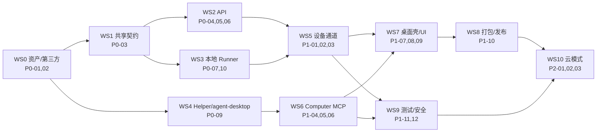

# LinkSense 桌面端双模式任务拆解

日期：2026-11-16。依据：[桌面端双模式方案 v2](../research/linksense-desktop-dual-mode-plan-2026-11-16.md)。

范围与前提：

- 仓库形态：当前 monorepo 新增 `apps/desktop`（Electron）与 `apps/desktop-helper`（Go module），**不新开项目**；桌面契约放 `packages/shared/src/desktop/`。
- 桌面壳 **Electron**；本地电脑 **只做 macOS**；云电脑 **只复用现有 Linux Docker runner**。
- 不做 Windows（本地/云端）、不做 WebRTC/PIP 可视化云桌面、不做混合模式。
- 本地 computer use 使用 **`agent-desktop`（vercel-labs，Apache-2.0）** + 现有 Go helper 封装。
- 估时为**理想开发日**，按 1 名熟悉仓库的工程师计；并行安排见 §6。

---

## 1. 工作流与依赖

关键路径：**P0-01/P0-02 → P0-03 → P0-04/05 → P0-10 → P1-02/03 → P1-05 → P1-08 → P1-11 → P1-10**。

可并行的三条主线：

1. **Go/agent-desktop**：P0-02、P0-09、P1-05、P1-06。
2. **API/传输**：P0-03、P0-04、P0-05、P0-06、P1-01、P1-02、P1-03。
3. **Electron/UI**：P0-08、P0-10、P1-07、P1-08、P1-09、P1-10。

---

## 2. Phase 0：基础与资产（约 15–20 人日）

| ID | 任务 | 产出/落点 | 依赖 | 验收 | 估时 |
| --- | --- | --- | --- | --- | --- |
| P0-01 | `agent-desktop` 版本/许可/校验 | `third_party/agent-desktop/`（或 `deploy/desktop/agent-desktop/`）manifest；`THIRD-PARTY-NOTICES` 更新 | 无 | 固定版本（1.0.2 或 1.3.1）；sha256 记录；Apache-2.0 LICENSE/NOTICE 随包；macOS `snapshot`/`click`/`type` 冒烟通过；不自动下载未校验 binary | 2 |
| P0-02 | 纳入 Go helper 源码 | `apps/desktop-helper/`（Go module、构建脚本、README） | 无 | `go test ./...` 通过；可构建 arm64；现有 pair/socket 流程可用 mock API 跑通；与 `outputs/desktop` 原型的差异有记录 | 3 |
| P0-03 | 共享契约 | `packages/shared/src/computer-use.ts`、`desktop-device.ts`、`events.ts`、`locales/*` | 无 | Zod schema + 派生类型；设备帧/工具/事件/错误 code 单测；六语言 key 占位 | 2 |
| P0-04 | Prisma 模型与迁移 | `prisma/schema.prisma` + 新 forward migration | P0-03 | `prisma validate`；新库/测试库迁移成功；无破坏性变更；`Conversation` 新字段默认 cloud | 1.5 |
| P0-05 | 设备配对 + WS 骨架 | `apps/api/src/modules/desktop-devices/*` | P0-03/04 | 配对码一次性、TTL、限速；device token 只存哈希；WS 认证/心跳/撤销；Fastify inject 测试 | 3 |
| P0-06 | 会话 `executionTarget` | `apps/api/src/modules/conversations/*` | P0-04 | 创建/读取 local/cloud；local 必须绑定已配对设备；默认 cloud；旧会话不受影响；测试 | 1.5 |
| P0-07 | 本地 runner standalone 验证 | 运行手册 + `apps/runner/src/config.ts` 必要调整 | 无 | macOS 上 standalone + `local-process` 可完成一轮 Codex 对话；工作区/事件/Core MCP 正常；记录 env/端口/清理 | 2 |
| P0-08 | Electron 空壳 | `apps/desktop/`（main/preload/renderer/构建配置） | 无 | 能加载 `apps/web` 构建；`contextIsolation/sandbox` 开启；可启动/停止本地 runner；无 Node 暴露 | 3 |
| P0-09 | Helper ↔ agent-desktop 冒烟 | `apps/desktop-helper` 的 adapter + 本地测试 | P0-01/02 | 获取 snapshot + ref；click/type 生效；暂停后不再输入；权限缺失返回稳定 code | 3 |
| P0-10 | 设备桥骨架 | `apps/desktop/src/main/device-bridge.ts` | P0-05/07/08 | 本地 runner 的 `LINKSENSE_API_INTERNAL_URL` 指向桥；命令/事件经 mock WS 往返；重连幂等 | 3 |

**Phase 0 出口标准**：能在开发机上用 mock/本地 API 完成“设备配对 → 通过 WS 启动本地 Codex 回合 → 事件回传 → UI 看到流”；`agent-desktop` 的 snapshot/act 可被 helper 调用。

---

## 3. Phase 1：本地电脑模式 MVP（约 30–35 人日）

### 3.1 API / 设备通道

| ID | 任务 | 产出/落点 | 依赖 | 验收 | 估时 |
| --- | --- | --- | --- | --- | --- |
| P1-01 | 设备管理正式化 | `desktop-devices` service/routes；设备列表、重命名、撤销、在线状态 | P0-05 | 撤销立即断 WS、token 失效；跨 owner 拒绝；审计记录；测试 | 2 |
| P1-02 | `RunnerTransport` 抽象 | `apps/api/src/adapters/runner.ts` + `desktop-device-transport.ts` | P0-06/10 | cloud 走 HTTP、local 走 WS；超时/断线映射到现有错误；`turns/start` 幂等；测试 | 3 |
| P1-03 | 设备桥生产化 | `apps/desktop/src/main/device-bridge.ts` | P0-10 | 白名单路径；命令 TTL/取消；事件批量/去重；文件/工件上传；断线重连；日志脱敏 | 4 |
| P1-04 | 本地会话与权限 API | `apps/api/src/modules/local-computer/*`（或并入 conversations） | P1-01/02 | 启动/停止/状态；grant 创建/撤销；过期；owner/conversation 校验；测试 | 2.5 |

### 3.2 Runner / Computer Use

| ID | 任务 | 产出/落点 | 依赖 | 验收 | 估时 |
| --- | --- | --- | --- | --- | --- |
| P1-05 | `computer_use` Core MCP 模块 | `apps/runner/src/mcp/core-services/computer-use-service.ts`；注册 `core-service-registry.ts` | P0-03 | `computer_status/observe/act`；Plan 模式只读；fake helper 单测；超时/取消 | 3 |
| P1-06 | Helper 本地 RPC + adapter | `apps/desktop-helper`：status/observe/act/pause/stop/permissions | P0-09 | action allowlist；ref 校验；截图/树裁剪；JSON 错误归一；Go 测试 | 5 |
| P1-07 | 权限、任务授权、暂停/停止 | helper + API + 事件 | P1-04/06 | 5 分钟 grant；续期；暂停立即停止输入；停止撤销；拒绝路径；审计 | 3 |
| P1-08 | 桌面操作安全边界 | helper + runner | P1-06/07 | 禁止任意 `--arg/--env/--cdp`；launch 白名单；不记录键入/截图；危险动作二次确认 | 2 |

### 3.3 Electron / UI

| ID | 任务 | 产出/落点 | 依赖 | 验收 | 估时 |
| --- | --- | --- | --- | --- | --- |
| P1-09 | Electron 主进程/预加载 | `apps/desktop/src/main/*`、`preload/*` | P0-08 | 单实例、托盘、深链登录、runner/helper supervisor、orphan guard、崩溃日志；preload 最小面 | 4 |
| P1-10 | 桌面 UI 集成 | `apps/web/src/features/*` + desktop-only 入口 | P1-02/04 | 目标选择器（本地/云）；设备设置/配对；本地状态卡；权限卡片；审计页；复用现有组件 | 5 |
| P1-11 | macOS 权限引导 | desktop UI + helper | P1-06 | Accessibility/Screen Recording 检测；系统设置深链；拒绝/重试；不崩溃 | 2 |
| P1-12 | 打包/签名/公证/更新 | `deploy/desktop/*`、electron-builder 配置 | P1-09/10 | arm64 安装包；签名/公证；helper/agent-desktop 资源与许可；自动更新渠道；干净 Mac 冒烟 | 4 |

### 3.4 测试 / 发布

| ID | 任务 | 产出/落点 | 依赖 | 验收 | 估时 |
| --- | --- | --- | --- | --- | --- |
| P1-13 | 本地 E2E | Playwright Electron + 测试 workspace | P1-09/10/11 | 创建 local 会话→读/写/Shell/浏览器→observe/act→暂停/恢复→断线重连→撤销；截图/日志无敏感内容 | 4 |
| P1-14 | 安全测试 | API/helper/协议 | P1-01/03/08 | 未授权设备、伪造 token、重放命令、跨会话、路径遍历、权限绕过、撤销后重试 | 3 |
| P1-15 | i18n 六语言 | `packages/shared/src/locales`、web locales | P0-03/10 | 所有新文案六语言；key 覆盖测试；插值一致；无英文占位 | 1.5 |
| P1-16 | 文档与运行手册 | `docs/development/desktop-*` | 全部 | 开发/构建/配对/权限/故障排查/回滚 | 1.5 |

**Phase 1 出口标准**：macOS 安装包可在干净机器配对；本地电脑模式完成“文件 + Shell + 浏览器 + 桌面 GUI”闭环；权限/暂停/撤销/审计可用；六语言完整。

---

## 4. Phase 2：云模式（复用 Docker，约 5–7 人日）

| ID | 任务 | 产出/落点 | 依赖 | 验收 | 估时 |
| --- | --- | --- | --- | --- | --- |
| P2-01 | 云目标路由 | API + web/desktop UI | P1-02/10 | `executionTarget=cloud` 走现有 `RunnerClient`；local 设备不参与；默认 cloud | 1.5 |
| P2-02 | 桌面端云模式对齐 | `apps/desktop` + web | P2-01 | 会话/SSE/工件/浏览器面板与 Web 一致；断线重连；worker 回收 | 2 |
| P2-03 | 云模式回归 | 测试 + 部署 | P2-02 | Docker runner 现有测试全绿；`pnpm test` 受影响包；无 Windows 依赖 | 2 |
| P2-04 | 功能开关/灰度 | API + UI | P2-03 | `desktop.localComputer`、`desktop.cloudTarget` 开关；不可用提示；遥测 | 1.5 |

**Phase 2 出口标准**：桌面端可在同一 UI 切换本地/云目标；云模式完全复用现有 Docker runner，无新增云桌面基础设施。

---

## 5. 跨任务测试矩阵

| 层级 | 范围 | 工具/命令 | 必须覆盖 |
| --- | --- | --- | --- |
| 单元 | shared schema、权限、命令白名单、transport 路由 | `pnpm --filter @linksense/shared test`、runner/api Vitest | 正常/边界/空值/非法输入 |
| API | 配对、设备 WS、会话目标、本地会话/权限 | Fastify inject + Vitest | 未认证、越权、撤销、过期、并发 |
| Runner | `computer_use` 模块、helper client | Vitest + fake helper | 超时、取消、Plan 只读、错误归一 |
| Helper | pair/socket、agent-desktop adapter、grant | `go test ./...` | 权限拒绝、ref 失效、暂停、停止 |
| Desktop E2E | Electron 本地模式 | Playwright `_electron` | 配对→会话→工具→GUI→暂停→重连→撤销 |
| 云模式 | Docker runner 回归 | 现有 runner 测试 + 冒烟 | 文件/Shell/浏览器/SSE/回收 |
| 安全 | 设备/命令/权限/路径 | 专用测试 | 伪造、重放、越权、路径遍历、日志脱敏 |
| i18n | 六语言 | web i18n tests + shared key test | key 覆盖、插值、fallback |

Definition of Done（每个任务）：

- 代码 + 测试 + 类型检查 + lint 通过；
- 新用户可见文案六语言；
- 不新增 `any`、不跳过测试、不降低覆盖率；
- 不在日志/事件/测试快照中写入截图、键入内容、token、设备密钥；
- 相关文档/运行手册更新。

---

## 6. 排期建议（2 人并行）

| 周 | 开发 A（API/传输） | 开发 B（Helper/Electron） |
| --- | --- | --- |
| 1 | P0-03、P0-04、P0-05 | P0-01、P0-02、P0-09 |
| 2 | P0-06、P1-01、P1-02 | P0-07、P0-08、P0-10 |
| 3 | P1-03、P1-04 | P1-05、P1-06 |
| 4 | P1-07、P1-09（协同） | P1-09、P1-10 |
| 5 | P1-10、P1-13 | P1-11、P1-12 |
| 6 | P1-13、P1-14、P1-15 | P1-14、P1-16、P2-01 |
| 7 | P2-02、P2-03、P2-04 | 回归/发布/G A 准备 |

> 若只有 1 人：按依赖顺序串行，约 7–9 周；Phase 2 可压缩到 3–4 天。

---

## 7. 风险与前置决策

| 风险/决策 | 影响 | 处理 |
| --- | --- | --- |
| `agent-desktop` 1.0.2 vs 1.3.1 | 兼容/安全 | P0-01 先升级回归；不通过则固定 1.0.2 并记录 CVE/差异 |
| Go helper 源码导入成本 | 进度 | P0-02 先跑通构建；若依赖 mygo 版本冲突，锁定 go.mod |
| macOS TCC 权限不可自动化 | 首次体验 | P1-11 做向导/深链；E2E 用已授权 runner 或 mock |
| 本地 runner 与 Electron 生命周期 | 稳定性 | P1-09 supervisor + orphan guard；异常退出可重启 |
| 设备通道命令不确定 | 重复执行 | P1-02/P1-03 用 commandId + 不重发；UI 显示 uncertain |
| 云模式被误解为“可视化云电脑” | 预期 | UI 明确“云电脑=文件/Shell/浏览器”；不做 Windows/PIP |
| 六语言遗漏 | 发布阻塞 | P1-15 纳入 CI key 检查 |

---

## 8. 交付物清单

- `apps/desktop`（Electron）源码、构建与签名配置；
- `apps/desktop-helper`（Go）源码、agent-desktop 资源与许可；
- `packages/shared` 新契约与六语言资源；
- `apps/api` 设备/本地会话/权限模块与迁移；
- `apps/runner` `computer_use` Core MCP 模块；
- `apps/web` 桌面入口/目标选择/设备/权限 UI；
- `deploy/desktop` 打包/公证/更新脚本；
- 测试：单元/集成/E2E/安全/i18n；
- 文档：运行手册、故障排查、回滚、第三方许可。
