# LinkSense 桌面端双模式任务拆解

日期：2026-11-16，2026-11-18 修订。依据：[桌面端双模式方案 v2](../research/linksense-desktop-dual-mode-plan-2026-11-16.md)。

> 2026-11-17 修订：壳改为 Go + mygo；按"完整桌面客户端"重排任务，新增主窗口 webview、桌面宿主适配层、本地 runner supervisor；computer use 按已有初稿扩展而非重写。
>
> 2026-11-17 安全边界及复审修订：新增 `desktop` provider、独立严格设备契约及用途凭据（P1-24）、文件链路（P1-25）、GUI 设备租约（P1-26）、协议兼容（P1-27）、GUI 授权（P1-28）与 Core MCP 受限回调（P1-29）。命令与文件审批分别校验；E2E、安全、Windows 权限/发布、手册分为 M1 与 GUI 增量。合计 130 人日，理想开发约 13 周，排期预留 14 周。
>
> 2026-11-17 复审补齐：设备通道以真实 Codex 回合验收（P1-01/24/02/03/04 后的通道门槛），回显桩不算通过；更新与进行中回合互斥（P1-22）；本地工作区保留期与清理（P0-07、P1-10）。均为既有任务内的验收补充，不改动估时。
>
> 2026-11-18：本轮仅推进 macOS 的 Phase 0、M1、M1b 与 Phase 2。Windows 专属任务及跨平台项中的 Windows 验收留待后续。

范围与前提：

- 桌面壳：**Go + mygo**（`github.com/egoist/mygo` v0.10.0，MIT；Go 1.27.3）；外壳单二进制、无 Electron/Node 运行时；本地执行运行时（Node + `apps/runner` + Codex）随安装包分发。
- 目标是**完整桌面客户端**，不是只做 computer use 的伴随程序：主窗口 = mygo webview 承载 `apps/web` 全量 UI；Go 侧提供窗口/托盘/深链/更新/本地 runner 监督/设备桥/computer-use 引擎。
- 开发基线是当前 `feat`。`feat-computer-use` 分支的 `apps/desktop` 只作 **computer use 参考实现**（配对、设备 WS、`agent-desktop` 引擎、原生伴随窗口、六语言、打包脚本），不整分支合并、不 cherry-pick；需要的部分按当前主线结构重写/摘取并记录参考 commit。
- 仓库形态：当前 monorepo；`apps/desktop` 是 **Go module**（不进 pnpm workspace，由 `scripts/desktop.mjs` 构建）；桌面契约放 `packages/shared`；不建 `apps/desktop-helper`（引擎与应用同进程）。
- 本地电脑 **macOS + Windows**；云电脑 **只复用现有 Linux Docker runner**；不做 Windows 云电脑/VM、Linux 客户端、WebRTC/PIP 可视化云桌面、混合模式。
- 本地 computer use 使用 **`agent-desktop`（vercel-labs，Apache-2.0）**。
- 估时为**理想开发日**，按 1 名熟悉仓库的工程师计；并行安排见 §7。

---

## 1. 基线盘点：初稿里已有什么

| 能力 | 参考实现（`feat-computer-use:apps/desktop`） | 本期 |
| --- | --- | --- |
| 设备配对 | 配对码 UI、`api/v1/computer-use/pair`、单次码 2 分钟 | 复用，接入设备网关与设备列表 |
| 设备通道 | WS `/socket`，`desktopBridge`/`desktopCommand`/`desktopRequest` | 复用，补命令白名单/TTL/幂等/重连 |
| computer use | `engine.go` 调 `agent-desktop`、错误归一、5 分钟任务授权、暂停 | 复用，加 loopback RPC 供本地 runner 调用 |
| 原生 UI | 480×570 伴随窗口（配对/状态/权限/暂停），mygo `ui` | 保留为伴随窗口 |
| 主窗口 | 无（不承载网站） | **新增**：webview 加载 `apps/web` 构建 |
| 本地 runner | 无 | **新增**：supervisor + loopback 转发 |
| 产品 UI 集成 | 无 | **新增**：Web 侧桌面宿主适配层 + 目标/设备/权限面板 |
| 打包 | `scripts/desktop.mjs`、`mygo.json`、`.app`/DMG/zip、legal | 复用，补 Developer ID 签名/公证/更新 |
| Windows 构建 | `mygo.json` Windows 目标、`process_windows.go`、x64/arm64 安装器产物 | 复用，补 Authenticode、WebView2 检测、UIA 回归 |
| Browser Use | 现有 Chrome/Edge 扩展、`browser_use` 工具链、配对/授权/撤销 | 复用；桌面端补状态、引导与配对入口 |
| 壳能力 | mygo v0.10.0：webview/native、类型化 IPC、菜单/托盘/深链、Secrets、打包/签名/更新、权限引导 | 直接使用；用法见方案 §5.9/§5.10/§7.2 |
| 测试 | Go 单测 + 原生白盒（真实窗口/AX）+ 打包引擎测试 | 复用，补浏览器侧 E2E、Windows 白盒与桌面冒烟 |

**结论**：初稿解决了"设备 + computer use"；本期主要新增"完整客户端壳 + 本地 runner + 产品 UI 接入"。

---

## 2. 工作流与依赖

```mermaid
flowchart LR
    WS0["WS0 参考实现/资产<br/>P0-01,02"] --> WS1["WS1 共享契约<br/>P0-03"]
    WS1 --> WS2["WS2 API<br/>P0-04,05,06"]
    WS0 --> WS3["WS3 桌面壳<br/>P0-08,09,10"]
    WS3 --> WS4["WS4 本地运行时<br/>P0-07,11"]
    WS2 --> WS11["WS11 设备凭据<br/>P1-24"]
    WS11 --> WS5["WS5 设备通道/审批<br/>P1-02,03,04,07"]
    WS4 --> WS5
    WS2 --> Devices["设备管理<br/>P1-01"] --> WS11
    WS5 --> Tools["受限工具回调<br/>P1-29"]
    Tools --> WS12["WS12 文件链路/协议版本<br/>P1-25,27"]
    WS5 --> WS7["WS7 M1 产品 UI<br/>P1-09,10,21"]
    WS12 --> WS7
    WS7 --> WS8["WS8 macOS 打包/更新<br/>P1-12,22"]
    WS8 --> WS9["WS9 M1 E2E/安全/文档<br/>P1-13a,14a,15,16a"]
    WS7 --> WS9 --> M1["macOS M1 发布"]
    M1 --> WS6["WS6 GUI（M1b）<br/>P1-05,06,08,11,23,26,28"]
    WS6 --> GuiChecks["macOS GUI 增量验收<br/>P1-13b,14b,16b"]
    GuiChecks --> M1b["macOS M1b 发布"]
    WS7 --> WS10["WS10 云模式回归<br/>P2-01..04"]
    WS6 --> Browser["内置浏览器<br/>P2-05..07"]
```

macOS M1 主要依赖链：Phase 0 出口 → P1-01 → P1-24 → P1-02/03/04 → P1-29 → P1-25 → P1-10 → P1-12 → P1-22 → P1-13a/14a → P1-16a。审批（P1-07）和协议兼容（P1-27）也必须在产品 UI 验收前完成。

Windows 专属任务 P1-17/18/19a/19b/20a/20b 不属于本轮前置。进入 Windows 实施时再恢复对应依赖。M1 的依赖闭包不能包含 GUI 任务。

可并行的三条主线：

1. **Go/桌面壳**：P0-01、P0-08、P0-09、P0-10、P0-11、P1-09、P1-12。
2. **API/传输**：P0-03、P0-04、P0-05、P0-06、P1-24、P1-01、P1-02、P1-03、P1-04、P1-25、P1-27、P1-29；P1-26 在 M1b 接入 GUI 执行器。
3. **Web/UI**：P0-09、P1-10、P1-15。

---

## 3. Phase 0：基线与壳（约 30 人日）

| ID | 任务 | 产出/落点 | 依赖 | 验收 | 估时 |
| --- | --- | --- | --- | --- | --- |
| P0-01 | 新建 Go 模块并参考旧实现 | 在当前 `feat` 新建 `apps/desktop`（Go module）、`scripts/desktop.mjs`、licenses；按需摘取配对/设备 WS/引擎/打包代码并重写 | 无 | `go test ./...` 通过；`pnpm desktop:test` 通过；构建出 `.app` 与 Windows 安装器；记录参考 commit 与摘取范围 | 2 |
| P0-02 | `agent-desktop` 升级/许可/校验 | 使用最新版（当前 1.3.1）；manifest + sha256；`THIRD-PARTY-NOTICES` | 无 | 升级后 macOS AX / Windows UIA 各自 `snapshot`/`click`/`type` 冒烟；下载/内置 binary 校验；不自动下载未校验 binary | 2 |
| P0-03 | 共享契约 | `packages/shared/src/computer-use.ts`、`desktop-device.ts`、事件、错误码、六语言 key | 无 | Zod schema + 派生类型；单测；六语言 key 占位 | 2 |
| P0-04 | Prisma 模型与迁移 | `prisma/schema.prisma` + forward migration | P0-03 | `prisma validate`；新库迁移成功；`Conversation` 新字段默认 cloud；无破坏性变更 | 1.5 |
| P0-05 | 设备配对 + WS 骨架 | `apps/api/src/modules/desktop-devices/*` | P0-03/04 | 配对码一次性/TTL/限速；token 只存哈希；WS 认证/心跳/撤销；Fastify inject 测试 | 3 |
| P0-06 | 会话 `executionTarget` | `apps/api/src/modules/conversations/*` | P0-04 | 创建/读取 local/cloud；local 必须绑定已配对设备；默认 cloud；旧会话不受影响 | 1.5 |
| P0-07 | `desktop` worker provider 最小实现（双平台） | `apps/runner/src/controller/desktop-worker-provider.ts` + `config.ts` 新增枚举；不复用 development-only 的 `local-process` | P0-01 | 测试专用入口 + fake model 验证 Codex 启动、临时工作区、Core MCP 装载与退出；macOS/Windows 当前用户运行；确认 Windows 原生/WSL2 路径；工作区按会话隔离，启动时清理超过 14 天或总量超 10 GiB 的最旧会话；不接生产内部接口或下发平台密钥；runner 相关测试通过 | 4 |
| P0-08 | 主窗口 webview | `apps/desktop/web.go`：加载 `apps/web` 构建、系统浏览器登录、单实例、窗口状态、外部链接策略 | P0-01 | 服务地址打包注入、首启无 URL 表单；复用浏览器 session，经 state/PKCE 一次性授权码交接；主窗口显示完整 Web UI；刷新/前进后退正常；外链走系统浏览器；无 Node 暴露 | 4 |
| P0-09 | 桌面宿主适配层（Web 侧） | `apps/web` 桌面入口 + mygo typed IPC 客户端；环境检测、登录交接、下载/上传、通知、更新入口 | P0-08 | 纯浏览器行为不变；桌面内可用；类型化调用有测试；失败降级 | 3 |
| P0-10 | 本地 runner supervisor（Go） | `apps/desktop/runtime.go` 扩展：启动/健康检查/退出清理/orphan guard/日志 | P0-01/07 | 应用启动即拉起 runner；崩溃可重启；退出无孤儿进程；日志脱敏 | 3 |
| P0-11 | 独立运行时冒烟 + 云模式贯通 | 随包 Node + `apps/runner` + Codex；`scripts/desktop.mjs` 测试入口 | P0-07/08/09/10 | **干净机器**上安装 → 登录 → 云会话 → SSE → 下载 → 更新检查；独立本地运行时用 fake model 验进程/工作区/退出，不依赖设备执行通道或 `computer_use`；记录体积（预算 150–250 MB） | 4 |

**macOS Phase 0 出口标准**：打包应用在干净 Mac 上跑通壳与云模式（登录/SSE/下载/更新检查），独立本地运行时通过 fake model 冒烟；设备配对/WS 只验注册、心跳和撤销骨架。完整设备回合及受限业务请求在 M1 验收，GUI 在 M1b 验收。本机开发白盒可与独立模块的实现并行；夹具不代替安装验收。

---

## 4. Phase 1：本地电脑模式 MVP（约 82 人日）

> M1：**设备白名单契约/凭据 → 双向受限请求 → 文件链路/原生审批 → 产品 UI → macOS 发布验收**。GUI、桌面占用租约与其测试归 M1b；M1 只依赖回合凭据租约。后缀 a 为 M1，b 为 GUI 增量。

**通道门槛（第 4–5 周末）**：P1-01/24/02/03/04 完成后，用**一次真实 Codex 回合**验收设备通道——读文件 → 执行命令 → 事件回传 → 取消各一次，且设备侧全程无供应商密钥。回显桩、只回状态的假回合不算通过；未过不进入 P1-25/P1-29/P1-10。理由：否则事件排序、去重、取消的缺陷要到文件链路和 UI 集成时才暴露。

### 4.1 API / 设备通道

| ID | 任务 | 产出/落点 | 依赖 | 验收 | 估时 |
| --- | --- | --- | --- | --- | --- |
| P1-01 | 设备管理正式化 | `desktop-devices` service/routes；列表、重命名、撤销、在线状态 | P0-05 | 撤销立即断 WS、token 失效；跨 owner 拒绝；审计；测试 | 2 |
| P1-24 | 严格设备契约与用途凭据 | shared 独立严格设备 schema；`desktop-credentials`、`model-proxy`；保留云端内部契约 | P0-03、P1-01 | 白名单构造设备请求；主模型/记忆提取/模型切换来源均用用途代理 token；未知字段、嵌套内部 provider 拒绝；三条路径抓包/进程检查无真实供应商密钥及内部 secret；过期/撤销生效；云契约回归 | 3 |
| P1-02 | `RunnerTransport` 抽象 | `apps/api/src/adapters/runner.ts` + `desktop-device-transport.ts` | P0-06/10、P1-24 | cloud 走 HTTP、local 走 WS；设备离线→`RUNNER_UNAVAILABLE`、结果不明→`RUNNER_OPERATION_UNCERTAIN` 且不重发；`turns/start` 幂等；按 requestId 去重；设备方向 body 不含平台凭据 | 3 |
| P1-03 | 设备桥生产化（Go） | `apps/desktop/bridge.go` 扩展 | P0-10、P1-24 | 命令 TTL/取消；事件批量/去重；受限请求帧收发；断线重连；日志脱敏；不持有 `/internal` secret | 4 |
| P1-04 | 本地会话与权限 API | `apps/api/src/modules/local-computer/*` | P1-01/02 | 启动/停止/状态；grant 创建/撤销/过期；owner/会话校验 | 2.5 |
| P1-29 | Core MCP 受限请求/响应 | runner `desktop/device-event-sink.ts` + 设备桥 + API 网关操作白名单，见方案 §6.7 | P1-02/03/24 | Browser Use/知识库/网页搜索/连接器实际闭环；逐项覆盖现有必要工具及启动确认/心跳/退出回调；服务端资源权限；关联 ID、超时/取消、迟到响应、断线副作用不重放；不开放任意内部路径，不下发内部 secret | 3 |
| P1-25 | 文件与工件链路 | `modules/files/` 扩展；设备桥上传/下发 | P1-03/29 | 输入附件下发到设备工作区并回 `ready`；本地工件预签名上传 + API 确认后入列表；`workspaceRelativePath` 在 API 侧换成资源 ID；本地绝对路径不进事件/日志/模型上下文 | 4 |
| P1-27 | 桌面协议版本兼容 | API `client-build` 扩展 + Web 宿主适配层 | P0-09 | 桌面上报 `desktopProtocolVersion` + 能力位，API 校验兼容区间；不兼容返回 `DESKTOP_UPDATE_REQUIRED` 并给更新入口；上一版安装包连当前 API 可登录、可开会话；Web 现有构建一致性检查不变 | 2 |
| P1-07 | 命令/文件审批与沙箱分档（M1） | API + runner + 按请求类型的审批卡 | P1-02/04 | 默认 `untrusted` + `workspaceWrite`，显式 `full_access` 才用宽松档；命令按 `CommandExecutionApprovalDecision`、文件按 `FileChangeApprovalDecision`；文件无前缀规则选项且 API/runner 拒绝错类型决策；超时 `cancel`；命令始终授权显式开启、30 天过期、native 撤销后复测；云保持现有策略 | 3 |

### 4.2 Computer use（M1b）

| ID | 任务 | 产出/落点 | 依赖 | 验收 | 估时 |
| --- | --- | --- | --- | --- | --- |
| P1-05 | `computer_use` Core MCP 模块 | `apps/runner/src/mcp/core-services/computer-use-service.ts` + 注册 | P0-03、P1-29 | `computer_status/observe/act`；Plan 只读；fake 引擎单测；超时/取消 | 3 |
| P1-06 | 引擎本地入口（Go） | `apps/desktop` loopback RPC：status/observe/act/pause/resume/stop/permissions | P0-01、P1-24 | 本地 token 校验；action allowlist；ref 校验；截图/树裁剪；JSON 错误归一 | 3 |
| P1-26 | 设备桌面占用租约 | `desktop-devices` + 引擎 | P1-04/06 | 同设备单 GUI 任务；首次 observe 获取、回合结束/暂停/断线/超时/崩溃释放；第二会话 `DEVICE_BUSY`；窗口身份变化 `COMPUTER_TARGET_CHANGED` | 2 |
| P1-08 | 桌面操作安全边界 | 引擎 + runner | P1-06/28 | 禁止任意 `--arg/--env/--cdp`；launch 白名单；不记录键入/截图；危险动作二次确认 | 2 |
| P1-23 | 本地动作执行管道与效果契约 | Go 引擎：`ActionExecutor`、通行证约束、风险分级、`effect`/`wait` 读回、中断语义 | P1-05/08/26/28 | 所有 GUI 动作只能经执行器；风险等级进审批与审计；`no_effect` 不自动重试；等待默认 8s / 上限 20s；崩溃标 `interrupted` 不重放；单测覆盖 | 3 |
| P1-28 | GUI 授权、暂停/停止与审计 | 引擎 + API + 事件 | P1-06/07/26 | 5 分钟 grant；续期；暂停立即停止输入；停止撤销；拒绝路径；审计；撤销后已授权动作失效 | 2 |
| P1-11 | macOS 权限引导 | mygo `plugins/permissionflow` + 主窗口联动，见方案 §7.2 | P1-06/28 | 签名 `.app` 只在用户需要 GUI 时分项引导；确认设置页、跟随面板拖入 LinkSense、手动开关后的引擎权限复查；覆盖已有权限、取消/拒绝、录屏待重启及手动添加 | 2 |

### 4.3 桌面壳 / 产品 UI

| ID | 任务 | 产出/落点 | 依赖 | 验收 | 估时 |
| --- | --- | --- | --- | --- | --- |
| P1-09 | 桌面产品化（Go） | 托盘、菜单、全局快捷键、通知、多窗口、崩溃日志、单实例深链 | P0-08 | 关窗不退出策略可配；托盘菜单齐全；浏览器登录与深链配对可用；六语言 | 3 |
| P1-10 | M1 桌面 UI 集成（Web 侧） | 本地/云目标、设备设置、命令/文件审批、审计页；GUI 卡片由 M1b 补齐 | P1-02/04/07/25/27/29 | 本地/云均可创建会话并确认切换；审批选项按原生类型显示；命令规则可撤销；审计脱敏；设置页显示本地工作区占用并可一键清理；GUI 未启用时不要求其权限 | 5 |
| P1-21 | Browser Use 桌面接入 | 桌面宿主适配层 + 设置页引导 + 状态展示 | P0-09、P1-29 | 桌面内显示扩展状态；系统浏览器完成配对后桌面可见；本地会话经受限回调操作真实标签页；撤销即时；macOS/Windows | 3 |
| P1-22 | 应用内更新 | `mygo.json` 的 `updates`、更新密钥、`mygo build -upload`、更新窗口/横幅、beta 渠道 | P1-12 | macOS 签名更新；delta 命中与失败回退整包；stable/beta 切换；只读安装位置降级；安装暂存前锁定本地任务，重启后不续跑；发布流程文档 | 4 |
| P1-12 | 打包/签名/公证 | `scripts/desktop.mjs`、`mygo.json`、`deploy/desktop/` | P1-09/10 | arm64 `.app`/DMG；Developer ID + 公证；运行时/legal 随包；干净 Mac 冒烟；产物供 P1-22 验证更新，不以更新 UI 为本任务前置 | 4 |

### 4.4 测试 / 发布

| ID | 任务 | 产出/落点 | 依赖 | 验收 | 估时 |
| --- | --- | --- | --- | --- | --- |
| P1-13a | M1 本地 E2E | Web UI E2E + macOS 打包应用冒烟 | P1-10/21/22/25/27/29 | 登录→配对→真实 local 回合→读/写/Shell/扩展浏览器/知识库/连接器→断线重连→撤销；旧安装包连新 API；不依赖 GUI | 3 |
| P1-13b | GUI 增量 E2E | Go 白盒 + macOS 打包冒烟 | P1-13a/11/23 | observe/act→效果/等待→暂停/恢复→崩溃中断不续跑→撤销 | 1 |
| P1-14a | M1 安全测试 | API/runner/设备协议 | P1-07/24/25/27/29 | 伪造/过期/撤销凭据、跨会话、受限工具越权、路径遍历、嵌套密钥泄露、错类型审批、默认档直调 AppleScript/PowerShell 绕过拦截、云契约回归；不依赖 GUI 执行器 | 2 |
| P1-14b | GUI 增量安全测试 | API/引擎/设备租约 | P1-08/23/26/28 | GUI 授权绕过、同设备并发、窗口变化、暂停/撤销后动作拒绝、断线不续跑 | 1 |
| P1-15 | M1 i18n 六语言 | `packages/shared`、`apps/web`、`apps/desktop/locales` | P0-03/09 | M1 新文案六语言；key 覆盖测试；无英文占位；GUI 文案在各增量任务按 DoD 验收 | 1.5 |
| P1-16a | M1 文档与运行手册 | `docs/development/desktop-*` | P1-13a/14a | 开发/构建/配对/模型及工具代理/文件/命令审批/升级/故障排查/回滚 | 1 |
| P1-16b | GUI 增量手册 | 既有桌面手册补充 | P1-13b/14b | 系统权限、桌面租约、暂停/停止、GUI 故障排查与恢复 | 0.5 |

### 4.5 Windows 本地模式（后续）

| ID | 任务 | 产出/落点 | 依赖 | 验收 | 估时 |
| --- | --- | --- | --- | --- | --- |
| P1-17 | Windows 构建与安装器 | `mygo.json` Windows 目标、安装器脚本、`deploy/desktop/` | P0-01 | x64/arm64 构建；WebView2 检测与引导；安装/卸载/升级；Authenticode 签名 | 3 |
| P1-18 | UIA 引擎回归 | `apps/desktop/engine.go`、`process_windows.go` | P1-06 | UIA snapshot/click/type/scroll；DPI/多显示器；提权窗口返回稳定 code；白盒测试 | 3 |
| P1-19a | Windows M1 权限与沙箱 | runner + API + UI | P1-07/17 | 当前用户文件访问、原生命令/文件审批与沙箱、SmartScreen/WebView2 提示；无 GUI 权限前置 | 1 |
| P1-19b | Windows GUI 安全差异 | 引擎 + API + UI | P1-18/28 | 完整性级别约束；无 TCC 的引导路径；剪贴板/启动白名单 | 0.5 |
| P1-20a | Windows M1 测试与发布 | CI + 安装包 | P1-12/17/19a/22 | Go 测试（arm64 无 `-race`）；干净机器安装/升级/自动更新；文件/Shell/扩展浏览器；不依赖 UIA | 1.5 |
| P1-20b | Windows GUI 增量回归 | 既有安装包 + UIA 白盒 | P1-18/19b/23/20a | GUI 输入、DPI/多显示器、提权拒绝；M1 安装/升级流程继续可用 | 0.5 |

**Phase 1 出口标准**：

- **macOS M1**：安装/升级、会话/工件/浏览器/设置、本地文件/Shell/扩展浏览器及知识库/连接器调用均可用；严格设备凭据、受限工具请求、文件链路、分类型审批、协议兼容、六语言全部验收。P1-13a/14a/16a 交付；GUI 不启用、不索取其系统权限。
- **macOS M1b（不阻塞 M1）**：完成 GUI 操作与设备桌面占用租约闭环，P1-13b/14b/16b 作为增量交付，M1 功能继续可用。

---

## 5. Phase 2：云模式与内置浏览器（约 18 人日）

| ID | 任务 | 产出/落点 | 依赖 | 验收 | 估时 |
| --- | --- | --- | --- | --- | --- |
| P2-01 | 云目标路由回归 | API + Web/桌面 UI | P1-02/10/27 | 回归 M1 已提供的双目标与确认切换；cloud 走现有 `RunnerClient`、本地设备不参与；默认 cloud | 1.5 |
| P2-02 | 桌面端云模式对齐 | `apps/desktop` + `apps/web` | P2-01 | 会话/SSE/工件/浏览器面板与 Web 一致；断线重连；worker 回收 | 2 |
| P2-03 | 云模式回归 | 测试 + 部署 | P2-02 | Docker runner 现有测试全绿；`pnpm test` 受影响包；无 Windows 依赖 | 2 |
| P2-04 | 功能开关/灰度 | API + UI | P2-03 | `desktop.localComputer`、`desktop.cloudTarget` 开关；不可用提示；遥测 | 1.5 |
| P2-05 | 内置浏览器窗口（Go） | `apps/desktop/browser.go`：原生窗口 + webview、工具条/标签/下载/页内查找、`NewSession` 隔离 | P0-08 | 多标签/前进后退/刷新/下载确认/查找；独立 cookie；外部协议交系统；macOS/Windows | 4 |
| P2-06 | 内置浏览器 Agent 适配 | `assets/browser-agent.js`（DOM 快照/ref/点击/输入/等待）+ loopback RPC + `browserTarget` 路由 | P1-06/23、P2-05 | navigate/read/click/type/scroll/screenshot/wait；稳定 ref；JS 失败回落坐标点击；不支持项稳定错误码 | 5 |
| P2-07 | 内置浏览器安全与交接 | 隔离会话、下载/外链策略、登录/验证码交接、审计 | P2-05/06 | 第三方页 `Untrusted`；`file://` 拦截；下载确认；登录交给用户；审计不含正文/键入 | 2 |

**Phase 2 出口标准**：M1 双目标与桌面/Web 行为一致性回归通过；云模式完全复用现有 Docker runner，无新增云桌面基础设施；内置浏览器可独立使用并接受 Agent 操作，扩展仍是默认浏览器。

---

## 6. 跨任务测试矩阵

| 层级 | 范围 | 工具/命令 | 必须覆盖 |
| --- | --- | --- | --- |
| 单元 | shared schema、权限、命令白名单、审批决策映射、效果/风险分级、transport 路由 | `pnpm --filter @linksense/shared test`、runner/api Vitest | 正常/边界/空值/非法输入 |
| API | 配对、设备 WS、会话目标、本地会话/权限 | Fastify inject + Vitest | 未认证、越权、撤销、过期、并发 |
| Runner | `computer_use` 模块、引擎客户端 | Vitest + fake 引擎 | 超时、取消、Plan 只读、错误归一、`effect`/`wait` 语义 |
| 桌面（Go） | 配对、设备桥、引擎 adapter、执行器、supervisor | `go test ./...`、`pnpm desktop:test` | 权限拒绝、ref 失效、暂停、停止、孤儿进程、中断不重放 |
| 桌面（原生白盒） | 真实窗口 AX/截图 | `LINKSENSE_DESKTOP_NATIVE_WHITEBOX=1 go test` | 快照、点击、输入、滚动的真实效果 |
| Windows | 构建、UIA、安装器、更新 | Windows runner 上 `go test`/`pnpm desktop:test` + 安装器冒烟 | 签名、WebView2、升级、完整性级别 |
| Browser Use | 扩展状态、配对引导、工具路由 | 现有 Web/API 测试 + 桌面冒烟 | 未安装、未连接、撤销、跨任务 tab、重连 |
| 更新 | 签名、manifest、delta、回退、渠道 | 打包冒烟 + 本地 HTTPS 源 | 篡改签名、降级、断网、delta 失败回退整包 |
| 产品 UI | Web UI（浏览器 + webview） | 现有 Web E2E + 桌面冒烟 | 登录、会话、工件、浏览器面板、目标选择、权限卡片 |
| 内置浏览器 | 导航、DOM 操作、下载、隔离会话 | Go 测试 + 桌面冒烟 + 双平台 | 标签/前进后退/下载/查找；点击/输入/等待；`file://` 拦截；会话隔离 |
| 云模式 | Docker runner 回归 | 现有 runner 测试 + 冒烟 | 文件/Shell/浏览器/SSE/回收 |
| 安全 | 设备/命令/权限/路径 | 专用测试 | 伪造、重放、越权、路径遍历、日志脱敏 |
| 凭据边界 | 严格设备契约、用途代理 token、事件回传 | API Vitest + 抓包/进程检查 | 正常/记忆提取/模型切换均无真实供应商密钥及内部 secret；未知/嵌套字段拒绝；过期/撤销/跨会话拒绝；云契约回归 |
| Core MCP 回调 | P1-29 受限请求/响应 | API + runner/设备桥 + fake service/冒烟 | Browser Use/知识库/网页搜索/连接器；操作白名单及资源权限；请求关联、超时/取消、迟到响应、副作用不重放 |
| 沙箱与审批 | 本地 shell/文件 | runner + 真实 Codex | `untrusted` + `workspaceWrite` 生效；默认档直调 AppleScript/PowerShell 绕过拦截；宽松档显式开启；命令/文件各自 v2 schema，文件无前缀选项且错类型决策拒绝；`cancel` 超时；native 命令规则撤销 |
| 里程碑依赖 | Phase 0 / M1 / M1b | 任务依赖与打包验收清单核对 | Phase 0 不引用 P1/P2 前置；M1 不依赖 GUI；安全/E2E/Windows/手册 a/b 增量分开 |
| 文件链路 | 附件下发、工件上传、路径映射 | API + 设备桥 + 冒烟 | 附件到达设备；工件确认后入列表；本地路径不进事件/日志/模型上下文 |
| 设备租约 | 同设备并发、窗口身份 | Go + API 测试 | 第二会话 `DEVICE_BUSY`；崩溃/断线后释放；`COMPUTER_TARGET_CHANGED` |
| 协议兼容 | 旧安装包 ↔ 新 API | 打包冒烟 | 可登录、可开会话、`DESKTOP_UPDATE_REQUIRED` 可达更新入口；Web 构建检查不变 |
| i18n | 六语言 | Web i18n tests + Go locale catalog | key 覆盖、插值、fallback |

Definition of Done（每个任务）：

- 代码 + 测试 + 类型检查 + lint（Go 为 `go vet`/`gofmt`）通过；
- 新用户可见文案六语言（Web 与 `apps/desktop/locales` 同步）；
- 不新增 `any`、不跳过测试、不降低覆盖率；
- 不在日志/事件/测试快照中写入截图、键入内容、token、设备密钥；
- 相关文档/运行手册更新。

---

## 7. macOS 实施顺序

| 阶段 | 工作 | 验收 |
| --- | --- | --- |
| Phase 0 | P0-01..11 | 以本机白盒验证壳、登录、云模式和独立运行时；干净 Mac 的安装验收单独记录 |
| M1 通道 | P1-01 → P1-24 → P1-02/03/04 | 真实 Codex 回合走设备通道，平台密钥不离开服务端 |
| M1 产品 | P1-07/27/29 → P1-25/21/10 → P1-12/22 → P1-13a/14a/15/16a | 文件、审批、连接器、签名安装与更新贯通 |
| M1b | P1-05/06/08/11/23/26/28 → P1-13b/14b/16b | GUI 工具、按需系统权限、暂停/停止与审计 |
| Phase 2 | P2-01..07 | 回归云模式；内置浏览器隔离、导航、下载与交接 |

---

## 8. 风险与前置决策

| 风险/决策 | 影响 | 处理 |
| --- | --- | --- |
| 参考实现照搬 | 带入旧结构 | 只作参考；P0-01 按当前主线重写并记录参考 commit，跑通 `go test` 再扩展 |
| `agent-desktop` 升级（1.0.2 → 最新 1.3.1） | 兼容/安全 | P0-02 升级并回归；不通过先修适配，确需回退须单独确认并记录原因 |
| mygo 升级 | 壳、WebView 桥接及打包兼容 | Go 与 Web 桥接版本同步，回归登录、系统凭据库、SSE、下载、更新与打包 |
| Go 1.27.3 工具链 | 构建 | `go.mod` 已声明；本机 1.23+ 自动下载；CI 固定 `GOTOOLCHAIN` |
| webview 内容安全 | 注入/外链 | 内容按不可信；content rules 限制导航/新窗口；只暴露显式 IPC |
| macOS TCC 权限由用户授予 | GUI 首次使用 | P1-11 验收系统设置拖拽与手动开启；自动白盒覆盖状态处理，不替用户切换系统开关 |
| Windows 本地 runner | Codex 运行方式 | P0-07 验证原生或 WSL2；不支持原生则明确要求 WSL2 |
| Windows 签名/SmartScreen | 分发 | Authenticode + 安装器；未签名先内部渠道 |
| UIA 与 AX 行为差异 | 兼容 | 平台分支动作映射；不支持的能力返回稳定 code |
| WebView2 缺失 | 启动 | 检测 + bootstrapper + 引导 |
| webview UA 非 Chrome/Edge | 扩展检测误判 | 桌面引导替代 UA 检测；复用现有连接状态接口 |
| 更新密钥丢失 | 已安装用户无法更新 | 离线备份 + CI secrets；轮换流程 |
| GitHub 源限流（60 次/小时/地址） | 检查更新失败 | 自托管 `url` 为主源，GitHub 备用 |
| 安装位置不可写 | 自更新禁用 | `Enabled()` 检查 + 降级下载链接 |
| 本地 runner 与桌面应用生命周期 | 稳定性 | P0-10 supervisor + orphan guard；异常退出可重启 |
| `local-process` 不适用于生产/Windows | 本地模式跑不起来 | P0-07 新增 `desktop` provider；不复用仅 development 的 provider |
| 平台密钥下发到用户机器 | 凭据泄露 | P1-24 独立严格契约；主模型/记忆/切换来源均走用途代理；三路径抓包验收 |
| 全局内部 secret 下发 | 内部 API 暴露 | P1-24/29；设备事件与工具回调走受限通道 |
| Core MCP 回调遗漏 | M1 浏览器/知识库/连接器失效 | P1-29 按 RunnerEventSink 调用方逐项登记与验收 |
| 只改审批不改沙箱 | 无实际拦截 | P1-07 沙箱与审批分档；`untrusted` + `workspaceWrite` 为本地默认 |
| 内嵌资源被 build ID 锁死 | 旧客户端无法升级 | P1-27 协议版本与 Web build ID 解耦 |
| 本地工件无法注册 | 文件功能不可用 | P1-25 附件下发 + 工件上传确认 + 路径映射 |
| 同设备多会话抢焦点 | 操作错对象 | P1-26 设备任务租约 + 窗口身份校验 |
| 设备通道命令不确定 | 重复执行 | P1-02/03 用 commandId + 不重发；UI 显示 uncertain |
| 云模式被误解为"可视化云电脑" | 预期 | UI 明确"云电脑=文件/Shell/浏览器"；不做 Windows 云电脑/PIP |
| 六语言遗漏 | 发布阻塞 | P1-15 纳入 CI key 检查 |

---

## 9. 交付物清单

- `apps/desktop`（Go + mygo）源码：主窗口 webview、伴随窗口、设备桥、引擎、supervisor、构建配置；
- Windows 安装器（x64/arm64）与 Authenticode 配置；
- Browser Use 桌面接入：状态、引导、系统浏览器配对入口；
- 应用内更新：更新密钥管理、签名 manifest、delta、stable/beta 渠道、发布流程；
- `scripts/desktop.mjs` 构建/准备/测试脚本与 `deploy/desktop` 签名/公证/更新；
- `agent-desktop` 资源与第三方许可；
- `packages/shared` 新契约与六语言资源；
- `apps/api` 设备/本地会话/权限模块与迁移；设备凭据（run lease）与模型代理；文件链路扩展；
- `apps/runner` `desktop` worker provider、设备回调适配器与 `computer_use` Core MCP 模块；随包 Node 运行时与构建产物；
- `apps/web` 桌面宿主适配层、目标选择/设备/权限 UI；
- 测试：单元/集成/Go 白盒/产品 UI/安全/i18n；
- 文档：运行手册、故障排查、回滚、第三方许可。

## 10. 实施记录（2026-11-17）

Phase 0 正在实现，设备基础与会话目标按已验证的子任务分批提交；尚未满足整个阶段的出口。操作入口见 [`apps/desktop/README.md`](../../apps/desktop/README.md)。

- P0-01/08/09：已新增 Go/mygo 模块、共享 Web 构建内嵌、类型化 IPC、原生 API/SSE 传输、系统凭据库中的刷新凭据、内存 access token、退出清理、外链与连接器 OAuth 宿主适配。首启服务地址现由打包注入；登录交接见方案 §5.7。API/Auth 100 项（含真实 Redis 并发兑换）、Web 定向 61 项、共享契约 2 项、构建/资源 9 项及 Go race/vet 通过。真实浏览器运行编译后的 React 页面并与 WKWebView 联测，两次交接只输入一次密码，深链通过测试夹具投递。macOS ARM64 示例包已重新打包并确认编译地址、Info.plist URL scheme、ad hoc 签名验证和包内 Codex/Core MCP 冒烟。仍须实测安装后的系统深链唤起、系统凭据库及真实企业/社交身份源；本次未发布安装包。
- 协议兼容已前移部分 P1-27：桌面上报独立协议版本；浏览器保留原 build ID 检查；另用保留 build ID 让前桌面版本的生产 API 在业务副作用前拒绝桌面请求。保留值已通过 API、Web 定向及原生回归；正式安装包的跨版本兼容矩阵仍属于 P1-27。
- P0-03/04/05：设备严格契约、增量迁移、一次性配对、认证 epoch、Redis 在线租约和跨副本撤销已提交 `b7ab4ccc`。两轴 code review 后补了并发配对、订阅恢复、延迟替换通知、握手替换竞态和凭据库故障回归，并自主修复发现的问题。
- PostgreSQL 白盒使用独立临时数据库，验证了新库安装、旧会话字段保留及继续读写、并发一次消费、跨 owner 拒绝、撤销与认证 epoch；迁移只应用于该临时数据库，未改开发/生产数据。
- P0-06：创建、列表与投影支持 local/cloud，local 必须绑定同 owner、未撤销且认证 epoch 有效的设备；侧聊继承目标。本地设备通道接通前拒绝 local 的云 Runner 调用、预热、fork 和自动化目标，创建失败会清理本次独占 staging，避免隐式回落云执行。API 全量 5,096 项、共享包 834 项、API 类型/lint/build 和 PostgreSQL 白盒通过；后续新增回归需以对应提交的最终结果为准。
- 桌面宿主最新定向验证：Go race/vet、Web 94 项及 8 项打包/资源检查通过；真实 WKWebView 通过登录、刷新、设备配对/恢复/退出与远程 iframe 隔离。已构建包含固定运行时的 macOS arm64 `.app`/DMG 和 Windows x64/arm64 安装器；Windows 两套成品的外壳/引擎/执行运行时 PE 架构已静态核对。安装器分别为 174.3 MB / 173.5 MB，未在 Windows 上执行；均为开发产物，macOS 使用 ad hoc 签名，未做干净机器验收。
- P0-02/11 运行时分发：已固定 Node 24.22.1、Codex 0.168.0、agent-desktop 1.3.1 的四目标资源、许可、下载及可执行文件哈希。打包 review 发现的 `.pnpm` 遗漏与 anydoc Windows ARM64 缺失绑定已分别通过 portable hoisted 部署、明确的 x64 兼容运行时选择修复；Windows ARM64 外壳及 GUI 引擎仍为原生 ARM64。成品 Mac `.app` 已验证依赖路径在包内，复制到仓库外后用真实 Codex/Core MCP 调目录工具并完成本地模型 fixture 回合、正常退出。体积为 DMG 174.6 MB、展开 app 601.6 MB，展开体积需要继续按方案 §5.2 复核；GUI 权限及双平台真机检查仍未执行。
- Web 最终全量单测 6,210 项通过（应用组 353、其余组 5,857）。Chromium E2E 全量复测共 182 项，当前 128 项通过、54 项失败；本轮改动前的 `cd159dcb` 基线用独立源码副本运行同一套用例，126 项通过、56 项失败。逐项比对后，当前的 54 项失败均在基线失败，本轮未新增失败用例，浏览器 E2E 整体仍未全绿。
- 2026-11-18：P0-07/10 已接入独立的 desktop worker provider、私有启动管道与定时心跳。macOS 真实子进程已验证异常重启、心跳超时、退出与后代进程清理；成品包经实际 worker 的 Codex 就绪、会话隔离和退出检查，另以包内 Core MCP 和本地模型夹具完成真实 Codex 回合。白盒发现的 macOS 路径别名入口问题已修复并复测。Runner 全量 1,314 项通过、原有 1 项跳过，Go race/vet 通过，Windows x64/ARM64 Go 交叉编译通过，尚未验证 Windows 实际 Job Object、ACL 或原生执行。设备回合通道未开放。
- P0-11：macOS WKWebView 用隔离的 API 夹具打开云会话，验证 SSE 流式消费、携带已消费游标重连，以及从工件列表下载到本机并核对文件内容；原生登录、配对与云会话白盒一起乱序重复两次通过。窗口可见性由夹具模拟。
- P0-09/11 更新检查：已接入桌面设置和协议不兼容提示，更新源地址和公钥随包配置。mygo 本机源白盒覆盖新版本、最新版和检查失败，WKWebView 验证缺更新源时的提示。最终示例包已构建 macOS ARM64（DMG 174.7 MB）、Windows x64（174.5 MB）和 Windows ARM64（173.6 MB）；两个 Windows 包已静态核对 Base URL、更新源和二进制架构。API 全量 5,109 项，桌面专项 Web 128 项、资源 10 项、Go race 与 macOS WKWebView 白盒通过。该入口只检查；发布源、签名安装、干净系统真实云回合及双平台安装/运行仍待验收。
- P0-08 系统登录增量验收：`pnpm desktop:whitebox:os` 在 macOS 打开真实系统浏览器，两次授权只建立一次隔离浏览器会话；经 Launch Services 定向投递到真实运行的测试 `.app`，验证 Keychain 存储、WebView 刷新后的凭据使用及退出删除。两轴 code review 后修复总超时与父进程异常清理，故障注入验证写入后强制退出也会清掉该唯一 service；Go 临时目录和窗口状态一并隔离。后续增量已用同一签名测试二进制的新进程、新 WebView 验证 Keychain 恢复并完成认证，浏览器登录及授权计数保持不变，未传递 access token；父进程保留隔离 API 服务以校验刷新凭据。默认 scheme 路由未修改或实测；授权端使用 synthetic fixture，未覆盖真实身份源、正式安装包完整退出/重启、安装升级或干净系统验收，Phase 0 出口仍未通过。
- P0-02 macOS AX 冒烟通过（2026-11-18，macOS 15.8.1 ARM64、agent-desktop 1.3.1）：锁屏时自建和上游夹具均曾失败；解锁后 `pnpm desktop:whitebox:engine` 通过完整 AX 快照、Unicode 输入和语义点击，核对了应用写出的文件与新快照里的可见结果。两轴 code review 后，测试从固定哈希的上游归档独立校验引擎和 helper，只操作由夹具 PID 确认的窗口，并隔离运行目录及环境变量。复测覆盖外部 helper 配置、已有引擎进程时安全拒跑，以及中断后回收夹具和临时文件；10 项打包及资源检查通过。此结果覆盖准备目录中的 macOS 引擎；Windows UIA、已安装版本和 Phase 0 出口仍待验收。
- 安装验收：本轮使用现有环境做开发白盒，不下载系统镜像、不创建虚拟机。干净 Mac/Windows 安装与升级、Windows UIA 和安装包经现有 Linux Runner 完成云回合仍待验收；构建、静态检查和夹具结果不替代这些验收项。
- P1-01 设备管理 API 已单独验证：本人可重命名未撤销设备，已有配对与连接继续使用；配对、改名和首次撤销写入同事务的脱敏审计，重复撤销不重复记账。Redis 通知正常时跨副本立即断开；通知失败时已提交的撤销仍使凭据失效，服务端按 5 秒间隔批量复查并关闭旧连接，不依赖客户端心跳或重试。两轴评审后复测通过：API 5,111 项、共享包 837 项、API 类型检查/lint/构建、独立 PostgreSQL 白盒。未开启设备执行通道。
- 2026-11-18 mygo 升级：Go、`mygo-runtime`、fetch 同步到 v0.10.0，重新生成 IPC。两轴评审后修复冷 Go 缓存漏带许可证和开发包隐式签名身份变化；复测通过 `pnpm desktop:test`（128 项相关 Web 测试、Go race；打包专项增加到 11 项）、Go vet、Web 类型检查与 lint（2 条既有警告）、真实 WKWebView 和系统浏览器/Keychain 白盒、隔离更新源检查。用空 Go 源码缓存和已缓存的固定运行时重建 macOS ARM64 DMG（175.3 MB）并核对签名、原 bundle ID/深链和 6 份 Go 依赖许可；包内完成真实 Codex 夹具回合与 supervisor 检查。正式 Developer ID 升级、默认深链及真实云回合仍待验，未发布；Windows 不纳入本轮。macOS 权限引导按 §7.2 直接使用 mygo，M1b 接入。
- P1-24 凭据基础：严格区分回合、主模型、记忆提取和切换来源的 token，Redis 只存哈希及绑定。仅准备中的回合可签发；校验账号、设备、当前连接、会话与运行代际；活跃连接可续期，撤销标记挡住并发签发和续期。两轴评审后复测通过：Shared 838 项、API 5,118 项、API 类型检查/lint/构建及独立 PostgreSQL/Redis 白盒。该批不开放设备回合，模型代理与实际流量仍需验收。
- P1-24 模型代理增量：按已授权用户限流，Redis 通知跨副本中止在途响应，上传到推理共用同一个截止时间。切换来源仅在回合准备期间接受固定版 Codex 的原生压缩请求，不接受客户端选择的服务档位或缓存身份。macOS 包内 Codex 0.168.0 已对隔离代理通过三种模型协议、工具续接和两组原生模型切换；普通网关/切换及独立 PostgreSQL 白盒通过。两轴复审和修复后，API 5,145 项、Runner 1,317 项（1 项原有跳过）、Shared 838 项及相关类型检查、lint、构建通过。生产入口仍关闭：启用前须接设备通道，验证原生记忆提取与进程凭据隔离，接入服务端用量记账并保持隐私屏蔽规则。
- P1-02/03/04 通道基础：Mac ARM64 开发包（Codex 0.170.0、ad hoc 签名）用本地模型夹具跑过真实文件读取、Shell、沙箱拒绝、取消、重连和原投递 ID 补送；用真实原生历史验证缺少最终答案与终态时可以只读恢复，模型请求数不增加。复审后补上启动失败/取消、保留恢复记录的工作区清理、长输出分段与六语言提示。Runner 1,336 项（原有 1 项跳过）、Shared 842 项、API 桌面专项 53 项、Web 国际化 148 项、打包 11 项与 Go race/vet 通过。此处仅验证包内通道与网关夹具；生产 API 派发、会话授权、真实模型链路和强杀时独立 Shell 后代回收尚未验收。
- 2026-11-19，P1-02/03 Mac 网关增量：在独立 PostgreSQL/Redis 上使用真实 Fastify 网关、Go 设备桥和包内 Codex 0.170.0，验证绑定设备派发、Shell 读取、结果持久化、取消时模型流断开及相同提交键不重复执行。修复了连接切换时的启动投影、未支持的 Goal 事件、回执丢失提示和在线租约到期恢复。过期凭据不能回调；恢复按原回合检查历史、以原投递 ID 补送，只在确认终态后释放容量。API 5,185 项、Runner 1,337 项（1 项原有跳过）、Shared 842 项、Web 专项 177 项、Go race/vet、API 类型检查/lint/build 和真包联测通过。旧客户端仍可配对及上报在线状态；旧包接新 API 的云回合和混合版本恢复队列尚未验收，启用执行前须升级所有 API 及恢复队列消费者。
- 2026-11-19，P1-04 撤销收尾：撤销落库后，即使通知或队列任务丢失，仍可收尾运行中的 Mac 任务（含归档任务），保留已接收输出，把未确认的输入恢复成可编辑草稿，并提示用户到 Mac 核实实际执行结果。不重放原生回合、不改写已确认终态。容量释放可跨进程重启与会话删除补偿；新增表为加法迁移，须先部署迁移再更新 API/恢复队列消费者。沿用旧客户端能识别的启动失败事件；若回滚旧 API，已有六条请求时可先编辑或移除恢复草稿，再使用旧排序入口。
- 规格与规范评审后复测：API 5,189 项、Shared 842 项、Web 定向 459 项，API/Web 类型检查、lint 与构建通过（Web 两条原有 lint 警告）。`pnpm test:desktop:postgres` 用已有 Mac 包、隔离 PostgreSQL/Redis 验证旧数据升级、通知失败、归档、容量释放失败后删除、旧容量在清理前已删除、满队列排序及编辑恢复。上一版已安装客户端未做端到端复测。
- 2026-11-19，P1-04 会话授权 API：仅在 Mac 本地执行开关下注册启动、停止、状态及授权/撤销接口。权限记录绑定账号、会话、设备、运行代际、五分钟会话 ID 和单个应用；不会替用户授予 macOS 权限。评审后统一归档/设备撤销的锁顺序及 UUID 大小写，隔离 PostgreSQL 白盒验证两者并发、JWT 跨账号拒绝、到期/重复请求、归档再打开、运行代际变化和旧会话重新显式授权。API 5,189 项、Shared 846 项、Web 国际化 148 项及 API typecheck/lint/build 通过。
- 会话授权上线顺序：先应用新增 nullable 字段的迁移，再升级全部 API 副本，再启用本地执行。旧记录保留；没有会话或运行代际绑定的授权不会生效，用户可在原任务重新授权。回滚前先关闭本地执行并等现有五分钟授权全部过期，避免旧 API 归档路径遗漏撤销。执行器对权限的实时检查、暂停和续期为 M1b 验收项。
- 2026-11-19，P1-29 网页搜索增量：Mac 包内 Codex 通过现有 Core MCP 调用受限的 `web.search`，搜索配置和密钥只留服务端。工具协议单独协商，旧连接保留原就绪帧。两轴评审后补齐绝对截止时间、取消与撤销、重复请求不重发、回合状态保留并发容量、返回前复查权限和脱敏审计。最终 API 5,190 项、Runner 1,338 项（1 项原有跳过）、Shared 848 项，API/Runner 类型检查与 lint、Mac ARM64 开发包构建及隔离 PostgreSQL/Redis 整包白盒通过。搜索结果来自可控供应商夹具；知识库、连接器和浏览器扩展仍需分别接入及验收，正式安装升级尚未验证。
- 2026-11-19，P1-29 知识库增量：Mac 回合接通知识检索、文档列表及 Markdown，引用随答复入库。所选知识库只决定检索重点；回包前复查当前权限和文档版本，图片快照在事务内校验回合与资源权限。取消会中断进行中的对象读写，并清理未注册的图片。两轴评审修复后，API 5,208 项、Runner 1,338 项（1 项原有跳过）、Shared 848 项，相关类型检查、lint、构建，以及 Mac ARM64 开发包和独立 PostgreSQL/Redis 白盒通过。旧协议普通回合和网页搜索通过，旧连接不接带选定知识库的回合。此增量无数据库迁移；先升级全部模型代理和 API 副本，再启用新客户端的知识库能力。仍未验证旧安装包原地升级、真实供应商和生产流量。
- 2026-11-19，P1-29 连接器只读增量：Mac 回合按设备协商启用 OneDrive／SharePoint 元数据、Google Docs 文本及 Gmail／Outlook 查询。供应商凭据、原始响应及临时图片访问链接不进入设备通道；文档和邮件按序列化后 8 KiB 分页，内容变化要求从头读取。设备回调与现有云连接器接口独立，已连接账号无需重新配对或迁移。复审修复了锁内授权、OAuth 取消、撤销与缓冲结果、原生启动确认竞态。API 5,237 项、Runner 1,338 项（1 项原有跳过）、Shared 848 项以及相关类型检查、lint、构建通过。隔离 PostgreSQL／Redis 用 Mac ARM64 开发包验证 OneDrive、Google Docs 长文档逐页重组、旧工具协商与取消不重放；没有访问真实供应商。连接器二进制传输和写入仍未启用，需随文件通道和审批交付。
- 2026-11-19，P1-21／P1-29 浏览器增量：Mac 设置从打包时确定的服务器打开系统浏览器，登录后返回扩展设置区。桌面可查看连接、回到应用时刷新和撤销旧配对。本机回合用 Codex 原生逐次审批；允许与取消按同一工具调用确认，停止入口保持可用。浏览器动作可能已执行时返回结果不明，不自动重发。截图限本回合读取一次，不进会话事件。部署顺序和旧配对兼容见 [Browser Use](browser-use.md#构建与部署)。
- 两轴评审修复后，隔离快照通过 API 5,272 项、Runner 1,348 项（1 项原有跳过）、Shared 848 项和 Web 专项 276 项，相关类型检查、lint 与构建通过。Mac ARM64 开发包在独立 PostgreSQL／Redis 上用真实 Codex 0.170.0 和扩展夹具通过逐次审批、取消、停止、点击及截图；真实 Chromium 扩展另与模拟设备通过配对和标签页操作；WKWebView 白盒覆盖设置。Web 全量早期有 4 项在改动前基线可复现的失败。已安装 Mac 包直接连真实扩展、旧包升级和混合副本切换仍待验收。
- 本地执行仍只在非生产环境显式启用。真实供应商及原生记忆提取、服务端计量和隐私屏蔽、进程内凭据与强杀后的 Shell 子进程回收仍待验收。未开启生产执行，未发布。
- 现有交互式应用的桌面批注需要跨源桥接，已在代码标记为 P1-10 的 M1 必修项；不能仅把 iframe URL 改为服务器地址后视为完整适配。
