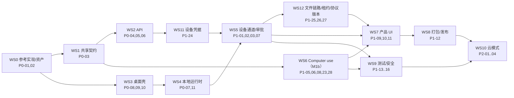

# LinkSense 桌面端双模式任务拆解

日期：2026-11-16，2026-11-17 修订。依据：[桌面端双模式方案 v2](../research/linksense-desktop-dual-mode-plan-2026-11-16.md)。

> 2026-11-17 修订：壳改为 Go + mygo；按"完整桌面客户端"重排任务，新增主窗口 webview、桌面宿主适配层、本地 runner supervisor；computer use 按已有初稿扩展而非重写。
>
> 2026-11-17 安全边界修订：新增 `desktop` provider（不复用 development-only 的 `local-process`）、设备凭据模型（P1-24）、文件与工件链路（P1-25）、设备任务租约（P1-26）、桌面协议版本兼容（P1-27）、打包运行时冒烟（P0-11）；命令级审批与沙箱分档（P1-07）留在 M1，GUI 授权/暂停/审计拆为 P1-28（M1b）。合计 127 人日。

范围与前提：

- 桌面壳：**Go + mygo**（`github.com/egoist/mygo` v0.7.4，MIT；Go 1.27.3）；外壳单二进制、无 Electron/Node 运行时；本地执行运行时（Node + `apps/runner` + Codex）随安装包分发。
- 目标是**完整桌面客户端**，不是只做 computer use 的伴随程序：主窗口 = mygo webview 承载 `apps/web` 全量 UI；Go 侧提供窗口/托盘/深链/更新/本地 runner 监督/设备桥/computer-use 引擎。
- 开发基线是当前 `feat`。`feat-computer-use` 分支的 `apps/desktop` 只作 **computer use 参考实现**（配对、设备 WS、`agent-desktop` 引擎、原生伴随窗口、六语言、打包脚本），不整分支合并、不 cherry-pick；需要的部分按当前主线结构重写/摘取并记录参考 commit。
- 仓库形态：当前 monorepo；`apps/desktop` 是 **Go module**（不进 pnpm workspace，由 `scripts/desktop.mjs` 构建）；桌面契约放 `packages/shared`；不建 `apps/desktop-helper`（引擎与应用同进程）。
- 本地电脑 **macOS + Windows**；云电脑 **只复用现有 Linux Docker runner**；不做 Windows 云电脑/VM、Linux 客户端、WebRTC/PIP 可视化云桌面、混合模式。
- 本地 computer use 使用 **`agent-desktop`（vercel-labs，Apache-2.0）**。
- 估时为**理想开发日**，按 1 名熟悉仓库的工程师计；并行安排见 §7。

---

## 1. 基线盘点：初稿里已有什么

| 能力 | 参考实现（`feat-computer-use:apps/desktop`） | 本期 |
| --- | --- | --- |
| 设备配对 | 配对码 UI、`api/v1/computer-use/pair`、单次码 2 分钟 | 复用，接入设备网关与设备列表 |
| 设备通道 | WS `/socket`，`desktopBridge`/`desktopCommand`/`desktopRequest` | 复用，补命令白名单/TTL/幂等/重连 |
| computer use | `engine.go` 调 `agent-desktop`、错误归一、5 分钟任务授权、暂停 | 复用，加 loopback RPC 供本地 runner 调用 |
| 原生 UI | 480×570 伴随窗口（配对/状态/权限/暂停），mygo `ui` | 保留为伴随窗口 |
| 主窗口 | 无（不承载网站） | **新增**：webview 加载 `apps/web` 构建 |
| 本地 runner | 无 | **新增**：supervisor + loopback 转发 |
| 产品 UI 集成 | 无 | **新增**：Web 侧桌面宿主适配层 + 目标/设备/权限面板 |
| 打包 | `scripts/desktop.mjs`、`mygo.json`、`.app`/DMG/zip、legal | 复用，补 Developer ID 签名/公证/更新 |
| Windows 构建 | `mygo.json` Windows 目标、`process_windows.go`、x64/arm64 安装器产物 | 复用，补 Authenticode、WebView2 检测、UIA 回归 |
| Browser Use | 现有 Chrome/Edge 扩展、`browser_use` 工具链、配对/授权/撤销 | 复用；桌面端补状态、引导与配对入口 |
| 壳能力 | mygo v0.7.4：webview/native、类型化 IPC、菜单/托盘/深链、Secrets、打包/签名/更新 | 直接使用；用法见方案 §5.9/§5.10 |
| 测试 | Go 单测 + 原生白盒（真实窗口/AX）+ 打包引擎测试 | 复用，补浏览器侧 E2E、Windows 白盒与桌面冒烟 |

**结论**：初稿解决了"设备 + computer use"；本期主要新增"完整客户端壳 + 本地 runner + 产品 UI 接入"。

---

## 2. 工作流与依赖

关键路径：**P0-01 → P0-03 → P0-04/05 → P0-07/10 → P0-11 → P1-24 → P1-02 → P1-04 → P1-07 → P1-10 → P1-13 → P1-12（M1）→ P1-06/23/28（M1b）**。

Windows 本地模式（P1-17..20）复用同一批代码，挂在 WS3/WS6/WS8 上并行推进，不在关键路径上。

可并行的三条主线：

1. **Go/桌面壳**：P0-01、P0-08、P0-09、P0-10、P0-11、P1-09、P1-12。
2. **API/传输**：P0-03、P0-04、P0-05、P0-06、P1-24、P1-01、P1-02、P1-03、P1-04、P1-25、P1-26、P1-27。
3. **Web/UI**：P0-09、P1-10、P1-15。

---

## 3. Phase 0：基线与壳（约 30 人日）

| ID | 任务 | 产出/落点 | 依赖 | 验收 | 估时 |
| --- | --- | --- | --- | --- | --- |
| P0-01 | 新建 Go 模块并参考旧实现 | 在当前 `feat` 新建 `apps/desktop`（Go module）、`scripts/desktop.mjs`、licenses；按需摘取配对/设备 WS/引擎/打包代码并重写 | 无 | `go test ./...` 通过；`pnpm desktop:test` 通过；构建出 `.app` 与 Windows 安装器；记录参考 commit 与摘取范围 | 2 |
| P0-02 | `agent-desktop` 升级/许可/校验 | 使用最新版（当前 1.3.1）；manifest + sha256；`THIRD-PARTY-NOTICES` | 无 | 升级后 macOS AX / Windows UIA 各自 `snapshot`/`click`/`type` 冒烟；下载/内置 binary 校验；不自动下载未校验 binary | 2 |
| P0-03 | 共享契约 | `packages/shared/src/computer-use.ts`、`desktop-device.ts`、事件、错误码、六语言 key | 无 | Zod schema + 派生类型；单测；六语言 key 占位 | 2 |
| P0-04 | Prisma 模型与迁移 | `prisma/schema.prisma` + forward migration | P0-03 | `prisma validate`；新库迁移成功；`Conversation` 新字段默认 cloud；无破坏性变更 | 1.5 |
| P0-05 | 设备配对 + WS 骨架 | `apps/api/src/modules/desktop-devices/*` | P0-03/04 | 配对码一次性/TTL/限速；token 只存哈希；WS 认证/心跳/撤销；Fastify inject 测试 | 3 |
| P0-06 | 会话 `executionTarget` | `apps/api/src/modules/conversations/*` | P0-04 | 创建/读取 local/cloud；local 必须绑定已配对设备；默认 cloud；旧会话不受影响 | 1.5 |
| P0-07 | `desktop` worker provider 最小实现（双平台） | `apps/runner/src/controller/desktop-worker-provider.ts` + `config.ts` 新增枚举；不再走 `local-process`（该 provider 仅 development 且要求 POSIX uid/gid） | 无 | macOS 与 Windows 上各完成一轮 Codex 对话；当前用户身份 + 应用私有目录 `0700` + 单实例锁；确认 Codex app-server 在 Windows 的运行方式（原生或 WSL2）；工作区/事件/Core MCP 正常；`pnpm --filter @linksense/runner test` 通过 | 4 |
| P0-08 | 主窗口 webview | `apps/desktop/web.go`：加载 `apps/web` 构建、深链登录、单实例、窗口状态、外部链接策略 | P0-01 | 主窗口显示完整 Web UI；刷新/前进后退正常；外链走系统浏览器；无 Node 暴露 | 4 |
| P0-09 | 桌面宿主适配层（Web 侧） | `apps/web` 桌面入口 + mygo typed IPC 客户端；环境检测、登录交接、下载/上传、通知、更新入口 | P0-08 | 纯浏览器行为不变；桌面内可用；类型化调用有测试；失败降级 | 3 |
| P0-10 | 本地 runner supervisor（Go） | `apps/desktop/runtime.go` 扩展：启动/健康检查/退出清理/orphan guard/日志 | P0-01/07 | 应用启动即拉起 runner；崩溃可重启；退出无孤儿进程；日志脱敏 | 3 |
| P0-11 | 打包运行时冒烟 + 云模式贯通 | 内嵌 Node + `apps/runner` + Codex 的 `resources/<os>-<arch>/`；`scripts/desktop.mjs` 扩展 | P0-07/08/09/10 | **干净机器**（无 Node/无仓库）上：安装 → 登录 → 云会话 → SSE → 下载 → 更新检查 → 不含 GUI 的本地回合各跑通一次；安装体积记录在案（预算 150–250 MB） | 4 |

**Phase 0 出口标准**：桌面应用能打开主窗口跑完整 Web UI；**打包后的应用在干净机器上跑通云模式完整链路（登录/SSE/下载/更新）与一轮不带 GUI 的本地 Codex 对话**；配对后通过设备 WS 驱动本地 Codex 回合并把事件回传；`computer_use` 引擎可被本地 runner 调用。打包冒烟不过，不进入 Phase 1。

---

## 4. Phase 1：本地电脑模式 MVP（约 79 人日）

> 顺序固定：**凭据 → 传输 → 运行时 → 文件链路 → 审批/租约 → 目标选择 UI → GUI**。前六步构成可发布的 M1（本地文件 + Shell + 浏览器），GUI 是 M1b。

### 4.1 API / 设备通道

| ID | 任务 | 产出/落点 | 依赖 | 验收 | 估时 |
| --- | --- | --- | --- | --- | --- |
| P1-01 | 设备管理正式化 | `desktop-devices` service/routes；列表、重命名、撤销、在线状态 | P0-05 | 撤销立即断 WS、token 失效；跨 owner 拒绝；审计；测试 | 2 |
| P1-24 | 设备凭据模型 | `modules/desktop-credentials/`（run lease）、`modules/model-proxy/`；runner start 入参去掉 `apiKey` | P1-01 | 设备只拿 run lease + 模型代理 token；`LINKSENSE_RUNNER_SHARED_SECRET` 不下发；事件走设备 WS 回传；lease 过期/撤销后命令与模型调用同时失效；抓包 + 进程检查确认无平台密钥 | 3 |
| P1-02 | `RunnerTransport` 抽象 | `apps/api/src/adapters/runner.ts` + `desktop-device-transport.ts` | P0-06/10、P1-24 | cloud 走 HTTP、local 走 WS；设备离线→`RUNNER_UNAVAILABLE`、结果不明→`RUNNER_OPERATION_UNCERTAIN` 且不重发；`turns/start` 幂等；按 requestId 去重；设备方向 body 不含平台凭据 | 3 |
| P1-03 | 设备桥生产化（Go） | `apps/desktop/bridge.go` 扩展 | P0-10 | 路径白名单；命令 TTL/取消；事件批量/去重；断线重连；日志脱敏；不持有 `/internal` secret | 4 |
| P1-04 | 本地会话与权限 API | `apps/api/src/modules/local-computer/*` | P1-01/02 | 启动/停止/状态；grant 创建/撤销/过期；owner/会话校验 | 2.5 |
| P1-25 | 文件与工件链路 | `modules/files/` 扩展；设备桥上传/下发 | P1-03 | 输入附件下发到设备工作区并回 `ready`；本地工件预签名上传 + API 确认后入列表；`workspaceRelativePath` 在 API 侧换成资源 ID；本地绝对路径不进事件/日志/模型上下文 | 4 |
| P1-26 | 设备任务租约 | `desktop-devices` + 引擎 | P1-01/04 | 同设备单任务；首次 observe 获取、回合结束/暂停/断线/超时/崩溃释放；第二会话 `DEVICE_BUSY`；窗口身份变化 `COMPUTER_TARGET_CHANGED` | 2 |
| P1-27 | 桌面协议版本兼容 | API `client-build` 扩展 + Web 宿主适配层 | P0-09 | 桌面上报 `desktopProtocolVersion` + 能力位，API 校验兼容区间；不兼容返回 `DESKTOP_UPDATE_REQUIRED` 并给更新入口；上一版安装包连当前 API 可登录、可开会话；Web 现有构建一致性检查不变 | 2 |

### 4.2 Computer use

| ID | 任务 | 产出/落点 | 依赖 | 验收 | 估时 |
| --- | --- | --- | --- | --- | --- |
| P1-05 | `computer_use` Core MCP 模块 | `apps/runner/src/mcp/core-services/computer-use-service.ts` + 注册 | P0-03 | `computer_status/observe/act`；Plan 只读；fake 引擎单测；超时/取消 | 3 |
| P1-06 | 引擎本地入口（Go） | `apps/desktop` loopback RPC：status/observe/act/pause/resume/stop/permissions | P0-01 | 本地 token 校验；action allowlist；ref 校验；截图/树裁剪；JSON 错误归一 | 3 |
| P1-07 | 命令级审批与沙箱分档（M1） | API + runner + 审批卡 UI | P1-02/04 | **沙箱与审批分档**：本地默认 `untrusted` + `workspaceWrite`，`full_access` 显式开启才用 `dangerFullAccess` + `on-request`，云保持 `never`；审批卡（命令/cwd/写入/提权）；决策按 v2 schema `accept` / `acceptForSession` / `acceptWithExecpolicyAmendment` / `decline` / `cancel`，超时走 `cancel`；串行、不自动重试；始终授权需显式开启、30 天过期、撤销时同步下发 native 规则更新并复测 | 3 |
| P1-08 | 桌面操作安全边界 | 引擎 + runner | P1-06/28 | 禁止任意 `--arg/--env/--cdp`；launch 白名单；不记录键入/截图；危险动作二次确认 | 2 |
| P1-23 | 本地动作执行管道与效果契约 | Go 引擎：`ActionExecutor`、通行证约束、风险分级、`effect`/`wait` 读回、中断语义 | P1-05/06/28 | 所有 GUI 动作只能经执行器；风险等级进审批与审计；`no_effect` 不自动重试；等待默认 8s / 上限 20s；崩溃标 `interrupted` 不重放；单测覆盖 | 3 |
| P1-28 | GUI 授权、暂停/停止与审计（M1b） | 引擎 + API + 事件 | P1-06/07 | 5 分钟 grant；续期；暂停立即停止输入；停止撤销；拒绝路径；审计；撤销后已授权动作失效 | 2 |

### 4.3 桌面壳 / 产品 UI

| ID | 任务 | 产出/落点 | 依赖 | 验收 | 估时 |
| --- | --- | --- | --- | --- | --- |
| P1-09 | 桌面产品化（Go） | 托盘、菜单、全局快捷键、通知、多窗口、崩溃日志、单实例深链 | P0-08 | 关窗不退出策略可配；托盘菜单齐全；深链登录/配对可用；六语言 | 3 |
| P1-10 | 桌面 UI 集成（Web 侧） | `apps/web` 目标选择器（本地/云）、设备设置/配对、本地状态卡、权限卡片、审计页 | P1-02/04 | 复用现有组件；本地/云均可创建会话；权限卡片默认无“始终”、始终需显式开启、设置页可撤销；审计脱敏 | 5 |
| P1-21 | Browser Use 桌面接入 | 桌面宿主适配层 + 设置页引导 + 状态展示 | P0-09/10 | 桌面内显示扩展状态；系统浏览器完成配对后桌面可见；本地会话 `browser_use` 操作真实标签页；撤销即时；macOS/Windows | 3 |
| P1-22 | 应用内更新 | `mygo.json` 的 `updates`、更新密钥、`mygo build -upload`、更新窗口/横幅、beta 渠道 | P1-12 | 双平台签名更新；delta 命中与失败回退整包；stable/beta 切换；只读安装位置降级；发布流程文档 | 4 |
| P1-11 | macOS 权限引导 | 伴随窗口（原生）+ 主窗口联动 | P1-06 | 检测 → 分项引导 → 系统设置深链 → 重新检测；拒绝记录原因并可回落云电脑；屏幕录制授权后重启提示；不崩溃 | 2 |
| P1-12 | 打包/签名/公证/更新 | `scripts/desktop.mjs`、`mygo.json`、`deploy/desktop/` | P1-09/10 | arm64 `.app`/DMG；Developer ID + 公证；agent-desktop/legal 随包；自动更新（签名 + delta）；干净 Mac 冒烟 | 4 |

### 4.4 测试 / 发布

| ID | 任务 | 产出/落点 | 依赖 | 验收 | 估时 |
| --- | --- | --- | --- | --- | --- |
| P1-13 | 本地 E2E | Web UI E2E + Go 白盒 + 打包应用冒烟 | P1-09/10 | M1：登录→配对→创建 local 会话→读/写/Shell/浏览器→断线重连→撤销；M1b 追加 observe/act→效果/等待→暂停/恢复→崩溃中断不续跑 | 4 |
| P1-14 | 安全测试 | API/引擎/协议 | P1-01/03/08 | 未授权设备、伪造 token、重放命令、跨会话、路径遍历、权限绕过、撤销后重试 | 3 |
| P1-15 | i18n 六语言 | `packages/shared`、`apps/web`、`apps/desktop/locales` | P0-03/09 | 所有新文案六语言；key 覆盖测试；无英文占位 | 1.5 |
| P1-16 | 文档与运行手册 | `docs/development/desktop-*` | 全部 | 开发/构建/配对/权限/故障排查/回滚 | 1.5 |

### 4.5 Windows 本地模式

| ID | 任务 | 产出/落点 | 依赖 | 验收 | 估时 |
| --- | --- | --- | --- | --- | --- |
| P1-17 | Windows 构建与安装器 | `mygo.json` Windows 目标、安装器脚本、`deploy/desktop/` | P0-01 | x64/arm64 构建；WebView2 检测与引导；安装/卸载/升级；Authenticode 签名 | 3 |
| P1-18 | UIA 引擎回归 | `apps/desktop/engine.go`、`process_windows.go` | P1-06 | UIA snapshot/click/type/scroll；DPI/多显示器；提权窗口返回稳定 code；白盒测试 | 3 |
| P1-19 | Windows 权限与安全差异 | 引擎 + API + UI | P1-07 | 完整性级别约束；无 TCC 的引导路径；SmartScreen 提示；剪贴板/启动白名单 | 1.5 |
| P1-20 | Windows 测试与发布 | CI + 安装包 | P1-17/18 | Go 测试（arm64 无 `-race`）；安装/升级/自动更新冒烟；干净机器验证 | 2 |

**Phase 1 出口标准**：

- **M1（可发布）**：macOS 与 Windows 安装包可在干净机器安装、登录、配对；完整客户端功能（会话、工件、浏览器面板、设置）可用；本地模式完成"文件 + Shell + 浏览器"闭环；设备凭据、文件链路、审批分档、设备租约、协议版本兼容全部验收；Browser Use 可从桌面完成引导与配对；六语言完整。
- **M1b（不阻塞 M1）**：两平台完成 GUI 操作闭环（observe/act、效果/等待、暂停/恢复、中断不续跑）。

---

## 5. Phase 2：云模式与内置浏览器（约 18 人日）

| ID | 任务 | 产出/落点 | 依赖 | 验收 | 估时 |
| --- | --- | --- | --- | --- | --- |
| P2-01 | 云目标路由 | API + Web/桌面 UI | P1-02/10 | `executionTarget=cloud` 走现有 `RunnerClient`；本地设备不参与；默认 cloud | 1.5 |
| P2-02 | 桌面端云模式对齐 | `apps/desktop` + `apps/web` | P2-01 | 会话/SSE/工件/浏览器面板与 Web 一致；断线重连；worker 回收 | 2 |
| P2-03 | 云模式回归 | 测试 + 部署 | P2-02 | Docker runner 现有测试全绿；`pnpm test` 受影响包；无 Windows 依赖 | 2 |
| P2-04 | 功能开关/灰度 | API + UI | P2-03 | `desktop.localComputer`、`desktop.cloudTarget` 开关；不可用提示；遥测 | 1.5 |
| P2-05 | 内置浏览器窗口（Go） | `apps/desktop/browser.go`：原生窗口 + webview、工具条/标签/下载/页内查找、`NewSession` 隔离 | P0-08 | 多标签/前进后退/刷新/下载确认/查找；独立 cookie；外部协议交系统；macOS/Windows | 4 |
| P2-06 | 内置浏览器 Agent 适配 | `assets/browser-agent.js`（DOM 快照/ref/点击/输入/等待）+ loopback RPC + `browserTarget` 路由 | P1-06/23、P2-05 | navigate/read/click/type/scroll/screenshot/wait；稳定 ref；JS 失败回落坐标点击；不支持项稳定错误码 | 5 |
| P2-07 | 内置浏览器安全与交接 | 隔离会话、下载/外链策略、登录/验证码交接、审计 | P2-05/06 | 第三方页 `Untrusted`；`file://` 拦截；下载确认；登录交给用户；审计不含正文/键入 | 2 |

**Phase 2 出口标准**：桌面端可在同一 UI 切换本地/云目标；云模式完全复用现有 Docker runner，无新增云桌面基础设施；内置浏览器可独立使用并接受 Agent 操作，扩展仍是默认浏览器。

---

## 6. 跨任务测试矩阵

| 层级 | 范围 | 工具/命令 | 必须覆盖 |
| --- | --- | --- | --- |
| 单元 | shared schema、权限、命令白名单、审批决策映射、效果/风险分级、transport 路由 | `pnpm --filter @linksense/shared test`、runner/api Vitest | 正常/边界/空值/非法输入 |
| API | 配对、设备 WS、会话目标、本地会话/权限 | Fastify inject + Vitest | 未认证、越权、撤销、过期、并发 |
| Runner | `computer_use` 模块、引擎客户端 | Vitest + fake 引擎 | 超时、取消、Plan 只读、错误归一、`effect`/`wait` 语义 |
| 桌面（Go） | 配对、设备桥、引擎 adapter、执行器、supervisor | `go test ./...`、`pnpm desktop:test` | 权限拒绝、ref 失效、暂停、停止、孤儿进程、中断不重放 |
| 桌面（原生白盒） | 真实窗口 AX/截图 | `LINKSENSE_DESKTOP_NATIVE_WHITEBOX=1 go test` | 快照、点击、输入、滚动的真实效果 |
| Windows | 构建、UIA、安装器、更新 | Windows runner 上 `go test`/`pnpm desktop:test` + 安装器冒烟 | 签名、WebView2、升级、完整性级别 |
| Browser Use | 扩展状态、配对引导、工具路由 | 现有 Web/API 测试 + 桌面冒烟 | 未安装、未连接、撤销、跨任务 tab、重连 |
| 更新 | 签名、manifest、delta、回退、渠道 | 打包冒烟 + 本地 HTTPS 源 | 篡改签名、降级、断网、delta 失败回退整包 |
| 产品 UI | Web UI（浏览器 + webview） | 现有 Web E2E + 桌面冒烟 | 登录、会话、工件、浏览器面板、目标选择、权限卡片 |
| 内置浏览器 | 导航、DOM 操作、下载、隔离会话 | Go 测试 + 桌面冒烟 + 双平台 | 标签/前进后退/下载/查找；点击/输入/等待；`file://` 拦截；会话隔离 |
| 云模式 | Docker runner 回归 | 现有 runner 测试 + 冒烟 | 文件/Shell/浏览器/SSE/回收 |
| 安全 | 设备/命令/权限/路径 | 专用测试 | 伪造、重放、越权、路径遍历、日志脱敏 |
| 凭据边界 | run lease、模型代理、事件回传 | API Vitest + 抓包/进程检查 | 设备侧无平台 key、无 `LINKSENSE_RUNNER_SHARED_SECRET`；lease 过期/撤销；跨会话凭据拒绝 |
| 沙箱与审批 | 本地 shell/文件 | runner + 真实 Codex | `untrusted` + `workspaceWrite` 生效；`dangerFullAccess` 仅显式开启；直调 AppleScript/PowerShell 被拦；v2 决策值；`cancel` 超时；撤销后 native 规则失效 |
| 文件链路 | 附件下发、工件上传、路径映射 | API + 设备桥 + 冒烟 | 附件到达设备；工件确认后入列表；本地路径不进事件/日志/模型上下文 |
| 设备租约 | 同设备并发、窗口身份 | Go + API 测试 | 第二会话 `DEVICE_BUSY`；崩溃/断线后释放；`COMPUTER_TARGET_CHANGED` |
| 协议兼容 | 旧安装包 ↔ 新 API | 打包冒烟 | 可登录、可开会话、`DESKTOP_UPDATE_REQUIRED` 可达更新入口；Web 构建检查不变 |
| i18n | 六语言 | Web i18n tests + Go locale catalog | key 覆盖、插值、fallback |

Definition of Done（每个任务）：

- 代码 + 测试 + 类型检查 + lint（Go 为 `go vet`/`gofmt`）通过；
- 新用户可见文案六语言（Web 与 `apps/desktop/locales` 同步）；
- 不新增 `any`、不跳过测试、不降低覆盖率；
- 不在日志/事件/测试快照中写入截图、键入内容、token、设备密钥；
- 相关文档/运行手册更新。

---

## 7. 排期建议（合计约 127 人日；2 人并行约 13 周）

| 周 | 开发 A（API/传输） | 开发 B（Go 壳/引擎） |
| --- | --- | --- |
| 1 | P0-03、P0-04、P0-05 | P0-01、P0-02、P0-08（起） |
| 2 | P0-05、P0-06、P1-01 | P0-08、P0-09、P0-10 |
| 3 | P1-24、P1-02 | P0-07（desktop provider）、P1-03（起） |
| 4 | P1-02、P1-04 | P0-11（干净机器冒烟，Phase 0 出口）、P1-03 |
| 5 | P1-07（沙箱分档 + 命令审批）、P1-25 | P1-09、P1-12（起） |
| 6 | P1-25、P1-26 | P1-12、P1-17、P1-20 |
| 7 | P1-27、P1-10 | P1-21、P1-22 |
| 8 | P1-10、P1-13 | P1-15、P1-16 |
| 9 | P1-13、P1-14 | 双平台回归 → **M1 发布** |
| 10 | P2-01、P2-02 | P1-06、P1-28 |
| 11 | P2-03、P2-04 | P1-08、P1-23 |
| 12 | P1-05、P1-11 | P2-05 |
| 13 | P1-18、P1-19、P2-07 | P2-06 → **M1b** |

> M1 在第 10 周先发布（不含 GUI）；GUI 与内置浏览器在后三周收尾，不阻塞 M1。
> 若只有 1 人：按依赖顺序串行，约 25 周；Phase 2 的云模式部分可压缩到 3–4 天。

---

## 8. 风险与前置决策

| 风险/决策 | 影响 | 处理 |
| --- | --- | --- |
| 参考实现照搬 | 带入旧结构 | 只作参考；P0-01 按当前主线重写并记录参考 commit，跑通 `go test` 再扩展 |
| `agent-desktop` 升级（1.0.2 → 最新 1.3.1） | 兼容/安全 | P0-02 升级并回归；不通过先修适配，确需回退须单独确认并记录原因 |
| mygo v0.7.4 生态/升级 | 壳能力 | 固定版本；升级前跑白盒；必要时本地补丁 |
| Go 1.27.3 工具链 | 构建 | `go.mod` 已声明；本机 1.23+ 自动下载；CI 固定 `GOTOOLCHAIN` |
| webview 内容安全 | 注入/外链 | 内容按不可信；content rules 限制导航/新窗口；只暴露显式 IPC |
| macOS TCC 权限不可自动化 | 首次体验 | P1-11 向导/深链；E2E 用已授权环境或 mock |
| Windows 本地 runner | Codex 运行方式 | P0-07 验证原生或 WSL2；不支持原生则明确要求 WSL2 |
| Windows 签名/SmartScreen | 分发 | Authenticode + 安装器；未签名先内部渠道 |
| UIA 与 AX 行为差异 | 兼容 | 平台分支动作映射；不支持的能力返回稳定 code |
| WebView2 缺失 | 启动 | 检测 + bootstrapper + 引导 |
| webview UA 非 Chrome/Edge | 扩展检测误判 | 桌面引导替代 UA 检测；复用现有连接状态接口 |
| 更新密钥丢失 | 已安装用户无法更新 | 离线备份 + CI secrets；轮换流程 |
| GitHub 源限流（60 次/小时/地址） | 检查更新失败 | 自托管 `url` 为主源，GitHub 备用 |
| 安装位置不可写 | 自更新禁用 | `Enabled()` 检查 + 降级下载链接 |
| 本地 runner 与桌面应用生命周期 | 稳定性 | P0-10 supervisor + orphan guard；异常退出可重启 |
| `local-process` 不适用于生产/Windows | 本地模式跑不起来 | P0-07 新增 `desktop` provider；不复用仅 development 的 provider |
| 平台密钥下发到用户机器 | 凭据泄露 | P1-24 run lease + 服务端模型代理；设备侧抓包验收 |
| 全局内部 secret 下发 | 内部 API 暴露 | P1-24 设备不持有 `LINKSENSE_RUNNER_SHARED_SECRET`；事件走设备 WS |
| 只改审批不改沙箱 | 无实际拦截 | P1-07 沙箱与审批分档；`untrusted` + `workspaceWrite` 为本地默认 |
| 内嵌资源被 build ID 锁死 | 旧客户端无法升级 | P1-27 协议版本与 Web build ID 解耦 |
| 本地工件无法注册 | 文件功能不可用 | P1-25 附件下发 + 工件上传确认 + 路径映射 |
| 同设备多会话抢焦点 | 操作错对象 | P1-26 设备任务租约 + 窗口身份校验 |
| 设备通道命令不确定 | 重复执行 | P1-02/03 用 commandId + 不重发；UI 显示 uncertain |
| 云模式被误解为"可视化云电脑" | 预期 | UI 明确"云电脑=文件/Shell/浏览器"；不做 Windows 云电脑/PIP |
| 六语言遗漏 | 发布阻塞 | P1-15 纳入 CI key 检查 |

---

## 9. 交付物清单

- `apps/desktop`（Go + mygo）源码：主窗口 webview、伴随窗口、设备桥、引擎、supervisor、构建配置；
- Windows 安装器（x64/arm64）与 Authenticode 配置；
- Browser Use 桌面接入：状态、引导、系统浏览器配对入口；
- 应用内更新：更新密钥管理、签名 manifest、delta、stable/beta 渠道、发布流程；
- `scripts/desktop.mjs` 构建/准备/测试脚本与 `deploy/desktop` 签名/公证/更新；
- `agent-desktop` 资源与第三方许可；
- `packages/shared` 新契约与六语言资源；
- `apps/api` 设备/本地会话/权限模块与迁移；设备凭据（run lease）与模型代理；文件链路扩展；
- `apps/runner` `desktop` worker provider 与 `computer_use` Core MCP 模块；随包 Node 运行时与构建产物；
- `apps/web` 桌面宿主适配层、目标选择/设备/权限 UI；
- 测试：单元/集成/Go 白盒/产品 UI/安全/i18n；
- 文档：运行手册、故障排查、回滚、第三方许可。
