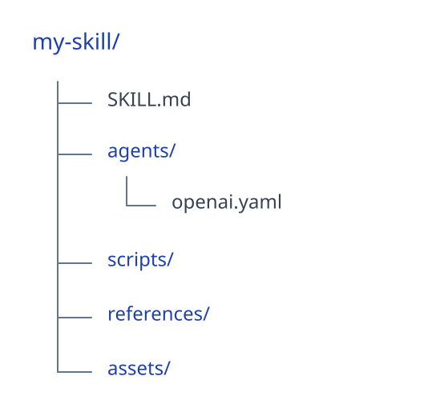
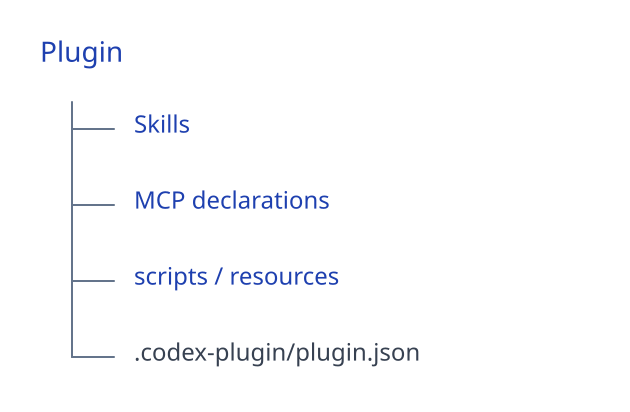

# 应用场景、自主部署与扩展

[返回 README](../README.zh-CN.md)

## 应用场景

| 方向 | 可以如何使用 |
| --- | --- |
| 组织内部应用 | 为成员提供统一工作空间，将成熟的知识、技能与应用共享给团队，由 IT 统一管理访问和用量。 |
| 业务任务处理 | 结合产品资料和模板编写销售方案、整理客户支持资料、生成运营报告；按需接入系统查询与回写。 |
| 产品与服务扩展 | 将专业知识与工具组合为应用，配置外部访问后嵌入官网、客户门户或现有业务系统。 |

业务系统调用取决于已接入的接口、授权范围与业务规则；部署平台后仍需完成对应配置。

## 开源。自主部署。由你掌控。

在自己的服务器、私有云或 VPC 中运行完整平台。查看源码、修改平台、自主选择模型与集成服务，并在自己掌控的基础设施中运行。没有强制依赖的闭源企业运行时、LinkSense 云端控制平面或在线运行时许可激活心跳。

使用私有模型、本地知识和本地 MCP 服务时，提示词、文件、任务状态、知识索引、凭据、审计记录和结果都可以保留在你掌控的基础设施中。

配置的外部服务仍可能产生外部网络请求，因此 LinkSense 将自己描述为**支持自主部署、适合私有网络**，而非正式的完全离线隔离系统。

**模型：** OpenAI · Azure OpenAI · Anthropic · Google / Vertex · Alibaba · DeepSeek · OpenRouter · OpenAI 兼容端点

内部部署例外、署名要求和品牌使用许可见[开源协议](license-guide.zh-CN.md)。

## 基于 LinkSense 扩展

LinkSense 提供三种主要扩展方式，无需修改 LinkSense 源码。

### 构建技能

使用原生 Codex 技能格式，将可复用的方法、工作流、领域实践、脚本、参考资料和辅助资源交给 AI。

  

技能既可以由 Codex 原生发现，也可以由用户和应用显式选择。

### 构建基于 MCP 的插件

通过 MCP 连接外部系统与 API，再将 MCP 声明、技能和辅助资源一起打包。

  

对于 CRM、ERP、SaaS、监控系统和内部 API，通常推荐将 MCP 作为集成边界。

凭据与插件包保持分离。

### 构建交互式应用

基于已授权的 LinkSense 能力，构建面向特定用途的界面和工作流。

交互式应用包含 `manifest.json`、HTML、JavaScript、CSS 和资源文件，并在沙箱化的 iframe 中运行。

其 SDK 可以请求明确获准的能力，例如访问用户资料、发现能力、访问知识库、发现 MCP 服务，以及创建任务。

交互式应用与普通应用相互独立，普通应用主要是配置和能力组合对象。
