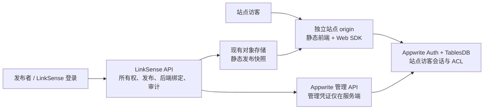

# LinkSense 发布站点接入 Appwrite：现状与实现方案

调研日期：2026-11-13（Asia/Shanghai）。仓库依据：本地 `main`，`81dc5699`。本文是调研和建议，尚未确认实施；本轮没有修改功能代码、安装依赖、启动 Appwrite、执行数据库迁移或部署。第 10 节为同日二轮复核补充。

> **2026-11-14 范围更新：用户已确认内容和服务全部自部署，不采用第三方托管云服务，并希望支持包含后端业务逻辑的公开动态应用。** 当前建议以[全自部署动态应用方案](./dynamic-app-self-hosting-2026-11-14.md)为准。本文保留静态发布代码、会话隔离和权限的研究依据；仅 Auth/CRUD 的首版范围及 Cloud 相关建议不作为当前实施依据。

## 1. 结论与建议

**可以实现。建议保留 LinkSense 的站点发布和静态资源托管，由 Appwrite 为选择启用后端的站点提供 Auth 和 TablesDB。** 页面仍可以是构建后的静态前端，登录、权限判断和数据持久化发生在 Appwrite；当前需求本身不要求每个站点运行一个 Node.js 服务，也不要求迁移到 Appwrite Sites。[Account][S02]、[TablesDB 权限][S05]、[Sites][S41]。Appwrite 的凭证边界见第 9 节。

建议首版采用以下边界，均为待确认方案：

1. LinkSense 继续管理发布者、站点、静态发布版本、地址、审计和站点后端绑定；平台现有认证、Prisma/PostgreSQL、Redis 和对象存储保持各自职责。
2. 一个逻辑站点绑定一个 Appwrite Project；Project 随站点持续存在，不随任务、前端发布版本或 slug 变更重建。每站点 Project 是身份和数据隔离单位，不是每站点一套 Appwrite 容器。
3. 有后端的站点使用独立 origin，优先放在与 LinkSense 控制台不同的可注册域下。登录和完整功能验证在该站点的顶层页面进行。
4. 生成网页用 Appwrite Web SDK 和访客会话访问数据；组织级、项目级管理密钥只保留在受控后端。
5. LinkSense 的停站动作同步到 Appwrite 的客户端服务开关；永久清理用户和业务数据需要单独明确规则。

本方案最先需要验证的不是 CRUD，而是：**目标部署方式下的项目与初始管理凭证创建流程、隔离域上的会话持久化，以及停站后旧会话对数据的访问撤销。**

## 2. LinkSense 现状：已按代码核对

| 环节 | 当前实现 | 对本次需求的意义 |
| --- | --- | --- |
| 生成与登记 | Runner 的 `register_artifact` 接受 HTML 入口和 `web_root_relative_path`，指向专门的公开目录 | 可以继续生成并登记完整前端构建产物 |
| 资源保存 | API 捕获目录、检查路径/大小/校验和并上传对象存储；发布引用不可变快照 | 无需为接入 Auth/数据库重写文件存储 |
| 管理与版本 | `/api/v1/web-sites` 使用平台认证和 owner 检查，创建/更新发布版本并切换当前版本 | 复用已有发布、更新、停用和管理交互 |
| 公开访问 | `/web/{slug}` 返回展示外壳；资源位于 `/_releases/{releaseId}/...` | 当前仅分发静态资源，不启动站点服务端程序 |
| 浏览器隔离 | iframe 和 HTML/SVG 响应 CSP 都没有 `allow-same-origin`；无凭据匿名 CORS | 无法直接套用依赖浏览器持久化会话的普通 Appwrite Web 接入 |
| 路由与网络 | 资源按 manifest 精确读取；`connect-src` 已允许 HTTPS；没有站点级 SPA history 回退 | 现有网页不是完全不能调用外部 API；缺的是托管后端、会话与配套管理 |
| 数据结构 | `WebArtifactBundle`、`WebSite`、`WebSiteAddress`、`WebSiteRelease`，没有站点后端或 Appwrite 绑定 | 需要增加可选绑定，而非把用户业务表混入平台 Prisma schema |
| 生命周期 | 停站/站点所有者停用后公开资源拒绝访问；删除来源任务会把关联站点改成 disabled；删除站点清理记录和地址 | 新增的外部数据接口也必须覆盖这些入口，不能只隐藏网页 |

代码依据：

- [Runner 产物登记](../../apps/runner/src/mcp/core-services/file-service.ts)：参数与工具说明。
- [文件登记与快照](../../apps/api/src/modules/files/service.ts)、[目录捕获](../../apps/api/src/modules/web-sites/bundle.ts)、[资源读取](../../apps/api/src/modules/web-sites/artifact-resources.ts)。
- [公开/管理路由与 CSP](../../apps/api/src/modules/web-sites/routes.ts)、[发布服务](../../apps/api/src/modules/web-sites/service.ts)、[所有权/版本/删除](../../apps/api/src/modules/web-sites/repository.ts)。
- [共享合同](../../packages/shared/src/web-sites.ts)、[Prisma 模型](../../prisma/schema.prisma)。
- [来源任务删除](../../apps/api/src/modules/conversations/deletion.ts)、[站点管理前端](../../apps/web/src/features/web-sites/api.ts)。
- [Nginx 静态部署入口](../../deploy/nginx/default.conf.template)、[生产网关入口](../../deploy/nginx/production-gateway.conf.template)。
- [现有设计文档](../development/web-site-sharing.md)、[私有 HTML 预览](../development/html-preview-resources.md)。

以上结论来自本地代码，不代表已经核实生产部署版本。现有测试覆盖沙箱、匿名 CORS、所有权、发布替换和删除；本轮只阅读，未重跑历史测试。

## 3. 关键改造：独立域与登录态

当前代码在 iframe 与资源 CSP 两层维持 opaque origin。Appwrite Web SDK 27.0.0 的请求准备阶段会访问 `window.localStorage`，普通请求携带 credentials；官方认证文档还说明 Cookie 不可用时回退 localStorage。因此不能把“加 SDK”当作现有预览环境直接支持登录的证明。[Web SDK 源码][S26]、[会话安全][S21]、[浏览器 sandbox][S43]。更直接的原因见第 10.4 节：不透明 origin 的请求为 `Origin: null`，无法登记为 Appwrite Web platform，请求在 CORS 阶段即被拒绝。

也不能直接在主应用同源的发布页面加 `allow-same-origin`。平台当前把访问会话写入 localStorage，放开后会改变生成网页与平台之间的安全边界。依据：[会话存储实现](../../apps/web/src/api/session.ts)、[MDN sandbox][S43]。

建议的部署关系：

域名示例仅说明边界：控制台 `console.example.com`，站点 `s-<stable-id>.example-apps.net`，Appwrite API `api.example-apps.net`，实际域名待确定。API 域与站点位于同一可注册域下，以支持官方建议的同站 Cookie；项目允许的平台 origin 按实际站点登记。[自定义 API 域][S23]、[Platforms][S20]。Cookie Domain、跨项目请求和子域隔离仍需在目标部署中验证。若使用自定义站点域，需要相应的 API 域/会话方案，不预设已支持任意域名。

- 动态站点顶层访问具备自身正常 origin；当前沙箱内预览继续用于外观检查，完整认证测试从独立站点入口打开。
- `/web/{slug}` 可为新类型站点提供跳转，旧静态站点继续走原路径。稳定 hostname 使用站点身份，避免 slug 修改导致账号存储或回调地址意外漂移。
- 新站点 origin 不应直接暴露 LinkSense 控制台及其 `/api` 路由；Host 映射、CORS、CSP、回调地址、证书和反向代理一起设计。
- 站点登录界面不等于所有前端 HTML 都受保护。静态代码视为公开内容，私有数据由 Appwrite 服务端权限保护；若需求是先登录才能下载任何页面，这是另一个需要明确的边界。
- 首版可让生成站点使用 hash 路由，避免同时引入新的 history 路由回退。后续确需 history 路由时，只给文档导航提供回退，不把丢失资源或 API 404 返回成 HTML。

## 4. 认证、数据权限与密钥

**区分两类用户：** LinkSense 用户管理和发布站点；站点访客在对应 Appwrite Project 注册和登录。首版建议站点独立账号，不默认复用平台 JWT。跨站统一登录、企业 SSO、LinkSense 账号自动登录另行评估。

建议首版覆盖邮箱密码注册、登录、退出、刷新后会话恢复、邮箱验证和密码重置。邮件能力必须配置 Appwrite 对应的发送服务并验证回调；现有 LinkSense SMTP 配置不会自动成为 Appwrite 项目配置。[邮箱密码与回调][S04]、[登录状态][S25]。默认能登录不等于邮箱已验证，需按业务用 verified 角色限制数据权限。

以“个人待办”作为最小数据验收模型：

- 表级只给目标登录用户群体创建记录的权限，不给全部登录用户全表 read/update/delete。
- 启用 Row Security；每条记录向实际创建者授予读、改、删权限。
- `owner_id` 或前端查询过滤只用于业务表达，不替代 Appwrite ACL。必须用另一用户直接请求记录 ID 验证拒绝。
- Appwrite 的表级权限与行级权限是授权相加；宽表权限不能再由行权限收窄。服务端 API key 会绕过记录 ACL，不能把管理 key 带到网页或用它代理所有用户 CRUD。[表与行权限][S05]、[通用权限][S10]。
- 业务规则若涉及余额、支付回调、不可变作者字段、固定审核流程、跨记录约束等，不能只靠客户端和 ACL；需要可信服务端逻辑，留到相应需求中实现。

浏览器只获取 endpoint、project ID、database/table ID 等公开配置。后端复用 [现有加密封装](../../apps/api/src/lib/crypto.ts)及受控配置模式保存管理凭证；不把组织 key、项目管理 key、平台 JWT 或用户密码写入网页包、源码、任务说明和日志。

## 5. AI 如何生成有后端的站点

最终体验建议是：用户描述“带登录、能保存数据的网站”，LinkSense 先准备/选择站点后端，再让 Agent 基于明确的数据结构生成前端，最后仍通过已有产物登记和发布流程交付。

需要后端的生成阶段先建立一个独立、owner 归属明确的 backend 记录，之后绑定站点。不能把 backend 的生命周期绑在临时对话上；更新已有站点时须先选择目标并复用其 backend。

优先复用官方 Web/Server SDK、官方文档和 MCP；不自建数据库协议。官方托管 MCP 使用 Cloud OAuth，自托管 MCP 使用 stdio 和项目 API key，两者能力与凭证方式不同。[托管 MCP][S44]、[自托管 MCP][S45]。

产品内自动操作还需要 LinkSense 自己的 owner/task/site 授权。建议沿用 [Core MCP 模块注册](../../apps/runner/src/mcp/core-service-registry.ts)和现有受控 API 链路，仅暴露准备后端、读取结构、应用已验证结构变更等必要操作。它们调用官方 SDK，密钥留在服务端；不让模型任意指定别人的 project ID 或获取组织级 key。只有官方 MCP 可提供相同权限边界时才直接复用其执行层，避免给管理 SDK 再造一整套通用工具。

数据库结构以受校验、可追踪的定义交付；第一次发布只创建所需表、字段和索引，等待实际可用后再切换版本。更新默认采取兼容性新增；删列、改类型、清数据和权限收紧要说明旧数据/旧页面影响并单独确认。这里的重试仅处理资源配置，不改变或重放原生 Codex turn。

预览和测试不得静默写入已上线的业务数据；验证阶段使用隔离测试 Project。是否把完整开发/生产环境管理做成首版产品能力，留待范围确认。

若后续修改内置帮助或 Skill writer，需要同步 `BUILT_IN_CAPABILITY_RUNTIME_REVISION` 并覆盖已有快照刷新；本轮不涉及此类修改。

## 6. 生命周期与旧数据兼容

| 动作 | 建议行为与验收条件 |
| --- | --- |
| 发布/更新前端 | 保留同一 backend/Project、用户、数据和地址；先验证资源与结构兼容，失败不切换当前版本 |
| 跨任务更新 | 保留站点 backend；校验源任务、目标站点及 backend 的所有权和匹配关系 |
| 改 slug | 不重建 Project，不清用户数据；稳定运行域不跟随 slug 随意变化 |
| 取消发布/所有者停用/来源任务删除 | 前端停止访问，同时关闭使用中的 Appwrite 客户端服务；只有后端撤销确认后才报告停用完成 |
| 重新发布 | 恢复该站点批准的客户端服务集，保留用户和数据；已撤销会话需要重新登录 |
| 删除站点 | 当前静态删除语义保持；对新增的后端用户和业务数据，建议先停用保留，再由明确的数据删除动作永久清理，最终规则待确认 |
| 下载 ZIP | 继续表示前端资源包；不能把它称作包含 Appwrite 用户、业务数据和密钥的完整备份 |
| 复制或新建另一个站点 | 默认不共享生产 backend；复制结构、复制数据、复用账号分别明确授权 |

Appwrite 原生项目服务开关可禁止客户端访问，而管理 key 仍可访问，适合用于“停站但保留数据”的实现候选。自托管 2.7.2 有 `PATCH /v1/project/services/:serviceId`（`project.write`）与 `DELETE /v1/project/sessions`（`users.write`），后者用于失效既有会话/JWT。[Services][S28]、[开关源码][S30]、[会话源码][S31]。需禁用所有实际可达的客户端数据通路，包含 TablesDB、legacy Databases 或 GraphQL 等相关入口；仅关闭 Account 不足以证明旧会话不能读数据。撤销全部会话可以补充，但不能替代服务关闭。旧 JWT、Realtime 已连接订阅、客户端缓存和重新启用行为必须实测；已经下载到访客设备的数据无法被收回。

LinkSense 数据库事务与 Appwrite API 不构成跨系统事务。配置操作用持久化状态、稳定操作标识和有界恢复执行；可复用现有队列/分布式租约和 [DurableWorkDispatcher](../../apps/api/src/lib/durable-work-dispatcher.ts)，不需引入新的工作流框架。停用操作部分失败时要展示尚未完成和可重试状态，不能仅更新本地 status 后宣称后端访问已撤销。

旧站点采用可选 backend 绑定：无绑定的历史记录保持原始行为，旧发布参数和旧 manifest 仍可读、可更新、可下载、可停用，不要求统一重建或重新登记。新旧前后端部署顺序也要验证；本轮不选择最终表结构，不生成迁移。

前端版本与数据库版本不能自动等同。回退前端前须保证旧页面仍能使用当前表结构；不能以“切回旧 HTML”承诺数据库和用户数据也已回滚。Appwrite 行事务不包含 schema 操作；官方 CLI 还提示 push 可能删除已移除的字段或因类型改变丢数据，不能每次发布就全量同步。[行事务][S32]、[CLI 结构同步][S33]。

## 7. 部署选择与首版范围

| 选择 | 优点 | 需要承担/验证 | 建议 |
| --- | --- | --- | --- |
| Appwrite 自托管 | 与 LinkSense 私有部署方向一致；数据和实例由部署方控制 | 独立服务栈、域名、SMTP、资源容量、升级、备份恢复、自动化凭证引导 | 私有化交付的优先候选，先验证目标固定版本。[安装][S01] |
| Appwrite Cloud | 免去底层实例运维；可使用官方 Partners/OAuth 能力 | 地区/访问质量、套餐和逐 Project 成本、凭证引导、外部依赖 | 快速验证或客户已有 Cloud 时可选。[Partners][S13]、[套餐][S35] |
| 同一个 Appwrite Project 放全部站点 | 管理对象少 | 不同站点共享身份边界；ACL/管理凭证误用的影响更广 | 不作为独立站点首版默认 |
| 迁移发布到 Appwrite Sites | 可利用其站点托管和服务端运行能力 | 现有发布、地址、停用、下载、备份和迁移都要重新对齐 | 当前 Auth/数据库需求尚不需要这次迁移 |
| 由 LinkSense 自身提供站点认证与数据 API | 复用现有 JWT/Argon2id/PostgreSQL/Redis/限流/审计；开通即建记录，无凭证引导问题；不新增基础设施 | 需自行设计站点任意表结构、访客与平台账号隔离、按站点作用域的授权与配额 | 未评估前不应排除，见第 10.2 节 |

自托管采用 Appwrite 官方部署方案并独立管理持久化数据，不把其业务表塞入 LinkSense 的平台数据库。官方最低硬件要求只能作为安装门槛，不能作为与 LinkSense 同机运行的生产容量承诺。

**建议首版交付范围：** 站点独立认证、TablesDB 基础 CRUD 与行权限、独立域访问、后端绑定、Agent 受控配置、发布更新保留数据、停用/恢复、基础配额与恢复说明、LinkSense 管理界面六语言。

**后置范围：** OAuth/SSO、跨站共享账号、用户上传与 Storage、Realtime、Functions、SSR、任意后端代码托管、可视化数据库管理器、通用多供应商平台。需求确实需要时再启用，不先部署整套能力。

## 8. 后续实施顺序与验收

1. **技术验证。** 在获准的隔离环境固定 Appwrite/SDK 版本，验证项目和首个管理凭证的正规引导、独立域 Cookie、真实双用户 ACL、停用后的旧会话，以及完整备份恢复。使用一张个人待办表即可。
2. **接入管理与发布。** 增加可选 backend 绑定、服务端适配器、站点域映射及状态同步，复用现有产物快照和版本发布。保留历史静态站点兼容。
3. **接入 Agent 与交付检查。** 增加必要的受控工具和生成约定、跨任务更新校验、结构变更记录；完成管理 UI 六语言和面向站点创建者的使用说明。

预计改动边界：

| 位置 | 需要覆盖的内容 |
| --- | --- |
| `apps/api` | Appwrite 服务端适配器与受控配置、web-sites 后端绑定/状态协调、站点域资源分发；覆盖任务删除与账号停用触发点 |
| `apps/runner` | 在现有 Core MCP 与受控 API 链路增加必要的后端结构操作，产物登记继续复用；不传组织管理凭证 |
| `packages/shared` 与 `prisma` | 可选 backend 合同、所有权/状态/外部 ID/凭证引用与迁移；旧输入和旧 manifest 保持可用 |
| `apps/web` 与 `apps/docs` | 站点后端状态、配置和发布检查、独立域入口、数据删除边界；管理文案覆盖六语言，更新中英使用文档 |
| `deploy` 与测试 | Appwrite 独立部署及域名/代理配置、备份恢复说明；API/Runner/Web 合同、历史数据和真实浏览器回归 |

验收至少覆盖以下五组，不能只用新站点的正常路径代替：

- 认证：注册/验证/重置/登录/退出/刷新恢复，邮件回调和跨浏览器存储限制。
- 数据与隔离：持久化、另一用户直接请求拒绝、另一站点/Project 拒绝、未登录拒绝；源码/ZIP/日志无管理密钥。
- 生命周期：更新和改名不丢数据；停用、所有者停用、任务删除后旧会话与 API 直连拒绝；恢复与永久删除符合确认规则；部分失败可恢复且不重复创建资源。
- 升级：代表性历史静态站点与缺字段/旧 manifest 继续访问、管理、跨任务更新、下载；旧动态前端对新增字段/权限变化的兼容；部署顺序与前端回退限制。
- 运维：备份恢复能同时恢复映射、配置、用户和业务数据；容量/配额/邮件失败可观测；真实浏览器与目标部署业务路径验收。

正式实现前需要明确的产品决定包括：**站点是否需要访客账号（还是只需表单提交与站主查看）；访问域；站点账号是否独立；删站后后端数据的保留/永久删除规则。** 部署形态已于 2026-11-14 确认为全部自部署，不再询问 Cloud 或自托管。其余选择仍是建议，具体首版范围以新的全自部署动态应用方案为准。

## 9. Appwrite 官方事实与证据附录

以下是官网和固定版本源码核对结果；API 存在、文档声明与实际端到端验证明确区分。

### 9.1 版本、产品名称与部署范围

2026-11-13 核对的官方自托管安装版本为 `2.7.2`，发布于 2026-11-12。官方兼容表对应 Web SDK `27.0.0`、Node SDK `29.0.0`；这属于官方声明，本轮没有安装或验证该组合。[安装与兼容表][S01]、[2.7.2 发布][S46]。Cloud 文档可能包含尚未在此镜像验证的能力，不能直接当成自托管的能力清单。

新接入建议统一使用 TablesDB 的数据库/表/列/行概念；旧 Databases collection/document API 仍为 Legacy API。Cloud 的 DocumentsDB、VectorsDB、托管原生 PostgreSQL/MySQL 是另外的产品，本次不引入。[数据库产品][S08]、[自托管服务配置][S29]。

自托管当前官方安装说明为一个新实例一个 organization，历史升级中的组织保留；建议一个平台运营组织管理多个站点 Project，不依赖每站创建组织。[安装与组织限制][S01]。

### 9.2 自动开通与管理凭证

#### Cloud 已核实的边界

补充：下面的凭证限制针对 **Partners key + Project API key** 路线。Cloud 另有组织安装令牌可供后台开通资源；较新的[公开动态应用选型](./dynamic-app-backend-alternatives-2026-11-13.md#appwrite-的开通方式影响选型)已将它列为首选验证路径，尚未实测刚创建的项目能否直接建表和部署函数。

- 官方 `Organization.createProject` 使用 **Partners key + organization ID**；客户端初始化不设置 project ID，请求体仍指定待创建的 `projectId`。普通 project API key 不能创建另一个项目。[创建 project][S12]
- Partners key 仅管理所属组织的项目等控制面资源；官方说明它不能读写项目内部的用户、数据库、函数等，这些需要 project API key。[Partners keys][S13]
- 官方 Create project 的下一步明确要求到 Console 创建 project API key。Project API 创建长期 key 自 **2026-08-17** 起废弃；现有 key 可 list/update/delete，也可派发最多 3600 秒的 ephemeral key。[创建 project][S12]、[项目 API keys][S14]

**结论：当前公开 Cloud 文档不足以证明“持有一个 Partners key，随后全自动创建任意站点 project、长期 project key、schema、platform”已闭环。** 不应把 deprecated 的 create-key 接口、一个 project key、普通 PAT 或浏览器 Console cookie 当成通用官方 provision 方案。

建议 POC 先人工创建/绑定一个 project 和最小 scopes 的服务端 key；确认 Cloud 的受支持授权流程或取得厂商确认后，再承诺全自动开通。若产品必须第一版全自动，凭证引导是立项门槛。

#### 自托管 2.7.2 源码已核实的范围

- 开源 tag 内有 `POST /v1/organization/projects`，并存在 Organization 初始化授权与 Console admin session 路径；这说明自托管并非“完全没有项目管理 API”。[Create 源码][S15]、[Init 源码][S16]
- 有 `POST /v1/organization/projects/:projectId/keys`，可接受 ADMIN/ORGANIZATION 授权；代码拒绝 standard/ephemeral project key 和 JWT 创建长期 key。其 scopes 包括 `organization.projects.keys.write` 或 `keys.write`。[长期 key 源码][S17]
- `Auth/Key.php` 有 organization key 委派 project key 的规则及过期时间约束；旧 project-scoped create-key route 的注释要求后续转向 Organization API。[Key 源码][S18]、[旧 route][S19]
- 自托管源码与 Cloud 当前 Partners 文档的可见 scopes/行为并不完全一致。上述源码**没有证明所部署自托管 Console 存在组织 key 的完整签发 UI/流程，也没有证明匹配 SDK 暴露所有管理方法**。

**待验证**：目标镜像的组织 key 初次签发方式、scope 清单、SDK/REST 可调用性、失效/轮换、无管理员密码或长期 Console session 的自动开通闭环。若仅能通过 Console session 操作，应明确作为运维引导方案评审，不将其包装为已支持的稳定 service credential。

建议 provision 步骤使用稳定资源 ID、状态记录与可恢复重试。官方明确提醒 `ID.unique()` 每次重试会创建不同 project；不能靠重复建项目“重试成功”。[创建 project][S12]

### 9.3 认证与数据 API 的最小使用方式

网页使用 `Account`：`create` 注册后另行 `createEmailPasswordSession`；启动时用 `account.get()` 检查会话，退出用 `deleteSession(current)`。邮箱验证用 `createVerification/updateVerification`，重置用 `createRecovery/updateRecovery`，回调域名须登记。`Users` 是管理员接口，不应由网页用于模拟访客注册和登录。[Account][S02]、[邮箱密码][S04]、[Users][S06]、[Web SDK Account][S24]。

表与字段由可信管理流程创建，访客只做获准的行操作。Client SDK 未显式传 ACL 时会默认给创建者读/改/删；Server SDK/Console 的默认权限不同，所以生成模板应明确声明权限。行权限需要 Row Security；`Permission.create` 属于表/桶权限，不是行权限。[Tables][S09]、[通用权限][S10]。

自托管 2.7.2 存在 project API 自定义域名 route `POST /v1/proxy/rules/api`，涉及域名校验和证书流程；这只能证明实现存在，不能证明目标域已配置或 Cookie 已验收。[API 域名源码][S27]。

### 9.4 运维与成本约束

官方自托管最低要求为 2 核 CPU、4GB RAM、2GB swap 和 Docker Compose v2；包含 API/Console、数据库、Redis、workers、代理等组件。自托管支持 PostgreSQL、MariaDB、MongoDB，新安装默认 PostgreSQL。仅需 Auth/CRUD 也不能把它估成单个无状态 SDK 服务。[安装][S01]、[数据库引擎][S34]。

Cloud 需要评估每站点 Project 的套餐、配额和总成本，不能把免费试用当成长期生产保证。官方公告说明 Free 项目可因开发活动不足而暂停，且长期暂停可能删除资源；应核对正式套餐和目标地域的实际访问质量。[Pro][S35]、[暂停规则][S36]、[删除规则][S37]。

自托管备份至少包括数据库、持久卷、环境配置和加密 key，并需做恢复演练。当前官方备份页仍主要给 MariaDB/MongoDB 示例，与新安装默认 PostgreSQL 的文档有更新差异，不能据此声称 PostgreSQL 恢复方案已验收。Cloud 数据库备份也不能自动等同于静态资源、认证、绑定及配置的完整恢复。[自托管备份][S39]、[Cloud 数据库备份][S40]。

### 9.5 本轮验证范围

已核对本地发布链路、相关合同/模型/测试及官方文档和固定版本源码。没有连接线上部署，没有运行 Appwrite、创建用户/表/项目/key、测试浏览器 Cookie/SMTP/ACL/停用/实时连接、执行升级或备份恢复，也没有跑延迟/容量测试。本轮不以旧文档里的历史测试结果作为当前部署可用性的证明。

## 10. 二轮复核：结论、对照方案与缺口

本节为同日二轮复核补充。复核只阅读代码与官方资料，未改动功能代码，未安装或运行 Appwrite。

### 10.1 复核范围与结果

抽查了第 2 节的代码依据与第 9 节的官方来源：7 个官方文档页、2 个 GitHub 发行 tag（`appwrite 2.7.2`、`sdk-for-web 27.0.0`）、11 个固定 tag 源码路径（9 个自托管 PHP、2 个 Web SDK），以及仓库中的 8 组代码断言。**未发现事实错误**，以下硬事实逐字核实：

- `2.7.2` 存在，发布于 `2026-11-12`；安装最低要求为 2 核 CPU、4GB 内存、2GB swap、Docker Compose v2，新安装默认 PostgreSQL。
- Project API 创建长期 key 自 `2026-08-17` 起废弃，长期 key 需在 Console 创建，ephemeral key 上限 3600 秒。
- Partners key 可创建、改名、删除 project，但「cannot read or write anything inside one」；创建 project 需 `projects.write`，project key 不能创建 project。
- 权限相加：「a user with access granted at either table level or row level will be able to access a row」——第 4 节「表级权限不能再由行级收窄」的结论成立。
- Web SDK `27.0.0` 的 `client.ts` 确有 `cookieFallback` 的 localStorage 回退与 custom domain 安全告警。
- 第 9 节引用的 9 个自托管源码路径与 2 个 Web SDK 路径全部存在（HTTP 200）；`Sessions/Delete.php` 的 scope 为 `users.write`，`Services/Update.php` 的 scope 为 `project.write`。

**未复核**：其余约 20 条引用（含 Account 接口语义、行事务、Cloud 暂停与删除规则、备份、官方 MCP）。依旧没有任何 Appwrite 运行验证：登录持久化、ACL 实际拒绝、停站后旧会话、真实浏览器行为、备份恢复全部仍为待验证项。

### 10.2 缺失的对照方案：不引入 Appwrite

第 7 节的选项表比较了自托管、Cloud、单 Project 承载全部站点、迁移到 Appwrite Sites 四种形态，四种都预设了 Appwrite。**「由 LinkSense 自身提供站点认证与数据 API」没有进入候选**，而它是与现有代码复用度最高的方案。补充一行：

| 选择 | 优点 | 需要承担/验证 | 建议 |
| --- | --- | --- | --- |
| 由 LinkSense 自身提供站点认证与数据 API | 复用现有 JWT、Argon2id、PostgreSQL、Redis、限流、六语言与审计；开通即建记录，不存在 9.2 节的凭证引导问题；不新增基础设施，也不新增第二套升级与备份生命周期 | 需自行解决站点的任意表结构（JSONB 集合或受控 DDL）、访客身份与平台账号隔离、按站点作用域的授权与配额；平台库需要承担站点数据的容量与隔离责任 | 未评估前不应排除，对照见 10.3 与 10.5 |

需要补上的是**原生方案的决策依据**：选用 Appwrite 买到的是「每个站点一份可编程的 schema 与身份沙箱，且不污染平台 Prisma schema、不需要运行时 DDL」。这是它相对自建方案的关键优势，但第 1、5 节没有把它作为决策依据讲清楚；「保留现有发布链路」的措辞读起来更像顺带复用，而不是一次有代价的取舍。同理，9.2 节的「凭证引导不闭环」是**选择「一站一 Project」带来的约束**，不是需求自带的约束。

### 10.3 架构天花板

第 4 节正确指出 ACL 无法承载余额、支付回调、跨记录约束等业务规则，第 7 节又把 SSR、Functions、任意后端代码后置。两者叠加的结果是：**纯静态前端 + TablesDB 恰好装不下最需要「认证 + 数据库」的那类需求。** 若后续要支持订单、支付、审核流，站点需要自己的服务端运行时，届时绑定结构需要重做。这一上限应在方案中写明，而不是留到实现阶段发现。

### 10.4 计费轴、CSP 缺口与滥用面

- **「一站一 Project」正是 Appwrite Cloud 的主要计费与配额维度。** 第 9.4 节只写了「需要评估成本」，未指出隔离模型与计费轴重合：站点越多，成本越高。
- **现有公开 CSP 还挡着三种能力。** 除 `sandbox` 之外，[发布资源策略](../../apps/api/src/modules/web-sites/routes.ts) 还有 `form-action 'none'`、`frame-src 'none'`、`worker-src 'none'`。原生表单提交、Worker、嵌入 iframe 全部被拒，动态站点必须按站点放宽；而这是所有站点共用的公开响应路径，需要站点级策略覆盖，不能全局改动。
- **「需要独立域」的论证可以更直接。** 第 3 节用 localStorage 与 Cookie 说明沙箱内登录不可行，链条较长。更直接的是：不透明 origin 下的请求为 `Origin: null`，而 Appwrite 的 Web platform 按 hostname 校验 CORS（[Platforms][S20]），`null` 无法登记，请求在 CORS 阶段即被拒绝，与 Cookie 是否可用无关。结论不变，但论证不再依赖 SDK 实现细节。
- **开放注册是新增滥用面。** 站点自助注册会带来垃圾账号与配额消耗；第 4 节未涉及限流、验证码与站点级配额。

### 10.5 规模与前置问题

第 8 节的改动边界横跨 `apps/api`、`apps/runner`、`packages/shared`、`prisma`、`apps/web`、`apps/docs`、`deploy`，外加一套新的基础设施栈和六语言界面。这是大型特性，第 1 节「保留现有链路」的表述不足以反映其规模。

在第 8 节列出的产品决定之外，还有一组更前置、也更能削减工作量的决定：

1. **站点是否需要访客账号。** 若多数真实需求只是「表单可提交、站主可查看」，则第 3、4 节的主体（独立域、独立身份、邮箱验证、密码重置、SMTP 接入）可以整体删除，方案规模大幅缩小。
2. **站点数据落在 LinkSense 自身的库，还是 Appwrite。**

这两问的答案不同，后面的方案就不是同一个。建议在 POC 之前先回答，再决定第 10.2 节的自建方案与 Appwrite 方案之间如何取舍。

## 官方资料

[S01]: https://appwrite.io/docs/advanced/self-hosting/installation
[S02]: https://appwrite.io/docs/products/auth/accounts
[S04]: https://appwrite.io/docs/products/auth/email-password
[S05]: https://appwrite.io/docs/products/databases/tablesdb/permissions
[S06]: https://appwrite.io/docs/products/auth/users
[S08]: https://appwrite.io/docs/products/databases
[S09]: https://appwrite.io/docs/products/databases/tablesdb/tables
[S10]: https://appwrite.io/docs/advanced/security/permissions
[S12]: https://appwrite.io/docs/partners/project/create
[S13]: https://appwrite.io/docs/partners/org-api-keys
[S14]: https://appwrite.io/docs/partners/project/api-keys
[S15]: https://github.com/appwrite/appwrite/blob/2.7.2/src/Appwrite/Platform/Modules/Organization/Http/Projects/Create.php
[S16]: https://github.com/appwrite/appwrite/blob/2.7.2/src/Appwrite/Platform/Modules/Organization/Http/Init.php
[S17]: https://github.com/appwrite/appwrite/blob/2.7.2/src/Appwrite/Platform/Modules/Organization/Http/Projects/Keys/Create.php
[S18]: https://github.com/appwrite/appwrite/blob/2.7.2/src/Appwrite/Auth/Key.php
[S19]: https://github.com/appwrite/appwrite/blob/2.7.2/src/Appwrite/Platform/Modules/Project/Http/Project/Keys/Create.php
[S20]: https://appwrite.io/docs/partners/project/platforms
[S21]: https://appwrite.io/docs/products/auth/security
[S23]: https://appwrite.io/docs/products/network/custom-domains
[S24]: https://github.com/appwrite/sdk-for-web/blob/27.0.0/src/services/account.ts
[S25]: https://appwrite.io/docs/products/auth/checking-auth-status
[S26]: https://github.com/appwrite/sdk-for-web/blob/27.0.0/src/client.ts
[S27]: https://github.com/appwrite/appwrite/blob/2.7.2/src/Appwrite/Platform/Modules/Proxy/Http/Rules/API/Create.php
[S28]: https://appwrite.io/docs/partners/project/services
[S29]: https://github.com/appwrite/appwrite/blob/2.7.2/app/config/services.php
[S30]: https://github.com/appwrite/appwrite/blob/2.7.2/src/Appwrite/Platform/Modules/Project/Http/Project/Services/Update.php
[S31]: https://github.com/appwrite/appwrite/blob/2.7.2/src/Appwrite/Platform/Modules/Project/Http/Project/Sessions/Delete.php
[S32]: https://appwrite.io/docs/products/databases/tablesdb/transactions
[S33]: https://appwrite.io/docs/tooling/command-line/tables
[S34]: https://appwrite.io/docs/advanced/self-hosting/configuration/databases
[S35]: https://appwrite.io/docs/advanced/billing/pro
[S36]: https://appwrite.io/changelog/entry/2026-02-20-1
[S37]: https://appwrite.io/changelog/entry/2026-06-29
[S39]: https://appwrite.io/docs/advanced/self-hosting/production/backups
[S40]: https://appwrite.io/docs/products/databases/tablesdb/backups
[S41]: https://appwrite.io/docs/products/sites/rendering
[S43]: https://developer.mozilla.org/en-US/docs/Web/HTML/Reference/Elements/iframe#sandbox
[S44]: https://appwrite.io/docs/tooling/ai/mcp-servers
[S45]: https://appwrite.io/docs/advanced/self-hosting/mcp
[S46]: https://github.com/appwrite/appwrite/releases/tag/2.7.2
