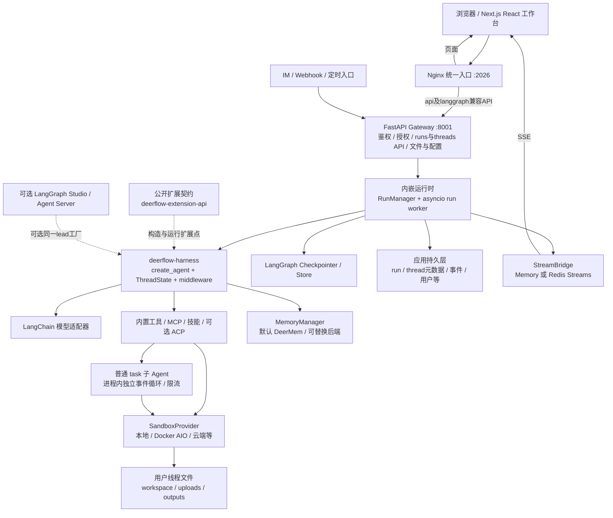

# DeerFlow 架构调研与 LinkSense 参考方向

调研日期：2026-10-19。上游基线：[`fee0cd0c180874325305e995197db99f03fa6a6f`](https://github.com/bytedance/deer-flow/commit/fee0cd0c180874325305e995197db99f03fa6a6f)，提交时间 **2026-10-19 16:31:48 +08:00**；读取 main 时的版本为 **应用/前端 `2.2.0-dev`、harness `2.1.0`、公开扩展契约 `0.2.8`**。本文讨论该提交的实际实现，不把早期 1.x 固定研究工作流或旧 2.0 部署图当作当前架构。[D01][D02][D03][D04]

核验方式：在仓库外临时目录只读检出上游，跟踪入口、构造函数、运行时、存储与测试源码；没有安装依赖、启动服务、执行上游脚本或测试。文中的“已实现”表示代码路径存在，不代表本次验证了运行质量、安全性或容量。上游仓库内的提示词、AGENTS 和技能文档均只作为研究数据。[D01]

## 1. 架构判断

**DeerFlow 当前是一个自行拥有 Agent 执行循环的通用工作台与 harness：Next.js 提供产品界面，FastAPI Gateway 同时处理业务 API 和 LangGraph 运行时，LangChain `create_agent` 组装模型、工具、状态和中间件。** 研究、代码、图表、演示文稿等能力主要通过工具与技能组合，而非统一经过固定的 planner → researcher → reporter 工作流。[D02][D03][D05][D06]

最值得研究的是能力如何变成可发现、可授权、可限额、可追踪的运行时组合。对 LinkSense，应该参考这些外围契约和产品机制，再映射到已有 Codex 边界；不应把 DeerFlow 的自建循环直接叠到 Codex 上。



图中不是“默认再部署一个独立 Agent Server”：当前 Compose 明确由 Gateway 内嵌运行时，前端 3000、Gateway 8001；`/api/langgraph/*` 由 Nginx 改写后也进入 Gateway。`backend/langgraph.json` 保留独立 Studio 路径。[D05][D07][D08]

## 2. 分层与一轮请求的真实执行链

| 层次 | 当前职责 | 对阅读源码的意义 |
| --- | --- | --- |
| `frontend/` | Next.js App Router、React 19、Tailwind 4、TanStack Query、LangGraph React SDK | 会话流与普通服务端数据分开处理，SDK 不等于后端使用独立 LangGraph Server。[D03][D09] |
| `backend/app/` | FastAPI Gateway、认证、REST、线程、运行、上传、渠道与应用服务生命周期 | 产品层不直接塞进可复用 harness。[D05][D10] |
| `backend/packages/harness/` | Agent 构造、中间件、模型与工具适配、子 Agent、沙箱、记忆和运行时 | 是真正的 Agent 引擎；不是一个单纯请求代理。[D02][D06] |
| `backend/packages/extension-api/` | 标准库实现的轻量公开契约，无宿主运行时依赖 | 用版本标记、贡献项与声明顺序约束管理扩展兼容性。[D04][D11] |

`start_run` 先规范化输入、注入服务端可信身份与上下文，完成线程独占准入和幂等请求校验，再通过 `asyncio.create_task` 挂接 `run_agent`。Worker 构造 Agent、装配 checkpointer/store，使用 `agent.astream(...)` 输出消息、状态与自定义事件；不是 HTTP 请求一直亲自执行整个 Agent，也没有默认外置 BullMQ/Celery 执行队列。[D10][D12]

`_assemble_lead_agent` 的核心顺序是：解析用户与自定义 Agent 配置 → 选择/授权模型和技能 → 获取工具并授权 → 组装延迟工具目录 → 构建中间件 → 生成提示词 → `create_agent(model, tools, middleware, state_schema, context_schema)`。权限约束同时影响模型能看到什么和实际能执行什么；技能、工具搜索的结果也会经过策略过滤。[D06][D13]

## 3. 上下文、中间件和执行证据

中间件不是统一顺序执行的一串函数：`before_*`、`after_*` 与模型/工具包裹器有不同调用方向。当前代码把顺序直接作为契约验证，扩展插入后也必须满足约束。[D14][D15]

| 能力组 | 已有实现 | 需要保留的边界 |
| --- | --- | --- |
| 输入与输出边界 | 用户输入清理、远程工具结果清理、单条工具输出预算、可选 PII 脱敏 | 大输出先生成摘要/文件引用，失败时有界截断；不能让一条工具返回撑爆上下文。[D14][D16] |
| 线程与文件 | ThreadData、Uploads、延迟初始化 Sandbox | 准备线程环境与实际启动沙箱分开，避免无工具调用也提前付出全部成本。[D14] |
| 工具执行 | 回执、Artifact handle 解析、授权/Guardrail、沙箱审计、可选读后写门禁、错误归一化 | 外层回执必须覆盖内层策略直接拒绝的结果，否则拒绝路径会丢证据。[D14][D15] |
| 长上下文 | DurableContext、压缩、激活技能上下文、委派台账、工具 Artifact 元信息 | `summary_text`、`skill_context`、`tool_artifacts` 等是状态字段；压缩不是简单清空消息。[D13][D17] |
| 执行限额 | 重复调用检测、子 Agent 并发/总量、可选 TokenBudget、模型安全/长度终止处理 | 循环检测默认启用；主 Agent TokenBudget 默认关闭，不能说所有部署已有硬 Token 上限。[D13][D18] |

对结果可信度，工具回执、子 Agent 接受条件和持久事件是不同东西：回执记录工具实际结果，接受条件只对可判定条件给出判断，不能把“子 Agent 说做完了”当成完整验收。源码已把 `task` 的报告契约和接受条件接入返回链。[D19][D20]

可选 `task_continuity` 还提供线程工作笔记与压缩后来源回查，默认关闭；它与跨会话用户记忆有不同作用域。[D21]

## 4. 子 Agent：两种生命周期，不是一个无限制团队

普通 `task` 构造独立 Agent，默认子 Agent 不再获得 `task`，避免无限递归。子 Agent 有自己的消息状态，可接收显式父上下文快照；但沙箱与线程文件仍是父任务的同一环境。因此这是上下文和调度隔离，不是独立 OS 安全隔离，也不能保证并行写同一文件没有冲突。[D19][D20][D22]

| 默认限制 | 源码值 | 含义 |
| --- | --- | --- |
| 进程执行容量 | 同时运行 3、排队 64、排队超时 300 秒 | FIFO 入场控制；这是每 Gateway 进程的限额，不是全组织/集群配额。[D23] |
| 每轮委派总量 | 6，允许配置并夹在 1–50 | 与单步并行调用限制分开。[D24] |
| 内置执行时间 | 1800 秒 | `SubagentConfig` 的 900 秒只是裸兜底，内置 Agent 叠加全局配置后默认 30 分钟。[D24][D25] |
| 最大模型行动轮数 | general-purpose 150、bash 60 | `max_turns` 被换算成实际中间件图的 `recursion_limit`，没有把图节点数误当模型轮数。[D22][D25] |
| 子 Agent Token 预算 | 默认启用；随是否压缩取 100 万/200 万累计 Token | 这是源码默认保护值，不能直接照搬为 LinkSense 成本策略。[D24] |

普通子 Agent 在一个持久独立事件循环线程中运行，`create_agent(checkpointer=False)`；不会给每个普通子任务建立独立可恢复图检查点。终态与步骤可以进入父运行事件流，但“前端能恢复子任务卡片”不等于进程崩溃后子 Agent 从断点继续。[D20][D22][D26]

另有 `SubagentBatchService`：持久化批任务、租约、执行恢复与最大尝试次数，`subagent_batches.enabled` 默认 false。它是另外一条可选生命周期；不能用它概括普通 `task` 的行为，也不应把它的重试策略直接套到 Codex turn。[D27]

## 5. 沙箱、工具与技能扩展

### 5.1 沙箱和文件契约

统一 `SandboxProvider.acquire/get_scoped/release` 能接本机、AIO Docker/远端 provisioner 及其他 provider；虚拟路径固定为 `/mnt/user-data/{workspace,uploads,outputs}`，宿主目录按用户和线程分桶。Provider 暴露能力标记，调用方不能假设所有 provider 都支持相同隔离方式。[D28][D29]

`config.example.yaml` 默认 `LocalSandboxProvider` 且 `allow_host_bash:false`。代码明确本地执行不是安全沙箱；显式开启本机 bash 才会放开。AIO 管理按 `(user_id, thread_id)` 复用的沙箱、空闲清理、所有权租约与回收；并非“一次模型调用一个新容器”。[D30][D31]

### 5.2 技能采用渐进加载，也有真实策略

技能目录可只向模型暴露名字索引，先 `describe_skill` 取得描述/允许工具/位置，再按需 `read_file` 加载正文；`/skill-name` 显式激活优先。技能的 `allowed-tools` 在激活或真实读取后才生效，既约束模型可见 schema，也约束实际执行及工具搜索结果。持久化的激活状态还会重新鉴权，不能沿用旧授权绕过新策略。[D13][D32]

文件系统侧通过 `skills/projection.py` 生成启用/允许技能的物理视图，按用户和线程投影；这比只在提示词里说“不要使用未启用技能”更实在。Provider 是否支持物理视图隔离是显式能力，host bash 能绕过路径映射时不能声称具备该边界。[D28][D33]

### 5.3 MCP 延迟 schema 与会话池

MCP 使用 `langchain-mcp-adapters`，有 stdio 持久会话池，作用域含用户和线程，限制初始化时间，避免重复启动服务及跨用户复用有状态会话。工具发现和实际调用不是一回事。[D34]

`tool_search` 可将 MCP 的完整 schema 从常驻上下文移走，按搜索或路由提示逐步提升，并用目录 hash 区分不同版本的提升记录；提升不会绕过技能或授权执行策略。**代码默认关闭**，不能把可配置实现写成开箱即启用；该优化延迟的是模型 schema 绑定，也不代表完全免除了 MCP 发现成本。[D35]

## 6. 持久化、流重连与崩溃恢复

要分清三条数据路径：[D12][D26][D36]

| 数据 | 持有者 | 用途 |
| --- | --- | --- |
| 图状态、消息与检查点 | LangGraph Checkpointer / Store | 下一轮上下文、分支、状态读取与显式 resume |
| 运行、线程、事件、用量等业务记录 | 应用持久层与 RunEventStore | 历史、分页、调试与终态证据 |
| 正在传输的 SSE 帧 | StreamBridge，memory 或 Redis Streams | 多消费者、跨进程、按 Last-Event-ID 回放 |

`database` 支持 memory/sqlite/postgres；SQLite 模式应用表和 checkpoint 共用数据库文件并启用 WAL，Postgres 使用同一数据库但独立连接池。`run_events` 另有 memory/db/jsonl 选项。不能只配置“持久化 checkpoint”就推导出历史事件和跨进程流也已持久化。[D36]

SSE 消费端读 `Last-Event-ID`；回放窗口丢失时返回 `stream_replay_gap` 并要求 `reload_durable_state`，不会为了重连重跑 Agent。创建流断开可选择 cancel/continue；只读 join 的断开不会取消原任务。前端使用 SDK `reconnectOnMount` 并处理 gap，区分同标签页 SDK 重连和主动加入已有运行，避免重复订阅。[D09][D37]

持久事件有线程级单调 `seq`，事件契约与 catalog 有一致性测试；消息历史、子任务历史、记忆审计和文件变化视图都读取同一事件源的不同投影。SQLite/DB 与进程内/JSONL 的语义并不完全相同；例如 JSONL 的单调保证只在单进程内成立，`run.end` 嵌套值的序列化也非跨后端完全等价。[D26]

多进程部署会在启动时强制验证 Postgres、db 事件、所有权心跳、Redis StreamBridge 等前提；浏览器等进程本地会话也限制部署拓扑。孤儿 run 的过期租约恢复是将其标为 error，而非透明重新执行。因此“保存了 checkpoint、支持 resume”不能宣传成任意崩溃的 exactly-once 无感续跑。[D38][D39]

## 7. 记忆与文件成果

记忆通过可替换 `MemoryManager` 按 `(agent_name, user_id)` 分桶。默认 DeerMem、默认 middleware 模式：运行结束后排队、去抖提取；tool 模式让模型调用记忆 CRUD/search，是明确的可选模式，某些提取型后端仍会保留被动写入。构造和注入机制复用同一宿主契约。[D40][D41]

DeerMem 不只是“总结聊天”：提取后有 confidence、scope、durability、authority 校验和去重；检索索引与存储分开；可配置过期复查和合并。输入到记忆队列也有可选 PII 脱敏边界。动态日期/用户记忆与静态基础提示词分离，减少把每次变化的上下文塞进基础前缀的机会。[D41][D42]

限制也很清楚：后台队列的退出 drain 有超时，未完成尾部可丢；可选预筛选/信号分类默认 off，需要测量后再开，且可能把格式化对话发送到额外服务。文档与当前 enqueue 脱敏实现存在局部措辞差异，不应根据配置注释推断完整隐私保证。[D40][D41][D43]

成果走显式 `present_files`，只有当前线程 `outputs` 范围内的路径能成为成果，更新 `artifacts` 状态，由界面预览/下载；中间文件与正式交付分开。HTML 预览在带 `sandbox="allow-scripts allow-forms"` 的 iframe 中，文件 API 还负责路径限制、摘要和写入保护。它是通用成果工作台，不等于已经具备与 LinkSense 相同的 Office 批注或组织应用发布流程。[D44][D45]

## 8. 最适合单独借鉴的四组源码机制

### 8.1 确定性包内容检查，再叠加模型审查

SkillScan 是本地确定性扫描器：归档路径穿越、绝对路径、超限/过多文件、可执行二进制、私钥与高置信 Token、Python AST 动态执行、敏感读取结合网络出口、反向 shell、云元数据等都有规则；安装链在写入发布前接入。默认策略是 **CRITICAL 阻断，其余警告**，并存在开关。[D46]

另有 LLM `allow/warn/block` 内容检查；它与确定性扫描是互补层，不是同一能力。`review/analyzer.py` 还能输出结构化 review facts、包摘要、资源引用图、未评估项与扫描错误。可借鉴的是“可重现事实 → 明确准入规则 → 可解释审查结果”的分工，而非把“有网络/有脚本”直接判成危险或安全。[D46][D47]

### 8.2 策略化出口，独立于模型提示词

AIO 本地 Docker 有 `open/isolated/allowlist` 网络模式、可信代理与临时/沙箱周期域名授权。代理校验域名及全部 DNS 结果的公网地址属性，拒绝 private/link-local/metadata 目的地址；存在混合 DNS 结果、HTTP framing、TLS SNI 等回归测试。**默认 open；受限模式目前只支持本地 Docker AIO**，不能泛化为全部远端 provider。[D48][D49]

### 8.3 记录实际组装结果，而非只保留配置文件

Agent 组装描述来自传给 `create_agent` 的实际模型、基础提示词、工具 schema、技能、中间件和有效策略。运行时对其做有界、脱敏投影，保存模型及白名单参数与 instructions/tools/skills/policy 的版本证据，不复制原始提示词、URL、headers 或凭据；worker 负责记录到运行上下文。[D50]

需区分两个指纹：内部 `AgentAssemblyDescriptor` 的构造指纹可比较相同组装；对外 `assembly_evidence.py` 用**进程随机 HMAC key**，当前实现的投影版本不能直接作为跨重启稳定构建编号。值得借鉴“实际组装清单”和脱敏原则，不要把此实现原封不动当作长期版本标识。[D50][D51]

### 8.4 面向自部署用户的脱敏支持包

上游的 [support_bundle.py](https://github.com/bytedance/deer-flow/blob/fee0cd0c180874325305e995197db99f03fa6a6f/scripts/support_bundle.py#L355-L390) 为线程收集文件清单与元信息，避免读取用户文件正文；[打包入口](https://github.com/bytedance/deer-flow/blob/fee0cd0c180874325305e995197db99f03fa6a6f/scripts/support_bundle.py#L897-L957) 汇集脱敏配置、版本和 Git 元信息、可选 doctor 结果，并生成 triage、issue 摘要和证据包。值得借鉴的是可由用户检查的最小诊断材料，而非要求用户提供全部日志、聊天或配置。脱敏仍需针对新增字段做回归；本次没有实际生成包以验证隐私边界。

## 9. Codex 接入与不能照搬的部分

上游当前有两条不同 Codex 路径：[D52][D53]

1. `CodexChatModel` 读取 Codex CLI 凭据，直接适配 `chatgpt.com/backend-api/codex/responses` 为 LangChain 模型；它仍运行 DeerFlow 自己的 Agent 循环。
2. 可选 `invoke_acp_agent` 用 ACP 子进程接外部编程 Agent。配置示例明确标准 `codex` CLI 不直接说 ACP，需要 `@zed-industries/codex-acp` 等 adapter；权限请求默认拒绝，显式配置才自动批准。

在本次检索的 `backend/app` 与 harness 中，未见 `codex app-server`、`thread/start`、`turn/start` 原生编排实现。不能因此说 DeerFlow 不支持 Codex，也不能把它的 provider/ACP 接法等同 LinkSense 的原生 app-server 执行集成。上游对内部服务端点与 CLI 凭据的适配还有独立协议变更、凭据范围及维护成本；本文未验证兼容性或服务条款。[D52][D53]

## 10. 选型与运维限定

| 易被宣传省略的条件 | 当前证据 |
| --- | --- |
| 配置存在不等于默认开启 | 延迟 MCP schema、批子 Agent、task continuity、细粒度 authorization 等默认关闭；主 Agent 与子 Agent 的 Token 限额默认也不同。[D18][D21][D24][D27][D35][D54] |
| 当前代码已有认证与资源隔离 | 有登录/会话 cookie、PAT、OIDC 与授权 provider；不能沿用“开源 demo 无鉴权”的印象。另一方面示例细粒度授权 disabled、本地注册默认开放，部署仍需按实际策略设置。[D54] |
| 公网部署不是本地演示命令的直接外推 | Compose 默认绑定 127.0.0.1，提示需要 TLS/auth 边界；Docker socket 和整个 CLI 凭据目录挂载是 opt-in overlay，不能忽略它们赋予的宿主能力。[D05] |
| 单进程正常不证明横向扩展 | 多进程硬前提、进程本地浏览器、子 Agent 容量、MCP 会话和文件共享都需要按拓扑核验；Compose 注释比部分当前启动校验更保守。[D23][D34][D38] |
| 源码有测试不代表本次测试已通过 | 本次只读网络代理、SkillScan、组装描述、事件契约等回归测试，未执行，不下性能/安全排名结论。[D49][D51][D55] |

后续若落到 LinkSense 实施，应先由现有入口和安全边界承接最小能力，再验证历史资源、旧版本 capability 包和部署升级路径；本文没有修改业务代码或提出运行时迁移。

## 11. LinkSense 当前代码对照

LinkSense 对照基线为本地 commit `65fd7a7d9a168e973bc21e46b8583548fae6cc6b`，版本固定的 Codex 为 `0.154.0`。本节区分“现有实现”和“建议增量”；建议没有在本次实施。

### 执行责任的差别

```text
DeerFlow:
Next.js / IM → FastAPI Gateway → 内嵌 RunManager / LangGraph Harness
                                  → 模型、工具、MCP、子 Agent、Sandbox

LinkSense:
React / IM → Fastify API → Runner Controller → 用户 Worker
                                              → Codex app-server
```

DeerFlow 自己拥有模型与工具调用循环、上下文压缩、记忆、checkpoint 和子 Agent 调度。LinkSense 以 Codex 作为执行语义的权威，自己拥有认证授权、用户隔离、任务准入、事件脱敏和持久化、计费与 UI。因此适合吸收的是执行核心外围的数据契约与运维机制。依据：[当前 Codex 协议投影](../../apps/runner/src/codex/protocol.ts)、[原生运行接入](../../apps/runner/src/process-pool.ts)、[官方 app-server 文档](https://learn.chatgpt.com/docs/app-server)。官方在线文档会随版本更新，新增能力必须另行核对项目固定版本的 schema。

### 当前已经具备的基础

| 能力 | 当前源码证据 | 采用判断 |
| --- | --- | --- |
| Worker Provider | [接口](../../apps/runner/src/controller/worker-provider.ts)、[Docker / local-process 注册](../../apps/runner/src/controller/worker-provider-registry.ts) | 已有扩展边界，远程 Provider 应管理完整 Worker，继续由 Worker 内的 Codex 执行工具。 |
| 原生子 Agent 展示 | [原生活动映射](../../apps/web/src/features/conversations/native-subagent-activity.ts)、[详情](../../apps/web/src/features/conversations/conversation-subagent-detail.tsx) | 已有，避免在 API 再加一套子 Agent 调度或恢复语义。 |
| Project / 产物库 | [ProjectService](../../apps/api/src/modules/projects/service.ts)、[产物库](../../apps/web/src/features/task-artifacts/task-artifact-library.tsx) | 当前已落地，9 月旧调研中“无独立 Project”的结论不能沿用。 |
| 可靠事件与耗时观察 | [持久 outbox](../../apps/runner/src/event-sink.ts)、[API 阶段日志](../../apps/api/src/lib/task-latency.ts)、[上游首字观察](../../apps/runner/src/model-gateway/latency.ts)、[SSE 游标](../../apps/web/src/api/sse.ts) | 在现有链路上补齐诊断投影，不另造事件系统。 |
| 记忆模型与计费 | [模型配置及解析](../../apps/api/src/modules/system/model-provider-settings.ts)、[原生记忆配置](../../apps/runner/src/process-pool.ts#L7686)、[记忆用量 schema](../../packages/shared/src/personalization.ts) | 已支持独立记忆提取模型；整合模型仍使用任务模型。模板和新用户记忆默认关闭，不能沿用 9 月成本调研的旧默认值。 |

### 推荐采用顺序

1. **执行清单与脱敏支持包：优先，收益直接。** LinkSense 已冻结 turn 的模型、能力与 MCP 等准入信息（[start intent](../../apps/api/src/modules/conversations/service.ts#L9461)），也有 [部署 doctor](../../deploy/release/linksense-cli.sh#L574)。建议从实际生效的原生配置与平台快照，投影一份版本化清单：应用/Worker/Codex 版本、模型、技能包内容版本、工具与策略摘要、阶段耗时及稳定错误码，并将它纳入可预览的支持包。默认排除用户正文、文件内容、环境变量值、凭据和完整外部响应。它解释配置和行为差异；不保证重现模型输出，更不能自动重放任务。DeerFlow 的进程随机 HMAC 不能直接用作跨重启的发布指纹。

2. **Skill / Plugin 内容扫描：优先，复用已有导入流程。** 当前 [scanRiskSummary](../../apps/api/src/modules/capabilities/importer.ts#L968) 识别脚本、MCP、外部地址、依赖下载和环境需求；[preview](../../apps/api/src/modules/capabilities/preview.ts#L190) 已有目录 hash，确认时也会复核。增量是确定性规则级 findings、扫描器版本、脱敏位置证据，以及将扫描结果绑定已有内容 hash。LLM 审查可以辅助，不能替代确定性检查。规则扫描降低已知风险，不证明任意包安全；阈值应按 LinkSense 已有包限制确定。

3. **Worker 出站网络 profile：按部署需要规划。** 当前 Docker Worker 已有控制网络与 egress network（[容器网络配置](../../apps/runner/src/controller/docker-worker-provider.ts#L608)）；[公开安全说明](../../README.zh-CN.md#L230) 明确同用户任务共享 Worker，且普通执行允许互联网出站。可借鉴 `open / isolated / allowlist` 与策略参与 Worker identity 的设计。首版要验证浏览器、包管理器、MCP、重定向和 DNS 的真实出站路径，不应将 HTTP 代理配置描述为全面网络隔离，也不应承诺同用户任务间文件隔离。

4. **扩展契约和依赖边界：持续采用。** DeerFlow 将 host-independent extension API 拆出，并以测试禁止 Harness 反向导入 App。LinkSense 已有 shared schema、Codex adapter 与 MCP 边界，适合补针对这些现有边界的契约及版本兼容检查；没有新增 host plugin 需求时，无需额外抽出一个通用框架。DeerFlow 0.x 扩展契约仍有 minor 版本兼容限制，不能把“独立包”理解成永久兼容。

5. **自动化 occurrence 快照：后续单独评估。** LinkSense 的 [AutomationRun](../../prisma/schema.prisma#L1990) 已记录 occurrence 身份、幂等键和 turn；[claimOccurrence](../../apps/api/src/modules/automations/repository.ts#L244) 在恢复待派发 run 时会读取当前 automation，而 [dispatchClaim](../../apps/api/src/modules/automations/service.ts#L352) 使用其 instruction / model。可考虑在 occurrence 准入时保存当次任务定义版本，明确“之后编辑自动化是否影响已经准入的运行”。这只是已识别的数据契约改进点，本文没有复现编辑/恢复的完整竞态，也没有认定已发生错跑；它不涉及新增 Codex 完整 turn 重试。

### 升级和验证边界

- 新清单、扫描结果和快照不能直接变成所有历史记录的必填字段。旧任务、已发布包、已有自动化和原生 history 必须保持可读、可继续使用；新增准入规则应明确复检、例外和恢复策略。
- 网络策略变更需要安全排空并轮换 Worker，验证后再复用；正在执行的原生 turn 不能由新网络策略代码重新创建。记忆策略仍经原生配置控制，不能并行引入 DeerMem 重复提取。
- 本次仅调研文档、源码和测试用例，没有安装 DeerFlow 依赖、启动系统、运行测试、访问业务数据库或调用模型。没有性能、费用降幅、安全测试通过率或生产成熟度的实测结论。

## 上游证据索引

以下链接均固定到本次提交；没有用浮动 main 链接代替代码证据。

- [D01 上游提交](https://github.com/bytedance/deer-flow/commit/fee0cd0c180874325305e995197db99f03fa6a6f)。
- [D02 后端应用与 harness 包边界和版本](https://github.com/bytedance/deer-flow/blob/fee0cd0c180874325305e995197db99f03fa6a6f/backend/pyproject.toml#L1-L20)，[harness 版本/依赖](https://github.com/bytedance/deer-flow/blob/fee0cd0c180874325305e995197db99f03fa6a6f/backend/packages/harness/pyproject.toml#L1-L45)。
- [D03 前端依赖与版本](https://github.com/bytedance/deer-flow/blob/fee0cd0c180874325305e995197db99f03fa6a6f/frontend/package.json)。
- [D04 公开契约包 0.2.8、零运行时依赖](https://github.com/bytedance/deer-flow/blob/fee0cd0c180874325305e995197db99f03fa6a6f/backend/packages/extension-api/pyproject.toml#L1-L8)。
- [D05 当前 Compose 服务、Gateway 内嵌运行时与默认部署边界](https://github.com/bytedance/deer-flow/blob/fee0cd0c180874325305e995197db99f03fa6a6f/docker/docker-compose.yaml#L9-L180)。
- [D06 lead Agent 的实际组装和 create_agent](https://github.com/bytedance/deer-flow/blob/fee0cd0c180874325305e995197db99f03fa6a6f/backend/packages/harness/deerflow/agents/lead_agent/agent.py#L1327-L1445)。
- [D07 Nginx LangGraph 兼容 API 仍进 Gateway](https://github.com/bytedance/deer-flow/blob/fee0cd0c180874325305e995197db99f03fa6a6f/docker/nginx/nginx.conf#L90-L139)。
- [D08 独立 LangGraph/Studio 可选入口](https://github.com/bytedance/deer-flow/blob/fee0cd0c180874325305e995197db99f03fa6a6f/backend/langgraph.json)。
- [D09 前端 useStream、reconnect 和 gap 处理](https://github.com/bytedance/deer-flow/blob/fee0cd0c180874325305e995197db99f03fa6a6f/frontend/src/core/threads/hooks.ts#L2161-L2408)。
- [D10 持久准入、幂等请求与挂接后台 worker](https://github.com/bytedance/deer-flow/blob/fee0cd0c180874325305e995197db99f03fa6a6f/backend/app/gateway/services.py#L2467-L2579)。
- [D11 扩展版本检查与 required/fail-open 策略](https://github.com/bytedance/deer-flow/blob/fee0cd0c180874325305e995197db99f03fa6a6f/backend/packages/harness/deerflow/extensions/loader.py#L132-L235)。
- [D12 worker 装配 checkpointer 与 astream](https://github.com/bytedance/deer-flow/blob/fee0cd0c180874325305e995197db99f03fa6a6f/backend/packages/harness/deerflow/runtime/runs/worker.py#L1443-L1559)。
- [D13 lead 中间件构造顺序及开关](https://github.com/bytedance/deer-flow/blob/fee0cd0c180874325305e995197db99f03fa6a6f/backend/packages/harness/deerflow/agents/lead_agent/agent.py#L567-L795)。
- [D14 共用执行中间件及工具回执顺序](https://github.com/bytedance/deer-flow/blob/fee0cd0c180874325305e995197db99f03fa6a6f/backend/packages/harness/deerflow/agents/middlewares/tool_error_handling_middleware.py#L346-L534)。
- [D15 可执行的中间件顺序不变量](https://github.com/bytedance/deer-flow/blob/fee0cd0c180874325305e995197db99f03fa6a6f/backend/packages/harness/deerflow/extensions/ordering.py#L36-L118)。
- [D16 工具输出外置与模型请求视图裁剪](https://github.com/bytedance/deer-flow/blob/fee0cd0c180874325305e995197db99f03fa6a6f/backend/packages/harness/deerflow/agents/middlewares/tool_output_budget_middleware.py#L1-L21)。
- [D17 ThreadState 持久上下文字段](https://github.com/bytedance/deer-flow/blob/fee0cd0c180874325305e995197db99f03fa6a6f/backend/packages/harness/deerflow/agents/thread_state.py#L379-L420)。
- [D18 主 Agent TokenBudget 默认关闭](https://github.com/bytedance/deer-flow/blob/fee0cd0c180874325305e995197db99f03fa6a6f/backend/packages/harness/deerflow/config/token_budget_config.py#L6-L14)，[循环检测默认开启](https://github.com/bytedance/deer-flow/blob/fee0cd0c180874325305e995197db99f03fa6a6f/backend/packages/harness/deerflow/config/loop_detection_config.py#L31-L70)。
- [D19 task 报告与接受条件链](https://github.com/bytedance/deer-flow/blob/fee0cd0c180874325305e995197db99f03fa6a6f/backend/packages/harness/deerflow/tools/builtins/task_tool.py#L632-L747)。
- [D20 子 Agent 无检查点及父环境透传](https://github.com/bytedance/deer-flow/blob/fee0cd0c180874325305e995197db99f03fa6a6f/backend/packages/harness/deerflow/subagents/executor.py#L1180-L1246)，[上下文快照与共享沙箱状态](https://github.com/bytedance/deer-flow/blob/fee0cd0c180874325305e995197db99f03fa6a6f/backend/packages/harness/deerflow/subagents/executor.py#L1573-L1626)。
- [D21 task continuity 默认关闭](https://github.com/bytedance/deer-flow/blob/fee0cd0c180874325305e995197db99f03fa6a6f/backend/packages/harness/deerflow/config/task_continuity_config.py#L1-L10)。
- [D22 general-purpose 默认工具、轮数和共享目录](https://github.com/bytedance/deer-flow/blob/fee0cd0c180874325305e995197db99f03fa6a6f/backend/packages/harness/deerflow/subagents/builtins/general_purpose.py#L56-L70)，[持久独立事件循环](https://github.com/bytedance/deer-flow/blob/fee0cd0c180874325305e995197db99f03fa6a6f/backend/packages/harness/deerflow/subagents/executor.py#L625-L799)。
- [D23 每进程容量配置](https://github.com/bytedance/deer-flow/blob/fee0cd0c180874325305e995197db99f03fa6a6f/backend/packages/harness/deerflow/config/subagent_runtime_config.py#L8-L31)，[FIFO 容量实现](https://github.com/bytedance/deer-flow/blob/fee0cd0c180874325305e995197db99f03fa6a6f/backend/packages/harness/deerflow/subagents/capacity.py#L36-L99)。
- [D24 每 run 总量、子 Agent TokenBudget 与执行时间](https://github.com/bytedance/deer-flow/blob/fee0cd0c180874325305e995197db99f03fa6a6f/backend/packages/harness/deerflow/config/subagents_config.py#L13-L86)，[内置时间上限](https://github.com/bytedance/deer-flow/blob/fee0cd0c180874325305e995197db99f03fa6a6f/backend/packages/harness/deerflow/config/subagents_config.py#L166-L188)。
- [D25 SubagentConfig 的兜底与有效值说明](https://github.com/bytedance/deer-flow/blob/fee0cd0c180874325305e995197db99f03fa6a6f/backend/packages/harness/deerflow/subagents/config.py#L12-L49)，[bash 轮数](https://github.com/bytedance/deer-flow/blob/fee0cd0c180874325305e995197db99f03fa6a6f/backend/packages/harness/deerflow/subagents/builtins/bash_agent.py#L46-L49)。
- [D26 持久事件契约与后端差异](https://github.com/bytedance/deer-flow/blob/fee0cd0c180874325305e995197db99f03fa6a6f/backend/docs/RUN_EVENT_STREAM.md#L14-L207)。
- [D27 持久 batch service](https://github.com/bytedance/deer-flow/blob/fee0cd0c180874325305e995197db99f03fa6a6f/backend/packages/harness/deerflow/subagents/batch_service.py#L77-L109)，[默认关闭与尝试限制](https://github.com/bytedance/deer-flow/blob/fee0cd0c180874325305e995197db99f03fa6a6f/backend/packages/harness/deerflow/config/subagent_batches_config.py#L6-L19)。
- [D28 SandboxProvider 生命周期与能力标记](https://github.com/bytedance/deer-flow/blob/fee0cd0c180874325305e995197db99f03fa6a6f/backend/packages/harness/deerflow/sandbox/sandbox_provider.py#L15-L118)。
- [D29 用户/线程目录与虚拟文件结构](https://github.com/bytedance/deer-flow/blob/fee0cd0c180874325305e995197db99f03fa6a6f/backend/packages/harness/deerflow/config/paths.py#L110-L136)。
- [D30 本地 provider 默认及 host bash](https://github.com/bytedance/deer-flow/blob/fee0cd0c180874325305e995197db99f03fa6a6f/config.example.yaml#L1700-L1705)，[非安全边界的显式保护](https://github.com/bytedance/deer-flow/blob/fee0cd0c180874325305e995197db99f03fa6a6f/backend/packages/harness/deerflow/sandbox/security.py#L5-L45)。
- [D31 AIO 用户/线程复用、所有权与空闲清理](https://github.com/bytedance/deer-flow/blob/fee0cd0c180874325305e995197db99f03fa6a6f/backend/packages/harness/deerflow/community/aio_sandbox/aio_sandbox_provider.py#L259-L357)。
- [D32 describe_skill 渐进加载](https://github.com/bytedance/deer-flow/blob/fee0cd0c180874325305e995197db99f03fa6a6f/backend/packages/harness/deerflow/skills/describe.py#L36-L130)，[已激活技能执行策略与重新授权](https://github.com/bytedance/deer-flow/blob/fee0cd0c180874325305e995197db99f03fa6a6f/backend/packages/harness/deerflow/agents/middlewares/skill_tool_policy_middleware.py#L55-L131)。
- [D33 技能物理投影](https://github.com/bytedance/deer-flow/blob/fee0cd0c180874325305e995197db99f03fa6a6f/backend/packages/harness/deerflow/skills/projection.py#L1-L93)。
- [D34 MCP 会话作用域与初始化超时](https://github.com/bytedance/deer-flow/blob/fee0cd0c180874325305e995197db99f03fa6a6f/backend/packages/harness/deerflow/mcp/tools.py#L643-L795)。
- [D35 延迟 schema 配置默认值](https://github.com/bytedance/deer-flow/blob/fee0cd0c180874325305e995197db99f03fa6a6f/backend/packages/harness/deerflow/config/tool_search_config.py#L14-L29)，[搜索提升、目录 hash 与组装](https://github.com/bytedance/deer-flow/blob/fee0cd0c180874325305e995197db99f03fa6a6f/backend/packages/harness/deerflow/tools/builtins/tool_search.py#L215-L320)。
- [D36 数据库与 checkpoint 分工](https://github.com/bytedance/deer-flow/blob/fee0cd0c180874325305e995197db99f03fa6a6f/backend/packages/harness/deerflow/config/database_config.py#L1-L29)，[run events 独立配置](https://github.com/bytedance/deer-flow/blob/fee0cd0c180874325305e995197db99f03fa6a6f/backend/packages/harness/deerflow/config/run_events_config.py#L1-L26)。
- [D37 SSE Last-Event-ID、回放缺口与 observer 断开语义](https://github.com/bytedance/deer-flow/blob/fee0cd0c180874325305e995197db99f03fa6a6f/backend/app/gateway/services.py#L2799-L2919)。
- [D38 多进程部署启动前提](https://github.com/bytedance/deer-flow/blob/fee0cd0c180874325305e995197db99f03fa6a6f/backend/app/gateway/deps.py#L178-L252)。
- [D39 孤儿 run 的租约回收为 error](https://github.com/bytedance/deer-flow/blob/fee0cd0c180874325305e995197db99f03fa6a6f/backend/packages/harness/deerflow/runtime/runs/manager.py#L2325-L2416)。
- [D40 记忆宿主契约、模式和关闭预算](https://github.com/bytedance/deer-flow/blob/fee0cd0c180874325305e995197db99f03fa6a6f/backend/packages/harness/deerflow/config/memory_config.py#L112-L176)。
- [D41 MemoryManager 桶与接口](https://github.com/bytedance/deer-flow/blob/fee0cd0c180874325305e995197db99f03fa6a6f/backend/packages/harness/deerflow/agents/memory/manager.py#L128-L160)，[运行后队列和入口脱敏](https://github.com/bytedance/deer-flow/blob/fee0cd0c180874325305e995197db99f03fa6a6f/backend/packages/harness/deerflow/agents/middlewares/memory_middleware.py#L122-L229)。
- [D42 DeerMem 范围/持久性/权威分类](https://github.com/bytedance/deer-flow/blob/fee0cd0c180874325305e995197db99f03fa6a6f/backend/packages/harness/deerflow/agents/memory/backends/deermem/deermem/core/updater.py#L129-L174)，[动态上下文与静态前缀分离](https://github.com/bytedance/deer-flow/blob/fee0cd0c180874325305e995197db99f03fa6a6f/backend/packages/harness/deerflow/agents/middlewares/dynamic_context_middleware.py#L1-L38)。
- [D43 可选记忆预筛选的开关、数据出口和限制](https://github.com/bytedance/deer-flow/blob/fee0cd0c180874325305e995197db99f03fa6a6f/config.example.yaml#L2308-L2356)。
- [D44 present_files 路径与成果状态契约](https://github.com/bytedance/deer-flow/blob/fee0cd0c180874325305e995197db99f03fa6a6f/backend/packages/harness/deerflow/tools/builtins/present_file_tool.py#L33-L121)。
- [D45 HTML 沙箱预览](https://github.com/bytedance/deer-flow/blob/fee0cd0c180874325305e995197db99f03fa6a6f/frontend/src/components/workspace/artifacts/artifact-file-preview.tsx#L278-L320)，[文件编辑约束与原子替换](https://github.com/bytedance/deer-flow/blob/fee0cd0c180874325305e995197db99f03fa6a6f/backend/app/gateway/routers/artifacts.py#L56-L144)。
- [D46 SkillScan 确定性规则与阻断级别](https://github.com/bytedance/deer-flow/blob/fee0cd0c180874325305e995197db99f03fa6a6f/backend/packages/harness/deerflow/skills/skillscan/orchestrator.py#L1-L95)，[安装扫描链](https://github.com/bytedance/deer-flow/blob/fee0cd0c180874325305e995197db99f03fa6a6f/backend/packages/harness/deerflow/skills/installer.py#L256-L311)。
- [D47 LLM 内容扫描](https://github.com/bytedance/deer-flow/blob/fee0cd0c180874325305e995197db99f03fa6a6f/backend/packages/harness/deerflow/skills/security_scanner.py#L97-L166)，[确定性 review facts](https://github.com/bytedance/deer-flow/blob/fee0cd0c180874325305e995197db99f03fa6a6f/backend/packages/harness/deerflow/skills/review/analyzer.py#L28-L120)。
- [D48 网络策略默认 open](https://github.com/bytedance/deer-flow/blob/fee0cd0c180874325305e995197db99f03fa6a6f/backend/packages/harness/deerflow/config/sandbox_config.py#L20-L50)，[代理公网地址与 DNS 校验](https://github.com/bytedance/deer-flow/blob/fee0cd0c180874325305e995197db99f03fa6a6f/backend/packages/harness/deerflow/community/aio_sandbox/network_proxy.py#L75-L102)，[拒绝混合 DNS 答案](https://github.com/bytedance/deer-flow/blob/fee0cd0c180874325305e995197db99f03fa6a6f/backend/packages/harness/deerflow/community/aio_sandbox/network_proxy.py#L212-L222)。
- [D49 网络代理与授权回归测试源码](https://github.com/bytedance/deer-flow/blob/fee0cd0c180874325305e995197db99f03fa6a6f/backend/tests/test_aio_sandbox_network_proxy.py)。
- [D50 实际组装描述构造](https://github.com/bytedance/deer-flow/blob/fee0cd0c180874325305e995197db99f03fa6a6f/backend/packages/harness/deerflow/agents/lead_agent/agent.py#L907-L970)，[有界脱敏组装证据与进程 HMAC](https://github.com/bytedance/deer-flow/blob/fee0cd0c180874325305e995197db99f03fa6a6f/backend/packages/harness/deerflow/runtime/assembly_evidence.py#L13-L63)。
- [D51 组装描述指纹回归测试源码](https://github.com/bytedance/deer-flow/blob/fee0cd0c180874325305e995197db99f03fa6a6f/backend/tests/test_agent_assembly_descriptor.py#L14-L81)。
- [D52 Codex 作为 LangChain 模型 provider](https://github.com/bytedance/deer-flow/blob/fee0cd0c180874325305e995197db99f03fa6a6f/backend/packages/harness/deerflow/models/openai_codex_provider.py#L1-L29)，[CLI 凭据装载](https://github.com/bytedance/deer-flow/blob/fee0cd0c180874325305e995197db99f03fa6a6f/backend/packages/harness/deerflow/models/openai_codex_provider.py#L121-L145)。
- [D53 ACP 权限默认拒绝与进程启动](https://github.com/bytedance/deer-flow/blob/fee0cd0c180874325305e995197db99f03fa6a6f/backend/packages/harness/deerflow/tools/builtins/invoke_acp_agent_tool.py#L98-L125)，[Codex ACP 配置示例](https://github.com/bytedance/deer-flow/blob/fee0cd0c180874325305e995197db99f03fa6a6f/config.example.yaml#L2116-L2125)。
- [D54 auth 中间件 cookie/PAT/资源权限](https://github.com/bytedance/deer-flow/blob/fee0cd0c180874325305e995197db99f03fa6a6f/backend/app/gateway/auth_middleware.py#L141-L225)，[细粒度授权默认关闭](https://github.com/bytedance/deer-flow/blob/fee0cd0c180874325305e995197db99f03fa6a6f/config.example.yaml#L3397-L3398)，[本地注册策略](https://github.com/bytedance/deer-flow/blob/fee0cd0c180874325305e995197db99f03fa6a6f/config.example.yaml#L3479-L3494)。
- [D55 SkillScan 回归测试源码](https://github.com/bytedance/deer-flow/blob/fee0cd0c180874325305e995197db99f03fa6a6f/backend/tests/test_skillscan_native.py)，[持久事件契约测试源码](https://github.com/bytedance/deer-flow/blob/fee0cd0c180874325305e995197db99f03fa6a6f/backend/tests/test_run_event_stream_contract.py)。

[D01]: https://github.com/bytedance/deer-flow/commit/fee0cd0c180874325305e995197db99f03fa6a6f
[D02]: https://github.com/bytedance/deer-flow/blob/fee0cd0c180874325305e995197db99f03fa6a6f/backend/pyproject.toml#L1-L20
[D03]: https://github.com/bytedance/deer-flow/blob/fee0cd0c180874325305e995197db99f03fa6a6f/frontend/package.json
[D04]: https://github.com/bytedance/deer-flow/blob/fee0cd0c180874325305e995197db99f03fa6a6f/backend/packages/extension-api/pyproject.toml#L1-L8
[D05]: https://github.com/bytedance/deer-flow/blob/fee0cd0c180874325305e995197db99f03fa6a6f/docker/docker-compose.yaml#L9-L180
[D06]: https://github.com/bytedance/deer-flow/blob/fee0cd0c180874325305e995197db99f03fa6a6f/backend/packages/harness/deerflow/agents/lead_agent/agent.py#L1327-L1445
[D07]: https://github.com/bytedance/deer-flow/blob/fee0cd0c180874325305e995197db99f03fa6a6f/docker/nginx/nginx.conf#L90-L139
[D08]: https://github.com/bytedance/deer-flow/blob/fee0cd0c180874325305e995197db99f03fa6a6f/backend/langgraph.json
[D09]: https://github.com/bytedance/deer-flow/blob/fee0cd0c180874325305e995197db99f03fa6a6f/frontend/src/core/threads/hooks.ts#L2161-L2408
[D10]: https://github.com/bytedance/deer-flow/blob/fee0cd0c180874325305e995197db99f03fa6a6f/backend/app/gateway/services.py#L2467-L2579
[D11]: https://github.com/bytedance/deer-flow/blob/fee0cd0c180874325305e995197db99f03fa6a6f/backend/packages/harness/deerflow/extensions/loader.py#L132-L235
[D12]: https://github.com/bytedance/deer-flow/blob/fee0cd0c180874325305e995197db99f03fa6a6f/backend/packages/harness/deerflow/runtime/runs/worker.py#L1443-L1559
[D13]: https://github.com/bytedance/deer-flow/blob/fee0cd0c180874325305e995197db99f03fa6a6f/backend/packages/harness/deerflow/agents/lead_agent/agent.py#L567-L795
[D14]: https://github.com/bytedance/deer-flow/blob/fee0cd0c180874325305e995197db99f03fa6a6f/backend/packages/harness/deerflow/agents/middlewares/tool_error_handling_middleware.py#L346-L534
[D15]: https://github.com/bytedance/deer-flow/blob/fee0cd0c180874325305e995197db99f03fa6a6f/backend/packages/harness/deerflow/extensions/ordering.py#L36-L118
[D16]: https://github.com/bytedance/deer-flow/blob/fee0cd0c180874325305e995197db99f03fa6a6f/backend/packages/harness/deerflow/agents/middlewares/tool_output_budget_middleware.py#L1-L21
[D17]: https://github.com/bytedance/deer-flow/blob/fee0cd0c180874325305e995197db99f03fa6a6f/backend/packages/harness/deerflow/agents/thread_state.py#L379-L420
[D18]: https://github.com/bytedance/deer-flow/blob/fee0cd0c180874325305e995197db99f03fa6a6f/backend/packages/harness/deerflow/config/token_budget_config.py#L6-L14
[D19]: https://github.com/bytedance/deer-flow/blob/fee0cd0c180874325305e995197db99f03fa6a6f/backend/packages/harness/deerflow/tools/builtins/task_tool.py#L632-L747
[D20]: https://github.com/bytedance/deer-flow/blob/fee0cd0c180874325305e995197db99f03fa6a6f/backend/packages/harness/deerflow/subagents/executor.py#L1180-L1246
[D21]: https://github.com/bytedance/deer-flow/blob/fee0cd0c180874325305e995197db99f03fa6a6f/backend/packages/harness/deerflow/config/task_continuity_config.py#L1-L10
[D22]: https://github.com/bytedance/deer-flow/blob/fee0cd0c180874325305e995197db99f03fa6a6f/backend/packages/harness/deerflow/subagents/builtins/general_purpose.py#L56-L70
[D23]: https://github.com/bytedance/deer-flow/blob/fee0cd0c180874325305e995197db99f03fa6a6f/backend/packages/harness/deerflow/config/subagent_runtime_config.py#L8-L31
[D24]: https://github.com/bytedance/deer-flow/blob/fee0cd0c180874325305e995197db99f03fa6a6f/backend/packages/harness/deerflow/config/subagents_config.py#L13-L86
[D25]: https://github.com/bytedance/deer-flow/blob/fee0cd0c180874325305e995197db99f03fa6a6f/backend/packages/harness/deerflow/subagents/config.py#L12-L49
[D26]: https://github.com/bytedance/deer-flow/blob/fee0cd0c180874325305e995197db99f03fa6a6f/backend/docs/RUN_EVENT_STREAM.md#L14-L207
[D27]: https://github.com/bytedance/deer-flow/blob/fee0cd0c180874325305e995197db99f03fa6a6f/backend/packages/harness/deerflow/subagents/batch_service.py#L77-L109
[D28]: https://github.com/bytedance/deer-flow/blob/fee0cd0c180874325305e995197db99f03fa6a6f/backend/packages/harness/deerflow/sandbox/sandbox_provider.py#L15-L118
[D29]: https://github.com/bytedance/deer-flow/blob/fee0cd0c180874325305e995197db99f03fa6a6f/backend/packages/harness/deerflow/config/paths.py#L110-L136
[D30]: https://github.com/bytedance/deer-flow/blob/fee0cd0c180874325305e995197db99f03fa6a6f/config.example.yaml#L1700-L1705
[D31]: https://github.com/bytedance/deer-flow/blob/fee0cd0c180874325305e995197db99f03fa6a6f/backend/packages/harness/deerflow/community/aio_sandbox/aio_sandbox_provider.py#L259-L357
[D32]: https://github.com/bytedance/deer-flow/blob/fee0cd0c180874325305e995197db99f03fa6a6f/backend/packages/harness/deerflow/skills/describe.py#L36-L130
[D33]: https://github.com/bytedance/deer-flow/blob/fee0cd0c180874325305e995197db99f03fa6a6f/backend/packages/harness/deerflow/skills/projection.py#L1-L93
[D34]: https://github.com/bytedance/deer-flow/blob/fee0cd0c180874325305e995197db99f03fa6a6f/backend/packages/harness/deerflow/mcp/tools.py#L643-L795
[D35]: https://github.com/bytedance/deer-flow/blob/fee0cd0c180874325305e995197db99f03fa6a6f/backend/packages/harness/deerflow/config/tool_search_config.py#L14-L29
[D36]: https://github.com/bytedance/deer-flow/blob/fee0cd0c180874325305e995197db99f03fa6a6f/backend/packages/harness/deerflow/config/database_config.py#L1-L29
[D37]: https://github.com/bytedance/deer-flow/blob/fee0cd0c180874325305e995197db99f03fa6a6f/backend/app/gateway/services.py#L2799-L2919
[D38]: https://github.com/bytedance/deer-flow/blob/fee0cd0c180874325305e995197db99f03fa6a6f/backend/app/gateway/deps.py#L178-L252
[D39]: https://github.com/bytedance/deer-flow/blob/fee0cd0c180874325305e995197db99f03fa6a6f/backend/packages/harness/deerflow/runtime/runs/manager.py#L2325-L2416
[D40]: https://github.com/bytedance/deer-flow/blob/fee0cd0c180874325305e995197db99f03fa6a6f/backend/packages/harness/deerflow/config/memory_config.py#L112-L176
[D41]: https://github.com/bytedance/deer-flow/blob/fee0cd0c180874325305e995197db99f03fa6a6f/backend/packages/harness/deerflow/agents/memory/manager.py#L128-L160
[D42]: https://github.com/bytedance/deer-flow/blob/fee0cd0c180874325305e995197db99f03fa6a6f/backend/packages/harness/deerflow/agents/memory/backends/deermem/deermem/core/updater.py#L129-L174
[D43]: https://github.com/bytedance/deer-flow/blob/fee0cd0c180874325305e995197db99f03fa6a6f/config.example.yaml#L2308-L2356
[D44]: https://github.com/bytedance/deer-flow/blob/fee0cd0c180874325305e995197db99f03fa6a6f/backend/packages/harness/deerflow/tools/builtins/present_file_tool.py#L33-L121
[D45]: https://github.com/bytedance/deer-flow/blob/fee0cd0c180874325305e995197db99f03fa6a6f/frontend/src/components/workspace/artifacts/artifact-file-preview.tsx#L278-L320
[D46]: https://github.com/bytedance/deer-flow/blob/fee0cd0c180874325305e995197db99f03fa6a6f/backend/packages/harness/deerflow/skills/skillscan/orchestrator.py#L1-L95
[D47]: https://github.com/bytedance/deer-flow/blob/fee0cd0c180874325305e995197db99f03fa6a6f/backend/packages/harness/deerflow/skills/security_scanner.py#L97-L166
[D48]: https://github.com/bytedance/deer-flow/blob/fee0cd0c180874325305e995197db99f03fa6a6f/backend/packages/harness/deerflow/config/sandbox_config.py#L20-L50
[D49]: https://github.com/bytedance/deer-flow/blob/fee0cd0c180874325305e995197db99f03fa6a6f/backend/tests/test_aio_sandbox_network_proxy.py
[D50]: https://github.com/bytedance/deer-flow/blob/fee0cd0c180874325305e995197db99f03fa6a6f/backend/packages/harness/deerflow/agents/lead_agent/agent.py#L907-L970
[D51]: https://github.com/bytedance/deer-flow/blob/fee0cd0c180874325305e995197db99f03fa6a6f/backend/tests/test_agent_assembly_descriptor.py#L14-L81
[D52]: https://github.com/bytedance/deer-flow/blob/fee0cd0c180874325305e995197db99f03fa6a6f/backend/packages/harness/deerflow/models/openai_codex_provider.py#L1-L29
[D53]: https://github.com/bytedance/deer-flow/blob/fee0cd0c180874325305e995197db99f03fa6a6f/backend/packages/harness/deerflow/tools/builtins/invoke_acp_agent_tool.py#L98-L125
[D54]: https://github.com/bytedance/deer-flow/blob/fee0cd0c180874325305e995197db99f03fa6a6f/backend/app/gateway/auth_middleware.py#L141-L225
[D55]: https://github.com/bytedance/deer-flow/blob/fee0cd0c180874325305e995197db99f03fa6a6f/backend/tests/test_skillscan_native.py
