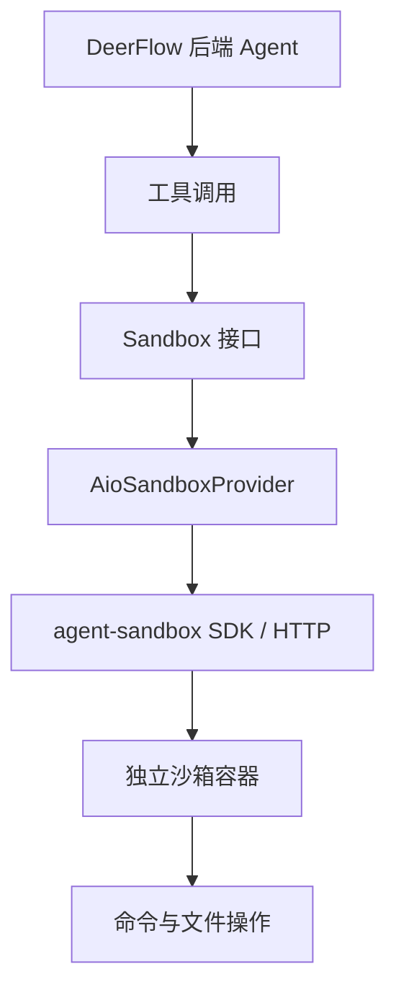
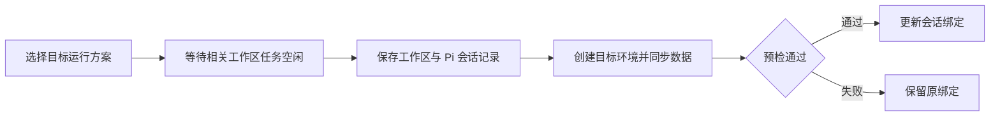
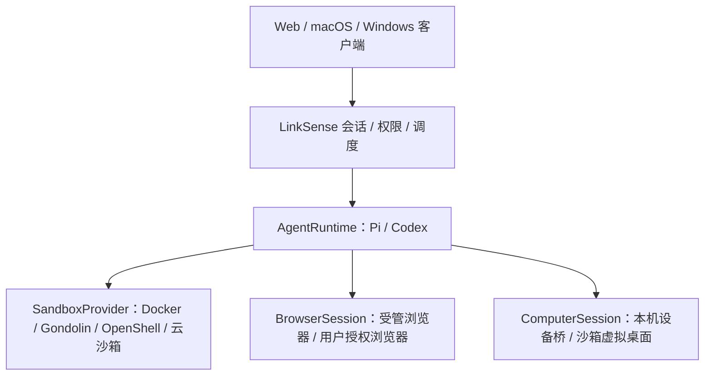

# DeerFlow、Pi、沙箱与 LinkSense Desktop：完整会话总结

- 整理日期：2026-10-21，Asia/Shanghai。
- 文档性质：会话纪要、源码调研总结及后续架构建议，不是已交付功能清单。
- 覆盖范围：上游会话中可见的 DeerFlow 调研和 Side Chat 背景，以及本次旁聊关于沙箱、Pi、运行环境配置、性能、Desktop、Browser Use、Computer Use 的全部实质讨论。
- 当前产品目标：LinkSense 保留已有能力，逐步支持可替换的 Agent 引擎与执行环境，并为首期 **macOS + Windows** 桌面应用预留本机设备能力。
- 本次交付：只新增本总结文档；没有实施文中架构重构，没有启动上游沙箱、桌面应用或云服务，没有运行性能基准。

> 阅读约定：**已确认需求**来自用户明确表述；**已核对事实**表示存在相应源码或官方文档证据，不代表经过运行验证；**建议方案**尚待设计和实现；**待验证**不得视为已具备能力。

## 1. 会话起点与需求演进

### 1.1 最初目标：研究 DeerFlow，但只借鉴 LinkSense 缺少的能力

用户最初要求阅读 [bytedance/deer-flow](https://github.com/bytedance/deer-flow)，了解其架构，并判断 LinkSense 可以参考的地方。随后明确增加约束：

1. 推荐之前必须核对 LinkSense 的现有实现，按用户已经能完成的事情去重。
2. 不应因为代码中缺少同名模块，就断言缺少对应功能。
3. “扩展审查”和“运行诊断”两个方向暂不继续，转而挖掘其他增量。
4. 对 Side Chat，希望继续完善交互，并从可点击原型推进到实际产品。

这些约束贯穿后续讨论：现有 Worker、会话、浏览器、文件、知识、异步处理能力应优先复用。

### 1.2 上游会话中的 Side Chat 与相关修改

以下是继承历史里可见的需求与选择，不是本次旁聊重新执行的任务：

| 主题 | 用户要求或已选择方向 | 本文对状态的表述 |
| --- | --- | --- |
| Side Chat 原型 | 先做可点击原型；原型提供“并排旁聊 / 原位追问” | 历史中明确讨论过原型及其后续实现 |
| 旁聊交互 | 主任务保持可见；旁聊结论先带回输入框，由用户发送 | 作为已讨论的产品方向保留 |
| 默认背景 | 默认附带前 2 条消息，可以取消 | 用户明确选择；后续旁聊源码也存在对应查询逻辑 |
| 功能入口 | 用户反馈找不到启动入口 | 记录为历史可发现性问题，本次未重新验收入口 |
| 图标 | 用户要求统一消息工具栏三个图标的颜色 | 记录需求，不据此声称本次修改了样式 |
| Code Review | 覆盖当时全部未提交改动，并修复问题；用户确认没有其他任务并行修改 | 本次旁聊未重新执行该次审查或完整测试 |
| 输入焦点 | 消息发送后保持输入框焦点，同时关注主任务和旁聊 | 记录需求，不据此补造测试结果 |
| Git 推送 | 用户曾要求推送，并明确推送全部改动到远程 main | 本次未执行 Git 推送，也不把历史请求本身视为推送成功证据 |
| 继续研究 | 继续分析 DeerFlow 中 LinkSense 没有的功能 | 本次进一步聚焦执行架构与桌面能力 |

当前旁聊读取过的 [Side Chat 模块](../../apps/api/src/modules/conversations/side-chat.ts#L29) 说明：引用来源仍与 `codexThreadId` 关联；可按开关读取所选消息之前的两条用户/助手消息。这既证明已有业务基础，也暴露了后续引擎解耦的一个实际影响点。

历史里的多次“OK”确认没有增加新的业务要求。用户偏好是在范围明确后继续完成工作，避免重复确认。

### 1.3 本次旁聊的主要问题顺序

1. DeerFlow 的 Sandbox 如何实现？底层 Agent 是否是 Pi？
2. LinkSense 能否支持第三方 Sandbox Provider，把现有 Docker Worker 作为其中一个实现？
3. 能否基于 Pi 二次开发，逐步解除对官方 Codex app-server 的强制依赖？
4. Pi 是否有现成的沙箱集成或推荐方向？
5. Pi + Docker / Gondolin / OpenShell 如何切换？安装过程和设置页如何选择？性能如何？
6. 后续 Desktop、Browser Use、Computer Use 会对这些边界产生什么影响？
7. 用户明确确认 Desktop 首期支持 **macOS + Windows**。
8. 最后要求把整个讨论整理为详细 Markdown 文档。

## 2. 当前结论与决策状态

| 项目 | 状态 | 准确含义 |
| --- | --- | --- |
| 可替换 Sandbox Provider | 用户明确希望支持 | 现有用户 Docker Worker 要作为一个 Provider 保留 |
| 第三方和自定义沙箱 | 用户明确希望支持 | 需要逐个 SDK 适配，或约定自定义服务协议 |
| 解除 Codex 强制绑定 | 用户明确表达目标 | Pi 是本次重点评估的替代引擎，尚未完成接入 |
| Pi 的技术可行性 | 已完成源码/文档层核查 | SDK 和远程工具扩展边界存在，功能等价尚未验证 |
| 先 Pi + Docker，再扩展其他沙箱 | 已讨论并得到积极回应 | 作为建议推进方向，不能视为已完成实现或最终上线默认值 |
| Gondolin | 可选后端候选 | 新增 Windows 桌面要求后，不适合作为两端统一的原生默认后端 |
| OpenShell | 可选受控执行后端候选 | 本机运行支持和远程连接能力要分别评估 |
| 安装选择 + 设置管理 | 建议方案 | 当前尚无完整的 Pi/Gondolin/OpenShell 产品切换入口 |
| Desktop 首期系统 | **用户已确认** | macOS + Windows |
| Electron | 倾向优先评估 | 尚未选定框架，也没有创建桌面工程 |
| 本机设备桥 | 架构建议 | 用于承接桌面权限、捕获、输入和本机浏览器连接 |
| 性能排名 | 未形成 | 没有 LinkSense 同机、同版本、同负载横向实测 |

关键原则：Agent 引擎、执行沙箱、浏览器会话、本机电脑控制是可以组合的不同边界。选择其中一个，不自动意味着其他能力已实现。

## 3. DeerFlow 的底层 Agent：不是 Pi

### 3.1 已核对的技术路径

DeerFlow 主 Agent 使用 Python，基于 LangChain 的 `create_agent()` 和 LangGraph 构建。DeerFlow 自己负责组合模型、工具、Skills、子 Agent、中间件、提示词及状态。

主 Agent 构造函数明确调用 `langchain.agents.create_agent()`，传入 `model`、`tools`、`middleware`、`system_prompt`、`state_schema` 等参数。它不是以 Pi 作为主执行引擎。[Agent 构造源码](https://github.com/bytedance/deer-flow/blob/main/backend/packages/harness/deerflow/agents/lead_agent/agent.py)、[harness 依赖](https://github.com/bytedance/deer-flow/blob/main/backend/packages/harness/pyproject.toml)

LangChain/LangGraph 提供底层模型与工具执行循环，DeerFlow 提供具体的运行策略和产品接入。模型调用层与 Agent harness 不是同一个概念。[LangChain Agent 文档](https://docs.langchain.com/oss/python/langchain/agents)

### 3.2 与 LinkSense 的对应关系

| 层次 | LinkSense 当前路径 | DeerFlow 当前路径 |
| --- | --- | --- |
| 产品入口 | Web、API、Runner、任务与应用 | Web、Gateway、线程与运行入口 |
| Agent 引擎 | 官方 Codex app-server | LangChain/LangGraph 加 DeerFlow 自有编排 |
| 模型接入 | 经 Codex 与 LinkSense 模型网关 | 经配置的模型适配器 |
| 执行环境 | 用户 Docker Worker，另有本地进程实现 | 可替换 Sandbox Provider |
| 复用边界 | 同一用户可复用 Worker 和相应工作区 | AIO 路径按用户与会话关联沙箱 |

此前仓库调研文档还记录了 Next.js 前端、FastAPI Gateway、内嵌运行时、持久化与事件桥接等整体结构；这些属于既有调研背景，不应与本次读取的最新主线文件混成一个固定提交。[既有架构调研](../../docs/research/deer-flow-architecture-2026-10-19.md)

## 4. DeerFlow Sandbox 的实现方式

### 4.1 Agent 与执行环境分层

以 AIO 模式为例，主要链路为：

`agent-sandbox` 是沙箱服务客户端，不是另一个 Agent 引擎。AIO 沙箱使用 [agent-infra/sandbox](https://github.com/agent-infra/sandbox) 的运行环境；镜像集成的服务能力与 DeerFlow 实际启用的工具应分别看待。[AIO 客户端实现](https://github.com/bytedance/deer-flow/blob/main/backend/packages/harness/deerflow/community/aio_sandbox/aio_sandbox.py)

### 4.2 抽象与生命周期

DeerFlow 将命令执行、文件读取/写入、目录与搜索等操作放在 Sandbox 抽象中；Provider 负责获取、连接和释放环境。

沙箱中间件默认按需获取环境。AIO Provider 管理容器发现、复用和回收，并可把已释放的运行环境放入暖池；释放不必立即等于删除。多实例环境还需要协调所有权，避免一个实例回收另一个实例仍在使用的沙箱。[沙箱中间件](https://github.com/bytedance/deer-flow/blob/main/backend/packages/harness/deerflow/sandbox/middleware.py)、[AIO Provider](https://github.com/bytedance/deer-flow/blob/main/backend/packages/harness/deerflow/community/aio_sandbox/aio_sandbox_provider.py)

### 4.3 文件持久化与并行子 Agent

本地 AIO 路径会挂载会话的 `workspace`、`uploads`、`outputs` 等目录，使文件生命周期可以独立于容器。远程环境能否直接共享目录，则取决于具体部署和存储方案，不能默认把本机绑定挂载等同于远程可见。

同一会话的主 Agent 与子 Agent 可以共享沙箱。AIO 为并行执行范围提供独立 Shell session，减少当前目录和环境变量互相干扰；共享文件的并发写入仍需另外协调。[目录挂载与身份关联](https://github.com/bytedance/deer-flow/blob/main/backend/packages/harness/deerflow/community/aio_sandbox/aio_sandbox_provider.py)、[Shell session 实现](https://github.com/bytedance/deer-flow/blob/main/backend/packages/harness/deerflow/community/aio_sandbox/aio_sandbox.py)

### 4.4 Provider 的隔离能力不同

本地 AIO 可以管理 Docker 或 Apple Container；远程 AIO 可以通过 Provisioner 创建 Kubernetes 沙箱。配置中也提供 BoxLite micro-VM 等其他方向。

需要特别保留的事实：当前示例配置默认是 `LocalSandboxProvider`，在后端所在环境直接执行，默认关闭主机 Bash。它不提供独立的 Shell 安全隔离边界。产品里的“Sandbox”名称不能替代对具体 Provider 隔离方式的核验。[沙箱配置](https://github.com/bytedance/deer-flow/blob/main/config.example.yaml)、[本地容器后端](https://github.com/bytedance/deer-flow/blob/main/backend/packages/harness/deerflow/community/aio_sandbox/local_backend.py)、[远程后端](https://github.com/bytedance/deer-flow/blob/main/backend/packages/harness/deerflow/community/aio_sandbox/remote_backend.py)

## 5. LinkSense 已有基础与真正的耦合点

### 5.1 已有用户 Worker，不需要重新发明容器平台

LinkSense 已为活跃用户动态管理 Docker Worker。同一用户的多个任务可复用 Worker，并共享相应 HOME 和 `CODEX_HOME`；无项目任务与同项目任务有各自的工作区复用规则。

隔离边界是用户 Worker，不是同一用户内部的每个项目目录。闲置回收、资源限制以及交付成果的独立持久化，已经有现成基础。[Worker 模型](../../README.zh-CN.md#L246)

因此，“DeerFlow 有 sandbox”本身不是 LinkSense 缺少的功能；真正新增的是第三方执行环境接入和引擎解耦。

### 5.2 已有 WorkerProvider

本次读取的接口已经包含：

- `initialize`、`discover`：初始化和发现运行实例。
- `prepareOwnerFilesystem`：准备用户文件系统。
- `acquire`、`resume`、`inspect`：获取、恢复和检查 Worker。
- `release`、`shutdown`：释放与关闭。
- 健康信息与用户环境关联查询。

现有实现为 `DockerWorkerProvider` 和 `LocalProcessWorkerProvider`，由注册工厂根据配置选择。这个接口管理的是完整 Worker 的放置与生命周期，还不是通用沙箱的命令/文件协议。[WorkerProvider](../../apps/runner/src/controller/worker-provider.ts#L52)、[注册工厂](../../apps/runner/src/controller/worker-provider-registry.ts)

需要继续复用它的现有实现，再补足第三方环境契约；不应另起一套重复的 Docker 管理器。

### 5.3 Codex 绑定不只在 JSON-RPC 客户端

| 位置 | 本次核对到的绑定 | 对 Pi 接入的影响 |
| --- | --- | --- |
| Runner 启动 | 执行模式在启动时检查 Codex 二进制版本 | Pi 路径需要独立的引擎启动与健康检查 |
| 版本配置 | 当前严格匹配 `0.154.0` | 版本约束应归属 Codex 适配器 |
| Process Pool | 直接创建 Codex 客户端并调用 thread/turn/fork/goal 等原生接口 | 需要明确的引擎调用边界 |
| 共享事件 | 已做事件映射，但多种结构仍带 Codex 类型与状态形状 | Pi 需要自己的映射，不能伪造 Codex 原生事件 |
| 数据库存储 | Conversation 保存 `codexThreadId`，ConversationTurn 保存原生线程/轮次 ID | 多引擎需要明确归属与兼容迁移 |
| Side Chat | 来源校验和回合查询依赖当前 Codex 线程 | 更换引擎会触及实际产品功能 |
| Worker 健康信息 | 包含 `codex_home`、app-server 进程及模型目录信息 | 需要按启用引擎展示和准入 |
| 模型网关 | 包含面向 Codex 的协议桥接及轮次关联 | 保留凭据、用量和授权职责，调整引擎特定部分 |

对应源码：[Runner 入口](../../apps/runner/src/index.ts#L64)、[版本校验](../../apps/runner/src/codex/runtime-version.ts#L19)、[版本配置](../../apps/runner/src/codex/runtime-version.json)、[Process Pool](../../apps/runner/src/process-pool.ts)、[事件映射](../../apps/runner/src/codex/event-mapper.ts)、[数据库模型](../../prisma/schema.prisma#L840)、[模型网关](../../apps/runner/src/model-gateway/model-gateway.ts)

这里的版本锁定是 LinkSense 针对已适配协议的严格兼容检查。解除全局绑定的正确方向，是把各引擎的启动、版本与协议约束收敛到对应适配器，而不是让所有执行路径共同通过 Codex 检查。

## 6. 基于 Pi 二次开发的可行性

### 6.1 推荐从 coding-agent SDK 接入

Pi 官方提供可嵌入 Node.js 的 `pi-coding-agent` SDK。会话核对时，原 `badlogic/pi-mono` 地址已重定向至 [earendil-works/pi](https://github.com/earendil-works/pi)，当前文档使用 `@earendil-works` 包名；选型时应按实际发布版本核验，避免混用不同年代的示例。

建议先用 SDK 和扩展点做 LinkSense 适配，复用其会话和运行行为。直接只用更底层的 Agent core，会扩大需要由 LinkSense 自行承担的职责。[Pi 项目](https://github.com/earendil-works/pi)、[SDK 文档](https://github.com/earendil-works/pi/blob/main/packages/coding-agent/docs/sdk.md)

### 6.2 可以复用的能力

Pi SDK 提供 Agent 会话、工具调用、流式事件、中断、运行中追加指令、上下文压缩和会话持久化。`SessionManager` 管理持久历史及分支，而不是把一份临时消息数组视为全部会话状态。

SDK 的运行事件、重试和排队语义需要按其自身契约映射；不能把一次低层循环结束直接认定为整个用户请求不再继续。[会话与事件契约](https://github.com/earendil-works/pi/blob/main/packages/coding-agent/docs/sdk.md)

### 6.3 远程沙箱有可用的扩展边界

Pi 官方提供 SSH 远程执行示例，可以将读写文件、编辑和 Bash 的底层操作委托给远程机器。相同边界可以进一步适配第三方沙箱 SDK。[远程工具示例](https://github.com/earendil-works/pi/blob/main/packages/coding-agent/examples/extensions/ssh.ts)

这提供的是接入可行性证据，不表示 E2B、Daytona 等已在 LinkSense 中接通。

### 6.4 需要继续适配或补齐的部分

| 类型 | 具体内容 |
| --- | --- |
| LinkSense 业务接入 | 权限、调度、统一事件、凭据、模型用量、文件交付与审计 |
| 功能迁移 | MCP 与 Skills 配置、旁聊和分支、审批、上下文来源等 |
| 能力差异 | 子 Agent 编排、计划模式、持续目标、Codex 原生插件与 Hook 行为 |
| 兼容性 | 历史会话、已有安装资源、数据库字段和旧事件的继续使用 |

Pi 的 coding-agent README 明确说明默认省略子 Agent 与计划模式，不能把这些直接当作已等价能力。当前 SDK 文档同时提到了内置 MCP 扩展，因此也不应基于“Pi 完全没有 MCP”的旧假设评估；LinkSense 的授权和配置适配仍需完成。[Pi 功能定位](https://github.com/earendil-works/pi/blob/main/packages/coding-agent/README.md)、[扩展文档](https://github.com/earendil-works/pi/blob/main/packages/coding-agent/docs/extensions.md)

### 6.5 解除绑定后的目标与限制

目标应包括：

1. Pi 路径不要求安装、启动或通过 Codex 二进制版本检查。
2. Codex 路径继续遵守原生协议；现有会话的行为不被 Pi 适配反向改变。
3. 各引擎分别报告能力与可用状态，由产品据此展示支持的功能。
4. Pi 依赖也锁定版本并验证升级，变化影响限制在对应适配边界。

换成 Pi 可以减少全局 Codex 耦合，但不会自动消除依赖升级、模型效果和维护成本问题。是否达到现有功能质量，需要真实任务验证。

## 7. 第三方沙箱与自定义 Provider

### 7.1 本次讨论过的候选

| Provider | 主要定位 | 需要适配的重点 |
| --- | --- | --- |
| 现有 Docker Worker | 当前默认基线 | 复用用户隔离、工作区、资源控制与回收 |
| E2B | 云沙箱 | 连接、命令和文件操作、暂停恢复与生命周期 |
| Daytona | 远程执行/开发环境 | 文件、进程、镜像、持久卷与生命周期 |
| OpenSandbox | 可自建的通用沙箱平台 | 统一执行 API、Docker/Kubernetes 后端、部署和存储 |
| Custom HTTP Provider | 自有或其他第三方服务 | 实现约定协议，或增加受信任的服务端适配器 |

官方入口：[E2B SDK](https://e2b.dev/docs)、[Daytona SDK](https://www.daytona.io/docs/en/typescript-sdk/)、[OpenSandbox](https://github.com/opensandbox-group/OpenSandbox)

“自定义”不能被理解为任意填入一个 URL 就能兼容所有服务。不同供应商的鉴权、命令、文件、状态和错误格式都可能不同。

### 7.2 最小公共能力与可选能力

建议将公共基础控制在以下范围：

- 获取/创建、连接、检查和释放运行环境。
- 命令执行、流式输出、截止时间及真实进程终止。
- 文件读取、写入、上传与下载。
- 环境身份、用户归属和可恢复引用。

休眠、快照、端口暴露、浏览器、图形桌面等应作为可选能力声明，不能要求每个 Provider 都假装支持。

单纯取消客户端 HTTP 等待不等于远端命令已经停止；同样，环境磁盘存在不等于运行进程或登录状态仍可恢复。这些行为必须进入 Provider 的契约测试。

### 7.3 生命周期不能统一为一个含糊的 stop

需要区分：释放租用、暂停计算、停止进程、保留磁盘、删除环境和删除持久数据。

例如，E2B 文档提供包含内存状态的暂停恢复，也有仅文件系统的路径；Daytona 的 Volume 可以独立于被删除的 Sandbox 保留。应按具体模式评估，而不是笼统断言所有快照都保留或都不保留内存。[E2B 持久化](https://docs.e2b.dev/sandbox/persistence)、[Daytona Volumes](https://www.daytona.io/docs/en/volumes/)

## 8. Pi 生态中的现成沙箱集成

### 8.1 官方列出的四种路径

Pi 官方隔离指南列出普通 Docker、Docker Sandboxes、NVIDIA OpenShell 和 Gondolin 扩展，没有规定唯一默认方案。[Pi 隔离指南](https://github.com/earendil-works/pi/blob/main/packages/coding-agent/docs/containerization.md)

| 方案 | 运行边界 | 本次评估定位 |
| --- | --- | --- |
| 普通 Docker | 整个 Pi 和扩展在容器内运行 | 最容易与现有 Worker 对接 |
| Docker Sandboxes | 专门的受管理沙箱产品 | 与普通 Docker 容器分开评估 |
| NVIDIA OpenShell | Pi 在受策略控制的执行环境中运行 | 可选受控本地/远程后端 |
| Gondolin 扩展 | Pi 在外层运行，内置工具委托给 micro-VM | Pi 生态中的本地 VM 候选 |

完整 Pi 进程隔离与仅隔离工具的区别必须保留。后一种模式下，扩展若自行访问外层进程环境，不会因为内置工具进入 VM 就自动受到同样约束。

### 8.2 Gondolin

Gondolin 与 Pi 位于同一个组织下，有 TypeScript SDK 和 Pi 集成示例。它提供本地 Linux micro-VM、文件与网络控制、服务入口和磁盘检查点。[项目说明](https://github.com/earendil-works/gondolin)

QEMU 路径可利用 Linux KVM 或 macOS HVF；没有硬件加速时的软件模拟会明显更慢。另有实验性 krun 后端，功能和配置兼容性需按版本核验。[QEMU 说明](https://github.com/earendil-works/gondolin/blob/main/docs/qemu.md)

其当前限制包括不支持原生 Windows 宿主运行，以及没有完整的进程/内存检查点恢复。默认临时文件目录也不能一概当作已持久化文件。[当前限制](https://earendil-works.github.io/gondolin/limitations/)

会话中的推荐因此发生了收敛：起初将它列为 Pi 的优先本地 VM 候选；确认 Desktop 要支持 macOS + Windows 后，调整为可选后端，不能承担两端统一的本机设备能力。

### 8.3 NVIDIA OpenShell

OpenShell 提供 Gateway、运行后端和策略控制。它能约束文件、进程、网络和凭据使用，接受对应后端支持的 Linux 工作负载。[架构](https://docs.nvidia.com/openshell/about/architecture)、[支持矩阵](https://docs.nvidia.com/openshell/about/support-matrix)

一个 Gateway 同时使用一个计算后端。若希望同时开放 Docker、VM、Kubernetes 路径，可通过不同 Gateway 建立多个 LinkSense 运行方案。[后端选择](https://docs.nvidia.com/openshell/how-it-works/sandboxes/runtimes)

其公开支持矩阵中，Windows 的 WSL 2 + Docker Desktop 路径仍为实验性。Windows Desktop 连接到远端 Linux Gateway，与在 Windows 本机运行该后端是两件事；前者也仍需验证设备连接、鉴权和文件链路。

### 8.4 容易混淆的名字

- **OpenShell**：本次讨论的 NVIDIA 受控运行环境。
- **OpenSandbox**：通用沙箱平台，提供沙箱管理和执行接口。
- **Docker Worker**：LinkSense 当前的用户执行单元。
- **Docker Sandboxes**：Docker 的专门沙箱产品。[产品文档](https://docs.docker.com/ai/sandboxes/)
- **Gondolin 沙箱中的 Linux**：与用户正在使用的 macOS/Windows 桌面不是同一个操作系统实例。

## 9. 安装、设置与用户选择的产品方案

### 9.1 使用“运行方案”作为用户入口

建议把以下配置组合保存为一个可命名的运行方案：

| 内容 | 示例 |
| --- | --- |
| 引擎 | Pi / Codex |
| 沙箱类型 | Docker Worker / Gondolin / OpenShell / 云沙箱 |
| 连接与镜像 | 受控服务地址、镜像或模板标识 |
| 资源策略 | CPU、内存、并发、截止时间与闲置策略 |
| 持久化规则 | 工作区和会话保存位置、恢复能力 |
| 权限范围 | 哪些用户可以使用、开放哪些能力 |

用户可以看到“标准开发”“虚拟机隔离”“受控执行”等名字，模型选择继续独立。运行方案是产品配置，不表示模型、引擎和沙箱已经绑定为不可拆分组件。

### 9.2 三个入口的职责

| 入口 | 建议职责 |
| --- | --- |
| 安装过程 | 选择要启用的组件；检测宿主平台与虚拟化条件；准备所选依赖和镜像 |
| 管理员设置 | 新增/测试/启用运行方案；管理受控凭据、资源和系统默认；限制用户可选范围 |
| 个人设置与新建会话 | 在已开放方案中设置个人默认，或为新会话选择一次覆盖 |

缺少宿主条件的 Provider 应准确显示不可用原因。设置页中的开关不能替代安装 QEMU、准备宿主权限或部署 Gateway。

### 9.3 与现有设置边界的关系

当前 Runner 通过环境变量选择 `docker / local-process`，现有系统设置页主要管理明确开放的产品参数，其他基础设施参数仍由部署侧管理。新增网页运行环境管理，需要一个受控配置模块及后端校验，不能假定已有设置页已经可以配置这些 Provider。[Runner 配置](../../apps/runner/src/config.ts#L81)、[设置边界文档](../../apps/docs/docs/admin-guide/system-settings.md)

凭据需要受控保存和脱敏展示；保存、测试、启用以及调整默认值应有明确状态，避免“保存成功”被误认为执行环境已经可用。

## 10. 切换沙箱与切换引擎的行为

### 10.1 配置与会话绑定

建议每个会话记录自己的引擎、运行方案标识和配置版本。修改默认值影响新会话；已有会话继续使用原绑定，直到用户发起明确迁移。

同一用户同时使用不同运行方案时，不能只靠“用户 ID”识别所有运行实例。Provider 资源、工作区与运行方案的关联需要明确，避免一个配置的回收误伤另一个仍在使用的环境。

### 10.2 同一 Pi 引擎切换沙箱

需要保存和迁移的是可持久化文件与 Pi 会话记录。运行中的进程、Shell 环境变量、连接和 VM 内存不作为跨 Provider 的通用迁移对象。

会话共用项目工作区时，要关注该工作区的所有写入任务，而不仅是当前聊天是否空闲。迁移成功前保留可恢复来源，回收按明确生命周期执行。

### 10.3 Codex 与 Pi 之间切换

这是另一种迁移，不等同于换一个执行容器。

- 旧会话默认继续由原引擎解释原生历史。
- 跨引擎优先采用新会话/新分支导入明确上下文和文件，并保留来源引用。
- 不把聊天记录能够展示，等同于原生会话能够完整续跑。
- 不通过伪造 `codexThreadId`、`codexTurnId` 或 Codex 事件来适配 Pi。
- 不因重连、迁移或 Provider 切换自动重放完整任务。

数据库与共享契约的兼容性方案尚未设计或执行。现有历史记录、旁聊、应用资源和正在执行的任务都属于后续升级验证范围。

## 11. 性能：已知数据、影响因素与未验证部分

### 11.1 本次没有建立速度排名

没有在相同硬件、相同 Pi/模型版本、相同工具链和任务负载下运行三者比较。因此没有依据承诺 Gondolin 比 Docker 快多少，或 OpenShell 的统一启动延迟是多少。

| 组合 | 需要重点关注的成本 | 当前结论 |
| --- | --- | --- |
| Pi + 现有 Docker Worker | Worker 启动、工具和浏览器进程、依赖与工作区 I/O | 适合作为 LinkSense 基线；可复用既有环境 |
| Pi + Gondolin | VM 启动、硬件加速、单 VM 内存、文件桥接和工具调用 | 宿主条件影响很大，需要实际项目测量 |
| Pi + OpenShell | 所选后端、镜像准备、策略与控制链路、远程网络 | 应按具体 Gateway/Driver 分别评估 |

### 11.2 有出处的具体启动数据

OpenShell 上游实验性 VM 驱动 README 写明：首次沙箱启动约 **10–30 秒**，包含镜像获取、准备、缓存、libkrun 和 guest 初始化；后续创建复用准备好的镜像缓存。[VM 驱动说明](https://github.com/NVIDIA/OpenShell/blob/main/crates/openshell-driver-vm/README.md)

这个数字只描述上游文档中的特定路径，不是所有 OpenShell 后端、用户硬件或 LinkSense 工作负载的性能承诺。

### 11.3 性能应拆开测量

至少区分：

1. 首次镜像下载及准备。
2. 冷启动到第一条真实命令成功。
3. 环境就绪后的暖工具调用耗时及 P50/P95。
4. 项目搜索、较大文件操作、构建、测试和文件传输。
5. 单环境资源占用与并发情况下的吞吐、失败和尾延迟。

创建请求返回快，不一定代表环境已经可执行。桌面和浏览器环境还需要把浏览器就绪、页面可操作、画面可见分别计时。

### 11.4 远程调用的计算示例

本次举过一个纯计算示例：若每次串行工具调用额外增加 50 毫秒，100 次会增加约 5 秒等待。

这不是测量结果。它说明网络往返次数和批量操作设计会影响总体体验，不能只比较容器/VM 创建时间。

### 11.5 当前建议的优化顺序

先准备镜像与依赖、让同一会话复用环境、保留必要缓存，再根据真实瓶颈决定是否引入更复杂的预热策略。保持同一模型和推理服务，分别度量沙箱开销与端到端任务质量。

## 12. Desktop 带来的架构补充

### 12.1 用户已确认首期 macOS + Windows

这项明确选择改变了沙箱推荐的适用范围。桌面应用不仅是一个聊天窗口，还要承担：本机设备连接、系统权限、浏览器接入、画面展示、用户接管以及与远程服务的通信。

目标架构如下，图中均为设计边界，不代表这些新接口已经落地：

### 12.2 各层职责

| 层次 | 职责 |
| --- | --- |
| AgentRuntime | 调用引擎、接收状态、映射事件、暴露真实能力 |
| SandboxProvider | 工作区、命令、进程与执行隔离 |
| BrowserSession | 浏览器目标、页面动作、Profile、画面和会话控制 |
| ComputerSession / Device Bridge | 设备身份、系统捕获、原生 UI 操作、输入与用户接管 |

这允许 Agent 引擎与操作目标位于不同地点，例如服务端 Pi 操作用户授权的 Mac 浏览器。本机设备断开时，应暂停依赖该设备的动作；恢复后重新核对目标与状态。

### 12.3 Desktop 首版的建议定位

优先提供“连接已有 LinkSense 服务 + 本机设备能力”。本地 Pi 运行与本地沙箱可以是按需启用的组件，桌面客户端启动不应以安装完整服务端基础设施为前提。

完全离线的本地产品、完整后端打包和其他独立安装形态，本次没有确定方案。

### 12.4 Electron 与 Tauri 的讨论状态

基于当前 React、TypeScript、Node.js 和 Pi SDK，优先评估 Electron 是本次建议。UI、设备桥和可选 Agent 运行进程应有明确的进程与 IPC 边界，执行隔离继续交给 Sandbox Provider。[Electron 子进程能力](https://www.electronjs.org/docs/latest/api/utility-process)

Electron 的界面应保留 Context Isolation 和 renderer sandbox，通过有限的 preload/IPC 接口调用本机能力。独立 Node 子进程提供进程划分，并不自动形成与容器/VM 等价的执行隔离。[Electron 安全指南](https://www.electronjs.org/docs/latest/tutorial/security)

Tauri 也具有可行路径：使用系统 WebView，并可单独打包 Node.js sidecar。它尚未被排除或选定；桌面框架与设备协议应尽量解耦。[Tauri 架构](https://v2.tauri.app/concept/architecture/)、[Node.js sidecar](https://v2.tauri.app/learn/sidecar-nodejs/)

本次检索没有发现当前仓库已经建立的 Electron/Tauri 桌面工程，也没有创建新工程。

## 13. Browser Use：已有能力、真正增量与移植风险

### 13.1 已有受管浏览器能力

当前 `linksense-browser` 包装 Playwright CLI，统一处理会话、配置、输出目录和相应环境。普通路径与 Plan 模式的受管调用也有不同的能力限制。

相关实现已经有会话配额、命令排队、参数校验、取消、超时和输出预算。后续应复用这些契约，而不是重新描述为“从零接入浏览器”。[浏览器包装器](../../apps/runner/src/browser/cli-wrapper.ts)、[受管服务](../../apps/runner/src/mcp/managed-browser-service.ts)

这里的 Browser Use 指产品能力；是否使用同名第三方 Agent 框架是另一项技术选择，不是必需前提。

### 13.2 两种浏览器使用方式

| 方式 | 目标 | 建议路径 |
| --- | --- | --- |
| 专用自动化浏览器 | Agent 独立网页任务，可在本机或沙箱运行 | 复用 Playwright，使用独立 Profile 和清晰的会话生命周期 |
| 用户正在使用的浏览器 | 利用已登录网站和用户明确指定的页面 | 通过浏览器扩展等受控连接，限定当前连接可操作的标签页 |

Chrome 对默认用户数据目录的远程调试有明确限制；不能把直接启动默认个人 Profile 当作自动化方案。[Chrome 说明](https://developer.chrome.com/blog/remote-debugging-port)、[Playwright 持久上下文说明](https://playwright.dev/docs/api/class-browsertype#browser-type-launch-persistent-context)

Playwright 官方扩展已有连接现有浏览器、用户选择标签页及管理客户端标签分组的实现参考。本次没有安装或运行该扩展。[扩展说明](https://github.com/microsoft/playwright/tree/main/packages/extension#readme)

### 13.3 画面与控制权交接

产品需要展示 Agent 实际操作的同一个浏览器会话，不能用另开的页面代替执行现场。

建议分阶段补齐：先只读画面和页面状态，再开放用户输入与接管。接管需要明确谁拥有输入控制权；用户接管期间暂停 Agent 的页面动作，交还时重新核对页面状态。调试连接由受控服务代理，前端不直接持有未受限的 Runner 控制端口。

在本次检索范围内，LinkSense 的自动化与截图能力已经存在；完整 Live 面板、用户输入转发和独占控制权交接尚未被确认已实现。既有调研也记录了该差额。相关研究（原引用 `docs/research/deer-flow-additional-candidates-2026-10-21.md` 未随仓库收录）

### 13.4 已确认的桌面移植风险

当前 Chromium 配置包含 `headless: true` 和 `chromiumSandbox: false`。代码注释说明：浏览器在用户 Worker 容器内以非特权任务身份运行，由容器边界提供隔离。

这套配置不能直接移植为桌面浏览器启动配置。桌面目标需要保留适当的 Chromium 自身沙箱，并拆分 Linux 固定路径、容器特例和目标平台启动策略。[具体配置](../../apps/runner/src/browser/cli-wrapper.ts#L632)

这是未来直接复用时的风险，不是本次认定现有容器路径已经失去隔离，也没有在本次修改该配置。

## 14. Computer Use：真实电脑与虚拟桌面

### 14.1 三类目标不能混用

| 操作目标 | 必要能力 | 不能自动推导出的能力 |
| --- | --- | --- |
| 沙箱里的 Linux 桌面 | 图形镜像、画面传输和输入控制 | 不等于用户真实 Mac/Windows 桌面 |
| 用户 macOS 桌面 | 本机 Helper、屏幕捕获、Accessibility 与系统授权 | 不因连接云 Agent 就自动获得权限 |
| 用户 Windows 桌面 | 本机 Helper、屏幕捕获、UI Automation 与输入控制 | 不默认具备操作高权限系统 UI 的能力 |

沙箱中可以运行 Chromium，并不表示已经有完整图形桌面。本次读取的 Gondolin 示例验证的是沙箱内 Chromium 与外层 Browser Use Agent 通过 CDP 连接的路径。[Gondolin 浏览器示例](https://github.com/earendil-works/gondolin/blob/main/host/examples/browser-use.ts)

### 14.2 本机 Device Bridge 的职责

建议负责：

- 绑定并识别设备，核对当前会话授权。
- 获取所选屏幕、窗口和原生 UI 信息。
- 执行受控输入，管理人工接管与停止。
- 处理断线、权限撤销、窗口变化和无效目标。
- 将受控能力提供给 Agent，而不是把任意宿主命令执行暴露给界面。

远程服务允许使用某设备，与操作系统实际授予屏幕/辅助功能权限是两层不同条件。

### 14.3 平台差异

macOS 需要分别处理屏幕捕获和辅助功能访问。Apple 的 ScreenCaptureKit 资料和 Accessibility API 提供相应路径。[ScreenCaptureKit 示例](https://developer.apple.com/documentation/screencapturekit/capturing-screen-content-in-macos)、[Accessibility 信任检查](https://developer.apple.com/documentation/applicationservices/1459186-axisprocesstrustedwithoptions)

Windows 需要遵守 UI Automation 与进程完整性级别的限制。普通权限应用不能据此承诺控制所有管理员窗口、登录界面和受保护系统 UI。[Windows 安全边界](https://learn.microsoft.com/en-us/windows/win32/winauto/uiauto-securityoverview)

### 14.4 感知、动作与并发

推荐优先使用浏览器 DOM、macOS Accessibility 和 Windows UI Automation 的结构化信息，截图与坐标作为补充。Pi 负责工具运行循环，Computer Use 的可靠性仍依赖视觉模型、动作定位和任务验证。

需明确截图像素、设备无关坐标、Retina/Windows 缩放和多显示器映射。窗口或画面变化后，应重新确认动作目标。[Electron 坐标说明](https://www.electronjs.org/docs/latest/api/screen)

产品可以允许独立浏览器会话并行，但真实桌面的输入控制应按设备协调，避免人和多个 Agent 同时争用。供人观看的画面与供模型分析的取帧也应分别设计和测量。

## 15. Desktop 的安装与设置需要怎样调整

### 15.1 安装时按能力准备组件

建议允许选择和检测：

| 能力 | 安装/首次使用边界 |
| --- | --- |
| 桌面客户端 | 连接既有 LinkSense 服务及设备配对 |
| 本机 Browser Use | 准备受管浏览器或引导安装受控连接扩展 |
| 本机 Computer Use | 按实际使用申请系统权限，安装对应 Helper |
| 本地 Pi | 可选的本机引擎进程和受控模型接入 |
| 本地/远程沙箱 | 根据平台和已选 Provider 准备依赖或连接条件 |

Windows 桌面客户端无需因 Gondolin 缺少原生支持而整体不可用；它可以继续连接服务端执行环境。具体可开放组合需要能力检测和运行验证。

### 15.2 设置分成两个主要领域

| 设置领域 | 管理内容 |
| --- | --- |
| 运行环境 | 引擎、沙箱、资源、工作区、连接状态和默认方案 |
| 设备与浏览器 | 已配对设备、Profile、标签页/窗口范围、权限和接管状态 |

会话应清楚展示引擎运行在哪里、代码在哪个环境执行、当前浏览器属于哪个会话、电脑控制指向哪台设备。

设备配对、浏览器连接与桌面控制分别有自己的权限范围，不能把一次登录视为无限期的整机控制授权。

## 16. 建议推进顺序与验收重点

以下是讨论形成的建议路线，不是已经开始执行的开发计划。

| 阶段 | 主要工作 | 验收重点 |
| --- | --- | --- |
| 1. 明确边界 | 复用现有 WorkerProvider，建立引擎边界，拆分浏览器目标配置 | 原有 Codex + Docker 路径继续工作；历史资源和事件可用 |
| 2. Pi + Docker 闭环 | 接入 Pi SDK，与现有用户执行环境协作 | 对话、工具、停止、重连、会话恢复和交付文件 |
| 3. 远程/VM Provider | 选择代表性后端验证执行和文件协议，再扩展其他实现 | 真实终止、超时、持久化、回收、用户隔离和环境迁移 |
| 4. Desktop + 本机浏览器 | macOS/Windows 客户端、设备配对、浏览器画面与接管 | 同一实际会话、Profile 隔离、控制权交接和断线处理 |
| 5. 本机 Computer Use | 分别接入原生捕获、UI 信息和输入能力 | 权限撤销、多屏缩放、停止、设备输入协调及真实任务效果 |

引擎和沙箱接入顺序可以与桌面协议设计交错推进，但接口应提前考虑设备目标。没有必要等待所有沙箱实现完成，才开始验证浏览器和桌面连接链路。

### 16.1 升级与历史兼容

需要验证的不仅是全新安装：

- 原 Codex 会话能否继续执行，而不只是读取旧消息。
- Side Chat、分支、目标、应用和已安装资源能否继续使用。
- 新引擎字段、校验规则和事件格式对旧记录的影响。
- 已存在工作区和持久化文件的升级与恢复路径。
- 默认配置变化、Provider 禁用、失败迁移和组件升级时的行为。

本次没有确定数据库迁移内容，也没有批准丢弃历史数据或要求用户重建全部会话。

### 16.2 运行验证不能由类型检查替代

后续除了接口和权限测试，还需要真实沙箱、浏览器及双平台桌面验证。Gondolin/OpenShell 的上游示例只能建立可行性，不构成 LinkSense 的兼容性或性能验收。

## 17. 尚未确定的问题

| 领域 | 待确定内容 |
| --- | --- |
| 引擎 | Pi 首版需要覆盖哪些 Codex 功能；哪些差异明确展示或暂缓 |
| Pi 依赖 | 采用哪个稳定发布、哪些官方扩展、是否需要额外包 |
| 沙箱优先级 | 首个远程 Provider 选 E2B、Daytona、OpenSandbox 还是 OpenShell；Gondolin 的首期范围 |
| Desktop | Electron/Tauri 最终选择；本地引擎是否进入首版；签名、更新与发布方式 |
| 本机能力 | 首批支持哪些应用和任务；屏幕/窗口范围；原生 Helper 技术实现 |
| 浏览器 | 专用 Profile、个人浏览器扩展连接及登录态的产品边界 |
| 迁移 | 同引擎环境迁移、跨引擎上下文导入与历史会话兼容方案 |
| 部署 | 运行方案存储、凭据管理、实例归属、资源和计费策略 |
| 性能 | 同机基准结果、启动和交互指标、双平台资源与并发容量 |
| 模型 | GUI 场景的视觉模型、动作可靠性和端到端评估 |

用户已确认的是 Desktop 的 macOS + Windows 目标，以及希望支持可替换沙箱和解除 Codex 强制绑定的方向。上表中的方案不能因会话中的“nice”或积极回应就被当作全部批准并实现。

## 18. 上游功能去重背景与既有调研索引

本节仅归档相关背景，不继续执行主线程的其他任务。以下去重结论来自仓库已有调研记录，其固定版本与本次旁聊读取时点不同。

### 18.1 最初五个方向的去重结果

| 方向 | 已有研究记录的结论 |
| --- | --- |
| 项目指令与材料 | 共享工作区、AGENTS.md、应用指令、知识读取与历史文件引用已有基础；增量主要在入口整合 |
| Side Chat | 已有普通会话、分支和引用；值得补的是有限背景的选区旁聊和显式回填交互 |
| 大结果摘要与回取 | 文档、邮件、知识等已有分页和落盘，Codex 有原生输出预算；不应据此预建全工具通用 registry |
| 委派验收 | Plan、Goal、应用与 Skill 校验已有覆盖；不应从零新增通用验收 DSL |
| 外部异步作业 | 知识处理已有远端任务 ID、恢复、进度和取消流程；未来连接器优先复用现有模式 |

这些是历史基线的去重结论，不意味着所有实现、所有业务场景都完全等价。[原始复核文档](../../docs/research/deer-flow-new-mechanisms-2026-10-19.md)

### 18.2 新一轮功能候选

已有后续笔记保留了四项明确差额：显式引用其他会话、自动化结果主动投递 IM、条件满足后停止的监控、同一浏览器会话的可视面板与补充操作；另记录暂缓的记忆管理方向。这些仍是研究候选，不能作为本次新交付功能。后续研究（原引用 `docs/research/deer-flow-additional-candidates-2026-10-21.md` 未随仓库收录）

### 18.3 版本与证据边界

| 资料 | 记录的核对基线 |
| --- | --- |
| 2026-10-19 DeerFlow 架构与新机制研究 | DeerFlow `fee0cd0c180874325305e995197db99f03fa6a6f`；去重复核记录了对应 LinkSense 基线 |
| 2026-10-21 新一轮候选研究 | DeerFlow `d4012c4b24f9b5ee14236a8214c82815de5b5214`；LinkSense `694212b98eb331674a1f6ebdc6273a75df00333d` |
| 本次旁聊 | 只读本地工作区与上游主线源码、官方文档；当前文件和 main 链接可能继续变化 |

不能把这些不同时点的实现描述合并成“已在同一个版本全部实测”。详细上游引用和测试阅读范围，以各原始文档为准。

## 19. 证据入口汇总

### 19.1 LinkSense 本地源码

| 证据 | 主要用途 |
| --- | --- |
| [架构与 Worker 模型](../../README.zh-CN.md#L246) | 用户级隔离、工作区、回收与资源边界 |
| [WorkerProvider](../../apps/runner/src/controller/worker-provider.ts#L52) | 已有执行环境抽象 |
| [Provider 注册](../../apps/runner/src/controller/worker-provider-registry.ts) | 当前固定的实现选择 |
| [WorkerManager](../../apps/runner/src/controller/worker-manager.ts) | 用户目录、实例和健康准入 |
| [Runner 配置](../../apps/runner/src/config.ts#L81) | 当前 Provider 枚举 |
| [Runner 启动](../../apps/runner/src/index.ts#L64) | Codex 启动检查的位置 |
| [Codex 版本检查](../../apps/runner/src/codex/runtime-version.ts#L19) | 固定版本兼容约束 |
| [Process Pool](../../apps/runner/src/process-pool.ts) | 原生线程、轮次、分支和 Goal 调用 |
| [事件映射](../../apps/runner/src/codex/event-mapper.ts) | 引擎事件与内部契约 |
| [数据库模型](../../prisma/schema.prisma#L840) | 会话、原生 ID 与迁移范围 |
| [Side Chat](../../apps/api/src/modules/conversations/side-chat.ts#L29) | 已有引用逻辑与 Codex 关联 |
| [模型网关](../../apps/runner/src/model-gateway/model-gateway.ts) | 模型授权、协议桥接与轮次用量 |
| [浏览器包装器](../../apps/runner/src/browser/cli-wrapper.ts#L632) | Playwright 与容器启动配置 |
| [受管浏览器服务](../../apps/runner/src/mcp/managed-browser-service.ts) | 队列、校验、取消和输出预算 |

### 19.2 主要上游与官方文档

- DeerFlow：[主 Agent](https://github.com/bytedance/deer-flow/blob/main/backend/packages/harness/deerflow/agents/lead_agent/agent.py)、[沙箱配置](https://github.com/bytedance/deer-flow/blob/main/config.example.yaml)、[AIO Provider](https://github.com/bytedance/deer-flow/blob/main/backend/packages/harness/deerflow/community/aio_sandbox/aio_sandbox_provider.py)。
- Pi：[SDK](https://github.com/earendil-works/pi/blob/main/packages/coding-agent/docs/sdk.md)、[扩展](https://github.com/earendil-works/pi/blob/main/packages/coding-agent/docs/extensions.md)、[隔离指南](https://github.com/earendil-works/pi/blob/main/packages/coding-agent/docs/containerization.md)。
- Gondolin：[项目](https://github.com/earendil-works/gondolin)、[QEMU](https://github.com/earendil-works/gondolin/blob/main/docs/qemu.md)、[限制](https://earendil-works.github.io/gondolin/limitations/)。
- NVIDIA OpenShell：[架构](https://docs.nvidia.com/openshell/about/architecture)、[支持矩阵](https://docs.nvidia.com/openshell/about/support-matrix)、[运行后端](https://docs.nvidia.com/openshell/how-it-works/sandboxes/runtimes)。
- 第三方沙箱：[E2B](https://docs.e2b.dev/sandbox/persistence)、[Daytona](https://www.daytona.io/docs/en/typescript-sdk/)、[OpenSandbox](https://github.com/opensandbox-group/OpenSandbox)。
- 桌面与浏览器：[Electron](https://www.electronjs.org/docs/latest/tutorial/security)、[Tauri sidecar](https://v2.tauri.app/learn/sidecar-nodejs/)、[Playwright 扩展](https://github.com/microsoft/playwright/tree/main/packages/extension#readme)。
- Codex：[官方 app-server 文档](https://learn.chatgpt.com/docs/app-server)，具体接入仍须以 LinkSense 实际锁定版本的协议为准。

## 20. 本次实际完成与未完成的工作

### 已完成

1. 核对 DeerFlow 主 Agent 与沙箱的分层，确认主引擎不是 Pi。
2. 核对 LinkSense 已有 WorkerProvider、Codex 耦合、Side Chat 和浏览器执行基础。
3. 阅读 Pi SDK、远程工具扩展及相关沙箱的官方资料，形成可行性分析。
4. 明确 macOS + Windows 约束对 Gondolin、OpenShell 与本机控制的影响。
5. 整理安装、设置、切换、性能验证和分阶段推进建议，并输出本文。

### 未完成、未验证

- 未接入 Pi，未新增任何 Sandbox Provider，未建立 Desktop 工程。
- 未迁移数据库、历史会话、浏览器 Profile 或用户文件。
- 未运行 DeerFlow、Pi、Gondolin、OpenShell 或云沙箱的集成测试与性能基准。
- 未操作用户真实桌面，未安装浏览器扩展或申请系统捕获/辅助功能权限。
- 未重新验收上游历史中的 Side Chat 修复、完整 Code Review 或 Git 推送结果。

本文记录的是已讨论的事实、目标与建议。后续实施需要以实际版本、运行验证和历史资源兼容结果为准。
