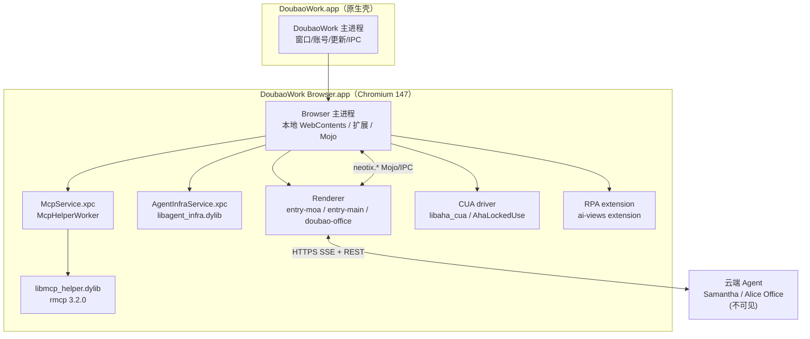

# 豆包工作 Desktop 2.36.19 Agent Harness 逆向调研

调研日期：2026-11-16。样本：`doubao_work_desktop_dbgzb_sem_pinp_hexin_cpc_xiaz_xin1_macos_v2036019_b4d5_1794570495.dmg`（SHA-256 `2e72a5b1a2ff10f2fc9a8efa6ab60f8139bed11af7ba5b3a2352778eb251eedc`，783 MB）。应用版本 **2.36.19**，Bundle ID `com.work.pc.doubao`，内置 Chromium **147.0.7727.149**，本地 Agent 基础设施 `libagent_infra.dylib` 与 Rust MCP Helper（`rmcp 3.2.0`）。[D01][D02][D03][D04]

核验方式：只读挂载 DMG，读取 `Info.plist`、`manifest.json`、`Resources`、`Helpers`、XPC 服务、Chromium Framework、`local_webcontents` 中的未加密 JS 与原生库字符串；使用 `shasum` 固定关键二进制；未启动应用、未执行任何内置脚本、未联网登录、未解出加密 pak 的 UI 内容。文中“已观察”表示静态代码/资源/符号可直接确认；“推断”表示由调用关系得出的高置信结论；“未知”表示本次未验证。

> 这是与前两家都不同的第三种形态：**Agent 的推理与编排在云端（Samantha / Alice Office），本地只负责“工具执行 + 权限 + 沙箱 + MCP + CUA + 浏览器”**。因此本次能完整还原的是“云端 Agent ↔ 本地执行器”的协议与本地工具面，而不是 Agent 循环本身。对 LinkSense 的参考价值主要在：**云端 Agent 如何安全地驱动桌面本地能力**。

---

## 0. 一页结论

1. **不是 Electron**：主程序是原生 macOS 壳（Mach-O universal，2.6 MB），真正的 UI/浏览器运行时是 `Helpers/DoubaoWork Browser.app`（Chromium 147 定制版，1.8 GB Framework）；主进程与浏览器通过 XPC/Mojo 协作。[D01][D02]
2. **Agent 循环在云端（推断）**：`entry-moa/main.js` 里没有本地 LLM 循环或系统提示词；它通过 `/alice/office/tool_local/chunk_stream`（SSE）接收服务端下发的 `TOOL_CALL` / `COMMAND` / `HEARTBEAT`，在本地执行后把结果上传回 `/alice/office/tool_local/upload_tool_call_result_v2` 等端点。服务端循环本身不可见。[D05][D06]
3. **本地工具执行器是 C++ 原生库**：`libagent_infra.dylib` 提供 `local_runtime:shell:*`、`local_runtime:file*:*`、`local_runtime:process:*`、`local_runtime:env:*`、`local_runtime:instance_group:*`、`cua:call_tool` 等命令，覆盖 shell 会话、文件读写/编辑/搜索、Spotlight 文件搜索、用户环境、沙箱实例与 CUA。[D03][D07]
4. **MCP 是独立 Rust 进程**：`libmcp_helper.dylib` 内嵌 `rmcp 3.2.0`，支持 stdio / legacy HTTP+SSE / streamable HTTP、OAuth PKCE/issuer 校验/刷新、分页 tools/list、resources/prompts/sampling/elicitation/tasks；由 `McpService.xpc` 以 worker 形式监管，通过 Mojo/Browser IPC 与页面通信。[D04][D08]
5. **工具集是 Claude-Code 风格**：前端适配器注册 `Bash`、`Read`、`Write`、`Edit`、`Grep`、`Glob`、`NotebookEdit`、`TaskOutput`、`TaskStop`、`SandboxEnvCreate/Query/Activate/Update`、`interaction.authorize_folder`；工具输入支持 `sandbox_permissions`、`justification`、`cmd_popup_warn`、`run_in_background`、`env_vars` 等。[D05][D09]
6. **权限模式三档**：`AlwaysAsk` / `AskOnRisk` / `FullAccess`（持久化为 `ask_always` / `ask_risky` / `always_allow`），并区分“文件目录授权”“Bash 沙箱升级”“危险命令确认”三类交互。[D09][D10]
7. **沙箱是系统级**：本地执行通过 ByteDance `sbox` SDK（`libauditSboxSDK.dylib`）或 macOS `seatbelt` 回退；沙箱权限对象包含 `filesystem.deny/readOnly/readWrite` 与 `network.allow/deny`；有文件/进程/网络审计回调。[D11]
8. **消息总线是“至少一次 + 可恢复”**：工具调用消息有 `CREATED → ACKED → … → COMPLETED` 状态与 `held/executing/settled/uploading/completing` 阶段；客户端 `ack`、`fetch`、`complete`、结果上传、断点恢复、checkpoint 都有显式实现。[D06]
9. **服务端下发工具调用带设备签名**：`signedEnvelope` 包含 `device_id/key_id/signature/timestamp_ms/user_id` 与 `tool_use_id/name/input/option`；客户端可校验来源，防止伪造工具调用。[D05]
10. **UI 是“本地 WebContents + 扩展”**：`local_webcontents/apps/{doubao-office,entry-main,entry-moa}` 是 Chromium 本地 app，`extensions/{ai-views,rpa-component-extension}` 是 MV3 扩展；资源以专有 `.pak` 打包（标准 DataPack 头不匹配，且随包带 `liblark_resource_encrypt.dylib`，推断为加密/自定义格式）。[D12]

---

## 1. 应用形态与包结构

### 1.1 包事实

| 项 | 值 |
| --- | --- |
| DMG | 783 MB，read-only 挂载 |
| App | `DoubaoWork.app` |
| Bundle ID | `com.work.pc.doubao` |
| 版本 | 2.36.19 |
| 主可执行 | `Contents/MacOS/DoubaoWork`（x86_64 + arm64，2.6 MB） |
| 浏览器运行时 | `Contents/Helpers/DoubaoWork Browser.app`（1.8 GB，Chromium 147.0.7727.149） |
| 本地 Agent 基础设施 | `Helpers/DoubaoWork Browser.app/.../Libraries/libagent_infra.dylib`（15 MB） |
| MCP 运行时 | `Helpers/libmcp_helper.dylib`（27 MB，Rust `rmcp 3.2.0`） |
| XPC 服务 | `AgentInfraService.xpc`、`McpService.xpc`（含 `McpHelperWorker`） |
| 本地 Web 应用 | `Resources/local_webcontents` 565 MB（apps / biz / extensions） |
| Finder 扩展 | `Contents/PlugIns/finder-ext.appex` |
| 签名配置 | `Contents/embedded.provisionprofile` + `Resources/manifest.json`（trustedOrigins 签名） |

关键哈希：[D02][D03][D04]

| 文件 | SHA-256 |
| --- | --- |
| `Contents/MacOS/DoubaoWork` | `c771165cdb1267d2dab22a36f595119c1bc37b56384620d31fb1ea84df26e23c` |
| `Helpers/libmcp_helper.dylib` | `f7a1835de1a646944c6501b9426bb2d47834d46383b53d59948efaa4d3dd8304` |
| `Libraries/libagent_infra.dylib` | `08480ab0f7a3b19530317ed2abb987fe02dbf8cddec6d58ac2a455ddd5146279` |

### 1.2 与 Electron 的差异

- 没有 `Frameworks/Electron Framework.framework`，也没有 `app.asar`。
- 主程序是原生壳，负责窗口、菜单、更新、账号、IPC 与启动浏览器 Helper。
- UI 由 Chromium 定制版加载本地 WebContents（HTML/JS）与扩展；`DoubaoWork Browser.app` 自身带完整 Chromium Framework、`XPCServices`、`Libraries`、`Helpers`。
- `豆包.app` 是 `com.work.pc.doubao.linkrouter`（链接路由），`relaunch_helper`、`saman_updater` 负责重启与更新。

---

## 2. 进程与服务拓扑



要点：

- **Agent 推理在云端**：Renderer 通过 SSE 接收工具调用，执行后上传结果；本地没有 LLM 循环（`entry-moa/main.js` 中未发现 system prompt / LLM 请求构造，只有工具适配与消息总线）。[D05]
- **本地执行在 XPC**：`AgentInfraService` 加载 `libagent_infra.dylib`，提供 `agent_infra` 运行时对象；`McpService` 以 supervisor + worker 的方式运行 Rust MCP Helper。[D03][D04][D08]
- **渲染层与原生层通过 `window.neotix` 桥**：385 个 `neotix.*` 方法，覆盖 sandbox、sandboxFs、sandboxBash、mcp、computerUse、browserUse、agentTask、aiSkills、fs、dbStorage、runtimeStorage、account、tabs、multiPage、remote 等。[D09]

---

## 3. 云端 Agent ↔ 本地执行协议

### 3.1 传输

- 工具调用通道：`/alice/office/tool_local/chunk_stream`，SSE；事件类型枚举为 `1=TOOL_CALL`、`2=COMMAND`、`3=HEARTBEAT`。[D05]
- SSE 客户端实现了 `Last-Event-ID` 重连、事件签名（`signature` 字段）、UTF-8 增量解码、AbortController 取消。[D05]
- 结果回传：`/alice/office/tool_local/upload_tool_call_result_v2`、`upload_tool_call_result`、`upload_command_result`、`upload_ask_human_result`、`upload_ask_human_warn_result`、`upload_prebuild_sandbox_result`。[D06]
- 消息总线：`/alice/office/tool_local/msg/fetch|ack|complete|fetch_agent_miss`；客户端按 `msg_id` 拉取、确认、完成。[D06]
- 设备/沙箱信息：`sandbox_info_report`（`protocol_version: "v1.0.0"`, `agent_id`, `info`, `connectors`, `mobile_context`）、`device_info_report`（`connect_info`）。[D06]
- 公钥：`/alice/office/tool_local/client_event_public_key` 用于校验服务端事件/工具调用的设备签名。[D06]

### 3.2 工具调用消息（已观察的字段）

服务端下发的工具调用被解析为：[D05]

```json
{
  "id": "tool call id",
  "name": "Bash | Read | Write | Edit | Grep | Glob | NotebookEdit | ...",
  "input": { "...": "..." },
  "agent_meta": {
    "assistant_message_id": "...",
    "question_id": "...",
    "sandbox_auth_type": "..."
  },
  "option": {
    "env_vars": "{\"KEY\":\"VALUE\"}",
    "...": "..."
  },
  "need_ack": true,
  "signedEnvelope": {
    "device_id": "...",
    "key_id": "...",
    "signature": "...",
    "timestamp_ms": 0,
    "user_id": "...",
    "tool_use_id": "...",
    "tool_use_name": "...",
    "tool_use_input": "...",
    "tool_use_option": { "...": "..." }
  }
}
```

`input` 既可能是对象，也可能是 JSON 字符串；解析失败会带 `inputParseFailed`。`env_vars` 是每个工具调用的运行时秘密，注入到本地执行环境（例如 Bash 的环境变量）。[D05]

### 3.3 沙箱命令（`name: "sandbox"`）

`sandbox` 命令有三种 `type`：[D09]

| type | 含义 | 关键字段 |
| --- | --- | --- |
| 1 | connect | `agent_id`、`connection_id`、`sandbox_id`、`task_id` |
| 2 | disconnect | 同上 |
| 3 | release | `sandbox_id` |

校验规则包括：缺 `sandbox_id`、agentId 不匹配、连接 ID 与沙箱 ID 不一致等都会拒绝并报错。收到 `INIT_AGENT_ENV` 时，客户端会 `ack` 对应 `msg_id`，并查询本地技能目录（`neotix.aiSkills.getLocalSkillsByWorkspace`），把 `localSkillDirs` 提供给 Agent。[D06][D09]

### 3.4 消息生命周期

前端实现了显式的消息状态机：[D06]

- 状态：`CREATED`、`ACKED`、`COMPLETED`（及中间状态）；
- 阶段：`held`、`executing`、`settled`、`uploading`、`completing`；
- 恢复：
  - `restore` 会重建未完成的上传/完成；
  - `checkpoint` 保存已 settle 但结果尚未清理的消息；
  - 工具结果有 `resultRestore`；
  - 服务端把消息标为 `COMPLETED` 时，客户端会 abort 仍在执行/held 的同 ID 工具；
  - `AGENT_RECONNECT` / heartbeat 维持连接。

这是一个**至少一次投递 + 客户端幂等/恢复**的设计，适合桌面端断网、休眠、切前后台。

---

## 4. 本地执行器：`libagent_infra`

### 4.1 运行时命令面

从符号与字符串可还原的命令命名空间（已观察）：[D03][D07]

| 命名空间 | 命令 |
| --- | --- |
| `local_runtime:shell` | `run_task`、`list_tasks`、`query_task_result`、`stop_task`、`write_to_task`、`close_stdin` |
| `local_runtime:file` | `read`、`write`、`edit`、`glob`、`grep`、`search`、`note_book_edit`、`create_temp_file`、`read_to_temp_url`、`register_access_scope`、`unregister_access_scope` |
| `local_runtime:file_tool` | `read`、`write`、`edit`、`read_notebook`、`get_info` |
| `local_runtime:process` | `run_process`、`stop_process`、`list_processes`、`query_process_result` |
| `local_runtime:env` | `probe`、`check`、`list`、`delete`、`ensure_prepared`、`query_prepare`、`cancel_prepare`、`get_shell_type`、`set_shell_type` |
| `local_runtime:instance_group` | `create`、`destroy`、`query`、`update_permission` |
| `local_runtime:runtime_policy` | `get` |
| `local_runtime:user_environment` | `refresh` |
| `cua` | `call_tool`、`version` |

实现要点（符号/字符串）：

- **shell**：非交互 shell session、持久 shell、PTY/pipe 传输回退、后台任务、输出文件、16 MiB IPC 帧限制、超时、进程树清理；
- **file**：读写/编辑（带 diff 选项）、glob/grep、Spotlight 文件搜索（`DarwinSpotlightSearchWorker`）、访问范围（`ScopedAccessToken`）、临时文件/临时 URL；
- **process**：一次性进程运行、进程列表、停止、结果查询；
- **env**：用户 shell 环境探测/准备/刷新、shell 类型切换、环境安装进度；
- **instance_group**：沙箱实例组、权限版本（`update_permission` 带 `expectedVersion`）；
- **CUA**：动态加载 CUA SDK（`cua sdk loader darwin`），`call_tool` / `version`。

### 4.2 沙箱

`libagent_infra` 链接/加载 `libauditSboxSDK.dylib`，并保留 `seatbelt` 回退：[D11]

- `SBoxSDK_Init` / `CreateSandbox` / `SetSBoxType` / `GetSBoxInfo` / `UnInit`；
- `sbox process` / `file_audit` / `network audit` 回调，带 `sbox_id`、`instance_id_hash`；
- macOS 不支持 sbox SDK 时回退 `seatbelt`；
- 内部配置：`sbox_readonly_dir`、`enable_sbox_create_fallback`、`enable_mac_sbox_sdk`；
- 进程启动带 `SandboxAuditScope`，shell 进程可走 PTY 或 pipe。

---

## 5. 工具系统（前端适配器）

### 5.1 工具清单

`entry-moa/main.js` 注册的工具适配器（已观察，工具名字面量）：[D09]

| 工具 | 说明 |
| --- | --- |
| `Bash` | 本地 shell；支持沙箱/非沙箱、后台任务、自动转后台（15s）、超时、`sandbox_permissions`、`justification`、`cmd_popup_warn`、运行时 env vars |
| `Read` | 文本 v2 / 媒体（图片/PDF/Office 预览）/ Notebook；支持 `limit/offset/pages`、图片/PDF 读取、上传型读取 |
| `Write` | 写文件；`diffOptions.enabled`，返回 `changeReport.unifiedDiff`；权限升级后重试（unsandboxed） |
| `Edit` | old/new 字符串替换；`replaceAll`；同样有 diff 与权限升级重试 |
| `Grep` | 原生 sandboxFs.grep：`-i`、`-A/-B/-C`、`glob/include`、`head_limit`、`line_numbers`、`multiline`、`offset`、`output_mode`、`path`、`pattern`、`type` |
| `Glob` | 原生 glob：符号链接、目录、排序（modified/name）、最大 10 万结果、300s 超时 |
| `NotebookEdit` | cellId/cellType/editMode(new_source/replace/insert/delete)，读写 Notebook |
| `TaskOutput` | 读取后台 shell 任务输出，支持 block/timeout |
| `TaskStop` | 停止后台 shell 任务 |
| `SandboxEnvCreate` | 创建本地环境（env、name、description、packages） |
| `SandboxEnvQuery` | 查询环境列表 |
| `SandboxEnvActivate` | 激活环境 |
| `SandboxEnvUpdate` | 更新环境 |
| `interaction.authorize_folder` | 文件夹授权交互（选择并允许、scope once/always） |

> 工具名只覆盖本地适配器；MCP 工具（连接器/插件）通过 `neotix.mcp.getAllTools` 动态接入，服务端按名称下发调用。

### 5.2 输入规范化与执行细节

- **Bash**：
  - `bash_sandbox_escape` 字段可携带 `justification`、`cmd_popup_warn`、`require_escalated_no_need_authorization`；
  - `sandbox_permissions` 为 `use_default` 或 `require_escalated`；
  - `require_escalated` 必须带 `justification`，否则直接返回错误；
  - 普通命令超时默认 15s，最大 600s；升级/弹窗命令超时可达 30 分钟+；
  - 支持 `run_in_background`；前台命令在 15s 后自动转后台；
  - 用户拒绝时返回 `decision: "reject"`，不执行命令。[D09]
- **Read/Write/Edit**：
  - 失败分类里有 `PERMISSION_DENIED`、`ReadOnlyMutation`；
  - 命中权限错误时，如果开启 `filePermissionElevationEnabled`，会弹文件权限升级；批准后以 `unsandboxed` 重试；
  - 写/编辑返回 `changeReport.unifiedDiff` 与文件变更回执（用于 UI diff 和后续回滚）。[D10]
- **Grep/Glob**：结果超过 5 万字符会截断并标注省略字符数；空结果有独立提示。
- **TaskOutput/TaskStop**：绑定 `sandboxId`、`instanceId`、`taskId`，并把后台任务与工具调用关联，供 UI 展示与中断。
- **SandboxEnv***：环境有 `envId`、`status`、`installProgress`、`packages`；任务类型 `LocalFile` / `GeneralAgent` / `SuperMode`。[D09]

### 5.3 工具调用超时与中断

- 每个工具适配器有 `timeoutConfig.resolveTimeoutMs`，例如 Bash 按是否升级动态计算；
- 执行上下文含 `executionDeadlineAt`、`executionSignal`、`sandboxId`、`sandboxLogId`、`sandboxAuthType`、`signedShellApi`；
- 工具交互（权限/提问/文件夹选择）通过统一的 interaction 框架创建、展示、超时和取消；超时会被标记 `timedOut` 并回传；
- `toolCallAbort` 管理后台 shell 任务与活动工具，服务器把消息标为完成/替换时会 abort。

---

## 6. 权限模型

### 6.1 三档授权模式

前端枚举：[D09][D10]

| 模式 | 存储值 | 语义 |
| --- | --- | --- |
| `AlwaysAsk`（0） | `ask_always` | 每次需要授权 |
| `AskOnRisk`（1） | `ask_risky` | 仅风险操作询问 |
| `FullAccess`（2） | `always_allow` | 全部允许 |

模式持久化在 `samantha-web-authorization-mode`（share runtime storage），并通过 `UpdateShareRuntimeStorage` 广播同步；带 `version`、`confirmedAlwaysAllow`、`skillDelivered`、`updatedAt`，旧写入会被拒绝。[D10]

### 6.2 交互类型

前端枚举的交互命令（`e9`）：[D09]

```
DEVICE_ENABLE_CONTROL_REQUEST/RESPONSE
GET_META_REQUEST/RESPONSE
COMPLETION_REQUEST/RESPONSE
DEVICE_STATUS_CHANGE
INTERACTION_ASK_HANDLE
INTERACTION_REQUEST_ACTION_HANDLE
INTERACTION_WARN_HANDLE
INTERACTION_AUTHORIZE_FOLDER_HANDLE
INTERACTION_ASK_V2
INTERACTION_RESPONSE
RTC_START_ROOM_REQUEST/RESPONSE
GET_REMOTE_FILES_CONTENT_REQUEST/RESPONSE
```

对应能力：

- **Ask Human**：服务端要求用户确认/补充信息，客户端弹出交互并把结果上传 `upload_ask_human_result`；
- **Warn**：风险提示，`require_ask_human_warn` + `upload_ask_human_warn_result`；
- **Authorize Folder**：选择文件夹并授权，`select_and_allow`、scope `once/always`、`suggestedScope`；
- **Request Action**：把工具请求映射为 UI 操作（完成/跳过/取消），由 `interaction.authorize_folder` 等适配器解析。

### 6.3 沙箱权限对象

前端把服务端权限转换为本地沙箱权限：[D10]

```json
{
  "filesystem": {
    "deny": ["..."],
    "readOnly": ["..."],
    "readWrite": ["..."]
  },
  "network": {
    "allow": ["..."],
    "deny": ["..."]
  }
}
```

- 实例组创建/更新权限带 `expectedVersion`，防止并发覆盖；
- 权限模式 `permissionMode` 与 `sandboxAuthType` 会传入本地执行器；
- 会话/环境状态会暴露 `deniedFolders`、`readOnlyFolders`、`readWriteFolders`、`envInstallProgress`、`activeShellTaskIds` 给 UI。

### 6.4 设备签名

客户端从服务端获取 `client_event_public_key`，校验工具调用信封的签名（`device_id/key_id/signature/timestamp_ms/user_id` + `tool_use_*`）。这保证本地执行的是“服务端为该设备签署的调用”，而不是任意网页/第三方伪造的调用。[D05][D06]

---

## 7. MCP 运行时

### 7.1 实现

`libmcp_helper.dylib` 是 Rust 实现，内嵌 `rmcp 3.2.0`，由 `McpService.xpc` 以 supervisor/worker 模式运行（`mcp.mojom.McpWorkerSupervisor` / `McpWorkerObserver`）。[D04][D08]

支持的传输：

- **stdio**：子进程 MCP；
- **legacy HTTP+SSE**：初始化探测 + SSE 端点；
- **Streamable HTTP**：优先，支持 legacy 回退；
- **OAuth**：PKCE、authorization server metadata、issuer 校验、动态客户端注册、token 刷新/撤销、`AUTH_REQUIRED` 状态；
- **x-mcp-header**：允许把请求头映射到 MCP 参数，但有类型/非空校验；
- **分页 tools/list**：有总超时、最大页数、重复 nextCursor 防护；
- **resources/list、resources/templates/list、resources/read**：有总超时与结果大小限制；
- **prompts、sampling/createMessage、elicitation、tasks**：schema 中可见；
- **tools 订阅**：`tools/subscription`、`tools refresh`；
- **取消**：`MCP cancellation notification`、活动工具调用取消。

### 7.2 Browser IPC 约束

MCP Helper 与浏览器之间通过 IPC 传输，代码里明确有：

- `Browser IPC frame limit` / `Browser IPC byte budget`；
- 输出队列关闭/预算关闭时丢弃事件并记录；
- 工具结果接近限制时告警；
- 只允许可序列化事件。

### 7.3 连接器与技能

- MCP 连接器由 `/alice/office/skills/manage/connector/*` 管理（创建、连接、断开、OAuth authorize/finish/status、启用/禁用、batch update）。[D06]
- 本地 MCP 配置可由 `neotix.mcp` 读取工具/资源并调用；MCP 会话由 `McpService` 托管，页面只持有桥接 API。
- 工具名称/描述/annotations 由 MCP server 提供，Harness 侧只做展示与调用。

---

## 8. 浏览器、CUA 与远程控制

### 8.1 浏览器自动化

- Chromium 147 定制版，扩展：
  - `extensions/ai-views`：MV3 side panel + content scripts，权限包含 `tabs`、`cookies`、`webRequest`、`scripting`、`sidePanel`、`declarativeNetRequest`、`bookmarks`；[D12]
  - `extensions/rpa-component-extension`：`debugger`（CDP）、`tabs`、`tabGroups`、`<all_urls>`、`downloads`、`nativeMessaging`，描述为“豆包浏览器自动化助手”。[D12]
- `window.neotix.browserUse`：createPage、closePage、listPages、registerPage、sendCdpCommand、createTask、destroyTask、listTasks、showAskHumanInChatSidePanel、showPermissionSettings 等。[D09]
- `window.neotix.agentTask`：createAgentTask、createWindow、offscreen view 的显示/隐藏/重载、`sendCDPMessage`、结果视图、下载目录、重命名下载文件、`showAskHumanPopup`。[D09]
- 此外还有 `multiPage`、`tabs`、`browserSettings` 等浏览器控制面。

### 8.2 CUA

- `libaha_cua.dylib` + `AhaLockedUse` 服务（`Resources/cua`）提供桌面控制；
- `window.neotix.computerUse` 有 43 个方法：takeScreenshot、launchApp、bringAppToFront、getProcessList、terminateProcessByName、enter/exitComputerUseMode、PIP 环境初始化、预览任务、权限检查、GUI 用户操作回调、RDP 占位等；[D09]
- 支持“人在回路”：`showAskHumanInChatSidePanel` / `showAskHumanInPopup`、`setComputerUseNeedsIntervention`、`setComputerUseTaskPaused`、`setComputerUseVisualFeedback`；
- 还带 `computer_recording`（4 MB）资源，可能用于录屏/回放（未验证）。

### 8.3 远程控制/多设备

- `@alice/dispatch/*`：设备发现、设备授权、设备信息、发送命令、设备状态、RTC session meta；[D06]
- `neotix.RemoteSession`：joinRoom/leaveRoom/sendMessage/updateToken；
- `neotix.computerUse` 含 PIP/RDP/远程桌面占位；
- 多环境 Agent：`sandbox_info_report` 以 `agent_id` 维度报告可用性、连接器、mobile_context；`multi_env_agent_*` 日志显示同一 Agent 可对应多个环境/设备。[D06]

---

## 9. 技能、连接器与本地数据

### 9.1 技能

- 云端技能：`/alice/office/skills/*`（list/my、enterprise、featured、store、install、uninstall、enable/disable、plugin、package、connector、suggestion、record_exposed）。[D06]
- 本地技能：`neotix.aiSkills.getLocalSkillsByWorkspace`、`getLocalSkillManifestContent`、`setLocalSkillEnabled`；`INIT_AGENT_ENV` 时把 `localSkillDirs` 传给 Agent。[D09]
- 技能包/插件支持 `package` 安装、`plugin` 安装、企业/个人范围、OAuth 连接器。

### 9.2 本地文件与存储

- `neotix.fs` / `sandboxFs`：文件选择、路径信息、创建目录、读写、图片信息；
- `neotix.aiUserAgentWorkspace`：Agent 工作区的 createFile/createDirectory/appendFile/writeFile/updateInitParam；
- `neotix.dbStorage` / `runtimeStorage`：IndexedDB/本地运行时键值；
- `neotix.imagexUploadNative`：上传资源；
- 语音：`neotix.audioRecorder`、`voice` 相关桥；`computerRecording` 资源另计。

---

## 10. UI 与本地 WebContents

### 10.1 本地应用

`Resources/local_webcontents`：[D12]

```
apps/
  doubao-office/   # Office 文档处理（xlsx/pptx/csv/docx/doc），main.js + doubao_office.pak + liblark_export.dylib
  entry-main/      # 主入口
  entry-moa/       # Agent/工作台入口（2.8 MB，工具适配与 Agent 客户端都在这里）
biz/
  ahalets/         # worklet：IM SDK、Office SDK 共享 worklet
  biz.pak          # 180 MB
extensions/
  ai-views/        # MV3 side panel + content scripts
  rpa-component-extension/  # 浏览器自动化（debugger/CDP）
```

`apps/doubao-office/manifest.json` 声明支持 `.xlsx/.pptx/.csv/.docx/.doc`，`type: "web"`，`main: main.js`；`main.js` 是 Chromium app shim，实际页面资源在 `doubao_office.pak`。

### 10.2 Pak 格式

- `doubao_office.pak`（113 MB）与 `biz.pak`（180 MB）的头部不匹配标准 Chromium DataPack v4/v5 的字段布局；
- 同目录存在 `liblark_resource_encrypt.dylib`（Lark 资源加密）；
- 推断：UI 资源经过专有加密/打包，运行时由浏览器解密加载；本次未尝试解密。

因此本报告对 UI 的分析主要基于未加密的 `main.js`/扩展 JS，而不是 pak 内页面。

---

## 11. 可靠性与安全工程

### 11.1 可靠性

- **消息状态机**：ack/fetch/complete + 上传/完成阶段 + 断点恢复 + checkpoint；
- **SSE 重连**：Last-Event-ID、心跳、事件签名；
- **工具中断**：服务器标记消息完成/替换时 abort 对应工具；
- **后台任务**：Bash 自动转后台、TaskOutput/TaskStop、任务与工具调用关联；
- **进程清理**：shell 进程树、MCP worker reaper、CUA 服务停止、XPC 父进程监视（`parent_process_watcher_mac`）；
- **重试**：MCP helper 的 stdio/HTTP/SSE 重连与工具调用超时；技能/连接器 API 重试；
- **限流/限额**：MCP 分页上限、结果大小上限、IPC 帧限制、工具输出截断。

### 11.2 安全

- **签名清单**：`Resources/manifest.json` 用签名声明 `trustedOrigins`（doubao/cici/dola 及其 CDN、多个扩展 ID），限制 INIT/FRAME/SCRIPT 来源；[D13]
- **设备签名**：工具调用信封带设备签名，客户端校验公钥；
- **XPC 隔离**：AgentInfra 与 MCP 各自独立 XPC 服务，MCP worker 由 supervisor 管理；
- **沙箱**：sbox SDK / seatbelt + 文件/进程/网络审计；
- **权限三档 + 目录授权 + Bash 升级审批**；
- **敏感值**：运行时 secrets 通过 `option.env_vars` 只进入执行环境，不进入展示；工具结果/日志有截断与脱敏逻辑（未逐条审计）。

---

## 12. 与 WorkBuddy、小浣熊的对比

| 维度 | WorkBuddy 5.11.3 | 小浣熊 1.2.0 | 豆包工作 2.36.19 |
| --- | --- | --- | --- |
| 壳 | Electron 37 | Electron 41 | 原生 macOS + Chromium 147 |
| Agent 位置 | 本地 daemon（Node/TS） | 本地单进程（Python） | **云端（Samantha/Alice）** |
| Agent 循环 | 可见（CodeBuddy） | 可见（box_agent） | **不可见（服务端）** |
| 本地职责 | 会话/工具/沙箱/MCP | 会话/工具/沙箱/MCP/记忆 | **工具执行/沙箱/MCP/CUA/权限** |
| 协议 | ACP v2 + Effect RPC | ACP + 扩展方法 | HTTP SSE + 消息总线 + 设备签名 |
| 工具暴露 | 内置 + 客户端 MCP + Executor | `tool_search`/`tool_ref` 延迟 MCP | 服务端下发 + 本地适配器 + MCP |
| 权限 | requestPermission 选项 | capability + scope + 临时/持久 | 三档模式 + 交互 + 沙箱升级 |
| 沙箱 | sandbox-center | Jupyter sandbox + workspace | sbox SDK/seatbelt + 审计 |
| 记忆 | 云端 + 本地文件 | 本地 v2 + MemoryHost | 未在本地发现记忆子系统（推断为云端） |

三个样本共同说明：**桌面 Agent 不一定把循环放在本地**。LinkSense 若选择“云端 Agent + 本地工具”，豆包的协议（签名信封、消息 ack/complete、沙箱实例、权限交互）是最直接的参考；若选择“本地 Agent”，WorkBuddy/小浣熊的会话与工具协议更合适。

---

## 13. 对 LinkSense 的启示

1. **三种部署形态要明确选型**：
   - 本地 Agent（Codex app-server 类）：隐私、离线、低延迟；
   - 云端 Agent + 本地工具（豆包）：模型/编排集中，桌面只做执行；
   - 混合（小浣熊的 MemoryHost 也是本地服务）。
   LinkSense 已有 `apps/api` + `apps/runner`，天然适合“云端编排 + 本地 runner 执行工具”，但需定义与豆包类似的安全边界。
2. **工具调用信封必须可验证**：服务端签名 + 设备密钥 + `tool_use_*` 绑定，能防止网页/第三方伪造工具调用；比“共享 secret”更细粒度。
3. **消息总线要可恢复**：`ack → fetch → execute → upload → complete` + checkpoint + 断点恢复，适合桌面休眠/断网；这比单纯 SSE 流更稳。
4. **权限交互要分层**：模式（AlwaysAsk/AskOnRisk/FullAccess）+ 单次交互（ask human/warn/folder authorize）+ 沙箱升级（Bash 精确命令 + justification），三层组合可解释、可审计。
5. **本地执行器独立成进程**：AgentInfra XPC + MCP XPC + CUA 服务，崩溃隔离、权限隔离、可单独更新；比把所有工具塞进主进程更安全。
6. **MCP 用成熟实现**：Rust `rmcp` 覆盖 stdio/SSE/streamable HTTP/OAuth/分页/取消，避免自研协议细节；LinkSense 的 MCP 层可直接采用官方 SDK。
7. **浏览器与桌面控制单独授权**：RPA 扩展用 `debugger` 权限，CUA 用独立服务与 PIP/RDP；两者都需要“人在回路”弹窗和中断能力。
8. **不要假设 UI 可静态分析**：豆包的 UI 资源加密，说明桌面产品可以把前端资产作为受保护资产；LinkSense 若需要可审计性，应保持 UI 可读或提供调试构建。

---

## 14. 未验证与风险声明

- **Agent 循环、系统提示词、模型、上下文压缩、记忆策略均在云端**，本包内不可见；本文没有对这些做任何行为断言。
- 未启动应用；未验证 SSE 实际消息、签名校验、权限弹窗、沙箱策略、CUA、MCP OAuth、浏览器自动化的运行行为。
- UI 的 `.pak` 资源未能解析（头部不符合标准 DataPack，且存在资源加密库）；未尝试解密。
- `libagent_infra.dylib`、`libmcp_helper.dylib` 的结论来自符号/字符串与静态结构，未做反编译级别的控制流验证。
- 未审计 `libaha_cua.dylib`、`AhaLockedUse`、RPA 扩展、连接器 MCP 的第三方代码与网络行为。
- 未读取任何用户数据、凭据、登录态；未连接豆包服务端。
- 版本差异：Chromium/AgentInfra/MCP Helper 都可能随版本变化；本文只对 2.36.19 样本负责。

---

## 附录 A：证据索引

| 编号 | 证据 | 说明 |
| --- | --- | --- |
| D01 | DMG 挂载 + `Info.plist` | 版本 2.36.19、Bundle ID、原生壳 |
| D02 | `MacOS/DoubaoWork` 哈希与 Mach-O 结构 | 主程序（universal） |
| D03 | `libagent_infra.dylib` 哈希/符号/字符串 | 本地运行时命令面 |
| D04 | `libmcp_helper.dylib` 符号/字符串（`rmcp 3.2.0`） | MCP 实现 |
| D05 | `local_webcontents/apps/entry-moa/main.js`（SSE、工具调用、适配器） | 云端 Agent 客户端 |
| D06 | `entry-moa/main.js` 中的 `/alice/office/tool_local/*`、`/alice/office/skills/*`、`/alice/dispatch/*` | 协议与 API |
| D07 | `libagent_infra.dylib` 中的 `local_runtime:*` 命令 | 本地执行器命令 |
| D08 | `XPCServices/{AgentInfraService,McpService}.xpc` 与 `McpHelperWorker` | XPC/MCP 监管 |
| D09 | `entry-moa/main.js` 中的 `neotix.*` 方法表、工具名、权限枚举 | 桌面桥与工具 |
| D10 | `entry-moa/main.js` 中的授权模式、sandbox 权限对象、交互类型 | 权限模型 |
| D11 | `libagent_infra.dylib` 中的 `SBoxSDK_*` / `seatbelt` / audit | 沙箱 |
| D12 | `Resources/local_webcontents`、扩展 manifest、`liblark_resource_encrypt.dylib` | UI 形态与 pak |
| D13 | `Resources/manifest.json`（base64 签名数据） | trustedOrigins / 来源限制 |

## 附录 B：关键目录

```text
DoubaoWork.app/Contents/
├── MacOS/DoubaoWork                    # 原生壳（universal）
├── Helpers/
│   ├── DoubaoWork Browser.app/         # Chromium 147 定制浏览器
│   │   ├── Contents/Frameworks/.../Libraries/
│   │   │   ├── libagent_infra.dylib    # 本地 Agent 执行器
│   │   │   ├── sbox/audit/             # sbox 沙箱（libauditSboxSDK/sandbox-launcher）
│   │   │   ├── libmcp_helper.dylib     # Rust MCP（rmcp）
│   │   │   ├── liblark.dylib / liblark_resource_encrypt.dylib
│   │   │   └── libVolcEngineRTC / libByteRTC* / libAGFX ...
│   │   ├── Contents/XPCServices/
│   │   │   ├── AgentInfraService.xpc
│   │   │   └── McpService.xpc/Helpers/McpHelperWorker
│   │   └── Contents/Resources/
│   │       ├── local_webcontents/
│   │       │   ├── apps/{doubao-office,entry-main,entry-moa}/
│   │       │   ├── biz/{ahalets,biz.pak}
│   │       │   └── extensions/{ai-views,rpa-component-extension}/
│   │       ├── cua/                    # libaha_cua + AhaLockedUse
│   │       ├── computer_recording/
│   │       └── manifest.json
│   ├── libmcp_helper.dylib
│   ├── relaunch_helper
│   ├── saman_updater
│   └── 豆包.app                        # linkrouter
├── PlugIns/finder-ext.appex
└── Resources/
    ├── manifest.json                   # 签名 trustedOrigins
    └── ...
```

## 附录 C：术语

| 术语 | 含义 |
| --- | --- |
| Samantha / Alice Office | 豆包的云端 Agent/会话服务（推断命名来自 API 路径） |
| AgentInfra | 本地工具执行基础设施（shell/file/process/env/sandbox/CUA） |
| sbox | ByteDance 的沙箱 SDK |
| MCP Helper | Rust `rmcp` 驱动的 MCP 客户端 worker |
| TOOL_CALL / COMMAND | SSE 下发的工具调用/控制命令事件 |
| sandbox command | connect/disconnect/release 本地沙箱实例的命令 |
| multi_env_agent | 同一 Agent 跨多个沙箱环境/设备的模型 |
| RPA extension | 带 `debugger` 权限的浏览器自动化扩展 |
| Pak | Chromium 资源包（本样本为专有/加密格式） |
