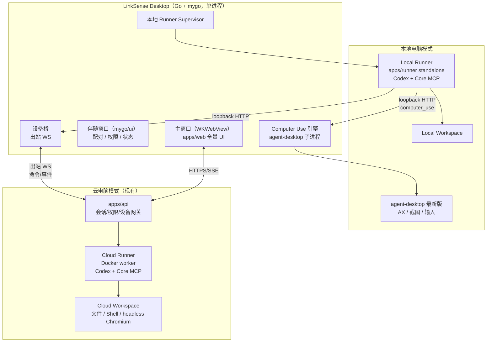

# LinkSense 桌面端方案（v2）：本地电脑 + 云电脑（Docker Runner）

日期：2026-11-16，2026-11-17 修订。依据：本仓库现有实现，以及 WorkBuddy、商汤小浣熊、豆包工作三份逆向调研。本文是**方案**，不包含实现改动。

> 2026-11-17 修订：桌面壳由 Electron 改为 **Go + mygo**；明确客户端是**完整应用**（主窗口 webview 承载 `apps/web` 全量 UI），computer use 参考 `feat-computer-use:apps/desktop` 的初稿实现，在当前 `feat` 上重建并扩展。

已确认的产品决策：

- 桌面壳：**Go + mygo**（`github.com/egoist/mygo` v0.7.4，MIT）。客户端是**完整 LinkSense 桌面应用**：主窗口用 mygo webview 承载 `apps/web` 全量 UI，Go 侧提供窗口、托盘、深链、更新、本地 runner 监督、设备桥与 computer-use 引擎；单二进制，无 Electron/Node 运行时。
- 开发基线：**当前 `feat` 分支**。`feat-computer-use` 分支的 `apps/desktop` 只作为 **computer use 的参考实现**（Go + mygo：配对、设备 WS、引擎、权限/暂停、打包脚本），不整分支合并、不 cherry-pick；需要的代码按当前主线结构重写/摘取并逐文件 review。
- 本地电脑：**macOS + Windows**（两个客户端平台）；不做 Linux 客户端。
- 云电脑：**就是现有的 Docker 隔离 runner**（Linux），不新建 Windows VM / WebRTC / PIP 基础设施。
- `agent-desktop`：确认上游为 `vercel-labs/agent-desktop`（Apache-2.0）；现有桌面应用已封装它，本期继续用它实现 local computer use，并采用**最新版**（当前 1.3.1）。

> 重要边界：现有 Docker runner 是**无图形界面的 Linux 执行环境**（文件、Shell、headless Chromium），不是“能看到 Windows 桌面并接管鼠标键盘”的云 PC。LinkSense 本期**不做 Windows 云电脑**（Windows VM / RDP / 视频流）；本地 Windows 客户端要做。“云电脑”= 云端 Linux 隔离执行环境。如果以后要“可视化云桌面”，只在 Linux 容器内做（见 §15.1），不引入 Windows。

---

## 0. 结论摘要

1. **桌面端不重写 Agent**：复用 `apps/web`、`apps/api`、`apps/runner`、Codex app-server、Core MCP、会话/回合/事件/SSE。
2. **两种模式 = 两种执行位置**：
   - **本地电脑**：Agent 在桌面本地 runner 中运行；文件/Shell/浏览器/桌面操作都在本机；桌面操作通过应用内 computer-use 引擎 + `agent-desktop`。
   - **云电脑**：Agent 在现有 Docker 隔离 runner 中运行；文件/Shell/headless Chromium 在容器内；桌面端只是 UI，不需要新云桌面基础设施。
3. **云电脑已经存在**：现有 Docker runner 就是“每用户隔离的云端执行环境”。Web 端现在的会话就是云模式；桌面端云模式复用同一套 API/runner/SSE，只是换了宿主 UI。
4. **本地模式需要反向设备通道**：家用网络中的 Mac 不能被云端 HTTP 直连。API 增加 Desktop Device Gateway，桌面应用主动建立出站 WebSocket；API 通过该通道下发命令、接收事件，设备不暴露入站端口；本地 runner 经桌面应用转发。
5. **computer use 有参考实现**：`feat-computer-use:apps/desktop` 已实现配对（`/api/v1/computer-use/pair`）、设备 WS（`/socket`）、5 分钟任务授权、暂停与 `agent-desktop 1.0.2` 引擎；本期参考它，在当前 `feat` 上重建 `apps/desktop`，再扩展出主窗口、本地 runner 监督与完整产品能力。
6. **权限分三层**：产品模式（每次询问/风险时询问/完全访问）、能力授权（computer.observe/act、filesystem、shell、browser）、执行端强制（本地应用引擎的 OS 权限/任务授权；云端 runner 的容器/工作区边界）。
7. **模式选择在会话级**：`Conversation.executionTarget = local | cloud`；Web 端默认 cloud，桌面端新建可选 local。切换需显式确认 + continuation，不静默切换。
8. **本期不做**：Windows 云电脑（VM/RDP/视频流）、Linux 桌面客户端、WebRTC/PIP 可视化云桌面、混合模式（云 Agent + 本地工具）。协议保留扩展点。

---

## 1. 目标与非目标

### 1.1 目标

- 桌面端可创建/继续会话，使用与 Web 一致的对话、计划、表单、工件、知识库、浏览器能力。
- **本地电脑模式**：Agent 读写本地工作区、执行 Shell、操作用户浏览器、通过可访问性树/截图操作本地桌面应用；用户可暂停/停止。
- **云电脑模式**：复用现有 Docker runner 的隔离执行（文件/Shell/headless 浏览器）；桌面端体验与 Web 会话一致。
- 两种模式共享会话事件、权限卡片、审计与 UI 组件；差异只在执行位置。
- 复用现有六语言 i18n、设计系统、测试与部署流程。
- 客户端是**完整产品**（会话、计划、表单、工件、知识库、浏览器面板、设置），不是只做设备配对或 computer use 的伴随程序；主窗口直接承载 `apps/web` 构建。
- 单二进制 Go 应用，无 Electron/Node 运行时；安装包为 `.app`/DMG 与 Windows 安装器，签名 + 公证/Authenticode + 自动更新。

### 1.2 非目标（本期）

- 不做 Windows **云电脑**（VM/RDP/视频流）、PIP 窗口、鼠标键盘接管。
- 不做 Linux 桌面客户端；不做 Windows 云桌面基础设施。
- 不做“云 Agent + 本地工具”或“本地 Agent + 云电脑”的混合模式。
- 不替换 Codex app-server，不复制其回合/审批/压缩语义。
- 不做云电脑计费结算；只预留 usage/quota。

---

## 2. 现有基础

### 2.1 LinkSense 现有能力

| 能力 | 现有实现 | 桌面端复用 |
| --- | --- | --- |
| Web UI | `apps/web` React/Vite、shadcn、TanStack Query、i18n | mygo webview 加载同一构建 |
| API | `apps/api` Fastify、Zod、Prisma/Postgres、Redis/BullMQ | 新增 desktop 模块 |
| Runner | `apps/runner` controller/worker/standalone、Codex app-server、Core MCP | 本地 standalone + local-process；云端保持 worker |
| 会话/回合 | `Conversation`、`ConversationTurn`、`ConversationEvent`、`PendingRequest`、`ConversationUserInputRequest` | 原样使用；新增 executionTarget |
| 事件流 | SSE（`sse_event_id` + 断点） | 桌面 UI 复用 |
| 工具注入 | `mcp/core-service-registry.ts` 的 Core MCP 模块 | 新增 `computer_use` 模块（本地） |
| 本地浏览器 | Chrome/Edge MV3 扩展、配对/授权/虚拟指针/截图浮窗、`browser_use` 工具链 | 桌面端复用；不内嵌浏览器 |
| 桌面参考实现 | `feat-computer-use:apps/desktop`（Go + mygo，computer use 初稿）；`outputs/desktop` 的 `agent-desktop` 1.0.2 与打包产物 | 仅作参考；在当前 `feat` 重建并扩展为完整客户端；agent-desktop 随包发布 |

### 2.2 Docker runner 的能力边界（关键）

现有 Docker runner（`deploy/docker/Dockerfile.runner`）是：

- **Linux 容器**，每用户/会话隔离；
- Node 24、Python 3.12、`linksense-browser`（Playwright/Chromium **headless**）、文件服务、Codex app-server、Core MCP；
- 工作区、上传/下载、技能、连接器、知识库；
- 无 X11/Wayland 桌面、无 Windows、无屏幕视频、无鼠标键盘接管。

因此：

| 需求 | 现有 Docker runner | 结论 |
| --- | --- | --- |
| 云端跑文件/Shell/Codex | ✅ | 云电脑模式直接复用 |
| 云端 headless 浏览器 | ✅ | 浏览器工具/截图可用 |
| 云端 GUI 桌面（Windows 应用、鼠标键盘、视频） | ❌ | 本期不做；需要额外桌面层 |

---

## 3. 总体架构



### 3.1 组件边界

| 组件 | 位置 | 职责 |
| --- | --- | --- |
| Desktop App（Go + mygo） | 用户机器 | 主窗口（webview 承载 `apps/web`）、伴随窗口（原生配对/权限）、托盘、深链、更新、本地 runner supervisor、设备桥 |
| Computer Use 引擎 | 用户机器（同一进程） | 任务授权、暂停/停止、`agent-desktop` 生命周期、OS 权限校验 |
| Local Runner | 用户机器 | Codex app-server、Core MCP、工具、工作区、事件 |
| Desktop Device Gateway | API | 设备注册/配对、出站 WS、命令路由、事件注入、撤销 |
| Cloud Runner | 云端 | 现有 Docker worker；Codex、云端工作区、headless 浏览器 |
| Web/Desktop UI | 浏览器/桌面 | 会话、计划、表单、工件、浏览器面板、权限卡片 |

---

## 4. 两种模式的运行链路

### 4.1 本地电脑模式

1. 桌面端创建会话：`executionTarget=local`，绑定 `desktopDeviceId`。
2. 桌面应用（Go）启动/复用本地 runner（`apps/runner` standalone + `local-process`）。
3. 桌面应用的设备桥主动连接 API 设备通道（出站 WS），注册设备能力与在线状态；本地 runner 的请求经桌面应用转发。
4. 用户发消息 → API 校验会话/设备/目标 → 设备通道下发 `turns/start` → 本地 runner。
5. 本地 runner 启动 Codex app-server，注入 Core MCP（含 `computer_use`），在本地工作区执行。
6. 工具：
   - 文件/Shell：本地 runner；
   - 浏览器：现有 browser-use 扩展；
   - 桌面：`computer_use` → 应用内引擎 → `agent-desktop`。
7. 事件：runner 产生事件 → 设备通道回传 API → `ConversationEvent` → SSE 推给 UI。
8. 暂停/停止：UI → API → 设备通道 → 桌面应用撤销任务授权并停止输入。
9. 回合中断：桌面应用退出/崩溃或设备断线时，正在跑的本地 GUI 回合标 `interrupted`，事件回传 API；**不重放已投递动作**，界面状态无法重建，由用户决定是否新开回合继续。

**关键点**：本地 runner 不暴露入站端口；API 不直接访问用户机器。

### 4.2 云电脑模式（现有 Docker runner）

1. 会话 `executionTarget=cloud`（Web 默认即此）。
2. API 使用现有 `RunnerClient` → Docker runner worker；无需新的云电脑 lease/网关。
3. runner 在容器内启动 Codex app-server + Core MCP，执行文件/Shell/headless 浏览器。
4. 事件走现有 runner → API event sink → `ConversationEvent` → SSE。
5. 桌面端与 Web 端看到同一条会话流；断线/重连复用现有 SSE 断点。
6. 会话结束/空闲：现有 worker 回收策略（`LINKSENSE_WORKER_IDLE_TTL_SECONDS` 等）。

**关键点**：云模式就是现在的 Web 会话；桌面端只是另一个 UI 宿主。没有 Windows VM、WebRTC、PIP。

### 4.3 模式选择与切换

- 新建会话时选择“本地电脑 / 云电脑”；默认值来自用户设置。
- Web 端没有本地设备，只能选云电脑。
- 切换目标：
  - 显式确认；
  - 使用现有 continuation 在新目标重建会话；
  - 文件不自动同步，提示用户上传/下载。
- 回退：
  - 本地设备离线/权限缺失 → 提示改用云电脑；
  - Docker runner 不可用 → 提示稍后重试或改用本地；
  - 绝不静默切换。

---

## 5. 组件设计

### 5.1 Desktop App（Go + mygo）

- 栈：Go 1.27.3 + `github.com/egoist/mygo` v0.7.4（MIT）；纯 Go、无 cgo，单二进制几 MB；不打包 Node/Electron 运行时。
- 形态：**完整客户端**，不是伴随程序。
  - 主窗口：mygo webview（macOS WKWebView / Windows WebView2）加载 `apps/web` 构建产物，复用全部会话、计划、表单、工件、知识库、浏览器面板与设置 UI。
  - 伴随窗口：保留现有 mygo 原生 UI（配对、设备状态、权限引导、暂停），与主窗口共存；系统级交互不走 webview。
- Go 侧职责：单实例锁、深链 `linksense-desktop://`（登录回调、配对）、托盘与菜单、窗口状态、通知、文件选择/下载、自动更新（mygo updater：签名 + delta）、崩溃日志、本地 runner supervisor、设备桥、computer-use 引擎。
- Web 侧新增：桌面宿主适配层（环境检测、mygo 生成类型化 IPC 客户端、深链登录、更新入口、本地/云目标选择、设备与权限面板）；没有桌面宿主时（纯浏览器）保持现状。
- 安全：webview 内容按不可信处理，由 mygo 的 content rules / protocol / permissions 限制导航、新窗口与外部打开；Go 只暴露显式绑定的 IPC 方法，不暴露任意文件或命令执行；CSP 沿用 Web 构建。
- 取舍：壳比 Electron 小一个数量级、无 Node 运行时；代价是 mygo 生态较小，原生 UI 能力以其 toolkit 为界，复杂页面一律放 webview。
- Windows：WebView2（系统自带）；安装器 + Authenticode 签名；SmartScreen 信誉随下载量积累，早期可能提示风险。

**与 Web 共用一套 UI（不 fork）**

- 可见界面全部由 `apps/web` 渲染：工具条内容（应用菜单、任务标题、环境 pill、操作）、侧栏、会话、设置，以及桌面新增页（设备/权限、更新）都在同一个 React 代码库里；桌面专属入口用 `isMyGo()` / host adapter 条件启用，Web 端隐藏。
- Go 只负责窗口层与系统能力：隐藏标题栏、红绿灯预留区与拖拽区、多显示器、菜单/托盘/对话框/通知/深链/更新/设备桥/runner supervisor；不用 Go 重画侧栏或聊天。
- 桌面专属页面复用现有路由、组件、设计 token 与六语言资源，不复制组件、不维护第二套 CSS；同一 PR 同时改 Web 与桌面行为。
- 约束：webview 是 WKWebView / WebView2，需在 WebKit 内核下回归（与 Chrome 有差异）；标题栏隐藏、拖拽区与红绿灯预留的具体机制在 Phase 0 用 mygo 自定义标题栏验证。
- 版本：桌面构建内嵌 `apps/web` 产物；host bridge 带版本号，Web 侧按 bridge 版本降级，避免桌面壳与 UI 版本错配。

### 5.2 Local Runner

- 复用 `apps/runner`：
  - `LINKSENSE_RUNNER_MODE=standalone`；
  - `LINKSENSE_WORKER_PROVIDER=local-process`；
  - 现有 Codex、Core MCP、workspace、事件、文件服务不变。
- 新增设备通道配置与 `computer_use` Core MCP 模块。
- 会话级审批策略：本地会话 `approvalPolicy=on-request`（由 Codex 原生发起命令/文件变更审批）；云会话保持 `never`（容器边界）。不要沿用全局常量 `LINKSENSE_APPROVAL_POLICY` 一刀切。
- 工作区：macOS `~/Library/Application Support/LinkSense/...`，Windows `%APPDATA%\LinkSense\...`；与云端隔离。

### 5.3 Desktop Device Gateway（API）

新增 `apps/api/src/modules/desktop-devices`：

- 配对：登录用户生成一次性配对码；桌面应用换取 device token（只存哈希）。
- 通道：桌面应用主动连接 `wss://api/desktop/devices/socket`；设备 token 认证、心跳、撤销。
- 命令路由：API 的 `RunnerTransport` 按 `executionTarget/deviceId` 选择 HTTP（cloud）或设备 WS（local）。
- 白名单：只允许 `turns/start`、`steer`、`interrupt`、`runtime`、`fork`、`prewarm`、`mcp-current-user/*`、`health` 等。
- 事件注入：设备回传事件 → 校验归属 → 写入现有 `ConversationEvent`；`sse_event_id` 幂等。
- 撤销：断开 WS、token 失效、终止该设备本地会话。

### 5.4 Computer Use 引擎（Go，随桌面应用进程内）

- 参考 `feat-computer-use:apps/desktop` 的 engine 实现，在当前 `apps/desktop` 重建：以子进程调用 `agent-desktop`（`LINKSENSE_AGENT_DESKTOP_BIN`），解析 stdout JSON 并做错误归一（`COMPUTER_USE_ACCESS_DENIED` / `COMPUTER_USE_PAUSED` / `COMPUTER_USE_COMMAND_FAILED`）。
- 本期扩展：
  - 本地入口：runner 的 `computer_use` MCP 通过 loopback HTTP / Unix socket 调引擎（`status`、`observe`、`act`、`pause`、`resume`、`stop`、`permissions.request`）；只接受带 conversationId/turnId 的本地 token。
  - 任务授权：每任务 5 分钟、可续期；暂停立即停止输入；停止撤销授权。
  - 与设备桥共用同一配对身份与设备状态。
- `agent-desktop` 不直接暴露给模型；模型只看到 `computer_*` 工具。
- 详见 §14。

#### 5.4.1 `agent-desktop` 适配映射

| LinkSense 工具/动作 | 引擎调用 | 说明 |
| --- | --- | --- |
| `computer_status` | `agent-desktop --version` + `permissions` | 版本、Accessibility/Screen Recording、当前任务授权 |
| `computer_observe` | `snapshot --app <app> -i --compact`、`list-windows`、`screenshot` | 返回 `@ref` 树/窗口/截图；限制深度与元素数 |
| `computer_act` click | `click @ref` | 只能点快照中的 ref；`click_at` 仅用于无 ref 的 canvas |
| `computer_act` type | `type @ref --text ...` 或 `set-value @ref --value ...` | 优先 `set-value`；文本长度上限 |
| `computer_act` key | `press <combo>` | 仅允许白名单键 |
| `computer_act` scroll | `scroll @ref --direction ... --amount ...` | 有界 |
| `computer_act` drag | `drag @from @to` / `--headed` | 需要图形会话与用户授权 |
| `computer_act` launch | `launch --app <name>` | 应用白名单；不启动任意路径 |
| `computer_act` wait | `wait --element @ref --predicate actionable` | 有界超时 |
| 停止/暂停 | `session stop` / 撤销授权 + 停止输入 | UI 立即生效 |
| 审计 | `session`/`trace` 本地元数据 | 不把 trace 内容上传；只上报 action 摘要 |

约束：

- 引擎只允许上述子命令与参数；禁止模型传入任意 `--arg`/`--env`/`--cdp`。
- 每次 `act` 前重新校验 ref 属于当前快照/窗口；操作后由模型或引擎重新 snapshot 验证。
- 不自动批量执行 `batch`；由上层逐个工具调用，便于权限与中断。
- `agent-desktop` 的 stdout JSON 由引擎解析、裁剪、错误归一后再返回 runner。

#### 5.4.2 本地动作执行管道（参考 Mika `ActionExecutor`）

所有改变本机状态的动作——`computer_act`、本地 Shell、文件写入——都经引擎里唯一的 `ActionExecutor`；工具层拿不到绕过它的入口（Go 用未导出类型 + 只允许 executor 构造的通行证结构）。

固定顺序：

1. 会话/设备/任务授权校验 + 暂停状态；
2. 风险判定（见下）；
3. 需要时审批（命令级或危险动作）；
4. 执行；
5. 效果核对（`effect` + 可选等待条件）；
6. 审计（动作、应用、窗口、结果、耗时；不含截图/键入原文）。

风险等级：

- `Read` 只读观察；`Change` 在本机界面内改动；`External` 把内容交给别人（发送、提交）；`Irreversible` 做了收不回（付款、下单、删除）；`Unknown` 看不清目标。
- `External` / `Irreversible` / `Unknown` 记 `outward`；审批卡的“风险”徽标、审计与可选的对外节奏都按这个等级。
- 点击类动作由引擎按目标（按钮文字、控件角色、所在应用）判级；判不出的记 `Unknown`，按高风险处理。

中断语义：

- 应用退出、崩溃或设备断线时，正在跑的本地 GUI 回合标 `interrupted`，不重放已投递动作；由用户决定是否新开回合。
- runner 已发出但未收到结果的命令记 `UNCERTAIN`，不自动重试。

对外节奏（可选，默认关，不进 MVP）：同一应用/站点连续 `outward` 动作之间加 8–20 秒随机间隔，最近 30 分钟递增，上限 30 秒。

### 5.5 Cloud Runner（现有）

- 不新增 Cloud Computer Gateway/Windows Agent/WebRTC。
- 复用现有 Docker worker；只在 API 侧增加会话目标路由与 UI 入口。
- 如果未来要做“可视化云桌面”，见 §15.1 的扩展路径。

### 5.6 UI

- 复用现有会话页；新增：
  - 环境选择器（本地电脑/云电脑）放在**输入区**，顶栏显示当前环境状态；每次新建可在输入区切换；
  - 设备设置页（配对、状态、权限、撤销）；
  - 本地电脑状态卡：权限、任务授权倒计时、暂停/停止；
  - 权限卡片：作用域、原因、风险、拒绝/允许一次/本次会话（主）；“始终允许”收在“更多”里；超时自动拒绝；
  - 审计页：computer 操作元数据（不含截图/输入内容）；
  - 云模式沿用现有 Web 会话、浏览器面板、工件/文件视图。

**环境切换（参考豆包工作 `chat_window_mode_select` / `chat_window_runtime_environment`）**

- 切换必须显式确认：中途不改变正在运行的目标；确认后用 continuation 新建会话，原会话不动。
- 确认框说明影响：文件不自动同步、云电脑有独立文件系统、本次切换写审计、可随时切回。
- 云电脑入口受功能开关控制（对应 `desktop_cloud_computer`）；不可用时提示并保留本地。
- 云电脑首次使用：探测 → 初始化（30–60 秒）→ 就绪；失败或用户拒绝记录原因，并可回落本地。
- 本期不做云桌面可视化：云模式展示容器文件、Shell 输出与 headless 浏览器面板，不提供桌面视频/接管；未来 Linux 云桌面路径见 §15.1。
- 本地模式展示 computer use 卡片（观察/操作/暂停）；云模式展示云文件与浏览器面板入口。

**视觉基线**：浅色 A（豆包浅蓝白）+ 深色 C（豆包深色），同一套 token 与组件；token、组件状态与交互规则以本节和 §5.7 为准，本地设计评审稿在 `docs/design/desktop-ui/`（未入库）。

- 六语言；键盘可达；焦点可见；`prefers-reduced-motion`。

### 5.7 完整客户端范围（桌面产品面）

**主窗口页面**

- 复用 Web 全部路由与组件：登录/注册、会话列表与详情（对话、计划、表单、工件）、知识库、浏览器面板、设置。
- 桌面新增页面：设备与权限（配对、在线状态、任务授权、授权记录、撤销）、本地电脑状态、更新、关于/诊断。
- 桌面隐藏或外跳：需要独立浏览器窗口的流程（支付、第三方 OAuth 页面、营销页）交给系统浏览器。

**壳能力（Go 侧）**

| 类别 | 能力 |
| --- | --- |
| 窗口 | 单实例；主窗口尺寸/位置恢复；可选“关闭到托盘”；多显示器；全屏 |
| 导航 | 深链 `linksense-desktop://`（登录回调、配对、会话跳转）；菜单栏；快捷键；外链走系统浏览器 |
| 文件 | 打开/保存对话框；拖拽上传；下载到本地；在 Finder 中显示；最近文档 |
| 系统 | 托盘菜单（打开、新建会话、暂停 computer use、退出）；通知（回合完成、权限请求、更新）；全局暂停快捷键；跟随系统主题/语言 |
| 生命周期 | 启动恢复会话；随应用启停本地 runner；崩溃日志本地留存；诊断包导出 |
| 更新 | 后台检查；签名校验；delta 下载；重启安装；stable/beta 渠道（见 §5.10） |

**登录与账号**

- 深链回调完成登录；token 存系统 Keychain（mygo secrets），不落 localStorage。
- 过期静默刷新；退出登录清理本地 token；设备与账号绑定，退出时提示是否同时解绑。
- 一期单账号；切换账号需重新登录并重新配对本地设备。

**离线与弱网**

- 会话事件始终经 API + SSE，即使 agent 在本地；因此**云端 API 不可达时本地模式也不可用**（一期明确提示，不做纯离线会话）。
- SSE 断线自动重连（现有断点）；设备离线时提示切换云电脑；云 runner 不可用时提示切换本地。

**首次启动引导**

1. 登录（深链/浏览器）。
2. 设备命名与配对（准备使用本地模式时）。
3. 系统权限：macOS 辅助功能 + 屏幕录制；Windows 无 TCC 等价授权，受完整性级别约束。
4. 连接浏览器（可选）：安装 Chrome/Edge 扩展并在系统浏览器里完成配对。
5. 默认执行目标（本地/云）。
6. 进入主界面。

**诊断与遥测**

- 结构化日志 + 脱敏；崩溃上报开关；诊断包（版本、设备、权限状态、最近错误码），不含截图、键入内容、token。
- 不采集会话内容。

**客户端范围外**

- 不做多窗口会话（Phase 3 可选）、内置终端、PIP 云桌面、Linux 客户端。
- 不做离线本地会话。

### 5.8 Browser Use（扩展 + 内置浏览器）

- **复用现有实现**：Chrome/Edge Manifest V3 扩展（127+），配对 `/api/v1/browser-use/pair`、`/socket`，凭据哈希存 Redis，tab 级授权、虚拟指针、截图浮窗、站点信任与撤销。规范以 [本地 Browser Use](../development/browser-use.md) 为准。
- **不内嵌浏览器**：桌面应用不打包 Chromium、不做内置标签页；扩展开在用户自己的 Chrome/Edge 里，操作的是用户已登录的真实页面。
- **桌面端职责**：
  - “设置 → 浏览器扩展”页在 webview 内复用；桌面宿主适配层提供“在系统浏览器中打开 LinkSense”（`Shell.OpenExternal`）用于扩展自动配对，以及扩展下载入口。
  - webview 的 UA 不是 Chrome/Edge，现有扩展检测会判为不支持；桌面内改用**桌面专用引导**（打开系统浏览器 → 登录同一账号 → 扩展自动连接），状态沿用现有连接状态接口展示。
  - 首次启动引导提供可选“连接浏览器”步骤；未连接不影响本地/云模式。
- **执行链路**：`browser_use` Core MCP → Worker/Controller → API → 扩展 WSS。本地模式操作真实浏览器；云端模式仍是容器内 headless Chromium。桌面应用不参与转发。
- **权限**：沿用 tab 级授权、任务归属、解除共享与撤销；桌面端只展示状态与入口。
- **平台**：macOS/Windows 相同，取决于用户安装的 Chrome/Edge。
- **内置浏览器**：客户端另带一个独立窗口的内置浏览器，供应用内打开链接与隔离浏览；Agent 可操作，但不替代扩展。详见 §5.11。

### 5.9 mygo 能力清单（可直接用）

依据 mygo v0.7.4 文档（`mygo.run/docs`）与 `examples/`。只列与本项目直接相关的：

| 能力 | mygo 提供 | LinkSense 用法 |
| --- | --- | --- |
| Web 前端内嵌 | 构建时把前端打进二进制；自定义协议；页面信任模型（`PageOptions.TrustedOrigins` / `Untrusted`） | 主窗口装 `apps/web` 构建；用户内容（HTML 预览、插件 UI）一律 `Untrusted` |
| 类型化 IPC | `mygo.Bind` + 生成的 TS 客户端；`isMyGo()`、`runtime()`、`currentWindow` | 桌面宿主适配层：只在 `isMyGo()` 时启用；Go 只绑定明确方法 |
| 事件 / 通道 | `mygo.Event` 的 `Broadcast`/`Emit`/`EmitPage`；`Channel` 流式值 | 更新进度、设备在线状态、任务授权倒计时推给页面 |
| 原生 UI | `ui` 包（flexbox/grid、控件、文本编辑、可访问性、动画）；`embed-webview` 示例演示原生壳内嵌 webview | 伴随窗口；复杂页面放 webview，原生只做系统级交互 |
| 窗口 / 菜单 / 托盘 | 窗口选项与状态、应用菜单、上下文菜单、托盘与 flyout、`menubar-*` 示例 | 托盘菜单（打开、新建会话、暂停、退出）、关闭到托盘 |
| 系统集成 | 对话框、通知、剪贴板、Shell（开浏览器/Finder）、显示器、深链 `OnOpenURL`、单实例 `RequestSingleInstanceLock`、文件关联、最近文档、拖放（带路径）、全局快捷键、主题/强调色/减少动态、电源、网络代理 | §5.7 的壳能力清单逐项对应，不需要自己写平台代码 |
| 安全存储 | `mygo.Secrets`（macOS Keychain / Windows Credential Manager，单条 ≤2560 字节） | 登录 token、device token；超限则文件加密 + 密钥进 Secrets |
| i18n | 原生 UI 的 `locales/` 目录；`mygo.locale` / `onLocaleChange` 注入页面 | 六语言与 Web 对齐；伴随窗口复用现有 catalog |
| 资源打包 | `resources/<os>-<arch>/` 平台目录；helper 可执行随包并一起签名 | `agent-desktop` 按平台放入；本地 runner 可选随包 |
| 打包 / 签名 | macOS `.app`/DMG、Developer ID + notarytool；Windows NSIS 安装器（per-user `%LOCALAPPDATA%\Programs`）、Authenticode（PFX / `signtool` / `osslsigncode` / Azure Trusted Signing `signCommand`） | Phase 1 发布；Windows 免管理员安装，便于自更新 |
| 更新 | 见 §5.10 | 应用内更新 |
| CI | `docs/github-actions.md` 提供构建、签名、公证、上传的 workflow | 双平台流水线 |

参考示例：`embed-webview`（原生壳 + webview 混排）、`markdown-chat`（流式聊天）、`chart-streaming`（Channel 流）、`menubar-flyout`（托盘）、`drag-drop`（文件拖入路径）。

### 5.10 应用内更新（自动更新）

- **机制**：`mygo build` 用更新密钥签名每个平台的产物；应用内嵌公钥，`mygo.Updater.Check/Install` 校验签名后替换自身；支持 bsdiff delta（默认最近 3 个版本），delta 校验失败自动回退整包；逐文件 SHA-256 校验，结果与发布版本完全一致。
- **发布源**：`updates.github`（公开仓库 + `tagPrefix: desktop-v`）或自托管 `updates.url` + `updates.s3`（S3 兼容：R2 等）。建议主源用自托管对象存储 + CDN（国内可达），GitHub 作为内部/备用；`mygo build -upload` 直接上传 archives、deltas、manifest、install 脚本。需要账号鉴权或自定义渠道时用 `Updater.SetSource`（仍校验同一把更新公钥）。
- **渠道**：stable = latest release；beta = prerelease + `Updater.SetPrereleases(true)`（用户选择持久化在设置里）。切换渠道不回退旧版本。
- **UI**：优先复用 mygo updater 插件（Sparkle 风格窗口：版本说明 Markdown、安装/跳过/稍后）；也可以在 Web UI 里做自定义横幅：`Check` → 显示 notes → `Install` 进度事件 → `App.Relaunch`；菜单提供“检查更新…”，启动后延迟检查一次，之后每 6–24 小时一次（含手动）。
- **安装位置**：`Enabled()` 只在应用可写时返回 true——macOS `/Applications` 或 `~/Applications`；Windows per-user 安装目录。只读位置或开发构建降级为“下载安装包”链接，不静默失败。
- **升级范围**：应用二进制、内嵌前端、`resources` 里的 `agent-desktop` 与本地 runner 一起升级；Chrome/Edge 扩展独立更新（设置页重新下载）。客户端上报版本，API 对过旧版本给升级提示但不强制。
- **安全**：更新私钥只存密码管理器与 CI secrets，不进仓库；公钥固定在构建里；拒绝未签名、篡改与降级；只走 HTTPS；日志不打印密钥与签名内容。
- **发布流程**：CI 在 macOS runner 签名 + 公证、在任何 runner 交叉构建 Windows 并 Authenticode 签名 → 上传为 draft/prerelease → 内部验证 → 转 latest；保留最近 3 个版本供 delta。
- **已知限制**：GitHub 源的检查受 60 次/小时/地址限制（自托管 `url` 无此限制）；delta 构建时需要能读取已发布 manifest，失败则本次不产 delta（整包更新仍可用）。
- **UI 状态机**（已是最新 / 可更新 / 下载中 / 待重启 / 检查失败 / 只读安装位置）：可更新时展示增量/完整大小与验证点；失败保留当前版本；只读安装位置降级为下载安装包。设置页布局见本地设计评审稿 `docs/design/desktop-ui/`（未入库）。

### 5.11 内置浏览器（客户端自带）

**定位**：三种浏览器面并存，不互相替代。

| 面 | 用途 | 登录态 | Agent 自动化 |
| --- | --- | --- | --- |
| 内置浏览器 | 应用内打开链接、隔离浏览、不想动用户主浏览器 | 应用自有隔离会话 | 可操作（DOM/JS，坐标兜底） |
| 用户真实浏览器（扩展） | 需要用户登录态、复杂站点、上传/验证码 | 用户 Chrome/Edge | 现有 `browser_use` |
| 云模式 | 容器内执行 | 容器内 | headless Chromium + 现有 browser panel |

**窗口与能力**

- 独立原生窗口：`WindowOptions.Content`（native UI）+ `Window.NewWebView`，不复用主窗口；主窗口仍是整页 webview，**不改成 native UI**。
- 工具条：后退/前进/刷新/停止、地址栏、标签页（每个标签一个 webview）、下载、页内查找、缩放；DevTools 仅开发构建。
- 会话：`mygo.NewSession("browser")` 独立 cookie/storage，不共享应用 webview；设置里可清空；可选 ephemeral。
- 下载：`Page.OnWillDownload` 确认后落盘到下载目录；`mailto:` 等外部协议交给系统。
- 链接：应用内链接默认内置浏览器打开；`target=_blank` 新标签；设置可改回系统浏览器。

**Agent 操作**

- 沿用现有 `browser_use` 工具语义（navigate / read / click / type / scroll / screenshot / wait），按 `browserTarget=builtin|extension` 路由；默认扩展，内置浏览器由用户显式选择或在其中发起任务。
- Go 侧注入 DOM agent（`Page.Eval`）：可见文本、可交互元素 + 稳定 ref、边界框、角色；限制元素数与文本长度。
- 点击优先 JS（`element.click()` + 合成事件）；站点要求 trusted event 或 JS 失败时，回落到 computer-use 引擎在窗口坐标上真点击（复用现有授权与暂停）。
- 输入优先设置 value + `input` 事件；需要真实键盘时回落到 computer-use 引擎。
- 截图用 `CapturePage`；等待用 DOM/URL 条件，默认 8 秒、上限 20 秒。
- 不支持：跨域 iframe 内部、文件上传自动化、网络拦截、扩展 API；遇到时返回稳定错误码并建议改用扩展浏览器。

**安全**

- 第三方页面 `PageOptions.Untrusted`：页面不能调用 Go 绑定；注入脚本只经 `Eval` 返回值通信。
- 独立会话；禁止 `file://` 与自定义协议导航；外链默认拦截；下载需确认；生产禁用 DevTools。
- 审批沿用动作风险：页面内点击/滚动 `Change`，提交表单/发送 `External`，付款/删除 `Irreversible`。
- 审计记录域名、动作、结果；不记录页面正文与键入原文。

**已知限制**

- 不是 Chromium/CDP：没有网络拦截、跨域 iframe 访问、文件上传自动化；复杂 SPA 与反爬站点成功率低于扩展。
- macOS WKWebView 与 Windows WebView2 在 UA、下载、媒体、权限上有差异，需双平台回归。
- 因此**扩展仍是默认**，内置浏览器是补充，不替代。

---

## 6. 协议设计

### 6.1 设备通道

TLS WebSocket，JSON 帧：

```text
C→S hello        { deviceId, token, appVersion, platform, arch, capabilities }
S→C hello.ok     { ownerId, serverTime, heartbeatIntervalMs, maxFrameBytes }
C→S heartbeat    { at }
S→C command      { id, conversationId, method, path, headers, body, expiresAt }
C→S command.result { id, status, headers, body }
S→C command.cancel { id, reason }
C→S event        { conversationId, event }
S→C event.ack    { id }
```

约束：命令白名单、`commandId` 唯一 + 短 TTL、会话归属校验、帧大小上限（大文件走 HTTPS 预签名）、断线重连幂等、设备撤销立即生效。

### 6.2 RunnerTransport 抽象

```ts
interface RunnerTransport {
  request<T>(input: {
    conversationId: string
    ownerId: string
    method: string
    path: string
    body?: unknown
    idempotencyKey?: string
    signal?: AbortSignal
  }): Promise<T>
}
```

- `HttpRunnerTransport`：现有 `RunnerClient`（cloud）。
- `DeviceRunnerTransport`：设备 WS（local）。
- 路由：`Conversation.executionTarget` + `desktopDeviceId`。
- 错误语义复用现有 `RUNNER_UNAVAILABLE` / `RUNNER_OPERATION_UNCERTAIN`：
  - 设备不在线 → `RUNNER_UNAVAILABLE`（可重试）；
  - 命令已发出、连接在收到结果前断开 → `RUNNER_OPERATION_UNCERTAIN`（不重发，UI 提示“可能已执行”）。
- 同一连接按 requestId 去重；离线不积压命令；参考上限：正文 1 MiB、单请求超时 65 秒、并发 8。

### 6.3 Computer Tool（仅本地）

`packages/shared/src/computer-use.ts`：

- `computer_status` → `{ available, permissions, activeGrant, agentDesktopVersion }`
- `computer_observe` → `{ apps, windows, tree?, treeQuality: good|partial|unusable, screenshot? }`
- `computer_act` → `{ action: click|type|key|scroll|drag|launch|wait, ref?, x?, y?, text?, key?, expect?, expectGone?, waitStable?, timeoutMs? }` → `{ ok, effect: done|small_change|no_effect|place_changed, wait?: { result: met|stopped|timed_out, waitedMs }, limitReached?, error?, screenshot? }`

规则：Plan 模式只读；每次 act 绑定 `toolCallId/turnId`；不确定结果不重试；模型按 `@ref` 操作，坐标只用于无 ref 的 canvas；引擎校验授权与暂停状态。

- `expect` / `expectGone` / `waitStable` 由引擎执行并读回，默认 8 秒、上限 20 秒；不把“等界面”变成模型轮询。
- `no_effect` 不自动重试同一动作；结果提示模型换做法。`limitReached` 表示屏上出现次数/频率限制文案，当前回合停在这一步。
- `treeQuality` 不足（自绘界面、canvas）时，引擎附截图并提示改用坐标/视觉定位；不静默返回空树。

云模式不提供 `computer_use`；现有浏览器工具有 `browser_use`（headless Chromium），文件/Shell 走现有工具。

### 6.4 会话事件

复用 `ConversationEvent`，本地新增：

```text
computer.session.updated
computer.permission.requested
computer.permission.resolved
computer.action.started
computer.action.finished
approval.requested
```

`approval.requested` 携带 Codex 服务端审批请求（命令/文件变更）；回答走 §8.2 的审批接口，完成后复用现有 `serverRequest/resolved`。

截图/视频帧不写事件流水；只存元数据。旧客户端忽略未知事件；新增字段可选。

---

## 7. 权限与安全

### 7.1 能力矩阵

| 能力 | 本地电脑 | 云电脑（Docker） |
| --- | --- | --- |
| filesystem | 本地工作区/授权目录 | 容器工作区 |
| shell | 本地 shell（命令级审批，见 §7.2） | 容器 shell（`approvalPolicy: never`） |
| browser | 用户 Chrome/Edge 扩展；内置浏览器（隔离会话） | headless Chromium |
| computer.observe/act | 本地桌面（agent-desktop） | 不提供 |
| clipboard | 本地（需授权） | 容器内（现有工具） |

### 7.2 本地权限

- 产品模式：`ask_always` / `ask_on_risk` / `full_access`。
- 能力：`computer.observe`、`computer.act`、`computer.launch`、`computer.clipboard`。
- 范围：应用、目录、动作、时间（5 分钟任务授权）。
- OS 权限（参考豆包 `INIT_LOCAL_APP` 的“检查 → 确认 → 复查 → 回传”）：
  - 首次进入本地会话时自动检测 Accessibility / Screen Recording，显示 0/2–2/2 状态；
  - 分项说明用途，提供系统设置深链；“重新检测”不重启会话；Screen Recording 授权后提示需重启应用生效；
  - 检测失败或用户拒绝：记录原因，提供“先用云电脑”，不重复弹窗；
  - Windows 无 TCC 等价授权，受进程完整性级别约束（提权应用可能不可操作）。
- 单应用授权：默认只给 **一次 / 本次会话**；**“始终允许”需显式开启**（确认卡展开或设备设置），按应用（bundle id/包名）授权，最长 30 天自动过期，设置里可查看/撤销、撤销立即生效；付款、删除、`Unknown`、工作区外写入、`sudo` 等高风险动作不吃“始终”，仍逐次确认。整桌面接管单独确认（对应 `MAIN_DESKTOP_PERMISSION`）。
- **命令级确认（本地 shell 与文件写入，参考小浣熊 §8.3）**：
  - 本地会话不使用 `approvalPolicy: "never"`（该值只用于容器内的云会话）；默认 `on-request`，由 Codex app-server 原生发起审批请求，LinkSense 不另造一套审批语义。
  - 确认卡展示完整命令、工作目录、将写入的路径、是否提权/联网；选项映射 Codex 决策：拒绝 `denied` / 允许一次 `approved` / 本次会话允许 `approved_for_session` / 始终允许 `approved_execpolicy_amendment`（写入前缀规则，默认收在“更多”里，30 天过期、可在设备设置撤销）。
  - 分级：只读命令与工作区内写入可自动放行；工作区外写入、`sudo`、删除、下载执行、启动常驻服务必须确认（以 Codex `untrusted` 策略的信任命令集为基线）。
  - 同一会话串行审批；超时自动拒绝；拒绝结果回传模型且不自动重试；审批与决策写审计（只记命令摘要，不记完整输出）。
  - 链路：runner 收到 Codex 审批请求 → API 写入会话事件 → SSE → 桌面/webview 确认卡 → 回答经 `RunnerTransport` 回传 runner → Codex；云会话不暴露该链路。
- 执行端：引擎在每次 act 前校验授权、OS 权限、暂停状态；UI 只负责展示与回传。

### 7.3 云模式权限

- 沿用现有 Docker runner 的容器/工作区边界、Core MCP 授权、文件服务校验。
- 不新增云桌面权限；没有“接管云桌面”概念。

### 7.4 安全

- 设备配对码一次性、短 TTL、限速；device token 只存哈希；Keychain；撤销即时。
- 本地引擎只监听 loopback/Unix socket；只接受带 conversation/turn 的本地 token；不暴露公网。
- `agent-desktop` 子进程受进程树/权限约束；引擎做 action allowlist；不把 CLI 直接交给模型。
- 审计只记录 action/app/window/结果 code/耗时，不记录截图、剪贴板、键入原文。
- 云模式沿用现有 runner 的日志脱敏、工作区隔离与容器安全策略。
- UI 显示“Agent 正在控制本地电脑”；提供全局停止快捷键/暂停。
- 内置浏览器使用独立会话与 `Untrusted` 页面；禁止 `file://`/自定义协议导航；下载需确认；生产禁用 DevTools；页面正文与键入不写审计。

---

## 8. 数据模型与 API

### 8.1 Prisma（新增，非破坏）

```prisma
model DesktopDevice {
  id               String   @id @default(uuid()) @db.Uuid
  ownerId          String   @map("owner_id") @db.Uuid
  name             String   @db.VarChar(120)
  platform         String   @db.VarChar(32)
  arch             String   @db.VarChar(32)
  appVersion       String   @map("app_version") @db.VarChar(40)
  capabilitiesJson Json     @default("{}") @map("capabilities_json") @db.JsonB
  tokenHash        String   @map("token_hash") @db.VarChar(64)
  lastSeenAt       DateTime? @map("last_seen_at") @db.Timestamptz(6)
  revokedAt        DateTime? @map("revoked_at") @db.Timestamptz(6)
  createdAt        DateTime @default(now()) @map("created_at") @db.Timestamptz(6)
  updatedAt        DateTime @updatedAt @map("updated_at") @db.Timestamptz(6)
  @@index([ownerId, revokedAt], map: "desktop_devices_owner_revoked_idx")
  @@map("desktop_devices")
}

model DesktopDevicePairing {
  id        String   @id @default(uuid()) @db.Uuid
  ownerId   String   @map("owner_id") @db.Uuid
  codeHash  String   @map("code_hash") @db.VarChar(64)
  expiresAt DateTime @map("expires_at") @db.Timestamptz(6)
  consumedAt DateTime? @map("consumed_at") @db.Timestamptz(6)
  createdAt DateTime @default(now()) @map("created_at") @db.Timestamptz(6)
  @@index([ownerId, expiresAt], map: "desktop_pairings_owner_expiry_idx")
  @@map("desktop_device_pairings")
}

model LocalComputerSession {
  id             String   @id @default(uuid()) @db.Uuid
  ownerId        String   @map("owner_id") @db.Uuid
  conversationId String   @map("conversation_id") @db.Uuid
  deviceId       String   @map("device_id") @db.Uuid
  status         String   @db.VarChar(24)
  grantScope     String   @map("grant_scope") @db.VarChar(24)
  expiresAt      DateTime? @map("expires_at") @db.Timestamptz(6)
  endedAt        DateTime? @map("ended_at") @db.Timestamptz(6)
  createdAt      DateTime @default(now()) @map("created_at") @db.Timestamptz(6)
  @@index([conversationId, status], map: "local_computer_sessions_conversation_status_idx")
  @@map("local_computer_sessions")
}

model ComputerPermissionGrant {
  id             String   @id @default(uuid()) @db.Uuid
  ownerId        String   @map("owner_id") @db.Uuid
  conversationId String?  @map("conversation_id") @db.Uuid
  deviceId       String?  @map("device_id") @db.Uuid
  capability     String   @db.VarChar(48)
  scope          String   @db.VarChar(24)
  targetJson     Json?    @map("target_json") @db.JsonB
  expiresAt      DateTime? @map("expires_at") @db.Timestamptz(6)
  revokedAt      DateTime? @map("revoked_at") @db.Timestamptz(6)
  createdAt      DateTime @default(now()) @map("created_at") @db.Timestamptz(6)
  @@index([ownerId, conversationId, revokedAt], map: "computer_grants_owner_conversation_idx")
  @@map("computer_permission_grants")
}
```

`Conversation` 新增：

```prisma
executionTarget String @default("cloud") @map("execution_target") @db.VarChar(16)
desktopDeviceId String? @map("desktop_device_id") @db.Uuid
```

现有会话默认 `cloud`，行为不变；桌面端新建可传 `local`。

### 8.2 API

| 方法 | 路径 | 说明 |
| --- | --- | --- |
| POST | `/desktop/devices/pairing` | 登录用户生成配对码 |
| POST | `/desktop/devices/pair` | 桌面应用换 device token |
| GET | `/desktop/devices` | 设备列表/在线状态 |
| DELETE | `/desktop/devices/:id` | 撤销设备 |
| GET | `/desktop/devices/socket` | 设备 WS |
| POST | `/conversations/:id/local-computer` | 启动本地电脑会话/授权 |
| DELETE | `/conversations/:id/local-computer` | 停止/撤销 |
| GET | `/conversations/:id/local-computer` | 状态/权限 |
| POST | `/conversations/:id/computer-permissions` | 授权/撤销 |
| POST | `/conversations/:id/approvals/:requestId` | 回传命令/文件审批决策（仅 local；`approved` / `approved_for_session` / `denied` / `approved_execpolicy_amendment`） |
| PATCH | `/conversations/:id` | 设置 `executionTarget`（仅新建/未开始会话） |

云模式不需要新 API；继续使用现有 turns/stream/runner。

### 8.3 兼容性

- 新字段 nullable/default；旧会话不变。
- 新事件可被旧客户端忽略；SSE 解析保持宽松。
- 不修改已应用迁移；新增 forward migration。
- Web 端不显示本地设备入口。

---

## 9. 分阶段落地

### Phase 0（1–2 周）

- 在当前 `feat` 新建 `apps/desktop`（Go + mygo），参考 `feat-computer-use` 的 computer use 实现按需摘取/重写；固定 mygo v0.7.4 / Go 1.27.3，`agent-desktop` 使用最新版（当前 1.3.1，见 §14）；验证 macOS/Windows 双平台构建。
- 桌面壳扩展：主窗口 webview 加载 `apps/web` 构建、桌面宿主适配层、本地 runner supervisor。
- 定义 `computer-use` shared schema、设备通道、`executionTarget`。
- API 增加 DesktopDevice/Pairing、设备 WS 骨架（无 UI）。

### Phase 1（3–5 周）

- 设备网关正式化 + `RunnerTransport` 双路由。
- 本地 runner standalone/local-process + `computer_use` Core MCP + 引擎本地入口。
- 任务授权/暂停/停止/审计；命令级审批（Codex 原生审批请求转发 + 规则记忆）；macOS 权限引导；Windows 完整性级别处理；本地/云目标选择与设备设置 UI。
- Windows 本地模式：WebView2 主窗口、安装器与 Authenticode、UIA 引擎回归、Windows 测试与发布。
- Browser Use：桌面端状态/引导/系统浏览器配对入口；本地模式 `browser_use` 走现有扩展链路。
- 打包/签名/公证（双平台）+ 应用内更新（签名 manifest、delta、stable/beta 渠道）；本地 E2E。

### Phase 2（1–2 周）

- 云模式：在 UI/API 中暴露 `executionTarget=cloud`，复用现有 Docker runner。
- 验证桌面端与 Web 端的会话、SSE、工件、浏览器面板一致。
- 不需要新基础设施。
- 内置浏览器：独立原生窗口 + 隔离会话 + 标签/下载/查找；Agent 通过 DOM/JS 操作，必要时坐标兜底；`browserTarget` 路由。
- 保持扩展为默认；内置浏览器不替代用户真实浏览器。

### Phase 3（后续）

- Linux 桌面客户端不做；Windows **云电脑**（VM/RDP/视频流）不做。
- 可选“可视化云桌面”：仅在 Linux Docker 内做 Xvfb + WebRTC + `agent-desktop` Linux（AT-SPI），不引入 Windows（见 §15.1）。
- 多设备、配额/usage、审计导出、GA 加固。

---

## 10. 测试与验收

- 单元：computer schema、权限矩阵、审批决策映射、设备通道命令白名单/幂等、transport 路由。
- 集成：API device gateway + fake desktop；local runner bridge；Core MCP computer 模块。
- E2E：
  - 本地：创建 local 会话 → 文件/Shell（命令审批：允许一次/本会话/始终/拒绝）→ 浏览器 → 桌面 observe/act → 暂停/恢复 → 断线重连 → 撤销。
  - 云：创建 cloud 会话 → 现有 Docker runner 文件/Shell/浏览器 → 断线重连 → worker 回收。
- 安全：伪造设备、重放命令、越权会话、路径遍历、撤销后重试；内置浏览器会话隔离、`file://` 拦截、外链与下载策略。
- 内置浏览器：导航/读取/点击/输入/滚动/等待/截图/下载/页内查找；登录交接；WKWebView 与 WebView2 双平台回归。
- 六语言；无硬编码；键盘可达。
- 验收：两种模式都能完成“读文件 + 改文件 + 执行命令 + 浏览器任务”；本地额外完成 GUI 操作；云模式不要求 GUI。

---

## 11. 风险与开放问题

| 风险/问题 | 影响 | 建议 |
| --- | --- | --- |
| `agent-desktop` 旧版（1.0.2）与最新版差异 | 兼容/安全 | Phase 0 升级到最新版（当前 1.3.1）并回归；记录 release/sha256 |
| 参考实现只在 `feat-computer-use` 分支 | 照搬带入旧结构 | 只作参考；按当前主线重写，记录参考 commit，跑通 `go test ./...` 再扩展 |
| mygo v0.7.4 生态较小 | 壳能力受限/升级风险 | 固定版本；升级前跑白盒测试；必要时本地补丁或 fork |
| Go 1.27.3 工具链 | 本机与 CI 版本 | `go.mod` 已声明 1.27.3，Go 1.23+ 自动下载 toolchain；CI 固定 `GOTOOLCHAIN` |
| webview 内容安全 | 注入/外链/权限提升 | 内容按不可信处理；content rules 限制导航与新窗口；只暴露显式 IPC |
| 本地 OS 权限引导 | 首次体验 | 向导 + 系统设置深链；失败可回落云模式 |
| Windows 签名与 SmartScreen | 分发体验 | Authenticode 证书 + 安装器；未签名先内部渠道并标注风险 |
| Windows UIA 与 macOS AX 差异 | 兼容 | 双平台白盒回归；动作映射按平台分支；不支持的能力返回稳定 code |
| WebView2 运行时缺失 | 启动失败 | 安装器检测/bootstrapper；失败给出引导 |
| webview UA 不是 Chrome/Edge | 扩展检测误判 | 桌面宿主适配层改用桌面引导；不复用浏览器 UA 判断 |
| 更新密钥丢失 | 已安装用户永久无法更新 | 离线备份 + CI secrets；轮换需发布内置新公钥的新版本 |
| GitHub 源限流（60 次/小时/地址） | 检查更新失败 | 主源用自托管 `url`（S3/CDN）；GitHub 仅备用 |
| Apple Developer / Windows 证书 | 分发阻塞 | Phase 0 申请；无证书前走内部渠道 + ad-hoc 签名 |
| 安装位置不可写 | 自更新禁用 | `Enabled()` 检查并降级为下载安装包链接 |
| Windows ARM64 | 构建/测试 | 现有测试已覆盖 arm64（无 `-race`）；x64 为主发布目标 |
| 模式切换文件不连续 | 用户预期 | 明确提示；后续做同步 |
| 云模式无 GUI 桌面 | 用户预期 | UI 明确“云模式=文件/Shell/浏览器”；需要 GUI 用本地模式 |
| 命令不确定结果 | 重复执行 | 不重发；`UNCERTAIN` + 用户确认 |
| 本地 computer use 占用真实桌面 | 干扰用户 | 明确横幅 + 任务授权 + 全局暂停/停止；不做后台虚拟桌面 |
| 崩溃/断线后界面不可重建 | 误重放动作 | 回合标 `interrupted`，不续跑；命令结果 `UNCERTAIN` 不重发 |
| 动作效果误判 | 空转/重复点击 | `effect` 契约 + `treeQuality` + 截图兜底；`no_effect` 不自动重试 |
| 内置浏览器无 CDP | 复杂站点成功率低 | 明确限制；默认用扩展；失败时回落到扩展或坐标点击 |
| WKWebView/WebView2 行为差异 | 双平台不一致 | 双平台回归；能力差异返回稳定 code |
| 多设备/并发 | 授权冲突 | 每会话单设备；设备撤销即终止 |

**开放问题**：

1. 云模式是否需要“浏览器实时预览”增强？（现有 browser panel 已够用）

---

## 12. 建议代码落点

```text
packages/shared/src/
  computer-use.ts                     # 工具名/schema/权限 code/事件
  desktop-device.ts                   # 设备帧/配对/能力

apps/api/src/
  modules/desktop-devices/            # 配对/设备列表/WS/撤销
  modules/local-computer/             # 本地会话/权限（可选）
  adapters/runner.ts                  # 抽出 RunnerTransport
  adapters/desktop-device-transport.ts

apps/runner/src/
  mcp/core-services/computer-use-service.ts
  mcp/core-service-registry.ts
  desktop/computer-tool.ts            # 调本地 computer use 引擎

apps/desktop/                         # Go module（当前 feat 新建；参考 feat-computer-use）
  main.go                             # 入口/单实例/深链/窗口
  web.go                              # 主窗口：webview 加载 apps/web 构建（新增）
  view.go                             # 伴随窗口：配对/权限/状态（已有）
  bridge.go                           # 设备 WS（已有）
  engine.go                           # agent-desktop 引擎（已有）
  browser.go                          # 内置浏览器：原生窗口 + webview + 标签/下载/查找（新增）
  assets/browser-agent.js             # 注入页面的 DOM 快照/点击/输入/等待（新增）
  runtime.go                          # 本地 runner supervisor（已有部分，扩展）
  locales/                            # 六语言（已有）
  mygo.json / mygo.config.ts          # 应用元信息、resources、updates、签名（已有，扩展）
  resources/<os>-<arch>/bin/          # agent-desktop 按平台随包（新增）

scripts/desktop.mjs                   # 构建/准备/测试（已有）
deploy/desktop/                       # 签名/公证/更新配置与 CI（新增）

prisma/migrations/                    # desktop_devices/pairings/local_sessions/grants/conversation 字段
```

复用原则：不复制 Web、不复制 runner、不复制 Core MCP、不复制 Codex 回合语义。

### 12.1 仓库形态：monorepo 子 app，不新开项目

建议在当前 monorepo 内推进：

- `apps/desktop`（**Go module + mygo**，由 `scripts/desktop.mjs` 构建；不加入 pnpm workspace）；
- 桌面契约放 `packages/shared`（`computer-use.ts`、`desktop-device.ts`）；
- 不建 `apps/desktop-helper`：computer use 引擎与桌面应用同进程。

理由：

1. **契约同源**：设备帧、computer 工具、事件、错误码、六语言 key 都在 `@linksense/shared`；独立仓库需要发布/版本化契约包，容易漂移。
2. **Web 复用**：mygo webview 直接加载 `apps/web` 构建，共享路由、组件、i18n、设计系统；独立项目需要复制或私有包。
3. **Runner 同源**：本地模式复用 `apps/runner`；API/runner/desktop 的协议改动应在一个 PR 内完成并一起测试。
4. **CI/版本/发布一致**：一个 lockfile、一套 lint/typecheck/test；Go 模块单独一个 job；桌面产物仍可有独立版本号，但源码同仓。
5. **Go 模块独立**：`apps/desktop` 用自己的 `go.mod`（mygo v0.7.4 / Go 1.27.3），不影响 pnpm；若未来需要独立团队维护，再拆仓库。

依赖边界：

- `apps/desktop` 通过 webview 使用 `apps/web` 构建产物，不 import Web 源码；桌面契约在 `packages/shared`，由 Web 侧消费；不 import `apps/api`/`apps/runner` 源码，runner 以构建产物/子进程方式打包。
- 引擎与本地 runner 通过 loopback RPC 通信；不依赖 Node 包。
- `packages/shared` 不依赖任何 app；只放 schema/类型/常量/事件/工具名/翻译 key。
- `outputs/desktop` 继续作为构建产物目录，不提交源码；源码在 `apps/desktop`。

何时考虑新项目：

- 桌面端有独立团队、独立发布节奏与权限边界，且需要独立仓库时；
- 届时把 `packages/shared` 中桌面契约抽成 `@linksense/desktop-contracts` 发布，而不是复制；
- 不建议现在拆，收益小于契约/构建/测试的同步成本。

---

## 13. 与三份调研的映射

| 设计点 | 来源 | 说明 |
| --- | --- | --- |
| 会话/回合/权限分层 | WorkBuddy | 不把 Agent 塞进 UI |
| 会话续接/压缩 | 小浣熊 | 复用现有 conversation/turn/event |
| 本地计算机权限/暂停 | 豆包工作 | 任务级授权、拒绝回退 |
| 反向设备通道 | 豆包消息总线 + LinkSense runner | WS 替代入站 HTTP |
| 加密/不重发 | 豆包 GAC | TLS + commandId/expiry；不确定不重发 |
| 客户端工具注入 | WorkBuddy | Core MCP 已具备 |
| 命令级审批 | 小浣熊 | Codex 原生审批请求 + 一次/会话/始终规则（§7.2） |
| 单一动作入口/效果核对 | Mika（Android） | `ActionExecutor` + `effect`/`wait` 契约（§5.4.2、§6.3） |

**不采纳**：豆包的 Windows VM/PIP/GAC（本期不需要）；WorkBuddy 双栈；小浣熊 Python 全量。

---

## 14. `agent-desktop` 是什么（详细）

### 14.1 上游与许可证

- 项目：`vercel-labs/agent-desktop`（GitHub）。
- 许可证：**Apache-2.0**。
- 形态：Rust 核心 + CLI + C FFI；跨平台。
- 最新 release：**v1.3.1**（2026-11-13）；LinkSense 现有产物是 **v1.0.2**（2026-11-03）。**本期采用最新版（当前 1.3.1），不以 1.0.2 为基线。**
- 平台（上游能力）：
  - macOS 13+：Accessibility（AX）API；
  - Windows 10 1809+：UI Automation；
  - Ubuntu 24.04+：AT-SPI（X11/Wayland）。
- **LinkSense 范围**：本地电脑使用 **macOS + Windows**；Linux 仅用于未来可选的 Linux 云桌面；**不做 Windows 云电脑/VM**。

### 14.2 能力

- 观察：`snapshot`（可访问性树 + `@ref`）、`find`、`get`、`is`、`screenshot`、`list-windows`/`list-apps`；
- 操作：`click`、`double-click`、`right-click`、`type`、`set-value`、`clear`、`focus`、`select`、`toggle`、`check`、`scroll`、`press`、`hover`、`drag`、`mouse-move`；
- 窗口/应用：`launch`、`close-app`、`focus-window`、`move/resize`；
- 其他：`clipboard`、`wait`、`batch`、`session`、`trace`、`skills`、`permissions`、FFI。
- 特点：模型用稳定 `@ref` 而不是像素坐标；每次操作后可重新 snapshot 验证；支持 Electron/Chromium 辅助；有权限引导。

### 14.3 LinkSense 现有封装

参考源码：`feat-computer-use:apps/desktop`（Go module，`github.com/egoist/mygo` v0.7.4，Go 1.27.3）；`outputs/desktop` 是其构建产物。该分支只作参考，不并入当前主线。现状：

- `LinkSense helper.app`（mygo）：
  - 配对码 UI、服务器地址、设备标签；
  - `api/v1/computer-use/pair`、`api/v1/computer-use/socket`；
  - WebSocket `desktopBridge`/`desktopCommand`/`desktopRequest`；
  - “Allow this task to use your computer?” 5 分钟任务授权、暂停、权限页；
  - `LINKSENSE_AGENT_DESKTOP_BIN`、`AGENT_DESKTOP_HOME`。
- 它是**伴随客户端**（约 480×570 原生窗口），不承载网站、不跑 agent；本期扩展点是主窗口 webview、本地 runner supervisor 与完整产品 UI。
- `agent-desktop` 由应用启动/管理；模型不直接调用 CLI。
- 构建：`pnpm desktop:prepare|dev|test|build`（`scripts/desktop.mjs`），产物含 `.app`/DMG/zip 与 legal 资源。

### 14.4 落地要求

1. **版本**：使用最新版（当前 1.3.1），Phase 0 升级并回归；记录 release/sha256，不以 1.0.2 为基线。
2. **许可证**：安装包内附 Apache-2.0 LICENSE/NOTICE；第三方声明更新。
3. **校验**：下载/内置 binary 校验 sha256；禁止未校验自动更新。
4. **安全**：引擎侧 action allowlist、任务授权、暂停/停止、审计；binary 签名/公证；不以 root 运行。
5. **兼容**：回归 macOS AX/截图与 Windows UI Automation；Electron/Chromium 辅助；系统权限拒绝路径。
6. **替代方案**：若不允许第三方 binary，可用 Swift/ObjC 自研 AX/ScreenCaptureKit helper（工作量更大）；当前 Apache-2.0 许可下建议复用。

---

## 15. 现有桌面资产清单

参考实现在 `feat-computer-use:apps/desktop`（不并入主线）；`outputs/desktop` 仅为构建产物与缓存。

```text
outputs/desktop/
├── build-artifacts/resources/bin/
│   ├── agent-desktop                 # 1.0.2, Rust CLI
│   ├── agent-desktop-macos-helper
│   └── manifest.json                 # version/target/sha256
├── LinkSense-Desktop-macos.zip       # "LinkSense helper.app" (Go)
├── LinkSense-Desktop-windows.exe     # Windows 客户端产物；本期纳入（安装器 + 便携 exe）
└── cache/agent-desktop-v1.0.2-aarch64-apple-darwin.tar.gz
```

已观察字符串：

```text
api/v1/computer-use/pair
api/v1/computer-use/socket
LINKSENSE_AGENT_DESKTOP_BIN
AGENT_DESKTOP_HOME
COMPUTER_USE_ACCESS_DENIED / COMPUTER_USE_PAUSED / COMPUTER_USE_COMMAND_FAILED
"Allow this task to use your computer?"
"Allow desktop access, including clicks and typing, for 5 minutes. You can pause at any time."
```

### 15.1 如果以后要“可视化云桌面”

只考虑 Linux 路径（本期不做）：

- 在 Docker 镜像内加 Xvfb + 轻量窗口管理器 + x11vnc 或 WebRTC + `agent-desktop` Linux（AT-SPI）；
- 用户看到的是 Linux 桌面；
- **不引入 Windows VM、Windows Agent 或 RDP**。

当前决策不需要可视化云桌面；云模式保持文件/Shell/headless 浏览器。
