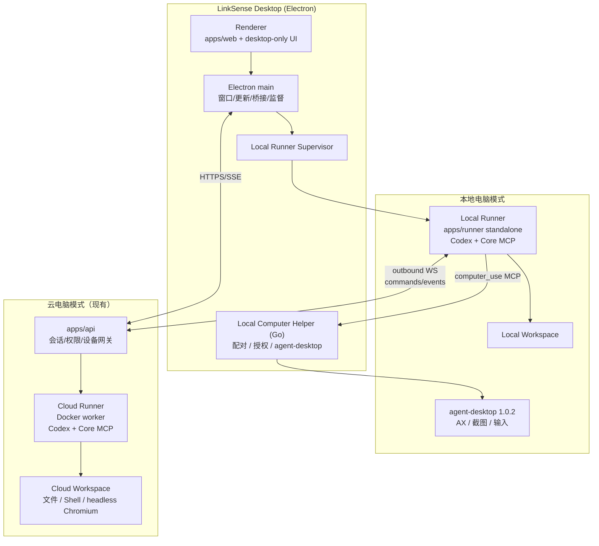

# LinkSense 桌面端方案（v2）：本地电脑 + 云电脑（Docker Runner）

日期：2026-11-16。依据：本仓库现有实现，以及 WorkBuddy、商汤小浣熊、豆包工作三份逆向调研。本文是**方案**，不包含实现改动。

已确认的产品决策：

- 桌面壳：**Electron**。
- 本地电脑：**只做 macOS**；不做 Windows。
- 云电脑：**就是现有的 Docker 隔离 runner**（Linux），不新建 Windows VM / WebRTC / PIP 基础设施。
- `agent-desktop`：确认上游为 `vercel-labs/agent-desktop`（Apache-2.0）；现有 helper 已封装它，本期就是用它实现 local computer use。

> 重要边界：现有 Docker runner 是**无图形界面的 Linux 执行环境**（文件、Shell、headless Chromium），不是“能看到 Windows 桌面并接管鼠标键盘”的云 PC。LinkSense 本期**不做 Windows**（本地或云端）；“云电脑”= 云端 Linux 隔离执行环境。如果以后要“可视化云桌面”，只在 Linux 容器内做（见 §15.1），不引入 Windows。

---

## 0. 结论摘要

1. **桌面端不重写 Agent**：复用 `apps/web`、`apps/api`、`apps/runner`、Codex app-server、Core MCP、会话/回合/事件/SSE。
2. **两种模式 = 两种执行位置**：
   - **本地电脑**：Agent 在桌面本地 runner 中运行；文件/Shell/浏览器/桌面操作都在本机；桌面操作通过本地 helper + `agent-desktop`。
   - **云电脑**：Agent 在现有 Docker 隔离 runner 中运行；文件/Shell/headless Chromium 在容器内；桌面端只是 UI，不需要新云桌面基础设施。
3. **云电脑已经存在**：现有 Docker runner 就是“每用户隔离的云端执行环境”。Web 端现在的会话就是云模式；桌面端云模式复用同一套 API/runner/SSE，只是换了宿主 UI。
4. **本地模式需要反向设备通道**：家用网络中的 Mac 不能被云端 HTTP 直连。API 增加 Desktop Device Gateway，helper/本地 runner 主动建立出站 WebSocket；API 通过该通道下发命令、接收事件，设备不暴露入站端口。
5. **本地桌面操作复用现有资产**：`outputs/desktop` 已有 `agent-desktop 1.0.2`（Rust，AX/UIA/AT-SPI）与 `LinkSense helper.app`（Go，配对、`/api/v1/computer-use/pair`、`/api/v1/computer-use/socket`、5 分钟任务授权、暂停）。源码不在本仓库，Phase 0 纳入并升级。
6. **权限分三层**：产品模式（每次询问/风险时询问/完全访问）、能力授权（computer.observe/act、filesystem、shell、browser）、执行端强制（本地 helper 的 OS 权限/任务授权；云端 runner 的容器/工作区边界）。
7. **模式选择在会话级**：`Conversation.executionTarget = local | cloud`；Web 端默认 cloud，桌面端新建可选 local。切换需显式确认 + continuation，不静默切换。
8. **本期不做**：Windows（本地或云端）、WebRTC/PIP 可视化云桌面、混合模式（云 Agent + 本地工具）。协议保留扩展点。

---

## 1. 目标与非目标

### 1.1 目标

- 桌面端可创建/继续会话，使用与 Web 一致的对话、计划、表单、工件、知识库、浏览器能力。
- **本地电脑模式**：Agent 读写本地工作区、执行 Shell、操作用户浏览器、通过可访问性树/截图操作本地桌面应用；用户可暂停/停止。
- **云电脑模式**：复用现有 Docker runner 的隔离执行（文件/Shell/headless 浏览器）；桌面端体验与 Web 会话一致。
- 两种模式共享会话事件、权限卡片、审计与 UI 组件；差异只在执行位置。
- 复用现有六语言 i18n、设计系统、测试与部署流程。

### 1.2 非目标（本期）

- 不做 Windows（本地或云端）、云桌面视频流、PIP 窗口、鼠标键盘接管。
- 不做本地 Windows 电脑，也不做 Windows 云电脑。
- 不做“云 Agent + 本地工具”或“本地 Agent + 云电脑”的混合模式。
- 不替换 Codex app-server，不复制其回合/审批/压缩语义。
- 不做云电脑计费结算；只预留 usage/quota。

---

## 2. 现有基础

### 2.1 LinkSense 现有能力

| 能力 | 现有实现 | 桌面端复用 |
| --- | --- | --- |
| Web UI | `apps/web` React/Vite、shadcn、TanStack Query、i18n | Electron renderer 加载同一构建 |
| API | `apps/api` Fastify、Zod、Prisma/Postgres、Redis/BullMQ | 新增 desktop 模块 |
| Runner | `apps/runner` controller/worker/standalone、Codex app-server、Core MCP | 本地 standalone + local-process；云端保持 worker |
| 会话/回合 | `Conversation`、`ConversationTurn`、`ConversationEvent`、`PendingRequest`、`ConversationUserInputRequest` | 原样使用；新增 executionTarget |
| 事件流 | SSE（`sse_event_id` + 断点） | 桌面 UI 复用 |
| 工具注入 | `mcp/core-service-registry.ts` 的 Core MCP 模块 | 新增 `computer_use` 模块（本地） |
| 本地浏览器 | browser-use 扩展、browser panel、`LINKSENSE_CURRENT_USER_ENDPOINT` | 保留 |
| 桌面资产 | `outputs/desktop` 的 `agent-desktop` 1.0.2、Go helper、配对/任务授权 | 正式纳入源码与打包 |

### 2.2 Docker runner 的能力边界（关键）

现有 Docker runner（`deploy/docker/Dockerfile.runner`）是：

- **Linux 容器**，每用户/会话隔离；
- Node 24、Python 3.12、`linksense-browser`（Playwright/Chromium **headless**）、文件服务、Codex app-server、Core MCP；
- 工作区、上传/下载、技能、连接器、知识库；
- 无 X11/Wayland 桌面、无 Windows、无屏幕视频、无鼠标键盘接管。

因此：

| 需求 | 现有 Docker runner | 结论 |
| --- | --- | --- |
| 云端跑文件/Shell/Codex | ✅ | 云电脑模式直接复用 |
| 云端 headless 浏览器 | ✅ | 浏览器工具/截图可用 |
| 云端 GUI 桌面（Windows 应用、鼠标键盘、视频） | ❌ | 本期不做；需要额外桌面层 |

---

## 3. 总体架构



### 3.1 组件边界

| 组件 | 位置 | 职责 |
| --- | --- | --- |
| Desktop Electron main | 用户机器 | 窗口、菜单、更新、启动/监督本地 runner/helper、preload 桥 |
| Local Runner | 用户机器 | Codex app-server、Core MCP、工具、工作区、事件 |
| Local Computer Helper | 用户机器 | 配对、任务授权、暂停/停止、`agent-desktop` 生命周期、OS 权限 |
| Desktop Device Gateway | API | 设备注册/配对、出站 WS、命令路由、事件注入、撤销 |
| Cloud Runner | 云端 | 现有 Docker worker；Codex、云端工作区、headless 浏览器 |
| Web/Desktop UI | 浏览器/桌面 | 会话、计划、表单、工件、浏览器面板、权限卡片 |

---

## 4. 两种模式的运行链路

### 4.1 本地电脑模式

1. 桌面端创建会话：`executionTarget=local`，绑定 `desktopDeviceId`。
2. Electron main 启动/复用本地 runner（`apps/runner` standalone + `local-process`）。
3. runner 主动连接 API 设备通道（出站 WS），注册能力与在线状态。
4. 用户发消息 → API 校验会话/设备/目标 → 设备通道下发 `turns/start` → 本地 runner。
5. 本地 runner 启动 Codex app-server，注入 Core MCP（含 `computer_use`），在本地工作区执行。
6. 工具：
   - 文件/Shell：本地 runner；
   - 浏览器：现有 browser-use 扩展；
   - 桌面：`computer_use` → helper → `agent-desktop`。
7. 事件：runner 产生事件 → 设备通道回传 API → `ConversationEvent` → SSE 推给 UI。
8. 暂停/停止：UI → API → 设备通道 → helper 撤销任务授权并停止输入。

**关键点**：本地 runner 不暴露入站端口；API 不直接访问用户机器。

### 4.2 云电脑模式（现有 Docker runner）

1. 会话 `executionTarget=cloud`（Web 默认即此）。
2. API 使用现有 `RunnerClient` → Docker runner worker；无需新的云电脑 lease/网关。
3. runner 在容器内启动 Codex app-server + Core MCP，执行文件/Shell/headless 浏览器。
4. 事件走现有 runner → API event sink → `ConversationEvent` → SSE。
5. 桌面端与 Web 端看到同一条会话流；断线/重连复用现有 SSE 断点。
6. 会话结束/空闲：现有 worker 回收策略（`LINKSENSE_WORKER_IDLE_TTL_SECONDS` 等）。

**关键点**：云模式就是现在的 Web 会话；桌面端只是另一个 UI 宿主。没有 Windows VM、WebRTC、PIP。

### 4.3 模式选择与切换

- 新建会话时选择“本地电脑 / 云电脑”；默认值来自用户设置。
- Web 端没有本地设备，只能选云电脑。
- 切换目标：
  - 显式确认；
  - 使用现有 continuation 在新目标重建会话；
  - 文件不自动同步，提示用户上传/下载。
- 回退：
  - 本地设备离线/权限缺失 → 提示改用云电脑；
  - Docker runner 不可用 → 提示稍后重试或改用本地；
  - 绝不静默切换。

---

## 5. 组件设计

### 5.1 Desktop App（Electron）

- Electron + 现有 `apps/web` 构建；`contextIsolation: true`、`sandbox: true`、`nodeIntegration: false`；自定义协议 `linksense://`；严格 CSP。
- 主进程：单实例、窗口/托盘、深链登录、自动更新、崩溃报告、本地 runner/helper supervisor、preload 最小桥。
- Renderer：复用 Web 路由；新增桌面设置/设备页；不暴露 Node API。

### 5.2 Local Runner

- 复用 `apps/runner`：
  - `LINKSENSE_RUNNER_MODE=standalone`；
  - `LINKSENSE_WORKER_PROVIDER=local-process`；
  - 现有 Codex、Core MCP、workspace、事件、文件服务不变。
- 新增设备通道配置与 `computer_use` Core MCP 模块。
- 工作区：macOS `~/Library/Application Support/LinkSense/...`；与云端隔离。

### 5.3 Desktop Device Gateway（API）

新增 `apps/api/src/modules/desktop-devices`：

- 配对：登录用户生成一次性配对码；helper 换取 device token（只存哈希）。
- 通道：helper 主动连接 `wss://api/desktop/devices/socket`；设备 token 认证、心跳、撤销。
- 命令路由：API 的 `RunnerTransport` 按 `executionTarget/deviceId` 选择 HTTP（cloud）或设备 WS（local）。
- 白名单：只允许 `turns/start`、`steer`、`interrupt`、`runtime`、`fork`、`prewarm`、`mcp-current-user/*`、`health` 等。
- 事件注入：设备回传事件 → 校验归属 → 写入现有 `ConversationEvent`；`sse_event_id` 幂等。
- 撤销：断开 WS、token 失效、终止该设备本地会话。

### 5.4 Local Computer Helper + agent-desktop

- 保留现有 Go helper（`outputs/desktop` 原型），扩展为本地计算机服务：
  - 统一 Desktop Device 配对；
  - 本地 loopback RPC：`status`、`observe`、`act`、`pause`、`resume`、`stop`、`permissions.request`；
  - 每任务 5 分钟授权、可续期；暂停立即停止输入；停止撤销授权。
- `agent-desktop` 作为执行引擎，由 helper 以子进程/FFI 调用；不直接暴露给模型。
- 详见 §14。

#### 5.4.1 `agent-desktop` 适配映射

| LinkSense 工具/动作 | helper 调用 | 说明 |
| --- | --- | --- |
| `computer_status` | `agent-desktop --version` + `permissions` | 版本、Accessibility/Screen Recording、当前任务授权 |
| `computer_observe` | `snapshot --app <app> -i --compact`、`list-windows`、`screenshot` | 返回 `@ref` 树/窗口/截图；限制深度与元素数 |
| `computer_act` click | `click @ref` | 只能点快照中的 ref；`click_at` 仅用于无 ref 的 canvas |
| `computer_act` type | `type @ref --text ...` 或 `set-value @ref --value ...` | 优先 `set-value`；文本长度上限 |
| `computer_act` key | `press <combo>` | 仅允许白名单键 |
| `computer_act` scroll | `scroll @ref --direction ... --amount ...` | 有界 |
| `computer_act` drag | `drag @from @to` / `--headed` | 需要图形会话与用户授权 |
| `computer_act` launch | `launch --app <name>` | 应用白名单；不启动任意路径 |
| `computer_act` wait | `wait --element @ref --predicate actionable` | 有界超时 |
| 停止/暂停 | `session stop` / 撤销授权 + 停止输入 | UI 立即生效 |
| 审计 | `session`/`trace` 本地元数据 | 不把 trace 内容上传；只上报 action 摘要 |

约束：

- helper 只允许上述子命令与参数；禁止模型传入任意 `--arg`/`--env`/`--cdp`。
- 每次 `act` 前重新校验 ref 属于当前快照/窗口；操作后由模型或 helper 重新 snapshot 验证。
- 不自动批量执行 `batch`；由上层逐个工具调用，便于权限与中断。
- `agent-desktop` 的 stdout JSON 由 helper 解析、裁剪、错误归一后再返回 runner。

### 5.5 Cloud Runner（现有）

- 不新增 Cloud Computer Gateway/Windows Agent/WebRTC。
- 复用现有 Docker worker；只在 API 侧增加会话目标路由与 UI 入口。
- 如果未来要做“可视化云桌面”，见 §15.3 的扩展路径。

### 5.6 UI

- 复用现有会话页；新增：
  - 目标选择器（本地电脑/云电脑）与会话设置；
  - 设备设置页（配对、状态、权限、撤销）；
  - 本地电脑状态卡：权限、任务授权倒计时、暂停/停止；
  - 权限卡片：应用授权、文件夹、危险命令；
  - 审计页：computer 操作元数据（不含截图/输入内容）；
  - 云模式沿用现有 Web 会话、浏览器面板、工件/文件视图，无 PIP。
- 六语言；键盘可达；焦点可见；`prefers-reduced-motion`。

---

## 6. 协议设计

### 6.1 设备通道

TLS WebSocket，JSON 帧：

```text
C→S hello        { deviceId, token, appVersion, platform, arch, capabilities }
S→C hello.ok     { ownerId, serverTime, heartbeatIntervalMs, maxFrameBytes }
C→S heartbeat    { at }
S→C command      { id, conversationId, method, path, headers, body, expiresAt }
C→S command.result { id, status, headers, body }
S→C command.cancel { id, reason }
C→S event        { conversationId, event }
S→C event.ack    { id }
```

约束：命令白名单、`commandId` 唯一 + 短 TTL、会话归属校验、帧大小上限（大文件走 HTTPS 预签名）、断线重连幂等、设备撤销立即生效。

### 6.2 RunnerTransport 抽象

```ts
interface RunnerTransport {
  request<T>(input: {
    conversationId: string
    ownerId: string
    method: string
    path: string
    body?: unknown
    idempotencyKey?: string
    signal?: AbortSignal
  }): Promise<T>
}
```

- `HttpRunnerTransport`：现有 `RunnerClient`（cloud）。
- `DeviceRunnerTransport`：设备 WS（local）。
- 路由：`Conversation.executionTarget` + `desktopDeviceId`。
- 错误语义复用现有 `RUNNER_UNAVAILABLE` / `RUNNER_OPERATION_UNCERTAIN`。

### 6.3 Computer Tool（仅本地）

`packages/shared/src/computer-use.ts`：

- `computer_status` → `{ available, permissions, activeGrant, agentDesktopVersion }`
- `computer_observe` → `{ apps, windows, tree?, screenshot? }`
- `computer_act` → `{ action: click|type|key|scroll|drag|launch|wait, ref?, x?, y?, text?, key? }` → `{ ok, changed?, error?, screenshot? }`

规则：Plan 模式只读；每次 act 绑定 `toolCallId/turnId`；不确定结果不重试；模型按 `@ref` 操作，坐标只用于无 ref 的 canvas；helper 校验授权与暂停状态。

云模式不提供 `computer_use`；现有浏览器工具有 `browser_use`（headless Chromium），文件/Shell 走现有工具。

### 6.4 会话事件

复用 `ConversationEvent`，本地新增：

```text
computer.session.updated
computer.permission.requested
computer.permission.resolved
computer.action.started
computer.action.finished
```

截图/视频帧不写事件流水；只存元数据。旧客户端忽略未知事件；新增字段可选。

---

## 7. 权限与安全

### 7.1 能力矩阵

| 能力 | 本地电脑 | 云电脑（Docker） |
| --- | --- | --- |
| filesystem | 本地工作区/授权目录 | 容器工作区 |
| shell | 本地 shell | 容器 shell |
| browser | 本地浏览器扩展 | headless Chromium |
| computer.observe/act | 本地桌面（agent-desktop） | 不提供 |
| clipboard | 本地（需授权） | 容器内（现有工具） |

### 7.2 本地权限

- 产品模式：`ask_always` / `ask_on_risk` / `full_access`。
- 能力：`computer.observe`、`computer.act`、`computer.launch`、`computer.clipboard`。
- 范围：应用、目录、动作、时间（5 分钟任务授权）。
- OS 权限：Accessibility + Screen Recording；首次引导到系统设置。
- 执行端：helper 在每次 act 前校验授权、OS 权限、暂停状态；UI 只负责展示与回传。

### 7.3 云模式权限

- 沿用现有 Docker runner 的容器/工作区边界、Core MCP 授权、文件服务校验。
- 不新增云桌面权限；没有“接管云桌面”概念。

### 7.4 安全

- 设备配对码一次性、短 TTL、限速；device token 只存哈希；Keychain；撤销即时。
- 本地 helper 只监听 loopback/Unix socket；只接受带 conversation/turn 的本地 token；不暴露公网。
- `agent-desktop` 子进程受进程树/权限约束；helper 做 action allowlist；不把 CLI 直接交给模型。
- 审计只记录 action/app/window/结果 code/耗时，不记录截图、剪贴板、键入原文。
- 云模式沿用现有 runner 的日志脱敏、工作区隔离与容器安全策略。
- UI 显示“Agent 正在控制本地电脑”；提供全局停止快捷键/暂停。

---

## 8. 数据模型与 API

### 8.1 Prisma（新增，非破坏）

```prisma
model DesktopDevice {
  id               String   @id @default(uuid()) @db.Uuid
  ownerId          String   @map("owner_id") @db.Uuid
  name             String   @db.VarChar(120)
  platform         String   @db.VarChar(32)
  arch             String   @db.VarChar(32)
  appVersion       String   @map("app_version") @db.VarChar(40)
  capabilitiesJson Json     @default("{}") @map("capabilities_json") @db.JsonB
  tokenHash        String   @map("token_hash") @db.VarChar(64)
  lastSeenAt       DateTime? @map("last_seen_at") @db.Timestamptz(6)
  revokedAt        DateTime? @map("revoked_at") @db.Timestamptz(6)
  createdAt        DateTime @default(now()) @map("created_at") @db.Timestamptz(6)
  updatedAt        DateTime @updatedAt @map("updated_at") @db.Timestamptz(6)
  @@index([ownerId, revokedAt], map: "desktop_devices_owner_revoked_idx")
  @@map("desktop_devices")
}

model DesktopDevicePairing {
  id        String   @id @default(uuid()) @db.Uuid
  ownerId   String   @map("owner_id") @db.Uuid
  codeHash  String   @map("code_hash") @db.VarChar(64)
  expiresAt DateTime @map("expires_at") @db.Timestamptz(6)
  consumedAt DateTime? @map("consumed_at") @db.Timestamptz(6)
  createdAt DateTime @default(now()) @map("created_at") @db.Timestamptz(6)
  @@index([ownerId, expiresAt], map: "desktop_pairings_owner_expiry_idx")
  @@map("desktop_device_pairings")
}

model LocalComputerSession {
  id             String   @id @default(uuid()) @db.Uuid
  ownerId        String   @map("owner_id") @db.Uuid
  conversationId String   @map("conversation_id") @db.Uuid
  deviceId       String   @map("device_id") @db.Uuid
  status         String   @db.VarChar(24)
  grantScope     String   @map("grant_scope") @db.VarChar(24)
  expiresAt      DateTime? @map("expires_at") @db.Timestamptz(6)
  endedAt        DateTime? @map("ended_at") @db.Timestamptz(6)
  createdAt      DateTime @default(now()) @map("created_at") @db.Timestamptz(6)
  @@index([conversationId, status], map: "local_computer_sessions_conversation_status_idx")
  @@map("local_computer_sessions")
}

model ComputerPermissionGrant {
  id             String   @id @default(uuid()) @db.Uuid
  ownerId        String   @map("owner_id") @db.Uuid
  conversationId String?  @map("conversation_id") @db.Uuid
  deviceId       String?  @map("device_id") @db.Uuid
  capability     String   @db.VarChar(48)
  scope          String   @db.VarChar(24)
  targetJson     Json?    @map("target_json") @db.JsonB
  expiresAt      DateTime? @map("expires_at") @db.Timestamptz(6)
  revokedAt      DateTime? @map("revoked_at") @db.Timestamptz(6)
  createdAt      DateTime @default(now()) @map("created_at") @db.Timestamptz(6)
  @@index([ownerId, conversationId, revokedAt], map: "computer_grants_owner_conversation_idx")
  @@map("computer_permission_grants")
}
```

`Conversation` 新增：

```prisma
executionTarget String @default("cloud") @map("execution_target") @db.VarChar(16)
desktopDeviceId String? @map("desktop_device_id") @db.Uuid
```

现有会话默认 `cloud`，行为不变；桌面端新建可传 `local`。

### 8.2 API

| 方法 | 路径 | 说明 |
| --- | --- | --- |
| POST | `/desktop/devices/pairing` | 登录用户生成配对码 |
| POST | `/desktop/devices/pair` | helper 换 device token |
| GET | `/desktop/devices` | 设备列表/在线状态 |
| DELETE | `/desktop/devices/:id` | 撤销设备 |
| GET | `/desktop/devices/socket` | 设备 WS |
| POST | `/conversations/:id/local-computer` | 启动本地电脑会话/授权 |
| DELETE | `/conversations/:id/local-computer` | 停止/撤销 |
| GET | `/conversations/:id/local-computer` | 状态/权限 |
| POST | `/conversations/:id/computer-permissions` | 授权/撤销 |
| PATCH | `/conversations/:id` | 设置 `executionTarget`（仅新建/未开始会话） |

云模式不需要新 API；继续使用现有 turns/stream/runner。

### 8.3 兼容性

- 新字段 nullable/default；旧会话不变。
- 新事件可被旧客户端忽略；SSE 解析保持宽松。
- 不修改已应用迁移；新增 forward migration。
- Web 端不显示本地设备入口。

---

## 9. 分阶段落地

### Phase 0（1–2 周）

- 确认 `agent-desktop` 上游/版本/许可证（已确认 Apache-2.0，见 §14）；决定升级到 1.3.1 或固定 1.0.2。
- 将 Go helper 与 `agent-desktop` 打包纳入仓库/构建流程。
- 定义 `computer-use` shared schema、设备通道、`executionTarget`。
- API 增加 DesktopDevice/Pairing、设备 WS 骨架（无 UI）。

### Phase 1（3–5 周）

- Electron 壳 + 复用 Web UI。
- 本地 runner standalone/local-process + 设备通道。
- Go helper + agent-desktop：status/observe/act/pause/stop、OS 权限引导。
- Core MCP `computer_use` 模块；本地权限卡片。
- macOS 签名/公证/更新；本地 E2E。

### Phase 2（1–2 周）

- 云模式：在 UI/API 中暴露 `executionTarget=cloud`，复用现有 Docker runner。
- 验证桌面端与 Web 端的会话、SSE、工件、浏览器面板一致。
- 不需要新基础设施。

### Phase 3（后续）

- **明确不做 Windows**（本地或云端）。
- 可选“可视化云桌面”：仅在 Linux Docker 内做 Xvfb + WebRTC + `agent-desktop` Linux（AT-SPI），不引入 Windows（见 §15.1）。
- 多设备、配额/usage、审计导出、GA 加固。

---

## 10. 测试与验收

- 单元：computer schema、权限矩阵、设备通道命令白名单/幂等、transport 路由。
- 集成：API device gateway + fake desktop；local runner bridge；Core MCP computer 模块。
- E2E：
  - 本地：创建 local 会话 → 文件/Shell/浏览器 → 桌面 observe/act → 暂停/恢复 → 断线重连 → 撤销。
  - 云：创建 cloud 会话 → 现有 Docker runner 文件/Shell/浏览器 → 断线重连 → worker 回收。
- 安全：伪造设备、重放命令、越权会话、路径遍历、撤销后重试。
- 六语言；无硬编码；键盘可达。
- 验收：两种模式都能完成“读文件 + 改文件 + 执行命令 + 浏览器任务”；本地额外完成 GUI 操作；云模式不要求 GUI。

---

## 11. 风险与开放问题

| 风险/问题 | 影响 | 建议 |
| --- | --- | --- |
| `agent-desktop` 版本落后（1.0.2 vs 1.3.1） | 兼容/安全 | Phase 0 升级并回归；固定版本 + sha256 |
| Go helper 源码不在仓库 | 维护/签名 | Phase 0 纳入源码与构建 |
| 本地 OS 权限引导 | 首次体验 | 向导 + 系统设置深链；失败可回落云模式 |
| 模式切换文件不连续 | 用户预期 | 明确提示；后续做同步 |
| 云模式无 GUI 桌面 | 用户预期 | UI 明确“云模式=文件/Shell/浏览器”；需要 GUI 用本地模式 |
| 命令不确定结果 | 重复执行 | 不重发；`UNCERTAIN` + 用户确认 |
| 多设备/并发 | 授权冲突 | 每会话单设备；设备撤销即终止 |

**开放问题**：

1. `agent-desktop` 升级到 1.3.1 还是固定 1.0.2？（建议升级并做回归）
2. Go helper 是纳入本仓库还是独立仓库？（建议本仓库 `apps/desktop-helper`）
3. 本地电脑是否允许“始终允许”跨会话？（建议默认仅任务/会话，始终允许需显式）
4. 云模式是否需要“浏览器实时预览”增强？（现有 browser panel 已够用）

---

## 12. 建议代码落点

```text
packages/shared/src/
  computer-use.ts                     # 工具名/schema/权限 code/事件
  desktop-device.ts                   # 设备帧/配对/能力

apps/api/src/
  modules/desktop-devices/            # 配对/设备列表/WS/撤销
  modules/local-computer/             # 本地会话/权限（可选）
  adapters/runner.ts                  # 抽出 RunnerTransport
  adapters/desktop-device-transport.ts

apps/runner/src/
  mcp/core-services/computer-use-service.ts
  mcp/core-service-registry.ts
  desktop/computer-tool.ts            # 调本地 helper

apps/desktop/                         # 新包（Electron）
  src/main/                           # 窗口/更新/supervisor
  src/preload/
  src/renderer/

apps/desktop-helper/                  # 现有 Go helper 源码纳入
deploy/desktop/                       # 签名/公证/更新

prisma/migrations/                    # desktop_devices/pairings/local_sessions/grants/conversation 字段
```

复用原则：不复制 Web、不复制 runner、不复制 Core MCP、不复制 Codex 回合语义。

### 12.1 仓库形态：monorepo 子 app，不新开项目

建议在当前 monorepo 内新增：

- `apps/desktop`（pnpm workspace 包，`@linksense/desktop`）；
- `apps/desktop-helper`（独立 Go module，可被 pnpm 忽略）；
- 共享契约放 `packages/shared/src/desktop/`，不另建契约包。

理由：

1. **契约同源**：设备帧、computer 工具、事件、错误码、六语言 key 都在 `@linksense/shared`；独立仓库需要发布/版本化契约包，容易漂移。
2. **Web 复用**：Electron 直接加载 `apps/web` 构建，共享路由、组件、i18n、设计系统；独立项目需要复制或私有包。
3. **Runner 同源**：本地模式复用 `apps/runner`；API/runner/desktop 的协议改动应在一个 PR 内完成并一起测试。
4. **CI/版本/发布一致**：一个 lockfile、一套 lint/typecheck/test；桌面产物仍可有独立版本号，但源码同仓。
5. **Go helper**：`apps/desktop-helper` 用自己的 `go.mod`，不影响 pnpm；若未来需要独立团队维护，再拆仓库或 vendored binary。

依赖边界：

- `apps/desktop` 依赖 `@linksense/shared`；通过构建产物使用 `apps/web`，不直接 import Web 源码；不 import `apps/api`/`apps/runner` 源码，runner 以构建产物/子进程方式打包。
- `apps/desktop-helper` 不依赖 Node 包；通过本地 RPC 与 runner/desktop 通信。
- `packages/shared` 不依赖任何 app；只放 schema/类型/常量/事件/工具名/翻译 key。
- `outputs/desktop` 继续作为构建产物目录，不提交源码；源码在 `apps/desktop`/`apps/desktop-helper`。

何时考虑新项目：

- 桌面端有独立团队、独立发布节奏与权限边界，且需要独立仓库时；
- 届时把 `packages/shared` 中桌面契约抽成 `@linksense/desktop-contracts` 发布，而不是复制；
- 不建议现在拆，收益小于契约/构建/测试的同步成本。

---

## 13. 与三份调研的映射

| 设计点 | 来源 | 说明 |
| --- | --- | --- |
| 会话/回合/权限分层 | WorkBuddy | 不把 Agent 塞进 UI |
| 会话续接/压缩 | 小浣熊 | 复用现有 conversation/turn/event |
| 本地计算机权限/暂停 | 豆包工作 | 任务级授权、拒绝回退 |
| 反向设备通道 | 豆包消息总线 + LinkSense runner | WS 替代入站 HTTP |
| 加密/不重发 | 豆包 GAC | TLS + commandId/expiry；不确定不重发 |
| 客户端工具注入 | WorkBuddy | Core MCP 已具备 |

**不采纳**：豆包的 Windows VM/PIP/GAC（本期不需要）；WorkBuddy 双栈；小浣熊 Python 全量。

---

## 14. `agent-desktop` 是什么（详细）

### 14.1 上游与许可证

- 项目：`vercel-labs/agent-desktop`（GitHub）。
- 许可证：**Apache-2.0**。
- 形态：Rust 核心 + CLI + C FFI；跨平台。
- 最新 release：**v1.3.1**（2026-11-13）；LinkSense 现有产物是 **v1.0.2**（2026-11-03）。
- 平台（上游能力）：
  - macOS 13+：Accessibility（AX）API；
  - Windows 10 1809+：UI Automation；
  - Ubuntu 24.04+：AT-SPI（X11/Wayland）。
- **LinkSense 范围**：只使用 **macOS**（本地电脑）；Linux 仅用于未来可选的 Linux 云桌面；**不使用 Windows**。

### 14.2 能力

- 观察：`snapshot`（可访问性树 + `@ref`）、`find`、`get`、`is`、`screenshot`、`list-windows`/`list-apps`；
- 操作：`click`、`double-click`、`right-click`、`type`、`set-value`、`clear`、`focus`、`select`、`toggle`、`check`、`scroll`、`press`、`hover`、`drag`、`mouse-move`；
- 窗口/应用：`launch`、`close-app`、`focus-window`、`move/resize`；
- 其他：`clipboard`、`wait`、`batch`、`session`、`trace`、`skills`、`permissions`、FFI。
- 特点：模型用稳定 `@ref` 而不是像素坐标；每次操作后可重新 snapshot 验证；支持 Electron/Chromium 辅助；有权限引导。

### 14.3 LinkSense 现有封装

`outputs/desktop` 原型：

- `LinkSense helper.app`（Go + `github.com/egoist/mygo`）：
  - 配对码 UI、服务器地址、设备标签；
  - `api/v1/computer-use/pair`、`api/v1/computer-use/socket`；
  - WebSocket `desktopBridge`/`desktopCommand`/`desktopRequest`；
  - “Allow this task to use your computer?” 5 分钟任务授权、暂停、权限页；
  - `LINKSENSE_AGENT_DESKTOP_BIN`、`AGENT_DESKTOP_HOME`。
- `agent-desktop` 由 helper 启动/管理；模型不直接调用 CLI。

### 14.4 落地要求

1. **版本**：升级到 1.3.1 或固定 1.0.2；记录 release/sha256。
2. **许可证**：安装包内附 Apache-2.0 LICENSE/NOTICE；第三方声明更新。
3. **校验**：下载/内置 binary 校验 sha256；禁止未校验自动更新。
4. **安全**：helper 侧 action allowlist、任务授权、暂停/停止、审计；binary 签名/公证；不以 root 运行。
5. **兼容**：回归 macOS AX/截图；Electron/Chromium 辅助；系统权限拒绝路径。
6. **替代方案**：若不允许第三方 binary，可用 Swift/ObjC 自研 AX/ScreenCaptureKit helper（工作量更大）；当前 Apache-2.0 许可下建议复用。

---

## 15. 现有桌面资产清单

```text
outputs/desktop/
├── build-artifacts/resources/bin/
│   ├── agent-desktop                 # 1.0.2, Rust CLI
│   ├── agent-desktop-macos-helper
│   └── manifest.json                 # version/target/sha256
├── LinkSense-Desktop-macos.zip       # "LinkSense helper.app" (Go)
├── LinkSense-Desktop-windows.exe     # 历史产物；不纳入本期 Windows 范围
└── cache/agent-desktop-v1.0.2-aarch64-apple-darwin.tar.gz
```

已观察字符串：

```text
api/v1/computer-use/pair
api/v1/computer-use/socket
LINKSENSE_AGENT_DESKTOP_BIN
AGENT_DESKTOP_HOME
COMPUTER_USE_ACCESS_DENIED / COMPUTER_USE_PAUSED / COMPUTER_USE_COMMAND_FAILED
"Allow this task to use your computer?"
"Allow desktop access, including clicks and typing, for 5 minutes. You can pause at any time."
```

### 15.1 如果以后要“可视化云桌面”

只考虑 Linux 路径（本期不做）：

- 在 Docker 镜像内加 Xvfb + 轻量窗口管理器 + x11vnc 或 WebRTC + `agent-desktop` Linux（AT-SPI）；
- 用户看到的是 Linux 桌面；
- **不引入 Windows VM、Windows Agent 或 RDP**。

当前决策不需要可视化云桌面；云模式保持文件/Shell/headless 浏览器。
