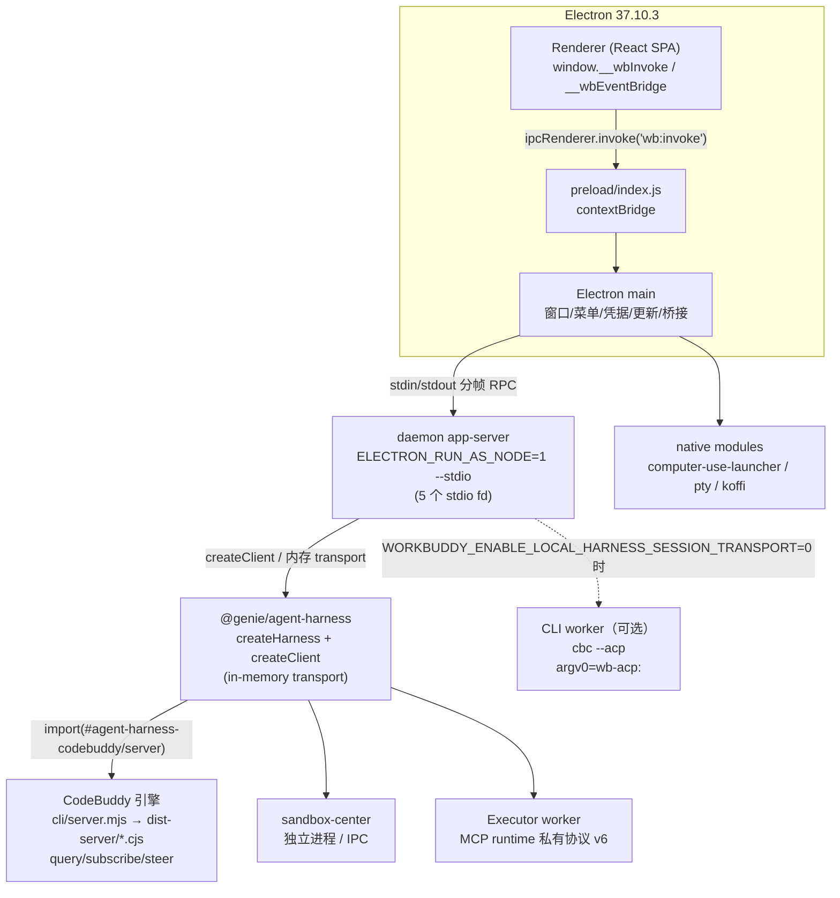
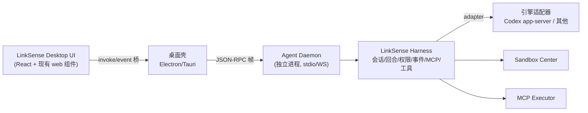

# WorkBuddy Desktop 5.11.3 Agent Harness 逆向调研

调研日期：2026-11-16。样本：`WorkBuddy-darwin-arm64-5.11.3.43806934-ecace0f7.dmg`（SHA-256 `f3b99997b0aebfe22af4f8c0070b37946b9f839b51cf9510eb6a97c9e45aa639`，358 MB）。应用版本 **5.11.3**，Bundle ID `com.tencent.workbuddy.mac`，Electron **37.10.3**，内置 Agent Harness `@genie/agent-harness` **0.2.0-beta.16**，内置 CodeBuddy Code CLI **2.176.0**。[W01][W02][W03][W04]

核验方式：只读挂载 DMG，使用 REA 读取 Electron fuses、生成 DMG 与 `app.asar` 清单，解包 `app.asar` 后对主进程、preload、harness 包、内置 CLI、产品资源做静态阅读；未启动应用、未执行任何内置脚本、未联网登录。文中“已观察”表示静态代码或资源中可直接确认；“推断”表示由调用关系得出的高置信结论；“未知”表示本次未验证。积分、会员、皮肤、计费等业务不在本文范围。[W01]

> 本文讨论的是一个“Electron 桌面壳 + 独立 daemon + 可嵌入 Agent Harness + CodeBuddy 引擎”的完整实现。对 LinkSense 最有价值的不是它用了 Electron，而是 Harness 的**协议分层、会话/回合语义、权限交互、客户端工具注入、产品配置下发**这套边界。

---

## 0. 一页结论

1. **桌面端不是“Electron 里直接跑 Agent”**。Electron 主进程只做窗口、菜单、凭据、更新、通知与桥接；真正执行 Agent 的是同包里由主进程拉起的 **daemon app-server** 子进程（`ELECTRON_RUN_AS_NODE=1` + `--stdio`），以及可选的、每次会话一个的 **CLI worker**（`cbc --acp`）。[W10][W11][W13]
2. **Agent 能力被抽成独立的 npm 包 `@genie/agent-harness`**（“Standalone JSON-RPC agent harness backed by CodeBuddy Code”）。它把 CodeBuddy 引擎包在一个 JSON-RPC/ACP v2 服务后面，提供会话、回合、事件、工具、权限、MCP、子代理、技能、插件、产品配置、检查点等一整套协议面。[W04][W05]
3. **引擎以“内嵌库”方式运行**：harness 通过 `#agent-harness-codebuddy/server` 映射到自带的 `cli/server.mjs`，在 daemon 进程内加载 CodeBuddy 的 `query()/subscribe()`，不是每个会话都起子进程；同时保留“standalone binary / 私有运行时子进程”两种形态。[W04][W06][W23]
4. **协议分两层**：外层是桌面自己的 `wb:invoke`（stdin/stdout 分帧 RPC，Electron main ↔ daemon）与 renderer 的 `__wbInvoke` 桥；内层是 harness 的 ACP v2 + Effect RPC 服务方法。Agent 事件以 24 种 `session/update` 变体向客户端流式投影。[W05][W07][W12][W14]
5. **会话/回合模型完整**：`session/new|resume|list|fork|delete|close|prompt|cancel|set_config_option|clear|compact|rewind`，支持 prompt **steer**（对进行中的回合追加输入）、**retry**（以 `expectedRequestId` 幂等重试）、断线 replay、子代理 journal 合并、检查点恢复。[W05][W06][W07]
6. **权限不是简单的 allow/deny**：引擎内的 `canUseTool` 被投影为 ACP `session/request_permission`，选项带语义（allow_once / allow_always / reject_once、计划模式退出的 auto/bypass/acceptEdits/fullAccess、沙箱目录授权）；提问走 `elicitation/create` 表单/URL；决策带 `user_temporary|user_permanent|user_reject` 分类。[W08]
7. **工具系统分为四类**：引擎内置工具（41 个，含 REPL、Computer Use、Workflow、Team、A2A、Cron 等）、子代理工具（按 agent 定义裁剪）、MCP 工具（经 Executor 隔离进程）、**客户端注入工具**（桌面通过内存 MCP `workbuddy-client-tools` 与 renderer 反向 RPC 提供）。[W09][W14][W16]
8. **产品配置（prompts/models/agents/skills/feature flags）与引擎代码解耦**：harness 用 Product Bootstrap v1（overlay/resolved）下发 58 个模型、21 个 Agent 定义、131 个提示词、132 个功能开关；WorkBuddy 再用插件化的 prompt fragments 组装交互模式。[W09][W18][W23]
9. **沙箱是独立进程 + 规则中心**：harness 管理 `sandbox-center`（macOS `sandbox-exec`/网络扩展，Linux `bubblewrap`），支持按 uid 启停、GET_RULES、文件目录授权与 `sandboxUnavailable` 策略；MCP 工具在单独的 Executor 子进程执行（私有协议 v6）。[W16][W17]
10. **桌面端是“会话运行时”编排器**：conversation 绑定 session，renderer 通过 subscription/lease（`ensureRuntime`/`releaseRuntimeHold`）控制运行时保活，空闲可回收；CLI worker 路径有预热池（prewarm pool）降低首字延迟。[W14][W15][W20]

---

## 1. 应用形态与进程拓扑

### 1.1 包结构

DMG 内是标准 macOS 安装镜像；`WorkBuddy.app/Contents/Resources` 中：

| 资源 | 大小 | 作用 |
| --- | --- | --- |
| `app.asar` | 172,911,441 B（约 165 MiB） | Electron 主进程、renderer、preload、node_modules、内置 CLI 的归档 |
| `app.asar.unpacked/cli` | 73 MB | 内置 CodeBuddy CLI 及其 lazy bundle、builtin 资源 |
| `app.asar.unpacked/main` | 436 KB | 少量未打包的主进程辅助文件（Qimei、preload） |
| `app.asar.unpacked/native` | 1.2 MB | `computer-use-launcher`、`turing-sdk`、`perf-metrics` 等 N-API 模块 |
| `app.asar.unpacked/renderer` | 17 MB | renderer 静态资源 |
| `app.asar.unpacked/resources` | 132 MB | 内置插件、扩展、模板、渠道品牌资源 |
| `app.asar.unpacked/node_modules/@genie/agent-harness` | 46 MB | 本文核心：独立 Harness 包 |

`Info.plist` 声明 `ElectronAsarIntegrity`（SHA-256 `c151aee8…`），REA 对 DMG 的完整清单为 51,300 个条目、12,236 个节点，其中 53 处“ASAR 声明哈希与伴生文件不一致”，均为打包后签名/裁剪的 native 文件（如 `pty.node`），REA 以 `record-and-continue` 保留为 observed-untrusted。[W01]

### 1.2 进程拓扑（已观察）



关键点：

- **Electron main 也是 daemon 的父进程与守护者**，但不是 Agent 宿主。daemon 通过 stdin 生命周期绑定父进程：stdin `end/close`、stdout `EPIPE` 都会触发“parent gone”优雅退出（`daemon-app-server-entry.js` 的 orphan guard）。[W11]
- **daemon 的启动参数**：`process.execPath` + `[entry, "--stdio"]`，环境含 `ELECTRON_RUN_AS_NODE=1`、`UV_THREADPOOL_SIZE=16`、经白名单清洗的 `NODE_OPTIONS`（追加 `--max-old-space-size`），stdio 为 5 条 pipe（0/1/2 + fd3/fd4 用于 catalog 旁路）。[W11]
- **主进程与 daemon 之间不是普通 JSON-RPC 库**，而是自定义帧：`ready`、`rpc-request {id,channel,args}`、`rpc-response`、`rpc-error`、`rpc-event {channel,result}`，daemon 也可反向 `rpc-request` 给 main；单条响应上限约 36 MiB，带有 pending 去重、卡住请求巡检与 fd3/4 大对象旁路。[W12]
- **CLI worker 路径**才是“每会话一个子进程”：默认命令 `cbc`，启动参数包含 `--acp`，`argv0` 设为 `wb-acp:<conversationId>`，stdio 三条 pipe，非 Windows 使用独立进程组；环境经允许列表过滤（`ELECTRON_RUN_AS_NODE=1`、`CODEBUDDY_DISABLE_IDE=1`、`SERVER__PORT=0`、`SERVER__HOST=127.0.0.1` 等），并强制 `CODEBUDDY_SESSION_HISTORY_CLEANUP=0`。[W13]
- **两条路径由 `WORKBUDDY_ENABLE_LOCAL_HARNESS_SESSION_TRANSPORT=1|true` 切换**。未设置时 `harnessSessions` 不注入，`setupConversations` 使用 LocalConnection（CLI worker）；设置后使用 `WorkbuddyHarnessHost` 提供的会话传输。harness 本身无论该开关如何都会启动，用于技能/配置/插件/市场等 RPC。[W10][W15]
- 这是一个**迁移中的双栈**：旧栈 = ACP v1（`session/load`、`session/set_mode`、client 侧 fs/terminal 能力）；新栈 = ACP v2 + harness 服务方法。两者在桌面代码中同时存在。[W05][W13]

### 1.3 Electron 安全配置（已观察）

REA 读取 fuses（Electron Framework arm64）：[W02]

| Fuse | 状态 |
| --- | --- |
| `RunAsNode` | 启用（daemon/worker 依赖 `ELECTRON_RUN_AS_NODE`） |
| `EnableNodeOptionsEnvironmentVariable` | 启用 |
| `EnableNodeCliInspectArguments` | 启用（可调试） |
| `EnableEmbeddedAsarIntegrityValidation` | 启用（强制） |
| `OnlyLoadAppFromAsar` | 启用 |
| `EnableCookieEncryption` | 关闭 |
| `LoadBrowserProcessSpecificV8Snapshot` | 关闭 |
| `GrantFileProtocolExtraPrivileges` | 启用 |

Renderer 通过 preload 暴露最小面：`__wbInvoke(channel, payload, ...args)` 与 `__wbEventBridge(listener)`；`wb:invoke` 只接受主 frame，扩展 iframe 需带受信 subject；主进程对 channel 做 desktop-host 命名空间校验（`app:`、`window:`、`dialog:`、`microphone:`、`system:`、`update:`、`wechat:`、`wecom:`、`clipboard:`）。[W14]

---

## 2. `@genie/agent-harness`：包结构与公共 API

### 2.1 包的事实

- 名称：`@genie/agent-harness`，版本 `0.2.0-beta.16`，`"type": "module"`，MIT。[W04]
- 大小：46 MB，其中 `lib` 2.4 MB / 255 个文件，`cli` 38 MB（内嵌 CodeBuddy 运行时），`executor` 2.2 MB，`bin` 120 KB。
- `exports`：`.`、`./client`、`./server`、`./transport`、`./product`、`./protocol`、`./telemetry`、`./binary`、`./product/schema.json`。
- `imports` 把组件与运行时映射到包内实现，例如 `#agent-harness-codebuddy/server → ./cli/server.mjs`、`#agent-harness-runtime → ./cli/dist-server/shared.cjs`、`#agent-harness-components/* → ./lib/components/*`。
- `bin.agent-harness` 是独立 CLI（可作 standalone 二进制运行）。

**公共 API（`lib/public.js` 全部导出）**：[W04]

```js
export { tool } from "#agent-harness-components/tool-definition";
export { createClient, RequestError } from "./client/public.js";
export { createHarness } from "./harness/create-harness.js";
export { installNoOrphans } from "./runtime/windows-stdio-containment.js";
export { currentModsExecutionContext } from "./harness/hooks.js";
export { sessionEventBacklog } from "./session/agent-server.js";
export { createServer } from "./server/create-server.js";
export { createAgentHarnessNetworkListener } from "./transport/network.js";
```

这是一个非常克制的对外面：**宿主只需要 `createHarness` + `createClient` 两件事**，其余都在协议内完成。

### 2.2 `createHarness` 的输入契约（已观察）

`createHarness(options)` 会严格校验并捕获以下配置：[W04]

| 参数 | 语义 / 约束 |
| --- | --- |
| `configDir` | 绝对路径；通过 `CODEBUDDY_CONFIG_DIR` 注入子运行时 |
| `projectConfigDirName` | 单个目录名（如 `.workbuddy`），写入 `CODEBUDDY_PROJECT_CONFIG_DIR` |
| `skills.builtinDirectory` | 绝对路径，写入 `CODEBUDDY_BUILTIN_SKILLS_DIR` |
| `tools` | `tool()` 定义的数组（插件 Agent 工具），要求 name/description/handler/inputSchema |
| `env` | 受控环境变量；禁止设置 `CODEBUDDY_API_KEY`/`CODEBUDDY_AUTH_TOKEN`/`CODEBUDDY_SESSION_SKILL_DIRS`，也不能覆盖由 Host 传入的配置项 |
| `plugins` | `{ backgroundManagement, marketplaceProviders }` |
| `host` | `{ ideName, ideType, ideVersion, extName, extVersion, userAgent }`，进入客户端身份头 |
| `productConfig` | Product Bootstrap v1（对象或路径） |
| `sandboxCenter` | `{ address }` 或托管启动 |
| `sandboxUnavailable` | `"fail"` 或 `"local"` |
| `hooks` | 宿主函数钩子（见 §7） |
| `resolveModelRequestHeaders` | 每次 run 解析模型请求头 |
| `resolveRemoteAgents` | A2A/远程 Agent 源 |
| `serviceProxy` | 外部服务代理（`resolve()`） |
| `shellEnvironmentPolicy` | shell 环境策略（`set()`） |
| `mcp` | `{ connectTimeoutMs, executorHealthTimeoutMs, toolCallTimeoutMs, toolsSyncTtlMs }` |
| `settingSources` | `user|project|local` 的组合 |
| `maxActiveSessions`、`sessionActivationTimeoutMs` | 并发会话预算/激活超时 |
| `resolveRuntimeAssetPath` | 运行时资源解析器（Electron `app.asar.unpacked` 等） |

设计上有一个重要约束：**同一个进程只能拥有一个 Harness**（`Symbol.for("codebuddy.ai/agent-harness/application-owner")`），关闭后才能重建。Host 应复用它来创建多个 Client/Session。[W04]

### 2.3 Harness 内部模块地图（255 个文件，节选）

| 目录 | 关键模块 | 职责 |
| --- | --- | --- |
| `harness/` | `create-harness`、`runtime`、`hooks` | 生命周期、服务装配、宿主钩子 |
| `server/` | `agent-harness-server`、`rpc-module`、`rpc-services` | JSON-RPC 分发、模块组合 |
| `transport/` | `stdio`、`network`、`endpoint`、`listen`、`auth` | stdio/WS/HTTP/Unix socket、鉴权、健康检查 |
| `protocol/` | `acp-v2*`、`methods`、`prompt`、`session-setup`、`error` | 协议方法、schema、元数据键 |
| `session/` | `agent-backend`、`agent-server`、`runtime`、`server-events`、`server-interactions`、`turn`、`compact`、`clear`、`replay`、`files`、`config-store` | 会话绑定、回合、事件投影、存储 |
| `agent/` | `v2`、`session-proxy`、`router` | 每连接 Agent 协议路由、会话代理 |
| `integration/` | `executor-supervisor`、`user-mcp`、`plugin-mcp`、`agent-integration`、`stdio-guardian-*` | MCP/Executor/子进程护栏 |
| `subagent/` | `journal`、`projection`、`history`、`module` | 子代理事件流与回放 |
| `tasks/` | `rpcs` | 后台任务查询/取消 |
| `checkpoint/` | `service`、`rpcs` | 文件检查点列表/读取/恢复 |
| `skills/` `plugin/` | `service`、`rpcs`、`schemas` | 技能与插件管理 |
| `product/` | `authority`、`module`、`schemas` | 产品配置权威与下发 |
| `auth/` | `local`、`managed`、`rpcs` | 本机/托管认证 |
| `runtime/` | `product-manager`、`sandbox-center`、`process-containment`、`private-runtime-role`、`node-runtime` | 运行时角色、沙箱、进程隔离 |
| `effect-runtime/` | `process-runtime`、`mcp-lifecycle` | Effect 运行时封装 |
| `settings/` | `setting-sources`、`service`、`proxy-policy` | 设置来源与代理策略 |
| `telemetry/` | `runtime`、`startup-profile`、`daily-jsonl-file-sink` | 结构化遥测 |

技术选型：**Effect（TypeScript 函数式运行时）**贯穿服务装配、RPC（`effect/rpc`）、Schema 校验与作用域生命周期；JSON-RPC 只是线协议。[W04][W05]

---

## 3. 协议栈与 RPC 面

### 3.1 三种传输形态

| 形态 | 入口 | 用途 |
| --- | --- | --- |
| stdio JSONL | `serveStdio` / `--stdio` / 默认 `stdio://` | 桌面 daemon、脚本嵌入 |
| WS / streamable HTTP | `--listen ws://host:port` / `http://…`，或 `+unix` | 远程/多客户端 |
| Unix socket / Windows named pipe | `unix://`、`http+unix://PATH`、`\\.\pipe\NAME` | 本机跨进程 |

网络监听有严格限制：拒绝 `https://`/`wss://` 直连（要求 TLS 终止前置）、拒绝带账号密码/query/fragment 的地址、要求显式端口；`/readyz`、`/healthz` 为内置健康端点；Origin 允许列表、`--allow-insecure-remote` 显式放行非回环明文；WS 鉴权支持 `capability-token`（token 文件或 SHA-256 校验器）与 `signed-bearer-token`（HS256、iss/aud/exp/nbf、clock skew）。[W05][W19]

### 3.2 ACP v2 方法面（已观察）

`initialize` 的 `protocolVersion` 在 SDK 适配层传 `1`，但 schema 集合是 ACP v2。核心 allowlist 如下：[W05]

**Agent 侧（客户端 → Harness）**

| 类型 | 方法 |
| --- | --- |
| 请求 | `session/new`、`session/list`、`session/delete`、`session/fork`、`session/resume`、`session/close`、`session/set_config_option`、`session/prompt`、`auth/login`、`auth/logout` |
| 通知 | `session/cancel`、`mcp/message` |
| 其他 | `initialize`、`initialized`、`$/cancel_request` |

**客户端侧（Harness → 客户端）**

| 类型 | 方法 |
| --- | --- |
| 请求 | `session/request_permission`、`elicitation/create`、`mcp/message` |
| 通知 | `session/update`、`elicitation/complete` |

此外还有 ACP v2 SDK 暴露的 `providers/list|set|disable`（模型提供方管理）。[W05]

说明：`session/list|delete|fork` 在 ACP allowlist 中，由 Harness 的会话层处理；内置 `AgentBackend` 的主路径是 `new/resume/prompt/cancel/clear/compact/rewind/close/setConfigOption`，`fork/delete` 依赖 `SessionFiles` 组件与具体后端能力。[W05][W06]

### 3.3 Harness 自有服务方法（Effect RPC）

这些方法不属于 ACP，而是同一连接上的扩展服务：[W05]

| 域 | 方法 |
| --- | --- |
| 会话 | `session/clear`、`session/compact`、`session/rewind` |
| 任务 | `tasks/list`、`tasks/get`、`tasks/cancel` |
| 子代理 | `subagent/list`、`subagent/read`、通知 `subagent/started` |
| 检查点 | `checkpoint/list`、`checkpoint/read`、`checkpoint/restore` |
| 配置 | `config/read`、`config/batchWrite`、`config/value/write`、通知 `config/warning`（`configWarning` 事件） |
| 技能 | `skills/list`、`skills/config/write`、通知 `skills/changed` |
| 插件/市场 | `plugin/list|read|install|uninstall|update|reconcile`、`marketplace/add|configure|remove|upgrade`、通知 `plugin/changed`、`plugin/installed` |
| 产品 | `product/read`、`product/provision`、`product/workspace/read`、`product/workspace/provision`、通知 `product/updated`、`product/workspace/updated` |
| MCP | `mcpServerStatus/list`、`mcpServer/tool/call`、`mcpServer/resource/read`、`mcpServer/oauth/login|complete|cancel|logout`、通知 `mcpServer/startupStatus/updated` |
| 账号 | `account/read`、`account/provision`、`account/refresh`、通知 `account/updated`、`auth/status` |
| Agent | `agent/list` |
| 回合差异 | 通知 `turn/diff/updated` |

### 3.4 客户端连接对象

`createClient(options)` 生成一个冻结对象，方法按域分层（`client.session.*`、`client.config.*`、`client.product.*`、`client.skills.*`…）。连接时：[W04][W05]

1. 打开 transport（内存/stdio/WS/HTTP）；
2. 发送 `initialize`，带 `clientInfo`、`capabilities`（`elicitation.form/url`）、`account`、`product`；
3. 收到 `initialized` 后进入 `connected`；
4. 注册客户端请求处理器：`session/request_permission`、`elicitation/create`、`mcp/message`；
5. 订阅通知：`session/update`、`elicitation/complete`、`subagent/started`、`turn/diff/updated`、`mcpServer/startupStatus/updated`、`plugin/changed`、`skills/changed`、`configWarning`、`product/updated`。

权限能力有前置约束：若声明 `elicitation.form`/`url`，必须在 `connect` 前注册 `elicitation/create` 处理器，否则拒绝连接；未注册时 `session/request_permission` 默认返回 `cancelled`。[W04]

---

## 4. 会话与回合模型

### 4.1 会话身份与绑定

- 会话 ID 默认 `randomUUID()`；客户端可通过 `_meta` 请求指定 ID（`readRequestedSessionId`），Harness 会先检查该 ID 是否已存在。[W06]
- `session/new` 的 `_meta` 可携带（均以 `codebuddy.ai/*` 为键）：
  `sessionSetup`（allowedTools/disallowedTools/askTools/agentTeams/aiTitle/capabilitiesRoots/strictMcpConfig/settingSources/mcpFirstPromptWaitMs）、`admittedModels`、`sessionId`、`sessionCapabilitiesRoots`、插件设置、prompt context 等。[W05][W06]
- 绑定一个会话时校验：`cwd` 必须是绝对路径；同一 execution 只能绑定一个 session；`additionalDirectories`、`mcpServers`、`capabilitiesRoots` 在 resume 时可更新（通过 `reload`）。[W06]
- 桌面层还会在 `session/new|resume` 时自动注入 `workbuddy-client-tools`（见 §6.4）。[W10]

### 4.2 回合（turn）生命周期

`session/prompt` 支持三种模式（`_meta["codebuddy.ai/prompt"]` 同域）：[W06]

| 模式 | 语义 |
| --- | --- |
| 普通 | 把 prompt 内容转换为引擎输入；`conversationRequestId` 用于关联 |
| `steer` | 对正在运行的回合追加用户输入；必须匹配 `expectedRequestId`，否则 `invalidRequest`；返回 `messageId/runId` |
| `retry` | 仅允许空 prompt；以 `expectedRequestId` 幂等重放原用户消息 |

取消：`session/cancel` 通知 → `abort(reason)` + `engine.interrupt(sessionId)`；正在等待的输入会被拒绝（`-32800` / `PROMPT_NOT_INSERTED`），并带上 `cancelReason`。[W06][W07]

引擎侧事件（内部 `agent_event`）被投影为 ACP：

```
run_started   → state_update: running
run_completed → state_update: idle + stopReason
input(item)   → agent_message_chunk / agent_thought_chunk / tool_call_update / usage_update …
error         → error update + 终态 error
turn_diff     → turn/diff/updated 通知
subagent_status → subagent/started / 子代理 journal
configuration → config_option_update
```

停止原因枚举：`end_turn`、`cancelled`、`error`、`refusal`、`max_turn_requests`、`max_tokens`。[W07]

### 4.3 会话操作语义

| 操作 | 行为 |
| --- | --- |
| `session/resume` | 读取持久化会话，恢复 config/usage/子代理历史；`replayFrom` 可回放历史事件（cursor 校验） |
| `session/fork` | 从既有会话派生新 session（子代理历史合并） |
| `session/clear` | 清空上下文（保留会话身份） |
| `session/compact` | 触发压缩；`compaction_update` 带 `trigger: manual|auto`，`compactType` 标记 |
| `session/rewind` | 按消息/工具调用游标回到历史边界；配合 `checkpoint/*` 恢复文件 |
| `session/close` | 释放执行；Harness 会取消运行中的任务并等待清理 |
| `session/set_config_option` | 运行中禁止（返回 `invalidParams`）；`security_review` 是特殊配置项 |
| `tasks/*` | 查询/取消会话内后台任务（Bash 后台任务等） |

### 4.4 子代理与历史合并

子代理是独立 session，但在主会话的 ACP 流中以 `codebuddy.ai/subagent` 元数据标记；`subagent/started` 通知携带 `rootSessionId/sessionId/parentToolCallId`。[W07][W05]

`subagent/journal.js` 实现了严密的事件合并：[W07]

- 消息身份：`(sessionId, messageId)` → 类型（`agent_message` / `agent_thought` / `user_message`）；
- 工具身份：`(sessionId, "tool", toolCallId)`；
- 事件身份：规范化 JSON 的哈希；
- 历史回放与实时流按“最长公共后缀/前缀”合并，避免重复；
- journal 对消息 chunk 做增量合并，对 tool update 做字段级 merge；
- 溢出有显式错误（`SubagentJournalOverflowError`、`SubagentAttachmentBufferOverflowError`）。

### 4.5 检查点与文件回滚

`checkpoint/*` 由 `SessionFiles` 组件实现，CLI 侧存储约定（已观察字符串）包括 `projects/*/*.jsonl`、`projects/*/*.meta.json`、`projects/*/*.file-rollback.ndjson`，并声明 `WORKBUDDY_PLATFORM_OWNED_PROJECT_FILE_PATTERNS` 为平台托管文件。[W22] `checkpoint/restore` 与 `session/rewind` 配合使用，`checkpoint/read` 返回 ACP 化的文件变更集。[W05][W23]

---

## 5. 事件与流式投影

`session/update` 的 `sessionUpdate` 判别式共有 24 种（ACP v2 SDK 枚举）：[W05]

```
agent_message              agent_message_chunk
agent_thought              agent_thought_chunk
available_commands_update  compaction_summary_chunk
compaction_update          config_option_update
notice                     plan_removed
plan_update                session_info_update
session_message            session_message_chunk
state_update               subagent_update
terminal_output_chunk      terminal_update
tool_call_content_chunk    tool_call_update
usage_update               user_message
user_message_chunk
```

桌面端只订阅并转发其中一部分，且按 conversation 订阅过滤（`wb:conversation:requestUpdate`、`requestUpdateBatch`、`childAgentEventBatch`）。[W14]

### 5.1 投影层的工程细节

`ServerSessionEvents` 负责把引擎事件变成稳定的客户端协议：[W07]

- **顺序保证**：`this.delivery = this.delivery.then(() => deliver(t))`，所有 update 串行投递。
- **终态补齐**：回合结束时，对仍未完成的工具补发 `tool_call_update(status=failed, “Tool did not complete”)`；子代理结束时清理挂起交互。
- **错误归一**：`agentHarnessErrorSchema` 校验，最终只暴露 `code/message/data`，不泄露堆栈。
- **用量与成本**：`usage_update {used, size, cost?}`；`cost` 以 credits 计（本文不展开计费）；上下文大小来自会话配置的 `contextSize(modelId)`。
- **元数据**：`codebuddy.ai/requestId`、`rootRequestId`、`subagent`、`outcome`、`cancelReason`、`finishReason`、`usageByCategory`。
- **输入确认**：用户消息进入会话后才 resolve `prompt` 的 `messageId`，避免“已接受但未入库”。

### 5.2 前端拿到的是什么

renderer 看到的是 conversation 级事件（文本/思考/工具卡片/计划/用量/权限请求），而不是原始 ACP。daemon 的 conversation 层还做：

- 历史与实时内容的合并（`mergeLiveContentAfterHistory`、重叠对齐、跨工具文本合并）；
- 重复 update 去重（`acp_inbound_session_update_duplicate_offset`）；
- 失败/超时/取消的请求快照与恢复；
- 事件订阅与运行时租约。[W14][W15]

---

## 6. 工具系统

### 6.1 工具总量与分组

`product.json` 的 `agents[].tools` 给出了每个 Agent 的工具白名单。主 Agent `cli` 拥有 41 个工具：[W09]

```
Agent, Read, Write, Edit, Bash, Glob, Grep, PowerShell,
EnterPlanMode, ExitPlanMode, TaskCreate, TaskGet, TaskUpdate, TaskList,
WebFetch, WebSearch, TaskStop, TaskOutput, Skill, AskUserQuestion,
StructuredOutput, ToolSearch, DeferExecuteTool, SendMessage,
TeamCreate, TeamDelete, DelegateTool, WeChatReply, WeComReply,
A2AGetAgentCard, A2ASendMessage, A2AGetTask, A2ACancelTask,
ImageGen, ViewImage, LibraryUpload, VideoGen, AudioTranscribe,
SkillManage, ListMcpResources, ReadMcpResource
```

`general-purpose` 子代理 26 个；`Explore` 17 个；`Plan` 18 个；`pulse` 2 个；其余为无工具的“功能型 Agent”（压缩、摘要、标题、记忆选择、安全审查、自动模式分类、图像描述、hook 评估等）。[W09]

`product.json` 另含 131 个提示词模板，其中 60+ 是工具描述（`tool-bash-description`、`tool-read-description`…），说明**工具描述也是产品配置的一部分**。[W09]

### 6.2 值得注意的工具

| 工具 | 机制（已观察） |
| --- | --- |
| `Agent` | 启动隔离子代理；工具集来自 agent 定义；可用 `run_in_background` |
| `REPL` | 持久 JS 内核，会话工具预置为 async 全局；变量跨调用保留；适合“同一操作 × N 个对象” |
| `ToolSearch` + `DeferExecuteTool` | 延迟加载工具 schema，再按名执行；权限与 hooks 仍生效 |
| `Skill` / `SkillManage` | 执行/管理 `SKILL.md` 技能（见 §11） |
| `Workflow` | 后台运行 JS workflow 脚本，`agent()/parallel()/pipeline()` 编排子代理；返回 taskId，完成后推送 `<task-notification>`；内置 `deep-research.workflow.js` |
| `TeamCreate` / `TeamDelete` / `SendMessage` | 多代理团队与代理间消息 |
| `A2A*` | 出站 Agent2Agent：获取 Agent Card、发消息、查/取消任务；受 `resolveRemoteAgents` 与信任标记约束 |
| `CronCreate/List/Delete` | 会话内定时任务（会话结束即失效） |
| `ComputerUse` | macOS 桌面控制，遵循 Anthropic `computer_20250124` schema；仅当 `CODEBUDDY_COMPUTER_USE_ENABLED=1` 开启；每次动作需用户批准 |
| `DelegateTool` | 执行外部客户端（IDE/Web UI/桌面）注册的工具；`toolId` + schema 校验 |
| `Artifact` | 发布本地 HTML/Markdown 为可分享链接 |
| `StructuredOutput` | 以指定 JSON schema 结束回答 |
| `LSP` | 定义跳转/引用/hover/符号/调用层级等 |

### 6.3 工具权限与 hooks

工具执行前会经过 `tool.check` 钩子与 `canUseTool` 权限层；`tool.call`、`tool.success`、`tool.denied`、`tool.describe` 等 hook 事件可用于产品注入策略。[W09][W08] 桌面端示例：`createWorkbuddyProductApprovalHooks` 对“高积分工具”强制追加一次确认；本文不展开计费语义。[W10]

### 6.4 客户端注入工具（桌面端关键设计）

桌面端在每个会话的 `mcpServers` 末尾追加一个内存 MCP 服务：

- 名称：`workbuddy-client-tools`；[W10]
- 传输：`createLinkedPair()` 生成的内存双端，不经过网络；
- 能力：`tools/list`（带 `listChanged`）、`tools/call`；
- 工具定义来源：renderer 注册的 `clientTools`（`conversation.registerClientTools`）。

执行链路：

```
agent tool call
  → client tools MCP (daemon)
    → Electron main RendererClientToolRouter
      → webContents.send('wb:event', {requestId, toolId, input, context})
        → renderer 执行（如弹 UI、取用户选择、读页面状态）
          → 回传结果 → MCP tool result
```

`RendererClientToolRouter` 还会校验绑定属于同一 renderer、限制 30s 超时、在窗口销毁时返回 `cancelled`。[W14] 这使桌面 UI 本身成为 Agent 的能力提供者，而无需把 UI 逻辑塞进引擎。

### 6.5 MCP 资源

`ListMcpResources` / `ReadMcpResource` 让模型直接读取 MCP 资源；对应 Harness RPC `mcpServer/resource/read`（3 MiB 上限）。[W05][W16]

---

## 7. 权限、提问与 Hooks

### 7.1 权限模式

引擎支持的模式枚举：`default`、`acceptEdits`、`bypassPermissions`、`plan`、`dontAsk`、`auto`、`fullAccess`。[W09] 桌面在 `session/set_config_option` 中切换；`security_review` 是独立配置项。[W06]

### 7.2 `session/request_permission` 的选项模型

`serverCanUseTool` 把引擎的 `canUseTool` 投影为 ACP 请求，请求体包含：[W08]

```json
{
  "sessionId": "...",
  "title": "Bash",
  "description": "...",
  "subject": {
    "type": "tool_call",
    "toolCall": {
      "toolCallId": "...",
      "title": "Bash",
      "rawInput": { "...": "..." },
      "content": [...],
      "locations": [{ "path": "/blocked/path" }],
      "_meta": { "codebuddy.ai/toolName": "Bash", "...": "..." }
    }
  },
  "options": [
    { "optionId": "allow_once", "name": "Allow once", "kind": "allow_once" },
    { "optionId": "allow_always", "name": "Always allow", "kind": "allow_always" },
    { "optionId": "reject_once", "name": "Reject", "kind": "reject_once" }
  ],
  "_meta": { "codebuddy.ai/requestId": "...", "codebuddy.ai/subagent": {...} }
}
```

不同场景的选项：

- **计划模式退出**：`exit-plan-auto`、`exit-plan-bypass`、`exit-plan-accept-edits`、`exit-plan-full-access`、`exit-plan-default`、`exit-plan-restore` + `reject`；返回 `updatedPermissions: [{type:"setMode", mode, destination:"session"}]` 与 `decisionClassification`。[W08]
- **沙箱目录拦截**：`fileApprovalScope` 决定“允许此目录/会话”；选项 ID 由沙箱组件生成（`fileDirectoryApprovalOptionId`），并回传 `_fileDirectoryApprovalResponderVersion`。[W08][W17]
- **普通工具**：`allow_once`、`allow_always`（`suggestions` 存在时；“session” 建议会显示为“Allow for this session”）、`reject_once`。
- **决策分类**：`user_temporary`（仅本次）、`user_permanent`（写入权限规则）、`user_reject`。[W08]

### 7.3 提问（elicitation）

- `AskUserQuestion` 被转换为 `elicitation/create` 表单请求；客户端返回 `action: "accept"` 与 `content`，Harness 将其映射回工具输入 `answers`；拒绝则返回 deny 并中断该工具。[W08]
- 客户端能力声明 `elicitation.url` 时，可使用 URL 型 elicitation（例如外部 OAuth/登录页）。[W05]
- `question-elicitation` 组件负责问题归一化：`questions[].question/header/options[]/multiSelect`。[W08]

### 7.4 Hooks

Host Hooks 通过 `createFunctionalHooks` 注入，桌面观察到的用法是 `prompt.context`（过滤 `claudeMd` 块）；CLI 内部可见的 hook 事件包括：[W09][W10]

```
prompt.submit / prompt.section / prompt.attachment / prompt.context
tool.register / tool.unregister / tool.list / tool.describe
tool.check / tool.call / tool.success / tool.denied / tool.interrupted / tool.cwd
turn.start / turn.complete / turn.abort
session.start / session.send / session.receive / session.append
session.usage / session.turns / session.model / session.surface / session.surfaces
session.version / session.root / session.repo
agent.name / message.id
```

这套钩子让宿主可以在不改引擎的情况下做：权限策略、上下文裁剪、工具展示、回合统计、审计。[W09]

---

## 8. 子代理、团队、工作流与后台任务

### 8.1 Agent 定义（21 个）

`product.json` 中每个 Agent 定义包含 `name/description/instructions/models/modelTags/commands/tools/tags`：[W09]

| 类别 | Agent |
| --- | --- |
| 主/通用 | `cli`、`general-purpose` |
| 规划/探索 | `Plan`、`Explore`、`pulse` |
| 上下文工程 | `compact`、`contextSummary`、`summaryGenerator`、`handoff-summary`、`contentAnalyzer`、`memorySelector` |
| 交互辅助 | `terminalTitleGenerator`、`promptSuggestion`、`enhance-prompt`、`viewImageDescriber`、`statusline-setup` |
| 策略/安全 | `securityReviewer`、`autoModeClassifier`、`promptHookEvaluator`、`insightsAnalyzer`、`agentInstructions` |

`models` 支持 `lite`/`builtin-lite` 等标签解析到具体模型；主 Agent 默认模型组含 `auto`、GLM-5.x、Kimi-K2.5、MiniMax-M2.7、DeepSeek-V3.2 等。[W09]

### 8.2 子代理执行

- 子代理是独立 session，继承/裁剪工具集；`Agent` 工具在子代理内被剥离，避免无限递归。[W09]
- 主会话通过 `subagent/started`、`codebuddy.ai/subagent` 元数据与子代理 journal 跟踪；用量按 `(rootSessionId, sessionId)` 记账。[W07]
- 子代理失败有显式 `failed-activation` 与 `interruptedSubagentUpdates` 处理；`reconnect-message-merge` 负责重连后的消息覆盖合并。[W07][W23]

### 8.3 团队 / A2A / Workflow

- **Team**：`TeamCreate/TeamDelete/SendMessage` + `agentTeams` 会话选项；CLI 侧存在 `/api/v1/team/messages/*` 与 “Agent Home” 频道模型（lead agent、成员、transcript）。[W09][W22]
- **A2A**：`A2AGetAgentCard/SendMessage/GetTask/CancelTask`；远程 Agent 源由 `resolveRemoteAgents` 提供，带 `remoteAgentsUrl/Trusted/Enabled` 三态，3s 超时降级。[W10][W09]
- **Workflow**：`workflows/*.workflow.js` 导出 `meta`，脚本内使用 `agent()/parallel()/pipeline()/phase()`；后台运行，主 Agent 收到 task 通知；适合 fan-out 与对抗验证。[W09]

### 8.4 后台任务与自动化

- 引擎后台 Bash 任务通过 `tasks/list|get|cancel` 管理；`TaskOutput`/`TaskStop`/`KillShell`/`BashOutput` 是模型侧接口。[W05][W09]
- 会话级 cron：`CronCreate` 只在当前会话存活；产品功能 `ScheduledTasks` 另行提供持久自动化。[W09]
- 桌面主进程存在 `AutomationDelivery*`、`BgAgentApiClient`、`local-task-activity-bridge` 等模块，用于后台自动化与通知；本次未展开其业务语义。[W23]

---

## 9. 上下文与记忆

### 9.1 上下文预算

`product.json` 的 `tokenUsageThresholds`（按模型比例）：[W09]

```json
{
  "compact": { "emergency": 0.4, "modelOverrides": { "deepseek": 0.5 } },
  "summary": { "emergency": 0.15 },
  "request": { "emergency": 0.9 },
  "inputTokens": { "warning": 0.6, "critical": 0.7, "emergency": 0.9, "preMessage": 0.5 }
}
```

`requestMaxStepLimit: 100` 限制单回合工具步数。压缩由 `compact`/`contextSummary` Agent 完成，事件以 `compaction_update` / `compaction_summary_chunk` 下发；触发类型 `manual|auto`。[W09][W05]

### 9.2 三层记忆（产品提示词，已观察）

`workbuddy-builtin` 插件定义了记忆分层：[W21]

1. **Cloud Memory**：服务端注入 `<memory>` 用户画像（只读，本地缓存会被下次会话覆盖）；`conversation_search` 检索历史会话。
2. **User-level Local Memory**：`{WorkbuddyUserMemoryDir}/MEMORY.md`，跨项目，限 4000 字符/会话。
3. **Project Memory**：`{WorkbuddyMemoryDir}/YYYY-MM-DD.md`（只追加的每日工作日志）与 `MEMORY.md`（项目指令）；限 3000 字符/会话。

另有 `workbuddy-memory-system-platform.md` 的云端记忆平台版本（`MemoryRecall`/`MemoryUpdate`）。[W21]

### 9.3 上下文装配

- `prompt.context` hook 可由宿主裁剪/替换块；WorkBuddy 用它移除 `claudeMd`。
- `session/new` 的 `_meta` 可带 `promptContext`、`capabilitiesRoots`、`settingSources`。
- 宿主可配置 `resolveModelRequestHeaders`（每次 run）、`resolveRemoteAgents`、`serviceProxy`，以及 live env（运行中刷新环境变量）。[W04][W10]

---

## 10. Product 配置与提示词装配

### 10.1 Product Bootstrap v1

`product/authority.js` 定义了严格 schema：[W23]

- `schemaVersion: 1`、`kind: "overlay" | "resolved"`、`configuration`；
- 禁止字段：`include`、`productConfigEnv`、`productConfigPathEnv`、`replacements`；
- `networkEnvironment`：`external/internal/iOA/ioa/selfhosted/cloudhosted`；`deploymentType`：`SaaS/Cloud-Hosted/Self-Hosted`；
- 大小限制：单文件最大 2 MiB、路径/字符串长度上限、64 个 endpoint 等；
- 生成 `revision` 与 authority digest（SHA-256），用于幂等下发与一致性校验；
- `ProductAuthorityResolver` 支持“bundled product.json + overlay + 远程权威（`/v3/config`）”三段式解析，`freshness: fresh|cached|degraded` 可观测。

### 10.2 workspace 级产品投影

`product/workspace/*` 的配置键（固定列表）：[W23]

```
agents, availableModels, builtInSubagents, commands, instructions, modelGroups,
modelPromotions, models, outputStyles, prompts, remoteAgents, skills, tools, variables
```

这正是 WorkBuddy 能把 “Agent 列表 / 模型 / 提示词 / 技能 / 工具” 作为数据下发而不发版的原因。

### 10.3 WorkBuddy 的实际产品配置

`cli/product.json`（本样本）：[W09]

- 58 个模型（含 `default`、DeepSeek-V4/3.2、MiniMax-M2.5/2.7/M3、GLM-5.x、Kimi-K2.x、腾讯混元 Hy3/Hy4、图像/视频模型等）；
- 21 个 Agent、9 个命令（`/init`、`/compact`、`/security-review`、`/commit`、`/commit-push-pr` 等）；
- 131 个提示词、132 个 `productFeatures`（`Skills`、`Task`、`WebSearch`、`BrowserUse`、`ComputerUse` 相关、`ScheduledTasks`、`A2AOutbound`、`DeferToolLoading`…）；
- `authentication`：`account-scoped-external-link`，token 走 `Authorization`，用户名走 `X-User-Id`，域白名单区分内网/外网/IOA/云托管；[W09]

### 10.4 交互模式与提示词拼装

`resources/plugins/workbuddy-builtin` 是一个 `.codebuddy-plugin` 插件，包含：[W18]

- `interactionmode/{ask,craft,expert,plan,quick}`：每个模式若干 `fragments/*.md`（agent-loop、current-mode、tool-use、task-management、browser-computer-use…）+ 插件清单；
- `welcomemode/{claw,code,design,work}`：`prompt.tpl` + `settings.json`（指定默认 agent）；
- `prompt-common/fragments/*`：记忆、微信路由、A2A、云记忆等公共片段；
- `hooks/high-credit-gate.cjs`；
- `mcps/`：内置 MCP（agently-cli、miora-mcp）；
- `skills/`：24 个内置技能（PDF、DOCX、PPTX、表格、图片/视频生成、站点、财务、Office 路由等）。

提示词使用 Nunjucks 模板：`{{ ToolResultPresentationPrompt }}`、``、条件变量（`CloudMemoryPlatformEnabled`、`WecomAgentAvailable`、`isOversea`）。装配结果通过产品配置的 `prompts/instructions` 注入 Agent。[W18]

---

## 11. Skills 与 Plugins

### 11.1 Skill 格式

与 Anthropic Agent Skills 一致：`skill-name/SKILL.md` + `scripts/`、`references/`、`assets/`。Frontmatter 至少 `name`、`description`；WorkBuddy 额外使用 `description_zh`、`description_en`、`allowed-tools`、`disable`、`agent_created`。[W18]

示例 `workbuddy-pdf` 的 SKILL.md 明确要求：

- 通过 `sh "<skill_dir>/scripts/run.sh"` 或 PowerShell 调用；
- 退出码 69 表示组件仍在后台下载，127 表示缺失；
- 禁止自行 `pip install` 或下载同名工具替代；
- 只用只读能力，不生成/编辑 PDF。

这说明 Skill 既是知识，也是**安全边界声明**。

### 11.2 技能 RPC 与目录

- `skills/list` 聚合多个 cwd 的技能；`skills/config/write` 写配置；`skills/changed` 通知宿主刷新。[W05]
- harness `createHarness` 支持 `skills.builtinDirectory`；WorkBuddy 传入 `plugins/workbuddy-builtin/skills`。[W10]
- 桌面还维护 `createHarnessSkillCatalog` / `createHarnessSkillOverrides` / `listSkillPluginDirectories`，把技能与插件目录桥到 UI。[W10]

### 11.3 插件与市场

- 插件 RPC：`plugin/list|read|install|uninstall|update|reconcile`；市场 RPC：`marketplace/add|configure|remove|upgrade`。[W05]
- 插件来源包括 `.codebuddy-plugin/plugin.json`、`plugins/workspace`、市场 provider（WorkBuddy 通过 `marketplaceProviders` 接入连接器市场）。[W10]
- 插件可声明：agents、commands、skills、hooks、MCP servers、prompt fragments、mods（UI 模块）。内置 `builtin/mods/host-api.json` 与 mod 模板说明存在一套 UI 扩展机制（本文不展开皮肤类模板）。

---

## 12. MCP 与 Executor

### 12.1 MCP 的三种来源

`McpSourceKind = "acp" | "plugin" | "user"`：[W16]

| 来源 | 说明 |
| --- | --- |
| `acp` | 客户端在 `session/new|resume` 时通过 ACP `mcpServers` 传入；Harness 透传/编译 |
| `plugin` | 插件声明的 MCP |
| `user` | 用户配置（`~/.codebuddy` 或项目配置）解析出的 MCP |

`strictMcpConfig: true` 时只接受 Host 提供的 `mcpServers`，忽略 USER 与 Plugin 源。[W04][W05]

### 12.2 Executor 隔离进程

MCP 连接与工具调用不跑在 Harness 主进程，而是由 **Executor worker** 执行：[W16]

- 私有协议版本 **v6**（版本不匹配直接拒绝 `runtime/initialize`）；
- 消息上限：单条 256 KiB（`_meta` 与 MCP 对象）、`resource/read` 结果 3 MiB；
- 传输：`stdio`、`remote (sse | streamable-http)`、`client`（由 ACP 客户端提供的内存能力）；
- OAuth：Host 持有回调端点，Executor 负责 PKCE/授权/刷新；支持动态客户端注册与预注册 client；
- 失败分类：`mcp_auth_required`、`mcp_connection_failed`、`mcp_invalid_result`、`mcp_request_failed`、`mcp_request_timeout`、`mcp_result_too_large`、`mcp_server_error_too_large`、`mcp_tool_not_found`；
- 遥测：Effect log/metric/span 经独立预算通道回传，不占请求/控制队列。

### 12.3 MCP 启动状态与首提示等待

- `mcpServerStatus/list` 返回可用性、错误、工具绑定（`ExecutorToolBinding`：`executorAddress`、`upstreamToolName`、`inputSchema`、annotations）。[W16]
- `mcpServer/startupStatus/updated` 通知客户端启动进度；会话首个 prompt 可配置 `mcpFirstPromptWaitMs` 等待 MCP 就绪，超时降级继续。[W05][W06]
- 桌面会过滤掉内部 `workbuddy-client-tools` 的启动状态，不下发 UI。[W10]

### 12.4 Harness 作为 MCP 客户端的管理面

`mcpServer/tool/call` 与 `mcpServer/resource/read` 允许客户端直接触发 MCP 调用（例如 UI 预览）；`mcpServer/oauth/login|complete|cancel|logout` 管理授权生命周期。[W05]

---

## 13. 沙箱

### 13.1 沙箱中心

`HarnessSandboxCenter` 是沙箱的宿主侧管理器：[W17]

- 地址：`SANDBOX_CENTER_IPC_ADDRESS` + 生命周期/规则命令；
- 托管模式：按 uid 启动 `sandbox-center` 子进程，连接超时 30s，45s 内复用；停止时先 `SHUTDOWN`（3s），再 SIGTERM→SIGKILL；
- 非托管模式：连接外部 sandbox-center（`startMode: connect-only`）；
- 每次准备执行 `GET_RULES` 拉取规则；uid 变化会重建连接。

### 13.2 平台实现

- **macOS**：`sandbox-exec` 风格规则；`sandbox-config.json` 声明 bundle id、app group、FileProvider、NetworkExtension（网络代理隧道）、SandboxHelper 与签名模式 `full`。[W03]
- **Linux**：`bubblewrap`（缺失时给出 `SandboxDependencyError`），并有 `ENABLE_LINUX_SANDBOX_CLI` / `WORKBUDDY_ENABLE_LINUX_SANDBOX_CLI` 选项。[W09][W17]
- **策略**：`sandboxUnavailable: "fail" | "local"`；规则 profile 有 `default-strict`、`fullAccess-relaxed`、`sandbox-disabled`；权限模式会影响规则选择（如 `fullAccess` 放宽）。[W09]
- **目录授权**：沙箱拦截文件访问时，权限请求带 `codebuddy.ai/sandboxIntercept` 元数据与 `fileApprovalScope`，用户可“允许一次/该目录/该会话”。[W08]

### 13.3 进程隔离配套

- `process-containment`、`sfe-process-containment`、`posix-process-group-anchor-*`、`windows-stdio-containment`：平台化进程组/作业对象/stdio 护栏；
- `stdio-guardian-*`：MCP stdio 子进程的启动、退出、清理与协议守护；
- `installNoOrphans`：Windows 下防止孤儿进程；POSIX 侧用进程组锚点。[W04][W23]

---

## 14. 认证、网络与远程

### 14.1 认证

- Harness 支持 `auth/local` 与 `auth/managed`；`account/read|provision|refresh` + `account/updated` 通知。[W05]
- 桌面通过 `WorkbuddyHarnessHost` 注入 `authority`（产品权威）与认证回调；模型请求头可带 `X-Domain`、`X-Tenant-Id`、设备风险头（`resolveModelRequestHeaders`）。[W10]
- `setAuthentication` / `clearAuthentication` 按 generation 幂等；认证变化会使会话需要 resume（`authentication_changed`）。[W06]
- CLI 侧认证：`/api/v1/auth/*`、`providers/list|set|disable`、OAuth（PKCE）与 token 刷新。[W22]

### 14.2 网络

- 代理：`settings/proxy-policy`、`proxy-env`、`proxy-agents`；CA bundle 写入 `NODE_EXTRA_CA_CERTS`；支持系统 PAC/RPC socket（`WORKBUDDY_PAC_RPC_SOCKET`）。[W10][W19]
- SSRF 防护：主进程对预览下载做私有地址/保留地址校验（10/127/169.254/172.16/192.168/224+、IPv6 ULA/链路本地等），仅允许 https、限制重定向次数与 200 MiB 大小。[W12]
- `serviceProxy`：Harness 可把外部服务访问代理到宿主（`CODEBUDDY_SERVICE_PROXY_URL`），业务代码不直接持凭据。[W10]
- 远程主机：`builtin/remote-host/*.sh|ps1` 提供平台探测、目录探测、运行时解析（nvm/fnm/asdf/mise/volta/n）；支持在远程主机执行会话。[W04]

### 14.3 A2A / IM 通道

- CLI HTTP API 暴露 `/api/v1/channels/{wechat,wecom,...}`、`/api/v1/agent-home`、`/api/v1/team/messages/*`；主进程依赖包含飞书、Slack、钉钉、企业微信、QQ Bot SDK。[W22][W03]
- 这说明 WorkBuddy 的 Agent 可以以“团队成员”的身份接入 IM 通道；与桌面会话共用同一引擎，但入口与投递独立。本文只记录架构，不展开业务。

---

## 15. 持久化与目录布局（观察 + 推断）

| 内容 | 位置（观察/推断） |
| --- | --- |
| WorkBuddy 配置根 | `WORKBUDDY_CONFIG_DIR`，默认 `~/.workbuddy`（产品配置决定）[W10] |
| Harness 配置 | `CODEBUDDY_CONFIG_DIR`（由 `createHarness` 注入，等于 WorkBuddy 配置根）[W04] |
| Harness 会话选择 | `{configDir}/harness/sessions/{sha256(cwd+sessionId)}.selections.json`（v2，含 v1 兼容读取；原子写 + fsync）[W23] |
| Agent 会话历史 | `projects/*/*.jsonl`、`*.meta.json`、`*.file-rollback.ndjson`；`history.jsonl`[W22] |
| 项目记忆 | `{memoryDir}/YYYY-MM-DD.md`、`MEMORY.md`[W21] |
| 用户记忆 | `{WorkbuddyUserMemoryDir}/MEMORY.md`[W21] |
| 检查点 | 由 `SessionFiles` 组件管理，RPC 暴露 list/read/restore[W05] |
| 日志/遥测 | `{configDir}/logs`、`traces/`、daily JSONL sink；崩溃报告写入 `Diagnostics/`[W11][W04] |
| 二进制/运行时 | `{configDir}/binaries/{node,python}`、下载缓存 `binaries/.cache/downloads`（7 天回收）[W23] |
| 线程池/进程 | daemon `UV_THREADPOOL_SIZE=16`；prewarm pool 的 pid 文件写在 sessions 目录[W11][W20] |

需注意：不同版本可能改变目录细节；上表是 5.11.3 的静态观察，未做升级兼容性验证。

---

## 16. 桌面端适配层（对 LinkSense 最有参考价值）

### 16.1 `WorkbuddyHarnessHost`

桌面在 daemon 内构造 Harness Host：[W10]

```js
new WorkbuddyHarnessHost({
  configDir, appVersion, logSink,
  authority: { productAuthority, projectProduct, cancelTurnsForOwnerChange, onSynchronized },
  bootstrapProduct,
  projectConfigDirName: ".workbuddy",
  builtinSkillsDirectory: "<resources>/plugins/workbuddy-builtin/skills",
  sessions: {
    userAgent, resolveProcessEnvironment, liveEnvironment,
    resolveMcpEnvironment, resolveBuiltinMcpServer,
    serviceProxy, shellEnvironmentPolicy, hooks,
    resolveModelRequestHeaders, resolveRemoteAgents
  },
  resolveRuntimeAssetPath,
  onSkillsChanged, marketplaceProviders, onConfigWarning
})
```

Host 负责：

- 复用同一个 Harness，向多个 conversation 提供 Client；
- `installInteractiveRequestHandlers({ permission, elicitation })` 把引擎交互路由到 conversation；
- `startLiveEnvironment()` 在会话运行中刷新环境；
- `reclaimIdleSession(id)` 回收空闲会话；
- `hasWork()/workRevision()` 供 idle 判定；
- `sessionEventBacklog()` 提供重连补发。

### 16.2 `ConversationHarnessClient`

每个 conversation 一个，包装 harness client：[W10]

- 支持请求：`session/new|resume|prompt|clear|compact|close|set_config_option|rewind`、`checkpoint/read|restore`、`mcpServer/tool/call|resource/read`、`_codebuddy.ai/session/cancelBackgroundTask`；
- 订阅通知：`session/update`、`subagent/started`、`turn/diff/updated`、`elicitation/complete`、`mcpServer/startupStatus/updated`；
- 交互路由：`session/request_permission`、`elicitation/create`；
- 客户端工具：注入 `workbuddy-client-tools` 内存 MCP，并支持 `setSource` 动态刷新工具列表；
- 会话执行方法（new/resume/prompt/compact/set_config_option）会先等待 `host.getSessionClient()`，避免会话未激活就发请求。

### 16.3 Renderer 桥与订阅

- `window.__wbInvoke(channel, payload, ...args)` → IPC `wb:invoke` → daemon `wb:invoke(channel, ...args)`；
- daemon 通过 `rpc-event` 推事件 → main 转 `wb:event` → preload 分发 `__wbEventBridge`；
- `RendererConversationEventSubscriptions` 按 `listChanged` / `current` / `requestUpdate` 订阅过滤，避免把非当前会话的高频事件推给所有窗口；
- `RendererConversationRuntimeHolds` 通过 `wb:conversations:ensureRuntime` / `releaseRuntimeHold` 表达“这个窗口还要不要运行时”，释放后才能回收；
- `RendererClientToolRouter` 负责把工具调用反向转发到 renderer 并等待结果（30s）。[W14]

### 16.4 会话运行时回收

- harness 提供 `reclaimIdleSession`；daemon 的 `getIdleActivity` 组合 conversation idle 与 `harnessHost.hasWork()/workRevision()`；`AgentBackend` 支持 rewind/replay/close 全链路清理。
- CLI worker 路径用 prewarm pool：保持 N 个热进程，按会话环境白名单复用；认证失效/代理切换时会 flush 并重建；有 pid 文件与 stale reaper。[W20]

### 16.5 环境分层

| 环境 | 用途 | 观察 |
| --- | --- | --- |
| Harness 进程环境 | 引擎/工具执行 | `CODEBUDDY_HOST=workbuddy-desktop`、`WORKBUDDY_CONFIG_DIR`、`FORCE_LITE_WB_BUNDLE` 等[W10] |
| MCP 环境 | MCP 子进程 | 独立 PATH、代理、CA、`CODEBUDDY_SERVICE_PROXY_URL`、`CODEBUDDY_HOST_CAPABILITIES`[W10] |
| Shell 环境 | Bash/终端 | `shellEnvironmentPolicy`、`WORKBUDDY_EXTRA_PATHS`、WeCom CLI 路径[W10] |
| Live env | 运行中刷新 | 托管 Node/Python、腾讯文档引擎变量[W10] |
| CLI worker 环境 | 旧栈子进程 | 允许列表过滤 + 强制禁用会话历史清理[W13] |

### 16.6 桌面注入的产品级 hook

- `createWorkbuddyHarnessHooks()`：目前只做 `prompt.context` 过滤 `claudeMd`；说明宿主可裁剪系统提示块。[W10]
- `createWorkbuddyProductApprovalHooks`：对高积分工具追加确认（本文不展开计费）。[W10]
- `PoiConsentRegistry` / `poi-mcp-consent.json`：地点类 MCP 的授权持久化。[W10]

---

## 17. 可靠性工程（值得借鉴的细节）

1. **启动握手**：daemon 必须发 `ready`，否则 spawn-to-ready 超时（默认值在 `DEFAULT_SPAWN_READY_TIMEOUT_MS`）并 SIGKILL。[W11]
2. **stdin 生命绑定**：父进程消失 → daemon 优雅/强制退出，避免孤儿。[W11]
3. **卡住请求巡检**：stdio 连接定期统计 pending 请求的数量、最老年龄、Top channel，超过阈值告警。[W12]
4. **请求去重**：文件列表类请求按 key 合并并发调用；`maxInFlightRequests` 限流。[W12]
5. **大对象旁路**：fd3/fd4 的 “catalog” 通道承接大 payload，避免阻塞主 RPC 通道。[W11]
6. **序列化投递**：会话事件串行 delivery，避免乱序。[W07]
7. **终端兜底**：回合结束补发失败工具；错误归一化；取消原因透传。[W07]
8. **幂等重试**：`prompt retry` 必须带 `expectedRequestId`；`setAuthentication` 按 generation 幂等；`conversationRequestId` 防止重复插入。[W06]
9. **重连**：`sessionEventBacklog()` + replay + journal merge；断线不产生新回合。[W06][W07]
10. **崩溃观测**：daemon 安装 crash writer、内存诊断、事件循环 lag 采样；子进程 stderr 尾部随崩溃上报。[W11]
11. **资源回收**：磁盘清理注册表（过期日志、归档临时文件、trace 30 天、安装残留 24h 等）。[W23]
12. **启动性能**：startup profiler、prewarm pool、lazy bundle、catalog 读取耗时埋点。[W20][W11]

---

## 18. 安全评估（观察 / 推断 / 未知）

### 18.1 已观察的防护

- ASAR 完整性与 `OnlyLoadAppFromAsar` 强制；[W02]
- `wb:invoke` 只接受主 frame，扩展 iframe 必须带受信 subject；channel 命名空间白名单；[W14]
- Harness 网络传输：TLS 终止前置、Origin 允许列表、Bearer/JWT 鉴权、连接/会话 ID 头、消息大小与并发上限、健康端点隔离；[W19]
- 权限请求带工具元数据、沙箱目录、计划模式选项；决策分类可审计；[W08]
- MCP OAuth 由 Host 持有回调端点，Executor 只做 PKCE/刷新；[W16]
- 主进程对外部 URL/预览下载做私有地址与协议校验，限制大小/重定向；[W12]
- 环境变量白名单与敏感项禁止通过 `createHarness.env` 注入；[W04]
- `Never Rules` 级别的路径归一化、资源授权等由引擎/harness 内部实现（本次未逐条审计）。[W23]

### 18.2 需要 LinkSense 注意的风险点

- **Debug 能力**：`EnableNodeCliInspectArguments` 开启，且 daemon 支持 inspector port；生产分发是否需要关闭，需要单独决策。[W02]
- **客户端工具反向 RPC**：renderer 成为工具执行者，必须严格校验来源、绑定、超时与结果 schema，否则等于把 UI 暴露给模型。[W14]
- **MCP 供应链**：插件/市场/用户三类来源 + OAuth + stdio 子进程，需要独立的信任分级与审计。[W16]
- **提示词注入面**：技能、插件、MCP 工具描述、工作区文件、记忆都会进入上下文；WorkBuddy 用“工具描述即产品配置”的方式集中管理，但未看到统一的注入防护层（本次未验证）。[W09][W18]
- **本地明文**：配置文件、日志、会话历史、trace 的敏感字段过滤需要单独审计；本次未读取真实用户数据。[W11][W23]

### 18.3 未验证

- 未启动应用，未验证运行时行为、实际权限弹窗、沙箱逃逸、网络链路、更新链路。
- 未解包/分析 `TuringShield.bundle`、`turing-sdk`、`wechat-copydata-decoder` 的 native 实现。
- 未验证 ACP v2 与 Codex app-server 的行为等价性（两者是不同引擎）。

---

## 19. 对 LinkSense 的启示（研究结论，不是实现方案）

> 下面是基于本次观察的架构映射，供后续桌面端调研/设计参考；不代表要求照搬 WorkBuddy 的全部复杂度。

### 19.1 推荐的分层



与 LinkSense 现有 `apps/api` + `apps/runner` + Codex app-server 的结构相比，WorkBuddy 的关键差异是：

1. **Harness 是独立库/进程，而不是散在 runner 里**：协议边界清晰，可被桌面、CLI、远程客户端复用。
2. **引擎被适配在 Harness 内部**：WorkBuddy 用 `#agent-harness-codebuddy/server` 把 CodeBuddy 包成进程内 server；LinkSense 可以把 `codex app-server` 包成同样的 adapter，保持“原生语义优先”。
3. **产品配置与引擎解耦**：Agent/提示词/模型/技能/工具策略作为数据下发，避免每次产品调整都发版。
4. **客户端工具注入**：桌面 UI 的能力通过内存 MCP 暴露给模型，而不是把 UI 逻辑写进引擎；这正好契合 LinkSense 的 conversation/structured input 体系。
5. **权限/提问是协议一等公民**：不是 UI 特例，而是可被任何客户端实现的 ACP 请求。
6. **多级隔离**：sandbox-center（文件/网络）、Executor（MCP）、进程 containment（子进程）分开，便于按风险升级。

### 19.2 可直接复用的协议设计

- **会话方法集**：`new/resume/list/fork/delete/close/prompt/cancel/set_config_option/clear/compact/rewind`；
- **回合语义**：`requestId/rootRequestId`、`steer`、`retry`、终态 `stopReason`；
- **事件模型**：文本/思考/工具/计划/用量/配置/状态/子代理/压缩/终端 的判别式联合；
- **交互模型**：`session/request_permission` 的选项语义与 `elicitation` 表单；
- **客户端能力协商**：`initialize.capabilities`（elicitation、image、embeddedContext、mcp）；
- **错误模型**：稳定 `code/message/data` + JSON-RPC error code 映射；
- **重连**：事件 backlog + replay cursor + journal merge。

### 19.3 不建议照搬的部分

- **计费/积分耦合**：WorkBuddy 把 credits、高积分工具确认、订阅门禁写进了权限 hook 与事件元数据；LinkSense 应保持计费在业务层，不进入 Agent 协议。
- **巨型单文件 bundle**：主进程 `server.js` 3.7 MB、CLI 入口 12.8 MB、96 个 lazy chunk；可维护性和调试成本高。
- **双栈长期并存**：ACP v1 worker + ACP v2 harness 同时存在，增加状态与兼容成本；LinkSense 应尽早收敛到一套协议。
- **把业务渠道（微信/企微/飞书）塞进引擎包**：WorkBuddy 在 CLI 里带了大量 IM SDK 与路由；LinkSense 更适合放在 API/集成层。
- **过度依赖进程内全局单例**：Harness 单例 + 大量 env/global 注入，虽然可控，但对多租户/测试不友好。

### 19.4 最小可行落地顺序（建议）

1. 先定义 **Harness 协议**（会话/回合/事件/权限），用现有 `apps/runner` 做 adapter；
2. 桌面壳只做 **窗口 + 桥 + daemon 生命周期**，不承载 Agent 逻辑；
3. 引入 **产品配置**（agents/prompts/skills）作为数据，不写死在前端；
4. 再补 **客户端工具 MCP** 与 **结构化输入**（LinkSense 已有 conversation structured input 基础）；
5. 最后做 **沙箱/Executor** 与 **远程/多客户端**。

---

## 20. 未验证项与风险声明

- 本文所有行为结论均来自静态代码阅读，**没有运行 WorkBuddy**；权限弹窗、沙箱实际策略、网络代理、模型请求、更新流程均未验证。
- `app.asar.unpacked/cli/dist/lazy-lite-wb` 有 96 个 chunk，部分 Agent 内部实现按需加载；本文对工具/事件的描述以主 bundle、product.json、harness 协议层为准，未逐一阅读全部 lazy chunk。
- REA 对 12.8 MB 主 bundle 的语义分析因堆上限只完成了部分覆盖（305 modules、2.98M AST nodes、2058 findings，semantic coverage partial）；本文未把未覆盖部分当作“不存在”。[W24]
- 版本差异：WorkBuddy 迭代很快（harness 仍是 beta），协议/目录/工具可能在后续版本变化；本文结论只对 5.11.3 样本负责。
- 未读取任何用户数据、凭据、登录态；未连接 WorkBuddy 服务端。

---

## 附录 A：证据索引

| 编号 | 证据 | 说明 |
| --- | --- | --- |
| W01 | `ev_65ae198af11be3ddaf6c31f1b7895f88bd724e4c916aadb1b53ea143bcd2b85f` | DMG 清单（51,300 条目，53 处 integrity contradiction） |
| W02 | `ev_523bff0fd3befcad1a2475ef89dcf71b862a8bf67c9283a509a5cb3de4de2e05` | Electron fuses |
| W03 | DMG 挂载 + `Info.plist` + `app.asar.unpacked` 目录 | 包结构、Electron 37.10.3、bundle id、sandbox-config |
| W04 | `node_modules/@genie/agent-harness/package.json`、`lib/public.js`、`harness/create-harness.js`、`harness/runtime.js`、`application/services.js` | Harness 包与公共 API |
| W05 | `lib/protocol/*`、`lib/client/*`、`lib/transport/*`、`lib/*/rpcs.js`、`acp-v2-sdk.js` | 协议方法/传输/鉴权 |
| W06 | `lib/session/agent-backend.js`、`lazy-backend.js`、`agent-server.js`、`runtime.js` | 会话/回合/steer/retry |
| W07 | `lib/session/server-events.js`、`subagent/journal.js`、`replay.js` | 事件投影、journal、回放 |
| W08 | `lib/session/server-interactions.js`、`components/question-elicitation.*` | 权限/elicitation |
| W09 | `cli/product.json`（58 models/21 agents/131 prompts/132 features） | 产品配置、工具描述、模式 |
| W10 | `main/server.js` 中的 `WorkbuddyHarnessHost`、`ConversationHarnessClient`、env 函数 | 桌面适配层 |
| W11 | `main/main-bootstrap.js`、`daemon-app-server-entry.js`、`daemon-app-server-main.js` | daemon 启动/生命周期 |
| W12 | `main/host-power-events.js`、`rpc-connection.js` | stdio 帧、渲染桥、SSRF |
| W13 | `main/node.js` | CLI worker / ACP v1 / 环境过滤 |
| W14 | `main/rpc-connection.js`、preload/*.js | renderer 桥、client tools、订阅/租约 |
| W15 | `main/conversations.js` | conversation 运行时、事件机 |
| W16 | `executor/lib/*.d.cts`、`lib/integration/*` | MCP Executor 私有协议 v6 |
| W17 | `lib/runtime/sandbox-center.js`、`components/sandbox.*`、`sandbox-config.json` | 沙箱中心 |
| W18 | `resources/plugins/workbuddy-builtin/**` | 提示词片段、模式、技能 |
| W19 | `lib/transport/network.js`、`transport/auth.js` | 网络传输/鉴权/限制 |
| W20 | `main/cli-prewarm-pool.js` | 预热池 |
| W21 | `resources/plugins/workbuddy-builtin/prompt-common/fragments/*memory*` | 记忆分层 |
| W22 | `cli/dist/codebuddy-lite-wb.mjs` 中的 `/api/v1/*`、session 存储字符串 | CLI HTTP API/存储约定 |
| W23 | `lib/application/services.js`、`product/authority.js`、`session/config-store.js`、`daemon-app-server-main.js` | 服务装配、产品权威、配置存储 |
| W24 | `ev_98ee856906b7f111651ca7784bc28f1bd7204d1416fc4f2a6e351aa29ade1d35` | REA JS 分析（partial coverage） |

## 附录 B：关键文件地图

```text
WorkBuddy.app/Contents/Resources/
├── app.asar                         # Electron 主进程 / renderer / preload / node_modules
├── app.asar.unpacked/
│   ├── cli/                         # CodeBuddy CLI 2.176.0
│   │   ├── dist/codebuddy-lite-wb.mjs
│   │   ├── dist/lazy-lite-wb/*.mjs
│   │   ├── builtin/{skills,workflows,mods,remote-host,...}
│   │   ├── product.json
│   │   └── sandbox-config.json
│   ├── main/                        # 少量主进程未打包文件 + preload
│   ├── native/                      # computer-use-launcher / turing-sdk / perf-metrics
│   ├── resources/
│   │   ├── plugins/workbuddy-builtin/
│   │   │   ├── interactionmode/{ask,craft,expert,plan,quick}/fragments
│   │   │   ├── welcomemode/{claw,code,design,work}
│   │   │   ├── prompt-common/fragments
│   │   │   ├── skills/*
│   │   │   ├── mcps/*
│   │   │   └── hooks/high-credit-gate.cjs
│   │   └── extensions/*             # agent-mail / cloud-assistant / im-channels ...
│   └── node_modules/@genie/agent-harness/
│       ├── lib/                     # Harness 协议/会话/集成（255 files）
│       ├── cli/                     # 内嵌 CodeBuddy 运行时
│       ├── executor/                # MCP Executor
│       └── bin/agent-harness.js
└── Frameworks/                      # Electron / Squirrel / Mantle / ReactiveObjC
```

## 附录 C：术语

| 术语 | 含义 |
| --- | --- |
| Harness | 把 Agent 引擎包装成标准协议服务的中间层 |
| ACP v2 | Agent Client Protocol v2 的方法/schema 集合（WorkBuddy 命名） |
| Executor | 独立进程，承载 MCP 连接与工具调用 |
| sandbox-center | 沙箱规则与网络代理的独立进程 |
| Conversation | 桌面侧会话单元，1:1 或 1:N 绑定 Harness session |
| Client Tools | 由 UI/宿主注入给模型的工具（内存 MCP） |
| Product Bootstrap | 产品配置的版本化下发格式（overlay/resolved） |
| Compaction | 上下文压缩（manual/auto） |
| Rewind / Checkpoint | 回合回退与文件恢复 |
