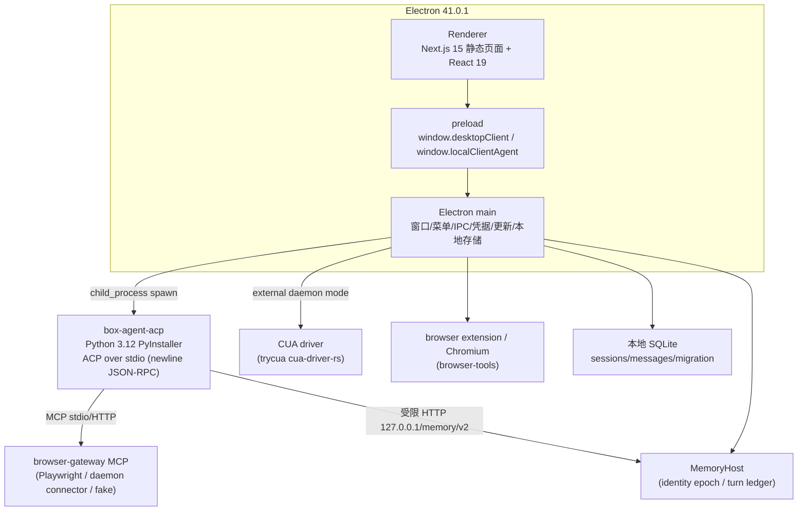

# 商汤小浣熊 Desktop 1.2.0 Agent Harness 逆向调研

调研日期：2026-11-16。样本：`商汤小浣熊-1.2.0-arm64.dmg`（SHA-256 `6e7c548da94dfab9ab3a616579d368c8e56bd9ee25e4d1aa324f2479e5bb55b8`，558 MB）。应用版本 **1.2.0**，Bundle ID `com.sensetime.desktop.raccoon`，Electron **41.0.1**，内置 Agent 运行时 **box-agent 1.0.10**（Python 3.12 + PyInstaller，名为 `box-agent-acp`）。[X01][X02][X03][X04]

核验方式：只读挂载 DMG，读取 `Info.plist`、Electron fuses、`app.asar` 清单与解包内容；使用 REA 对 `box-agent-acp` 做 PyInstaller 清单分析并解包 PYZ，静态读取 252 个 `box_agent` 模块的 code object（名称、文档字符串、字符串常量、导入关系）；未启动应用、未执行任何内置 Python/脚本、未联网。文中“已观察”表示静态代码/资源可直接确认；“推断”表示由调用关系得出的高置信结论；“未知”表示本次未验证。

> 这是与 WorkBuddy 完全不同的一种桌面 Agent 实现：**Electron（Next.js 静态导出 UI）+ 单个独立 Python Agent 进程（PyInstaller 冻结）+ ACP over stdio + 本地 MemoryHost + 宿主反向 RPC**。对 LinkSense 的价值主要在“Python 侧 Agent 内核的上下文/工具/权限/记忆设计”和“桌面宿主如何把本地能力以协议方式注入 Agent”。

---

## 0. 一页结论

1. **Agent 不是 Electron 的一部分**：`box-agent-acp` 是打包在 `Resources/box-agent-runtime` 下的 **PyInstaller 单文件可执行程序**（Python 3.12，253 MB），由 Electron 主进程作为子进程拉起；一个 Agent 进程承载多个 ACP session。[X03][X04]
2. **协议是 ACP（Agent Client Protocol）**：桌面实现 JSON-RPC（换行分帧）客户端，`initialize` 报 `protocolVersion: 1`，关闭 client 侧 fs/terminal 能力；Agent 返回 `sessionCapabilities.resume`、`loadSession`、`desktop_memory` 等能力。[X05][X06]
3. **会话、回合、历史都是“可恢复的持久状态”**：Agent 侧 `SessionLog` 是 append-only JSONL + writer lock + fsync + revision/projection；支持 `session/load` 回放、`session/resume` 续接、`session_continuation` 种子、`history_edit` 修订，并用 `turn_id` + `input_fingerprint` 做幂等。[X07][X05]
4. **上下文工程非常细**：基于 provider usage + request-only 增量估算；图片按像素计 token；压缩触发为 `90% × (context_window - max_output_tokens)`；摘要要求单一 `<summary>` 块，失败走确定性截断并恢复只读工具状态；有 loop guards、截断续写、重复流恢复、provider stale 保护、LLM judge 的“宣布了但没做”续跑。[X08]
5. **工具面分两层**：58 个工具类（Bash/文件/Jupyter/浏览器/CUA/图像/视频/搜索/邮件/表格/Obsidian/记忆/计划/待办/子代理/技能/MCP/工件/定时任务等），MCP 默认**延迟暴露**：`tool_search` 检索目录并返回 `tool_ref`，`call_tool` 才能执行；子代理继承父会话已激活的真实工具，但不继承 `tool_search`。[X09][X10]
6. **权限是能力模型而非布尔开关**：`filesystem.read/write`、`memory.openclaw_import` 三类 capability，scope 为 `session_workspace | user_home | custom`；越界通过 `permission/request` 升级，宿主可返回临时/持久授权；危险命令必须展示精确命令才能批准；无 UI 时回退原生对话框并超时取消。[X11][X12]
7. **记忆是独立子系统**：本地 `~/.box-agent/memory`（MEMORY.md + memory_summary.md + v2/experiences 主题分片）有 decay/archive/dedup/conflict 维护；桌面另有 MemoryHost（身份 epoch、turn ledger、origin witness、experience jobs/search），Agent 通过一个**私密 bootstrap 文件 + 127.0.0.1 + token + identity_epoch** 的受限 HTTP 代理访问。[X13][X14]
8. **桌面宿主大量参与 Agent 行为**：`session/new._meta` 携带 `llm_binding`、`permission_mode`、`filesystem_policy`、`workspace_layout`、`env_context`、专家/团队、连接器选择；Agent 反向请求 `session/request_permission`、`_session/runtime_environment`、`_session/memory_proposal`、`_session/skillhub_search|install`。[X05][X12]
9. **本地聊天存储是 SQLite**：sessions/messages/migration_state/migration_errors，消息以 JSON payload 存储，带 `turn_id`、`run_id`、`external_idempotency_key` 与迁移状态。[X15]
10. **与 WorkBuddy 的收敛点**：两者都采用 ACP、独立 Agent 运行时、会话/回合协议、权限请求、MCP、Skills、子代理、压缩、工件；差异在语言/进程形态、记忆子系统、工具暴露策略与产品化程度。[X16]

---

## 1. 应用形态与包结构

### 1.1 包事实

| 项 | 值 |
| --- | --- |
| DMG | 558 MB，read-only 挂载 |
| App | `商汤小浣熊.app` |
| Bundle ID | `com.sensetime.desktop.raccoon` |
| 版本 | 1.2.0 |
| Electron | 41.0.1 |
| 主入口 | `dist/electron/entry.cjs` → `main.cjs` / `client-main.cjs` |
| `app.asar` | 163 MB，2,221 个条目 |
| UI | Next.js 15.5.7 静态导出（`out/`，React 19.2.1） |
| Agent 运行时 | `Resources/box-agent-runtime` 253 MB（PyInstaller，Python 3.12，3,821 个 PYZ 条目） |
| 业务资源 | `render-node-deps` 100 MB、`browser-gateway` 15 MB、`browser-tools` 15 MB、`connectors`、`conversation-skills`、`team-document-skills`、`pandoc`、`rg` |

`app.asar` 内顶层布局：[X04]

```
/out           Next.js 静态导出的页面（chat / home / plan / workspace / local-agent /
               team-pilot / schedule / analysis / ppt / stage-preview / editor-preview …）
/build         主进程/共享代码的未打包 JS（含 electron/main/** 源模块）
/dist/electron 打包后的 Electron 入口与 preload
/vendor        ECharts 等前端 vendor 资源
/package.json  @raccoon/office-desktop
```

### 1.2 Electron 安全配置（已观察）

REA 读取 Electron Framework fuses（arm64）：[X02]

| Fuse | 状态 |
| --- | --- |
| `RunAsNode` | 启用（用于拉起 Python/Node 子进程） |
| `EnableCookieEncryption` | 启用 |
| `EnableNodeOptionsEnvironmentVariable` | 启用 |
| `EnableNodeCliInspectArguments` | 启用 |
| `EnableEmbeddedAsarIntegrityValidation` | **关闭** |
| `OnlyLoadAppFromAsar` | **关闭** |
| `GrantFileProtocolExtraPrivileges` | 启用 |
| `WasmTrapHandlers` | 启用 |

应用使用自定义 scheme `raccoon-desktop://shell/` 加载本地 UI；`security.cjs` 定义了：[X17]

- `shellWebPreferences`：`contextIsolation: true`、`sandbox: true`、`nodeIntegration: false`、`webSecurity: true`；
- CSP：`default-src 'self'; script-src 'self' 'unsafe-inline'; ... object-src 'none'; frame-src 'none'`；
- 资源解析严格限制在 app 根下，拒绝 `..`、反斜杠、NUL、`/_next/`、`/cloud-assets/`、`/api/` 等路径；
- 签名发布（`raccoonSignedRelease: true` 且未开启 `raccoonSignedPackageDevToolsEnabled`）时移除 DevTools 菜单、关闭 webview devtools。

**注意**：ASAR 完整性未启用、`OnlyLoadAppFromAsar` 未启用，属于与 WorkBuddy 不同的取舍；本次未评估其安全影响。

### 1.3 进程拓扑



一个 Electron 主进程只维护**一个** `box-agent-acp` 子进程（`this.child`），多个会话通过 ACP `sessionId` 复用同一进程；这也是它区别于 WorkBuddy “每会话 CLI worker”旧路径的设计。[X05]

---

## 2. Electron 桌面层

### 2.1 启动与运行模式

`entry.cjs` 根据参数选择：[X17]

- `--raccoon-browser-host`：浏览器宿主模式；
- `--preview` / `--live-profile`：预览模式；
- `--client` / `--client-profile`：客户端模式（打包后默认）。

打包环境必须存在 `.env.electron`，且 `NEXT_PUBLIC_LOGIN_URL`、`NEXT_PUBLIC_API_URL` 必须是 https；开发环境支持 `.env.electron.local` 与企业专属环境文件。[X17]

### 2.2 preload 暴露面

`client-preload.cjs` 暴露：[X12]

- `window.desktopClient`：会话跟踪、用户信息、记忆 v2、浏览器覆盖层、团队文件、Appshot、语音输入、MCP 配置、连接器、日程、数据源、桌面宠物、应用更新、反馈、工作区打开器、工件预览等；
- `window.localClientAgent`：本地 Agent 控制面：
  `getSessionPermission`、`setSessionPermissionMode`、`createSession`、`loadSession`、`status`、`getPromptOutcome`、`getWorkspaceDirectory`、`send`、`cancel`、`inject`、`cancelInject`、`goal`、`respondPermission`、`onEvent`、`onPermissionRequest`、`onPermissionDismiss`；
- `window.desktopTheme`、`window.APP_BOOT_ID`。

### 2.3 主进程 Agent 桥

`build/electron/main/client/agent/registerAgentBridge.js` 是本地 Agent 的 IPC 边界：[X12]

- 只注册具名 channel，不接受渲染层传入任意 channel/进程/凭据 API；
- `assertSender(event)` 校验发送者；`assertSessionAvailable` 校验会话归属；
- 会话语义：
  - `local-agent:send`：校验 workspace 授权、文件输入、连接器选择、历史编辑、会话续接种子；`sending` 集合保证同会话单飞；失败回滚；
  - `local-agent:inject`：`injectionId` 幂等，签名不一致返回 `INJECTION_IDEMPOTENCY_CONFLICT`，最多 2,048 条；
  - `local-agent:cancel`：可用 `expectedPromptId` 防止误取消新回合；
  - `local-agent:permission-respond`：仅接受 `temporary | persistent | cancel`，并校验 pending 请求的归属窗口；
  - `local-agent:goal`：目标控制（create/set/pause/resume/complete/block/clear/progress）。
- 宿主可调用 `sendFromHost` / `createFromHost`（如定时任务结果、外部会话），并区分 `DECISION_NOT_DISPATCHED`。

### 2.4 本地聊天存储

`build/electron/main/localChatStorage` 使用 SQLite：[X15]

```sql
sessions(id, title, chat_type, available, project_uuid, doc_uid, user_id,
         workspace_dir, created_at_ms, updated_at_ms, last_chatted_at_ms,
         raw_message_count, display_message_count, user_message_count,
         assistant_message_count, migration_status, payload_json)
messages(id, session_id, seq, display_group_seq, role, type, turn_id, uuid,
         run_id, external_idempotency_key, visible, active, created_at_ms,
         updated_at_ms, payload_json, legacy_document_id, legacy_array_index)
migration_state / migration_errors
```

特点：

- 消息以 JSON payload 保存，SQLite 只承担索引/排序/分页；
- `turn_id`、`run_id`、`external_idempotency_key` 支撑重放/去重；
- 有从旧 JSON/nedb 迁移的完整状态机（扫描偏移、指纹、错误表）；
- 有 `openWithRecovery`、`recoverHistory`、`nedbFileProtection` 等恢复/保护模块。

---

## 3. Agent 运行时：`box-agent-acp`

### 3.1 形态与入口

`Resources/box-agent-runtime/manifest.json`：[X04]

```json
{
  "name": "box-agent",
  "version": "1.0.10",
  "platform": "darwin",
  "arch": "arm64",
  "entry": "bin/box-agent-acp",
  "mode": "standalone",
  "managed_mcp_config_version": 1,
  "connector_skill_sources_version": 1,
  "mcp_multi_source_version": 1,
  "external_python_sandbox": true,
  "bundled_stable_runtimes": [],
  "mcp_servers": {
    "box-agent-web-extract": {
      "entry": "bin/box-agent-acp",
      "args": ["--web-extract-mcp"],
      "transport": "stdio"
    }
  }
}
```

REA 对 `box-agent-acp` 的 PyInstaller 清单：[X03]

- Python **3.12**（`libpython3.12.dylib`），CArchive 14 个条目、18.6 MB；
- PYZ 3,821 个条目，3828 个文件哈希全部验证通过；
- 冻结入口 `runtime_entry` 的文档明确要求 **stdout 只能属于 ACP 协议**，所有日志走 stderr；`--web-extract-mcp`、`--cua-mcp`、`--bootstrap-mcp-config` 三个子模式。

启动方式（桌面 `resolveLaunchConfig`）：[X05]

1. `BOX_AGENT_ACP_CMD` 直接指定命令；
2. `BOX_AGENT_DIR` 指向目录（manifest → `.venv/bin/python -m box_agent.acp.server` → `uv run box-agent-acp`）；
3. 随包 `box-agent-runtime/manifest.json`；
4. PATH 上的 `box-agent-acp`；
5. 开发目录（`~/Dev/lab/mini-agent_claude`）。

### 3.2 模块地图（252 个模块，节选）

| 目录 | 关键模块 | 职责 |
| --- | --- | --- |
| `acp/` | `__init__`、`message_display`、`request_state`、`follow_up_suggestions` | ACP Agent 适配、事件映射、展示元数据 |
| `kernel/` | `loop`、`context_engine`、`compact_engine`、`stream_controller`、`permission_gateway`、`tool_engine`、`tool_result_pipeline` | 单一 Agent 循环、上下文/压缩、流控制、权限与工具调度 |
| `tools/` | 71 个模块 + `engine/`、`file/` | 工具实现、调度、结果处理、MCP 加载 |
| `llm/` | `openai_client`、`anthropic_client`、`model_profiles`、`model_routing`、`capabilities`、`task_budgets` | 模型适配、profile、路由、预算 |
| `session/` | `session_log`、`session_projection`、`session_context`、`session_assembly`、`session_continuation`、`session_history`、`session_prompts` | 会话持久化、投影、续接、装配 |
| `turn/` | `turn_policy`、`turn_continuation`、`turn_runtime` | 回合分类、续跑判断、缓存指纹 |
| `memory/` | `memory`、`memory_maintainer`、`desktop_memory/*` | 三层记忆、维护、桌面代理 |
| `skills/` | `skill_loader`、`skill_runtime`、`skill_context`、`skill_preload`、`skill_dependencies` | 技能目录、选择、上下文、预加载、依赖 |
| `plugins/` | `host`、`runtime`、`hooks`、`builtins`、`cua` | 插件宿主、运行时、钩子 |
| `composition.py` | `compose_default_kernel_services`、`run_agent_loop_with_default_services` | 默认能力组合 |
| `agent.py` / `agent_session.py` / `agent_service.py` | `Agent`、`AgentSession`、`AgentService` | 公共 API、会话状态、协议无关服务 |
| `events.py` / `run_events.py` | 26 种事件、`RunEventChannel` | 结构化事件与有界投递 |
| `experts.py` | `ExpertProfile`、`ExpertTeamProfile` | 专家/团队元数据与提示词 |
| `cloud_handoff.py` | 云任务交接 | 生成可独立执行的云端任务 JSON |
| `user_paths.py` | `~/.box-agent` | 状态目录与路径约束 |

### 3.3 分层

```text
Agent (公共 facade)
  → AgentService (协议无关构造)
    → AgentSession (会话状态/配置边界)
      → runtime.run_agent_loop
        → kernel.loop.AgentLoopKernel
          → compose_default_kernel_services (工具/上下文/压缩/权限/钩子/记忆)
```

`kernel/loop.py` 的文档写得很明确：它是**唯一 Agent 循环**，以 `AsyncGenerator[AgentEvent]` 产出结构化事件；CLI、ACP 和任何未来消费者都驱动同一个生成器，循环内不 `print()`、不 `input()`。[X07]

---

## 4. ACP 协议面

### 4.1 ACP 库

`acp/` 是一个完整的 Python ACP SDK，结构对齐 Rust `agent-client-protocol`：[X06]

- `connection.py`、`agent/connection.py`、`client/connection.py`、`router.py`、`stdio.py`、`transports.py`、`telemetry.py`；
- `schema.py` 覆盖：initialize/auth、session new/load/resume/fork/list/delete/close/set_mode/set_config_option/prompt/cancel、MCP（http/sse/acp/stdio）、elicitation（form/url）、permissions、plans、usage/cost、providers、NES（next edit suggestions）、terminal/fs 客户端能力；
- `stdio.py` 支持 POSIX 与 Windows 的 stdio 传输、`spawn_agent_process` / `spawn_client_process`。

桌面端 `initialize` 请求：[X05]

```json
{
  "protocolVersion": 1,
  "clientCapabilities": {
    "fs": { "readTextFile": false, "writeTextFile": false },
    "terminal": false
  },
  "clientInfo": { "name": "@raccoon/office-desktop", "version": "1.2.0" },
  "_meta": {
    "llm_binding": { "...": "..." },
    "host_client_info": { "...": "..." }
  }
}
```

Agent 返回的 `agentCapabilities` 被桌面用于探测：

- `sessionCapabilities.resume`（是否支持 `session/resume`）；
- `loadSession`（是否支持 `session/load` 历史回放）；
- `_meta.desktop_memory`：`{ protocol_version: 2, backend: "desktop", enabled: true, attempt_log_v1: true }`。

### 4.2 会话方法

| 方向 | 方法 | 说明 |
| --- | --- | --- |
| Client → Agent | `session/new` | 创建会话；`cwd` + `mcpServers: []` + `_meta` |
| Client → Agent | `session/resume` | 续接已有会话；可携带 `replayFromTurnId` |
| Client → Agent | `session/load` | 只读回放历史，不创建缺失会话、不执行工具 |
| Client → Agent | `session/prompt` | 发送用户回合 |
| Client → Agent | `session/cancel`（通知） | 取消当前回合 |
| Agent → Client | `session/update`（通知） | 流式事件 |
| Agent → Client | `session/request_permission`（请求） | 权限升级 |
| Agent → Client | `_session/runtime_environment` | 请求宿主提供运行环境 |
| Agent → Client | `_session/memory_proposal` | 记忆提升提案 |
| Agent → Client | `_session/skillhub_search` / `_session/skillhub_install` | 技能市场检索/安装 |

扩展方法（桌面 `this.request('_...')` / `ext_method`）：[X05][X06]

```
_workspace/get, _workspace/set
_list_skills
_inject, _cancel_inject
_goal
_request_wrap_up
_llm/prompt
_memory_proposal_list, _memory_proposal_apply
_mcp/status, _mcp/reconcile, _mcp/reconnect, _mcp/disconnect
_mcp/source/replace, _mcp/credential/set, _mcp/credential/clear
_presentation/preflight
```

### 4.3 `session/new._meta` 的完整字段（桌面构造）

来自 `boxAgentManager`：[X05]

| 字段 | 含义 |
| --- | --- |
| `host_capabilities` | `{ skillhub_search: 1, skillhub_install: 1, runtime_environment: 1 }` |
| `reasoning_effort` / `execution_profile` | 思考强度与执行档位 |
| `llm_binding` | 会话模型绑定：`source`（profile/model/autoRouting）、`profileId`、`profileRevision`、`model`、`maxTokens`、`contextWindow` |
| `permission_mode` | 会话权限模式 |
| `filesystem_policy` | `{ filesystem_scope: "session_workspace", session_workspace_root, allowed_directories }` |
| `artifact_mode` | 工件模式 |
| `workspace_layout` | `selected_root_dir`、`selected_root_kind`、`project_root_dir`、`session_workspace_dir`、`artifact_root_dir`、`upgrade_reason`、`fallback_applied` |
| `env_context` | 宿主已知的 CLI 路径、浏览器工具状态、图片服务、HyperFrames、Obsidian、平台等（Agent 会先清洗再放入提示词） |
| `host_client_info` | 宿主名称/版本 |
| `session_id` | 产品侧会话 ID（resume 时删除，避免覆盖稳定 ID） |
| `expert` / `expert_team` | 专家/团队 profile、revision |
| `skills` | 技能元数据（initialize 时返回，session 可覆盖） |

### 4.4 `session/prompt._meta` 的字段

来自 ACP Agent `prompt` 与桌面 `send`：[X06][X12]

| 字段 | 含义 |
| --- | --- |
| `turn_id` | 产品回合 ID，用于幂等、历史编辑、事件归属 |
| `input_fingerprint` | 输入指纹；重复 `turn_id` 但指纹不同 → `TURN_IDEMPOTENCY_CONFLICT` |
| `session_continuation` | `officev3-session-continuation/v2`：外部/定时任务恢复所需的历史种子 |
| `history_edit` | 历史修订：`target_turn_id` + `expected_revision_id` + 新内容 |
| `ui_language` | 宿主界面语言，影响进度文本 |
| `cloudHandoff` | 云任务交接 |
| `planApproval` / `require_plan_approval` | 计划审批决定/要求 |
| `goal` | 目标操作 |
| `userDecision` | `request_user_decision` 的宿主回答 |
| `selected_connector_ids` / `connector_statuses` | 本轮连接器选择与状态快照 |
| `image_attachment_paths` | 图片附件 |
| `input_context` | 文件/选区/数据库/预览等结构化输入事实 |
| `injected` | 注入消息（补充输入） |

### 4.5 换行 JSON-RPC 与反向请求

桌面 `handleStdoutChunk` 按 `\n` 切分并 `JSON.parse`；`respondToAgent` 写 `JSON.stringify({jsonrpc:"2.0", id, result|error}) + "\n"`。[X05]

反向请求方法：`_session/runtime_environment`、`_session/memory_proposal`、`_session/skillhub_search`、`_session/skillhub_install`、`permission/request`、`session/request_permission`。未知方法返回 `-32601 Method not found`。[X05]

---

## 5. 会话、回合与事件

### 5.1 SessionLog：唯一事实源

`session_log.pyc` 的文档：**每个逻辑会话一个 append-only JSONL**。[X07]

- 写入：`session/fsync duration_ms=...` 埋点；失败抛 `SessionLogDurabilityError`；
- 并发：`a+b` 打开 + writer lock，第二个 writer 得到 `SessionLogInUseError`；
- 校验：`SessionLogCorrupted`（不是合法前缀）、`SessionLogRevisionCorrupted`、`SessionLogIncompatible`（需要不同 reader）、`SessionLogWorkspaceMismatch`（cwd 不拥有该会话）；
- 恢复：`SessionLogReplayError` 表示已提交 surface 无法重建；
- 投影：`SessionProjection` 是从已提交日志重建的完整状态，**独立于 provider context**；Context Engine 可以裁剪/摘要它而不改变它；
- 标记：`TOOL_NOT_STARTED` / `TOOL_OUTCOME_UNKNOWN` 用于工具中断的确定性恢复。

### 5.2 会话恢复与历史回放

`session/load`：只打开并回放既有事实，不创建缺失会话、不执行工具；`session/resume`：恢复上下文，可选 `replayFromTurnId`（inclusive cursor）。[X06]

回放事件格式（`_replay_session_history`）包括：

- `user_message_chunk`、`agent_message`、`tool_call`/`tool_call_update`；
- `turn/binding`、`turn/end`（`complete|cancelled|error|interrupted`）；
- 图片引用用 `imageIndex`，历史中不可用的图片显示 `[Image unavailable in saved history]`；
- `REPLAY_CURSOR_NOT_FOUND` 表示 cursor 无效。

### 5.3 回合幂等与历史编辑

- `prompt` 先检查 `turn_id` + `input_fingerprint`：已提交 → `TURN_ALREADY_ACCEPTED`；指纹不一致 → `TURN_IDEMPOTENCY_CONFLICT`。
- `history_edit` 必须带 `target_turn_id` 与 `expected_revision_id`；不匹配 → `INVALID_HISTORY_REVISION`。
- 修订期间：
  - 先请求取消当前回合并等待（`HISTORY_CANCEL_TIMEOUT` / `HISTORY_CANCEL_UNCONFIRMED`）；
  - `session_log.revise_agent_history` 生成新 revision；
  - 关闭浏览器会话、清理工具、恢复 pending plan；
  - 失败时回滚并标记 `_history_restore_failed`。[X06]

### 5.4 事件模型

`events.pyc` 定义了 26 种结构化事件：[X07]

```
StopReason, StepStart, StepEnd, ThinkingEvent, ContentEvent, ProgressEvent,
PlanSnapshotEvent, TokenUsageEvent, LLMOutputEvent, LLMActivityEvent,
ToolCallStart, ToolCallResult, WebSearchEvent, ConfirmationRequired,
ArtifactEvent, SummarizationEvent, ErrorEvent, LogFileEvent, DoneEvent,
MemoryEvent, SubAgentEvent, PermissionRequestEvent, InjectedMessageEvent,
MemoryPromotionCandidate, MemoryPromotionPlan, MemoryProposalEvent
```

ACP 适配层 `_run_turn` 将其映射为 ACP `session/update`：文本/思考 chunk、工具开始/更新/内容、计划快照、LLM 输出/活动、进度、用量、工件、专家团队进度、技能使用归因。[X06]

`acp/message_display.py` 专门维护展示元数据：`messageId` 标识逻辑回答，`outputId` 标识单次模型输出；只有最外层请求结束后才发布最终回答归属，兼容旧客户端忽略扩展字段。[X06]

### 5.5 取消、注入与预算

- `cancel`：写 `turn.cancel_requested` 日志，取消 follow-up 建议任务，向 `run_handle.request_cancel` 发信号。
- `_inject`：向活动回合注入补充消息（`InjectionKind`），或取消注入；`BUDGET` 注入用于宿主时间预算。
- `_request_wrap_up`：宿主告知剩余时间，Agent 注入“开始收尾”的 BUDGET 提示。
- `RunEventChannel`：有界事件投递，`EventTooLargeError`、`EventConsumerTimeoutError`。[X07]

---

## 6. 上下文工程

### 6.1 估算

`kernel/context_engine.pyc`：[X08]

- 优先使用 provider 返回的 usage（matched route + message fingerprint）；
- 只对新增请求材料做估算（request-only fingerprint）；
- 图片：按像素估算 token（`pixels / divisor`，有默认/上限），不把 base64 计入字符数；
- 回退：4 字符 ≈ 1 token 的保守估算；
- `request_input_tokens` 使用精确的工具 schema 计算输入。

### 6.2 压缩

- 触发：安全输入上限；配置说明为 `90% × (context_window - max_output_tokens)`；
- 请求：在**完整历史末尾**追加摘要指令（保持 provider KV cache），要求单一 `<summary>...</summary>` 块；
- 失败：确定性截断 fallback（保留开头/结尾、当前用户请求优先），并显式标记 lossy；
- 保留：最近消息组（assistant tool call + 连续 tool result）；
- 恢复：压缩后通过只读工具状态恢复 `[Post-Compaction Runtime State]` 与 `[Post-Compaction Workflow Checkpoint]`；
- 预算：`SKILL_REFERENCE_BUDGET_CHARS`、`REQUEST_INPUT_HEADROOM_TOKENS` 从安全输入上限分配，不重复预留输出。

### 6.3 循环保护

`loop_guards.pyc`：[X08]

- 工具调用预算（general/web_search/search_files/sub_agent）；
- 接近上限/无进展的 wrap-up 提示；
- 重复流模式检测；
- 截断续写（`retry_on_suspected_truncation`，默认最多 1 次）；
- `search_files` 连续空结果引导；
- 子代理无进展步数限制。

`turn_continuation.pyc`：[X08]

- 检测“模型宣布要做但没做”的回合；
- 用 LLM judge 读只读快照与工具进度，决定是否注入续跑提示；
- 有超时、次数上限、预算控制；judge 失败不阻塞主流程。

`stream_controller.pyc`：

- provider stale 超时（env `BOX_AGENT_PROVIDER_STALE_SECONDS` 优先）；
- 传输中断后仅允许一次续跑（`StreamInterruptionRecovery`）；
- 重复/畸形输出后仅允许一次全新响应（`RepetitiveStreamRecovery`）；
- 心跳 `agent_activity_v1`。

---

## 7. 工具系统

### 7.1 工具清单（58 个 `Tool` 类，含基类/适配器，按类别）

| 类别 | 工具 |
| --- | --- |
| Shell | `BashTool`、`BashOutputTool`、`BashKillTool`、`ShellInspection`（命令解析/危险检测）、`PythonMutationGuard` |
| 文件 | `ReadTool`、`WriteTool`、`AppendTool`、`EditTool`、`SearchFilesTool`、`StagedFileWriteTool`、`FileChangeReceiptMixin`、`FileResultAdapter`、`OwnedFileCleanup` |
| 代码执行 | `JupyterSandboxTool`、`SandboxStatusTool`、`PythonEnvironment`、`RuntimeEnvironmentTool` |
| 搜索 | `GlobTool`、`GrepTool`（ripgrep）、`WebSearchRuntime`、`WebSearchPolicy` |
| 浏览器 | `BrowserTool`（经 browser-gateway）、`BrowserToolIntentPolicy`、`BrowserRuntimeCoordinator`、Playwright 会话池 |
| 电脑操作 | CUA adapter / `cua_server`（trycua driver） |
| 多模态 | `GenerateImageTool`、`ImageInspectionTool`、`ImageAttachmentSnapshotTool`、`ReadVideoTool`、`VideoTranscription`、`VisionReviewTool` |
| 文档 | `ReadEmailTool`、`ExtractEmailAttachmentTool`、`ValidateTableTool`、`JsonlQueryTool`、`PptxSafety`、`Obsidian*Tool` |
| 记忆 | `MemoryRead/Search/WriteTool`、`Memory*CorrectionTool`、`ExternalMemory*`、`MemsenseMemoryMutationTool` |
| 计划/待办 | `PlanWriteTool`、`PlanReadTool`、`TodoWriteTool`、`TodoReadTool`、`ReportExecutionResultTool` |
| 用户交互 | `RequestUserInputTool`、`RequestUserDecisionTool` |
| 代理 | `SubAgentTool`、`ToolSearchTool`、`CallTool`、`DelegatedBudget` |
| 技能 | `GetSkillTool`、`ListSkillsTool`、`SkillHubSearchTool`、`SkillHubInstallTool`、`SkillRecoveryGate`、`SkillScratchDirectory` |
| MCP | `McpConfigTool`、`MCPTool`、`MCPServerConnection`、`MCPToolCatalog`、`MCPToolExposureManager` |
| 工件/交付 | `PublishArtifactTool`、`ArtifactMetadata`、`ArtifactPublication`、`ChatReferences` |
| 自动化 | `CreateScheduledTaskTool` |

### 7.2 MCP 延迟暴露（关键设计）

`tools/mcp_tool_search.pyc`：[X10]

- `tool_search` 在本地工具 + MCP 目录中检索（支持多 query、精确 tool id、server、connector）；
- 命中后返回**完整 schema** 与 `tool_ref`（`tool:v1:<random>`）；
- 只有被激活的工具、协议必需 companion、显式 `alwaysLoad` 工具才可调用；
- `call_tool` 用 `tool_ref` 执行，避免模型直接编造 MCP 工具名；
- 激活状态是 **session-scoped**，有 generation 计数，MCP 重连会更新；
- 子代理继承父会话已激活的真实工具，但不继承 `tool_search`；
- connector allowlist 控制可发现范围；
- 搜索结果描述会做规范化比对，防止提示词注入伪造 `tool_ref`。

`mcp_loader.pyc` 还实现了：

- MCP 连接超时/执行超时/SSE 读超时；
- stdio/HTTP/SSE/streamable-http 传输；
- Playwright 会话隔离（每会话独立 BrowserContext，最大 8 个客户端，空闲 30 分钟关闭）；
- 托管 HTTP 服务进程（端口、pid 记录、stale reaper、退出清理）；
- OAuth 状态/凭据；
- 连接状态与工具目录重建。

### 7.3 工具执行管线

`tools/engine/` 拆分：

- `scheduler.py`：并行批次、超时、取消；
- `execution.py`：权限链、调用、结果；
- `preparation.py`：参数校验（`schema_validation`）、参数限额（`argument_limits`）；
- `results.py` / `artifact_results.py`：结果截断、结果存储、工件结果；
- `contracts.py`：工具契约（`ToolDefinitionView`、`tool_ref`）。

`kernel/tool_result_pipeline.pyc` 与 `file_result_adapter.pyc` 处理：

- 超长参数/结果的历史占位符（`[Full tool-call argument omitted from model history]` 等）；
- 占位符恢复（`_ModelHistoryPlaceholderRecovery`）；
- 图片/上下文资源的持久化与去重；
- `context_resource` 账本与历史决策。

---

## 8. 权限与安全边界

### 8.1 能力模型

`tools/permissions.pyc`：[X11]

```text
capabilities: filesystem.read | filesystem.write | memory.openclaw_import
scope:        session_workspace | user_home | custom
```

`CapabilityPolicy` 不可变；`PermissionEngine` 构造时冻结：

- `session_workspace`：workspace + `session_workspace_root` + `allowed_directories`；
- `user_home`：整个 `$HOME`；
- 额外放行：`~/.box-agent` 只读、内置技能目录、`/tmp`、`/var/tmp`（应用读取目录）；
- 路径解析：存在路径 `resolve()` 跟随符号链接；不存在路径解析最近已存在父目录再拼接；
- 包含判断用 `Path.relative_to` 组件级，避免 `/Users/x/Download` 误匹配 `/Users/x/Downloads`；
- 越界返回 `PermissionDecision(permission_request=...)`，由 `_PermissionNegotiator` 走 ACP `permission/request`；
- 授权：`GrantStore` 分 prompt/session 两种生命周期，目录授权按解析后的目录存储；
- 特殊：`safety` 范围必须带精确 `command` 才能批准（`canApproveLocalAgentPermission`）；`memory.openclaw_import` 独立开关。

### 8.2 桌面侧权限 UI

`boxAgentManager`：[X05][X12]

- 权限请求 payload：`requestId`、`sessionId`、`acpSessionId`、`scope`、`requested_scope`、`path`、`reason`、`command`、`risk`、`temporary_supported`、`persistent_supported`、`persistent_label`；
- 播放到发起会话的 renderer（`local-agent:permission-request`），不可用时回退**原生对话框**；
- 超时（`PERMISSION_DECISION_TIMEOUT_MS`）自动 cancel，避免挂死；
- `persistent` 决策走 `persistPermissionHandler` 持久化；
- 外部网关会话（`external_gateway`）禁止交互式权限，直接 cancel；
- skillhub 安装授权单独记录在 `approvedSkillHubInstalls`，安装时再次校验。

### 8.3 命令与写入安全

- `safety.py`：危险命令检测、scope escape、workspace 路径校验、`rm` 目标提取、备份、内置技能写入保护；
- `shell_inspection.py`：完整 shell 解析（引号、注释、heredoc、重定向、`$()`、变量赋值、PowerShell/CMD），用于权限分析；
- `chat_references.py`：HTML/Python/JS 引用变更拦截，防止修改聊天引用的本地依赖；
- `pptx_safety.py`：检测 PPTX 自检绕过、图片状态命令绕过；
- 子代理的 `_WriteScopedTool`：写路径必须在授权目录内，否则 `WRITE_SCOPE_VIOLATION`；
- `python_mutation_guard.py`：用 Python 脚本修改文件时额外约束。

### 8.4 沙箱

- `JupyterSandboxTool` 使用独立 venv / 内核，工作目录为会话 workspace；提示词明确禁止写 `/mnt/data/`、`sandbox:` 前缀；
- `allow_full_access: false`（默认）时文件/Bash 受 workspace 限制；`true` 时放开；
- 桌面 `filesystem_policy` 来自用户设置（`session_workspace` / `user_home` / 自定义目录）；
- 外部 Python 沙箱（manifest `external_python_sandbox: true`）与 `BOX_AGENT_SANDBOX_PYTHON` 环境；
- CUA 使用独立 driver 进程，macOS 需辅助功能 + 屏幕录制权限。

---

## 9. 子代理、专家与目标

### 9.1 子代理

`tools/sub_agent_tool.pyc`：[X9]

- 子代理是独立 Agent 循环 + 独立消息历史，只把最终摘要返回父会话；
- `parallel_safe = true`，多个子代理调用可并发；
- 子会话写入父 `SessionLog`（`subagent/descriptor`、`delegationDepth`），保留 lineage；
- 继承父会话**当前可见的真实工具**（包括父已激活的 MCP 工具），但**不继承 `tool_search`**；
- 共享父权限 broker（子代理权限升级回到同一宿主）；
- 技能访问受父会话 grant 限制；
- 写入范围按子任务 scoped；
- 预算：`sub_agent_token_limit`、delegated budgets、每步最多子代理数、无进展步数限制；
- 模型：自动路由可选 lite/子模型，支持 `thinking`。

### 9.2 专家与团队

`experts.pyc`：[X9]

`ExpertProfile` 字段：`name`、`role`、`description`、`starter_prompt`、`instructions`、`visible_rules`、`internal_rules`、`default_skills`、`required_skills`、`optional_skills`、`output_format`、`constraints`、`revision`。

- `internal_rules` 是隐藏执行指导，要求模型不要引用/枚举；
- `render_prompt()` 生成“专家档案”提示块；
- `skill_query_terms()` 用于技能检索；
- `ExpertTeamProfile` 增加 `members`、`workflow stages`、`workstreams`、`orchestration`、`execution mode`；
- 团队进度通过 ACP `expert_team/progress` 事件上报。

### 9.3 目标与计划

- `goal`：`create/set/pause/resume/complete/block/clear`，可带 objective、progress、blocked_reason、evidence、completed_by；
- `plan_write` / `plan_read`：结构化计划（目标、范围、步骤、验证、风险、假设），计划快照事件 `plan/snapshot`；
- 宿主可要求“先出计划再执行”；未批准时执行工具会被暂停；
- `request_user_decision` 与 `request_user_input` 区分“选择卡”与“补充信息”。

---

## 10. 记忆系统

### 10.1 本地记忆（v2）

`memory.pyc` 文档给出的目录：[X13]

```text
~/.box-agent/memory/
├── MEMORY.md          # 注入系统提示的核心记忆
├── memory_summary.md  # 轻量路由摘要，决定是否 memory_search
└── v2/experiences/    # 主题分片、按需检索
```

- `MemoryManager`：读写、搜索、上下文注入；
- `MemoryExtractor`：生命周期点自动抽取（冷却 300s、每 N 步）；
- 自动匹配：根据最新用户请求做弱相关匹配，注入 “Possibly relevant memory”，明确要求新任务时忽略；
- `MemoryMaintainer`：decay（无命中且久未使用 → archive）、archive 清理、Jaccard 聚类去重、冲突检测；
- 纠错：`MemoryWriteCorrection` / `Supersede` / `Delete` / `ListCorrections`；
- 后端：`local` / `memsense` / `generic`（mem0、memu 走 generic 映射）。

### 10.2 桌面 MemoryHost

`build/electron/main/memory-v2`：[X14]

- `MemoryHost`：主进程唯一权威；身份 epoch、授权、grants、read sequences、turn ledger、questionnaires、experience jobs；
- `MemoryTurnRouter` / `MemoryTurnLedger`：按回合记录读取与写入，防止跨身份/跨回合串数据；
- `MemoryOriginWitness`：记录证据来源；
- `MemoryExperienceJobs` / `MemoryExperienceSearch`：后台经验抽取与检索；
- `MemoryApiClient`：本地/云端 API；
- `MemoryStateRepository` / `MemoryStateStore`：状态持久化；
- `MemoryMigrationCoordinator`：迁移；
- `MemoryMaintenance`：维护；
- `legacyMemoryAccess`：旧模式兼容。

### 10.3 Agent ↔ MemoryHost 的私密传输

`desktop_memory/transport.pyc`：[X13]

- 启动时读取 bootstrap 文件（仅 owner 可读，`O_NOFOLLOW`、uid 校验、大小上限）；
- 内容必须为：`base_url` = `http://127.0.0.1:<port>/memory/v2`、`token`、`control_token`、`identity_epoch`、`profile_id`；
- 每个操作有 request/response 上限、超时、mutation/control 分类；
- 请求头 `Authorization: Bearer <token>`；`identity` 头绑定 epoch；
- 响应校验 `identity_epoch` 与 envelope；错误码归一化，绝不包含远端消息/地址；
- `SESSION_REVOKED` 后不可再用；关闭时撤销；
- 操作集：`context`、`turn/close`、`search`、`managed/read`、`core/read`、`core/mutate`、`qa/evidence`、`experience/job`、`experience/search`、`experience/facts/*`、`experience/observations/*`、`visibility/commit`、`visibility/revoke`。

`desktop_memory/evidence.pyc`：只从本回合 Session Log 后缀生成固定、脱敏的证据视图；`experience.pyc` 在 Host 冻结的证据上后台抽取，不读主 Agent 历史；`runtime.pyc` 在最终 QA 时用本回合不可变 scope 做非阻塞交接。

---

## 11. Skills 与连接器

### 11.1 Skill 格式与来源

`tools/skill_loader.pyc`：[X13]

- 支持：内置技能（只读，manifest 白名单）、用户技能 `~/.box-agent/skills/`（officev3 可写）、用户覆盖内置（保留名除外）；
- mtime 自动重载；
- `SKILL.md` frontmatter：`name`、`description`、`license`、`allowed-tools`、`keywords`、`required_skills`、`related_skills`、`capabilities`；
- 损坏技能不会静默消失：返回 `UNAVAILABLE` 诊断和技能根目录，要求用户修 frontmatter；
- 技能元数据以“渐进式槽位”放在系统提示末尾（`__BOX_AGENT_SKILLS_SLOT__`），并按中英文 token 化匹配；
- `skill_preload`：显式调用、自动预加载（roadmap/artifact/browser/host runtime）、去重、`required_skills` 展开；
- `skill_context`：技能引用只进入普通上下文，不进入系统指令；有预算与投影成本；
- `skill_execution_env`：为技能构造安全 PATH、Python user site、浏览器可执行文件；
- `skill_scratch`：每个技能独立 scratch 目录，防符号链接/重解析点逃逸。

### 11.2 内置技能（本样本）

`Resources/.../box_agent/skills` 有 48 个目录（部分为清单/说明），包括：`document-skills`、`pptx`、`canvas-design`、`data-dashboard`、`research-synthesis`、`scheduled-task`、`email-webmail-playwright`、`mac-cua`、`hyperframes-video`、`artifacts-builder`、`skill-creator`、`midu-*`、`self-media-ad-workflow`、`viral-topic` 等。[X13]

桌面另带 `conversation-skills/raccoon-visualize` 和 `team-document-skills/*`（股票研报、学术论文、工作报告、科技博客、法律合同、商业文案、项目规划等）。

### 11.3 SkillHub

- Agent 发现能力缺口 → 反向请求 `_session/skillhub_search`（gapType 白名单、query 长度/URL/邮箱/路径过滤）；
- 宿主返回候选（最多 3 条），Agent 通过 `_session/skillhub_install` 请求安装；
- 安装必须由用户在权限请求中批准（`scope: skillhub`，`requested_scope: install:<id>`）；
- 安装后推送到 `~/.box-agent/skills`。

### 11.4 连接器

`Resources/connectors` 是若干 MCP 连接器包（GitHub、高德、金数据、飞书、企业微信、Kdocs、百炼/来也等）；桌面 `connectorMcpManager` 负责：

- 用户 MCP 凭据存储（`userMcpCredentialStore`）；
- 连接器运行时恢复（`connectorRuntimeRestore`）；
- 归属与选择（`connectorOwnership`、`selected_connector_ids`）；
- 连接器状态快照注入 Agent 提示词（`<connector-status>`）。

---

## 12. 模型与运行时

### 12.1 模型绑定

- 桌面维护 `~/.box-agent/config/model-profiles.json`（version 1，profile 不可变 revision）；[X05]
- `llm_binding` 只带 profile 标识与模型参数，**凭据不进入 session metadata / trace**；
- Agent 侧 `llm/model_profiles.pyc` 解析 profile、校验 revision、构造 LLM client；
- `llm/model_routing.pyc`：自动模型选择（任务标签、能力、上下文窗口），`auto` 模式；
- `llm/capabilities.pyc`：图片输入、上下文上限、模型标签；
- 支持 Anthropic 与 OpenAI 兼容端点；OpenAI 客户端有 SenseNova thinking 参数、伪工具调用恢复、JSON 修复、工具名规范化等兼容逻辑；[X16]
- 可选本地 `llama-server`（默认端口 11435，`llamaManager`）。

### 12.2 运行时供给

`build/electron/main/runtimes` + `runtimeResources.manifest.json`：[X14]

- 托管 Node/Python 运行时；Jupyter 内核；Playwright Chromium；
- LibreOffice/soffice 渲染；pandoc；ripgrep；
- CUA driver（trycua `cua-driver-rs` 0.28.2，darwin universal）；
- 连接器 MCP bundle；
- 下载/校验/解压/健康检查/诊断，所有 artifact 带 sha256、size、entryCount、unpackedBytes 限制。

---

## 13. 桌面与 Agent 的协作边界

### 13.1 宿主注入

| 能力 | 注入方式 |
| --- | --- |
| 工作区 | `workspace_layout` + `filesystem_policy` |
| 模型 | `llm_binding`（profile/revision，不传密钥） |
| 权限 | `permission_mode` + 反向 `permission/request` |
| 环境 | `env_context`（CLI 路径、浏览器、图片服务、Obsidian、平台） |
| 连接器 | `selected_connector_ids` + `connector_statuses` |
| 专家/团队 | `expert` / `expert_team` + revision |
| 历史 | `session_continuation` / `history_edit` |
| 图片 | `image_attachment_paths` + 原生图片块 |
| UI 语言 | `ui_language` |
| 预算 | `_request_wrap_up` |
| 技能市场 | 反向 `skillhub_search/install` + 用户批准 |

### 13.2 Agent 回传

- `session/update`：文本/思考/工具/计划/用量/进度/工件/团队进度；
- 反向请求：权限、运行环境、记忆提案、SkillHub；
- 工件：`ArtifactEvent` 带 `artifact_id`、`artifact_revision_id`、`sha256`、`manifest_path`、`edit_mode`；
- 用量：`usage` 事件含 input/output tokens、上下文大小、成本（如适用）。

### 13.3 渲染与预览

`out/` 包含大量专用页面：`chat`、`plan`、`workspace`、`analysis`、`ppt`、`stage-preview`、`editor-preview`、`markdown-preview`、`team-pilot`、`local-agent`、`schedule`、`chat-history` 等；主进程提供工件预览、HTML/PPTX 预览、浏览器覆盖层、Appshot 截图/OCR、语音输入。

---

## 14. 可靠性与安全工程

### 14.1 可靠性

- 进程树终止：Windows Job Objects（`windows-job` / `_win_job`）、POSIX 进程组；
- 启动重试：3 次、3 秒间隔；失败清理整个进程树，避免 MCP/Chromium/Jupyter/soffice 孤儿锁文件导致自我强化超时；
- stderr 尾部保留（最近 20 行）用于失败诊断；
- 权限请求超时自动取消；权限 pending 按 requestId 幂等；
- 注入 `injectionId` 幂等 + 签名冲突检测 + 容量上限；
- 回合 `turn_id`/`input_fingerprint` 幂等；
- SessionLog fsync、writer lock、corruption/revision 错误分类；
- provider stale、重复流、截断、无进展等多重防护；
- 本地聊天 SQLite 迁移状态机 + 恢复任务；
- 运行时下载校验 sha256、解压限制、健康检查。

### 14.2 安全

- 私密 bootstrap 文件 + 127.0.0.1 + token + identity epoch（记忆）；
- 模型凭据只存在 auth/model profile 文件，ACP 元数据不含密钥；
- 路径解析/包含/符号链接处理；
- 危险命令必须精确展示；
- SkillHub 安装需用户批准；
- 外部网关会话禁止交互式权限；
- 自定义 scheme + CSP + sandbox/contextIsolation；
- 签名发布移除 DevTools。

### 14.3 注意

- ASAR 完整性与 `OnlyLoadAppFromAsar` 未启用；Python 运行时是 PyInstaller 冻结字节码（非加密），可被解包/分析（本次即如此）。
- 本次未审计 CUA、浏览器扩展、连接器 MCP 的具体实现与网络行为。

---

## 15. 与 WorkBuddy 的对比（简要）

| 维度 | WorkBuddy 5.11.3 | 商汤小浣熊 1.2.0 |
| --- | --- | --- |
| Agent 语言/形态 | Node/TS，`@genie/agent-harness` + 内嵌 CodeBuddy | Python 3.12，PyInstaller 单文件 `box-agent-acp` |
| 进程模型 | Electron → daemon app-server；会话可选 in-process harness 或 `cbc --acp` worker | Electron → 单个 `box-agent-acp`；多 ACP session 共用 |
| 协议 | ACP v2 + Effect RPC 扩展 | ACP（protocolVersion 1）+ 扩展方法 |
| 会话持久化 | 引擎 JSONL + harness config store | SessionLog append-only JSONL + revision/projection |
| 记忆 | 云端画像 + 用户 MEMORY.md + 项目日志；桌面注入 | 本地 v2 experiences + 独立 MemoryHost + 受限 HTTP 代理 |
| 工具暴露 | 内置 41 工具 + 客户端工具 MCP + Executor MCP | 58 工具类 + `tool_search`/`tool_ref` 延迟 MCP |
| 权限 | ACP requestPermission（allow_once/always、plan 模式、沙箱目录） | capability 模型（read/write/memory）+ scope + 临时/持久授权 |
| 子代理 | Agent 工具 + 团队/Workflow/A2A | SubAgentTool + 专家团队 + 目标/计划 |
| 沙箱 | sandbox-center（sandbox-exec/bwrap）+ Executor | Jupyter sandbox + workspace 策略 + CUA driver |
| 桌面 UI | React + shadcn/Tailwind | Next.js 15 + React 19 + Radix Themes |

两者最大的共同点是：**Agent 运行时独立于 UI，通过 ACP 暴露会话/回合/权限/事件；桌面只做宿主与产品编排。** 这也是 LinkSense 桌面化最值得借鉴的部分。

---

## 16. 对 LinkSense 的启示（研究结论）

1. **协议优先**：小浣熊用 ACP 把 Python Agent、Electron 宿主、未来的 CLI/远程客户端隔开；LinkSense 已有 Codex app-server 适配基础，建议把“桌面 Agent 协议”收敛为一份会话/回合/事件/权限契约，而不是让 UI 直接调用引擎。
2. **单进程多会话 vs 每会话进程**：小浣熊单进程多 ACP session，启动成本低、共享 MCP/技能/记忆；WorkBuddy 双栈并存。LinkSense 可优先单进程多会话 + 会话级隔离（SessionLog、权限、工作区），在需要强隔离时再升级为每会话进程。
3. **会话日志是产品资产**：append-only JSONL + revision + projection + replay 让“历史编辑、恢复、审计、跨端续接”都建立在一个事实源上；比“消息表 + 事件表”更容易保证一致性。
4. **上下文工程要可度量**：provider usage + request-only 增量 + 图片像素估算 + 明确压缩阈值 + 确定性 fallback，这套组合可以直接映射到 LinkSense 的上下文面板与压缩策略。
5. **工具暴露要可控**：`tool_search` + `tool_ref` + session 激活 + 子代理继承规则，能显著降低工具 schema 占用与误调用；LinkSense 的 MCP/工具很多时值得采用。
6. **权限是能力模型**：capability + scope + 授权生命周期（prompt/session）+ 精确命令确认，比“工具名 allowlist”更可解释；桌面 UI 与原生对话框双通道、超时取消是必须的。
7. **记忆独立成服务**：MemoryHost 的身份 epoch、turn ledger、证据脱敏、受限本地 HTTP，说明“记忆”需要独立的安全边界，不能只放在 Agent 上下文里。
8. **产品与引擎解耦**：小浣熊把专家、技能、连接器、模型 profile、工作区布局都作为宿主元数据注入；LinkSense 应继续把业务配置放在 API/产品层，Agent 只消费稳定契约。

---

## 17. 未验证与风险声明

- 未启动应用；未验证权限弹窗、CUA、浏览器网关、连接器 OAuth、模型请求、更新链路的实际行为。
- Python 模块结论来自 code object 的 docstring/常量/名称与导入关系，**未反编译为完整源码**；控制流细节可能遗漏，文中已避免把推断写成已验证。
- `box-agent-acp` 的 PyInstaller 归档完整（3,828 个哈希验证），但未分析其内嵌 native 依赖（libjpeg/libavif/libXau 等）的安全属性。
- 未审计 `browser-gateway`、`browser-tools`、`connectors`、`cua-driver` 的第三方代码。
- 未读取任何用户数据、凭据、登录态；未连接小浣熊服务端。
- 版本差异：box-agent 仍在快速迭代（1.0.10），协议/目录/工具可能变化；本文只对 1.2.0 样本负责。

---

## 附录 A：证据索引

| 编号 | 证据 | 说明 |
| --- | --- | --- |
| X01 | DMG 挂载 + `Info.plist` | 版本 1.2.0、Bundle ID、Electron 41.0.1 |
| X02 | `ev_f022e2af3b2333d6bbda8ccf4536e7ce59129906037c9abed4fea86d3c641552` | Electron fuses |
| X03 | `ev_d08ee9238ccf658b4f4d5c61f9ec02a3b0aa8e6038a3e69060f33624221f4f4d` | PyInstaller 清单（Python 3.12、3821 PYZ 条目、3828 文件哈希） |
| X04 | `app.asar` 解包、`package.json`、`Resources` 目录、`box-agent-runtime/manifest.json` | 包结构与运行时版本 |
| X05 | `build/electron/main/agent/boxAgentManager.js` | ACP 客户端、spawn、session/new、prompt、permission、事件 |
| X06 | `box_agent/acp/__init__.pyc`、`acp/schema.pyc`、`acp/stdio.pyc` | ACP 协议面与会话/回合 |
| X07 | `box_agent/kernel/loop.pyc`、`events.pyc`、`session_log.pyc`、`session_projection.pyc`、`session_history.pyc`、`run_events.pyc` | Agent 循环、事件、会话日志 |
| X08 | `box_agent/kernel/context_engine.pyc`、`compact_engine.pyc`、`stream_controller.pyc`、`loop_guards.pyc`、`turn_continuation.pyc` | 上下文、压缩、流控制、续跑 |
| X09 | `box_agent/tools/setup.pyc`、`tools/sub_agent_tool.pyc`、`experts.pyc`、`agent.pyc` | 工具装配、子代理、专家、目标 |
| X10 | `box_agent/tools/mcp_tool_search.pyc`、`mcp_loader.pyc`、`mcp_sources.pyc` | MCP 延迟暴露、连接、来源 |
| X11 | `box_agent/tools/permissions.pyc`、`safety.pyc`、`shell_inspection.pyc` | 权限引擎、安全校验 |
| X12 | `build/electron/main/client/agent/registerAgentBridge.js`、`client-preload.cjs`、`build/shared/client/permissions.js` | IPC 桥、权限 UI、会话控制 |
| X13 | `box_agent/memory.pyc`、`memory_maintainer.pyc`、`desktop_memory/*.pyc`、`skill_loader.pyc`、`skill_context.pyc` | 记忆与技能 |
| X14 | `build/electron/main/memory-v2/*`、`runtimes/*`、`runtimeResources.manifest.json` | 桌面记忆宿主与运行时供给 |
| X15 | `build/electron/main/localChatStorage/schema.js` | 本地 SQLite 结构 |
| X16 | `box_agent/llm/*.pyc`、`config/config-example.yaml`、`config/system_prompt.md` | 模型层、配置、系统提示 |
| X17 | `dist/electron/security.cjs`、`entry.cjs` | 自定义 scheme、CSP、窗口安全、启动模式 |

## 附录 B：关键文件地图

```text
商汤小浣熊.app/Contents/Resources/
├── app.asar                         # Electron 主进程 / Next.js 静态 UI / build 源模块
│   ├── dist/electron/               # entry / main / client-main / preload / security
│   ├── build/electron/main/         # agent / browser / computer-use / connectors /
│   │                                # data-sources / memory-v2 / runtimes / skills /
│   │                                # changes / artifacts / workspace / schedules …
│   ├── build/shared/                # agent decisions / client permissions / browser
│   └── out/                         # Next.js 静态页面
├── box-agent-runtime/
│   ├── VERSION                      # 1.0.10
│   ├── manifest.json
│   └── bin/
│       ├── box-agent-acp            # PyInstaller（Python 3.12）
│       └── _internal/box_agent/     # config / skills / mcp_servers 资源
├── browser-gateway/                 # MCP 运行时（Playwright/daemon/fake 源）
├── browser-tools/                   # Playwright/Puppeteer MCP + electron 客户端
├── connectors/                      # 各类 MCP 连接器包
├── conversation-skills/             # raccoon-visualize 等
├── team-document-skills/            # 研报/论文/报告/合同等专家写作技能
├── render-node-deps/                # 渲染侧 Node 依赖
├── pandoc / rg                      # 文档转换与检索
└── node_modules/
```

## 附录 C：术语

| 术语 | 含义 |
| --- | --- |
| ACP | Agent Client Protocol，Agent 与客户端之间的会话/事件/权限协议 |
| box-agent | 商汤小浣熊的本地 Python Agent 运行时 |
| SessionLog | append-only JSONL 会话事实源 |
| Projection | 从 SessionLog 重建的完整会话状态 |
| tool_ref | `tool_search` 返回的、可被 `call_tool` 使用的工具引用 |
| MemoryHost | 桌面主进程中的记忆权威服务 |
| CUA | Computer Use Agent，桌面鼠标/键盘/截图控制 |
| SkillHub | 技能市场（搜索/安装需用户批准） |
| OfficeV3 / officev3 | 宿主桌面产品（本 Electron 应用）的内部代号 |
